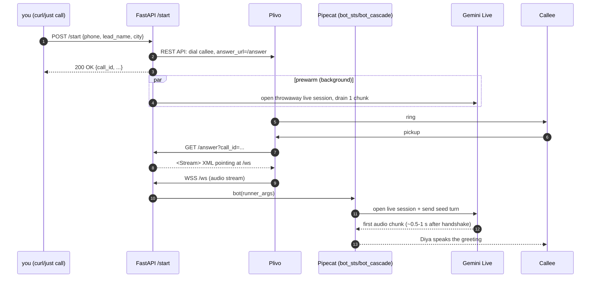

# Aakashvani

> **AI-powered outbound voice agent platform for the Indian SMB market.**
> Pipecat 1.1.0 + Plivo + Gemini Live + FastAPI.

---

## You are here

| Field             | Value                                                                                             |
| ----------------- | ------------------------------------------------------------------------------------------------- |
| Phase             | **Phase 0 — Foundation** (week 1 of 2)                                                            |
| Last milestone    | `bot_sts.py` (Gemini Live STS) and `bot_cascade.py` (Sarvam STT + Groq + Cartesia) place real outbound calls via Plivo. STS first-utterance lag down from ~30 s to ~1–2 s after migrating to the official pipecat pattern. |
| Current focus     | Developer ergonomics + scaffolding (this commit): rename to `aakashvani`, add `justfile`, hoist imports, instrument cost. |
| Next milestone    | SQLite call-log persistence + post-call transcript capture + per-call cost from pipecat `MetricsFrame`. |
| Full plan         | See [ROADMAP.md](ROADMAP.md).                                                                     |

---

## What this is

Two voice pipelines that can call any Indian phone number via Plivo and hold a conversation:

- **Route A — Cascaded** ([bot_cascade.py](bot_cascade.py)): Sarvam STT (Hindi/Marathi/auto) → Groq Llama 3.3 70B → Cartesia TTS. Tight script control, function-calling, easy to audit. ~1.5–2.5 s round-trip.
- **Route B — STS** ([bot_sts.py](bot_sts.py)): Gemini Live (speech-to-speech) — single model handles STT + LLM + TTS. ~0.5–1 s round-trip. Currently configured as **Diya**, a Marathi real-estate concierge for Pyramid Constructions.

Calls are placed by hitting `POST /start` on the FastAPI server in [server.py](server.py). Pipecat handles the audio pipeline; Plivo handles the PSTN leg.

---

## Prerequisites

- Python 3.12+
- [uv](https://github.com/astral-sh/uv) (`curl -LsSf https://astral.sh/uv/install.sh | sh`)
- [ngrok](https://ngrok.com/) with a reserved free domain (or a paid plan)
- [just](https://github.com/casey/just) (optional, recommended) — `sudo apt install just` on Ubuntu 24.04+, `cargo install just`, or grab a binary from the GitHub releases
- A Plivo account with auth ID/token and an outbound-enabled India phone number
- A Google API key with Gemini Live access

---

## Quick start

```bash
# 1. Install Python deps
uv sync

# 2. Copy and fill in secrets
cp env.example .env
# edit .env: set PLIVO_*, GOOGLE_API_KEY, NGROK_URL, BOT_ROUTE

# 3. Start the server (uses BOT_ROUTE from .env, defaults to sts)
just dev

# 4. In another terminal, open the ngrok tunnel on your reserved domain
just tunnel

# 5. In a third terminal, fire a test call
just call +919123866924 Satyam Pune
```

That's it. The callee's phone rings; on pickup, Diya greets them in Marathi.

### Without `just`

Same flow, no `just` install required:

```bash
BOT_ROUTE=sts uv run uvicorn server:app --host 0.0.0.0 --port 7860 --reload
ngrok http --domain=<your-reserved-domain> 7860
scripts/call.sh +919123866924 Satyam Pune
```

---

## Repo layout (current)

```
aakashvani/
├── server.py                FastAPI app: /start, /answer (Plivo XML), /ws, /health
├── bot.py                   Stock pipecat outbound example (kept as reference)
├── bot_sts.py               Route B: Gemini Live speech-to-speech (Diya, Marathi)
├── bot_cascade.py           Route A: Sarvam STT + Groq LLM + Cartesia TTS
├── justfile                 Dev commands (dev, dev-sts, dev-cascade, tunnel, call, health, route, sync)
├── scripts/
│   └── call.sh              Standalone call trigger (no `just` dependency)
├── env.example              Template for .env
├── .env                     Real secrets (not committed)
├── pyproject.toml           uv project metadata + deps
├── uv.lock                  Pinned dependency lockfile
├── Dockerfile               Pipecat Cloud deploy image
├── pcc-deploy.toml          Pipecat Cloud deploy config
├── ROADMAP.md               Full vision, architecture, phased roadmap, pricing
└── README.md                this file
```

---

## How a call flows



---

## `just` commands reference

| Command                    | What it does                                                                |
| -------------------------- | --------------------------------------------------------------------------- |
| `just dev`                 | Run uvicorn with whatever `BOT_ROUTE` is in `.env` (default `sts`)          |
| `just dev-sts`             | Force `BOT_ROUTE=sts` for this run                                          |
| `just dev-cascade`         | Force `BOT_ROUTE=cascade` for this run                                      |
| `just tunnel`              | Start ngrok on your reserved domain (`NGROK_URL` in `.env`), port 7860      |
| `just call +91… name city` | POST `/start` for an outbound call. `name` and `city` are optional          |
| `just health`              | GET `/health` on the public URL                                             |
| `just route`               | Print the currently-effective `BOT_ROUTE`                                   |
| `just sync`                | `uv sync` (rebuilds `.venv` — useful if anything looks broken)              |

---

## Troubleshooting

- **`just: command not found`** — install it (`sudo apt install just` or `cargo install just`) or use the `scripts/call.sh` fallback + the raw `uv run uvicorn …` invocations from the README.
- **`uv run` complains about a missing `.venv` after this rename** — run `just sync` (or `uv sync`) once to rebuild venv shebangs against the new path.
- **`server.py` keeps picking the wrong route** — `BOT_ROUTE` is read at module load. After editing `.env`, fully restart `just dev` (a uvicorn `--reload` re-import is fine).
- **Plivo says the WebSocket URL is unreachable** — confirm `just tunnel` is up and the reserved domain in `.env` (`NGROK_URL`) matches `https://<sub>.ngrok-free.dev` exactly.
- **First bot utterance is still slow** — watch the `[⏱ Ns]` log lines from `bot_sts.py`. If `parse_telephony_websocket done` takes >1 s, it's Plivo's `start` frame; if `LLMRunFrame queued → first audio` takes >2 s, it's Gemini's WS handshake. Prewarm handles the latter — make sure `_prewarm_gemini` in `server.py` is actually running.

---

## Next development steps

This README mirrors what I'm working on right now. For the longer vision (pricing, multi-tenant architecture, compliance, all future phases), see **[ROADMAP.md](ROADMAP.md)**.

Immediate next deliverables (Phase 0 continuation):

1. SQLite call-log persistence: every `/ws` call writes one row with `call_id`, duration, route, transcript.
2. Cost capture via pipecat's `MetricsFrame` (already enabled with `enable_metrics=True`).
3. Post-call extraction: Gemini Flash reads the transcript, returns a JSON schema per bot config.
4. `POST /webhooks/n8n` fire after every call.
5. Browser test path via `SmallWebRTCTransport` so we stop burning Plivo minutes during dev.
