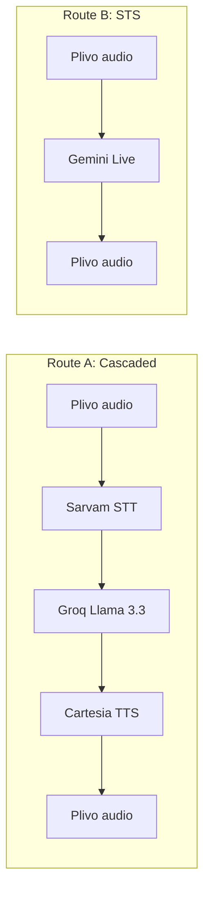
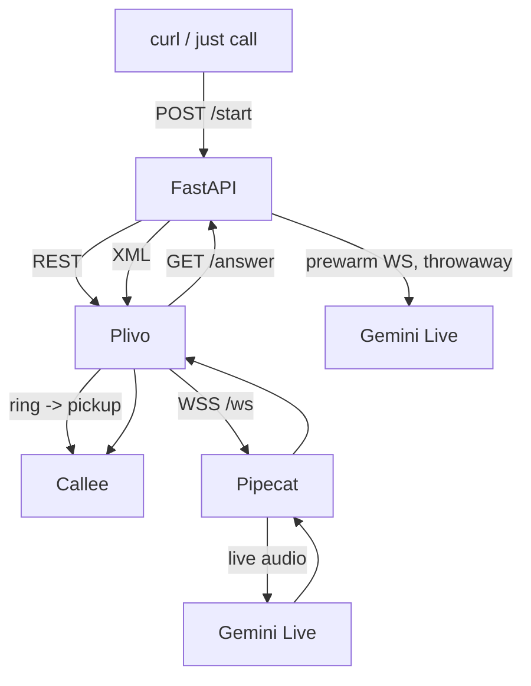
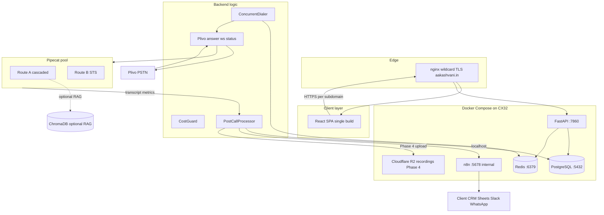

# Aakashvani — Roadmap

> The long-form plan. For day-to-day usage see [README.md](README.md).
>
> Status legend used throughout this document:
> - `done` — built, tested, in main
> - `in progress` — currently being worked on (only one phase at a time)
> - `planned` — designed, not yet started
> - `maybe` — considered, may be cut or deferred indefinitely

---

## Table of contents

1. [Vision](#1-vision)
2. [Two pipelines: cascaded vs STS](#2-two-pipelines-cascaded-vs-sts)
3. [Tech stack](#3-tech-stack)
4. [High-level architecture](#4-high-level-architecture)
5. [API surface](#5-api-surface)
6. [Database schema (Phase 1+, draft)](#6-database-schema-phase-1-draft)
7. [Pricing strategy](#7-pricing-strategy)
8. [Compliance and legal](#8-compliance-and-legal)
9. [Phased roadmap](#9-phased-roadmap)
10. [Explicitly deferred](#10-explicitly-deferred)
11. [Context for AI assistants](#11-context-for-ai-assistants)

---

## 1. Vision

Aakashvani is a **managed voice automation service**, not a self-service SaaS. Clients buy outcomes (qualified conversations, structured data, CRM handoff), not tools. Bot scripting, prompt engineering, route and model selection, Plivo number assignment, and extraction schema design are **handled by us**; clients use a frontend to upload leads, start and stop campaigns, watch live progress, inspect call logs and analytics, and manage credits and recharge. CRM integrations are designed and built **by us** using n8n — clients do not configure webhooks or n8n themselves. A structured bot configuration UI is deferred to Phase 3 (see [§9 Phased roadmap](#9-phased-roadmap) — Phase 3).

We provide:

- AI bots that make real phone calls on behalf of clients.
- Two calling architectures: cascaded (STT → LLM → TTS) and speech-to-speech (Gemini Live).
- Concurrent dialing: one server placing dozens of calls in parallel.
- Post-call data extraction: structured lead qualification data from every transcript.
- Dynamic script personalization: each lead called by name with CRM context.
- Prepaid minute-pack billing, like a SIM recharge.
- Post-call webhooks → n8n → client's CRM / Sheets / Slack / WhatsApp.

**Unit economics.** A 5-minute AI call costs us ~₹7. A human agent doing the same call costs the client ₹25-40. The AI is consistent, available 24/7, native in Indian languages, and produces structured data after every call. Selling at ₹6-12/min (prepaid pack) gives us a 75-85% margin while still being half the price of a human call centre.

**Target verticals.** Real estate, lending/credit cards, insurance, edtech, healthcare, and any Indian SMB running outbound lead qualification.

### Why build instead of using an existing platform?

| Platform        | Model              | India focus | Self-hosted | Price            |
| --------------- | ------------------ | ----------- | ----------- | ---------------- |
| Vapi            | Per-min SaaS       | No          | No          | $0.05-0.15/min   |
| Retell          | Per-min SaaS       | No          | No          | $0.07/min        |
| Bolna           | Per-min SaaS       | Partial     | No          | Higher           |
| Rapida          | Open source        | Yes         | Yes         | API costs only   |
| **Aakashvani**  | Per-min managed B2B | **Yes**     | **Yes**     | **₹6-12/min**    |

Pipecat (BSD license, Python-native, active) is our framework of choice. Rapida is GPL-2.0 with a logo requirement; everything else is closed.

### What clients can touch vs what we own

| What clients can touch | What only the Aakashvani team touches |
| ---------------------- | --------------------------------------- |
| Upload leads (CSV) | Bot scripts and prompts |
| Start / stop campaign | Bot config (language, voice, route) |
| Watch live call progress | n8n workflow design and maintenance |
| See call logs and extractions | CRM integration code |
| View analytics | Plivo number management |
| See credit balance | Server and infrastructure |
| Recharge credits | Pipecat pipeline code |

---

## 2. Two pipelines: cascaded vs STS



| Aspect                  | Route A (Cascaded)                              | Route B (STS — Gemini Live)              |
| ----------------------- | ----------------------------------------------- | ---------------------------------------- |
| Latency (round-trip)    | ~1.5-2.5 s                                      | ~0.5-1 s                                 |
| Script adherence        | High — full prompt control, function-calling    | Medium — prompt-led; **no live lead tool**; Groq fills `extraction_json` after hang-up |
| Auditability            | Easy — STT/LLM/TTS each emit separate frames    | Harder — single black-box model          |
| Indian language quality | Excellent (Sarvam saarika)                      | Good (Marathi, Hindi, English)           |
| Cost / min              | ₹1.48 (verified)                                | TBD — re-derive per audio-token rates    |
| Best for                | Tight outbound sales, qualification flows       | Inbound, complex conversational scenarios |

**Decision is per bot_config, not platform-wide.** Today it's a single env var (`BOT_ROUTE` — Phase 0 fallback only); from Phase 2 onwards, route comes from `BotConfig.route` at call time.

---

## 3. Tech stack

### Voice infrastructure

| Component         | Tech                                | Purpose                                 | Status        |
| ----------------- | ----------------------------------- | --------------------------------------- | ------------- |
| Voice framework   | Pipecat 1.1.0 (BSD)                 | Pipeline orchestration                  | done          |
| Telephony         | Plivo                               | Outbound + India PSTN                   | done          |
| Local dev transport | `SmallWebRTCTransport`            | Browser-based testing                   | planned       |

### AI services

| Component         | Provider          | Model                                | Status      |
| ----------------- | ----------------- | ------------------------------------ | ----------- |
| STS               | Google Gemini Live| `gemini-3.1-flash-live-preview`      | done        |
| LLM (cascaded)    | Groq              | `llama-3.3-70b-versatile`            | done        |
| STT (Indian)      | Sarvam            | `saarika:v2.5`                       | done        |
| TTS (cascaded)    | Cartesia          | `sonic-3`                            | done        |
| STT English       | Deepgram          | `nova-3`                             | maybe       |
| TTS English       | Deepgram          | `aura-2`                             | maybe       |
| TTS premium       | ElevenLabs        | `eleven_turbo_v2_5`                  | maybe       |
| VAD               | Gemini server VAD (STS) / Silero (cascaded) | Turn detection             | done        |
| Post-call extraction | Groq              | `llama-3.3-70b-versatile` (HTTP)     | done        |

### Infrastructure

Production target (**Hetzner CX32**: 4 vCPU / 8 GB RAM / ~€14/month) runs **`docker-compose.yml`** with **`fastapi`** (backend, port **7860**), **`postgres`** (5432), **`redis`** (6379 — Phase 2 onward for concurrent dialer queue), and **`n8n`** (5678 — **same server, internal only**, not exposed to clients). **nginx** terminates TLS (wildcard cert via **certbot**), routes **`*.aakashvani.in`** subdomains to FastAPI and the React SPA, and resolves tenant from the authenticated session (not separate server processes per client). **Cloudflare R2** stores call recordings (Phase 4). Local dev stays WSL2 + ngrok + uvicorn as today.

| Component       | Tech                              | Status                                       |
| --------------- | --------------------------------- | -------------------------------------------- |
| Backend         | FastAPI + Python 3.12 + uv        | done                                         |
| Persistence     | SQLite (Phase 0) → PostgreSQL 16  | planned (SQLite next sprint)                 |
| Cache / queue   | Redis 7                           | planned (Phase 2)                            |
| Vector DB       | ChromaDB                          | maybe — only if a client actually needs RAG  |
| Frontend        | None (CLI + curl) → React SPA (one build, all subdomains) | planned (Phase 1+)           |
| Reverse proxy   | nginx + wildcard TLS (`*.aakashvani.in`) | planned (deploy time)                 |
| Containerization| Docker Compose (fastapi, postgres, redis, n8n) | planned (deploy time)               |
| Server          | Hetzner CX32 (Germany)            | planned — consider AWS Mumbai if latency hurts |
| Workflow        | n8n on localhost:5678, shared instance; **per-client workflows** built by us | planned |
| Call recordings | Cloudflare R2 (signed URLs)       | planned (Phase 4)                            |
| CRM integrations| via n8n (we design and maintain) | planned                                      |
| Monitoring      | Uptime Kuma                       | planned                                      |
| CI/CD           | GitHub Actions                    | planned                                      |

### Dev environment (current)

- Windows 11 + WSL2 Ubuntu 24.04
- Python 3.12.3 in WSL
- `uv` for everything
- ngrok with a reserved free domain
- `just` for command shortcuts

---

## 4. High-level architecture

> **Multi-tenancy:** enforced by `client_id`. Every DB query must include `WHERE client_id = ?`. There are no per-client deployments. One codebase, one server, complete data isolation in the application layer.

Today (Phase 0):



Target architecture (after Phase 2):



---

## 5. API surface

Routes are split by **authentication**: client-facing APIs use a **per-client API token**; internal APIs use an **admin API key** only (localhost from n8n and admin tooling — never exposed to clients).

**Client-facing** (per-client token):

```
POST   /api/leads/upload
GET    /api/campaigns
POST   /api/campaigns
PATCH  /api/campaigns/{id}/start
PATCH  /api/campaigns/{id}/stop
GET    /api/campaigns/{id}/stats
GET    /api/calls
GET    /api/calls/{id}
GET    /api/credits
POST   /api/credits/recharge
```

**Internal** (admin key, n8n + ops only):

```
POST   /internal/webhook/call-completed
GET    /internal/clients
POST   /internal/clients
POST   /internal/bot-configs
POST   /internal/webhook-configs
```

Today’s Phase 0 code posts call payloads to `N8N_WEBHOOK_URL` from `.env` after extraction. Multi-tenant target: backend invokes **`POST /internal/webhook/call-completed`** (or equivalent internal fan-out) so **n8n on localhost** can trigger per-client workflows without exposing internal keys on the public internet. `webhook_configs` stores each client’s workflow URL and optional secret; clients who already run their own n8n can supply that URL — we store it the same way.

---

## 6. Database schema (Phase 1+, draft)

This schema is the **target** for Postgres (Phase 2+). Phase 0 uses SQLite with a single `call_logs` table. Phase 1 adds a **`leads`** table in SQLite plus client-facing campaign flows (see [§9 Phased roadmap](#9-phased-roadmap)); multi-tenant Postgres and `client_id` on every row land in Phase 2.

The draft `call_logs.recording_url` column exists from Phase 1 onward as a **placeholder**; **Phase 4** wires Plivo recording fetch → Cloudflare R2 → stored object key and signed URLs for the audio player (see Phase 4 milestones).

```sql
-- Multi-tenant: every table has client_id once we get there
CREATE TABLE clients (
    id UUID PRIMARY KEY DEFAULT gen_random_uuid(),
    name VARCHAR(255) NOT NULL,
    api_key VARCHAR(255) UNIQUE,
    balance_minutes FLOAT DEFAULT 0,
    max_concurrent_calls INTEGER DEFAULT 5,
    created_at TIMESTAMPTZ DEFAULT NOW()
);

CREATE TABLE bot_configs (
    id UUID PRIMARY KEY DEFAULT gen_random_uuid(),
    client_id UUID REFERENCES clients(id),
    name VARCHAR(255) NOT NULL,
    agent_name VARCHAR(100),
    company_name VARCHAR(255),
    route VARCHAR(20) NOT NULL,            -- 'cascaded' or 'sts'
    telephony_provider VARCHAR(20) DEFAULT 'plivo',
    telephony_number VARCHAR(20),
    llm_model VARCHAR(100),
    stt_provider VARCHAR(50),
    tts_provider VARCHAR(50),
    tts_voice VARCHAR(100),
    language VARCHAR(20) DEFAULT 'en-IN',
    system_prompt TEXT,                    -- supports {lead_name}, {city}, etc.
    temperature FLOAT DEFAULT 0.2,
    extraction_schema JSONB DEFAULT '{}',
    kb_collection VARCHAR(255),
    created_at TIMESTAMPTZ DEFAULT NOW()
);

CREATE TABLE campaigns (
    id UUID PRIMARY KEY DEFAULT gen_random_uuid(),
    client_id UUID REFERENCES clients(id),
    bot_config_id UUID REFERENCES bot_configs(id),
    name VARCHAR(255) NOT NULL,
    status VARCHAR(50) DEFAULT 'draft',   -- draft/running/paused/completed
    max_concurrent_calls INTEGER DEFAULT 5,
    calls_per_minute INTEGER DEFAULT 10,
    scheduled_at TIMESTAMPTZ,
    completed_at TIMESTAMPTZ,
    total_leads INTEGER DEFAULT 0,
    created_at TIMESTAMPTZ DEFAULT NOW()
);

CREATE TABLE leads (
    id UUID PRIMARY KEY DEFAULT gen_random_uuid(),
    campaign_id UUID REFERENCES campaigns(id),
    client_id UUID REFERENCES clients(id),
    phone VARCHAR(20) NOT NULL,            -- E.164
    name VARCHAR(255),
    metadata JSONB DEFAULT '{}',
    status VARCHAR(50) DEFAULT 'pending',  -- pending/calling/completed/failed/dnc
    attempts INTEGER DEFAULT 0,
    last_attempt_at TIMESTAMPTZ,
    created_at TIMESTAMPTZ DEFAULT NOW()
);

CREATE TABLE call_logs (
    id UUID PRIMARY KEY DEFAULT gen_random_uuid(),
    campaign_id UUID REFERENCES campaigns(id),
    lead_id UUID REFERENCES leads(id),
    client_id UUID REFERENCES clients(id),
    call_sid VARCHAR(255),                 -- Plivo call ID
    started_at TIMESTAMPTZ,
    ended_at TIMESTAMPTZ,
    duration_seconds INTEGER,
    route VARCHAR(20),
    outcome VARCHAR(50),
    qualified BOOLEAN DEFAULT FALSE,
    transcript TEXT,
    call_data JSONB DEFAULT '{}',
    audio_in_tokens INTEGER,
    audio_out_tokens INTEGER,
    cost_usd NUMERIC(10,6),
    cost_inr NUMERIC(10,4),
    quality_score INTEGER,
    flagged_for_review BOOLEAN DEFAULT FALSE,
    recording_url TEXT,
    created_at TIMESTAMPTZ DEFAULT NOW()
);

CREATE TABLE webhook_configs (
    id UUID PRIMARY KEY DEFAULT gen_random_uuid(),
    client_id UUID REFERENCES clients(id),
    event VARCHAR(50),
    url TEXT NOT NULL,
    secret VARCHAR(255),
    active BOOLEAN DEFAULT TRUE
);

CREATE TABLE minute_packs (
    id UUID PRIMARY KEY DEFAULT gen_random_uuid(),
    client_id UUID REFERENCES clients(id),
    pack_name VARCHAR(100),
    minutes_purchased FLOAT,
    minutes_remaining FLOAT,
    price_inr NUMERIC(10,2),
    expires_at TIMESTAMPTZ,
    created_at TIMESTAMPTZ DEFAULT NOW()
);

CREATE INDEX idx_leads_campaign_status ON leads(campaign_id, status);
CREATE INDEX idx_call_logs_campaign ON call_logs(campaign_id);
CREATE INDEX idx_call_logs_client_date ON call_logs(client_id, started_at);
```

### Phase 0 minimal schema (SQLite)

```sql
CREATE TABLE call_logs (
    id TEXT PRIMARY KEY,                   -- uuid
    plivo_call_id TEXT,
    lead_name TEXT,
    lead_phone TEXT,
    lead_city TEXT,
    route TEXT,                            -- 'sts' or 'cascade'
    started_at TEXT,                       -- ISO 8601
    ended_at TEXT,
    duration_seconds REAL,
    transcript TEXT,                       -- JSON array of {role, text, ts}
    audio_in_tokens INTEGER,
    audio_out_tokens INTEGER,
    cost_inr REAL,
    outcome TEXT
);
```

That's it for Phase 0 minimal SQLite. Phase 1 adds `leads` (and related campaign tables in SQLite); Phase 2 migrates to the Postgres layout below with `client_id` on every query.

---

## 7. Pricing strategy

Prepaid minute packs (like a SIM recharge). Minutes are for **connected call time only**: no charge for failed dials, no-answers, or busy signals. Packs expire in 90 days.

| Pack         | Minutes | Rate/min | Price (INR) | Our cost | Margin  |
| ------------ | ------- | -------- | ----------- | -------- | ------- |
| Starter      | 500     | ₹12      | ₹6,000      | ~₹740    | 87%     |
| Growth       | 2,000   | ₹10      | ₹20,000     | ~₹2,960  | 85%     |
| Scale        | 5,000   | ₹8       | ₹40,000     | ~₹7,400  | 81%     |
| Pro          | 12,000  | ₹7       | ₹84,000     | ~₹17,760 | 78%     |
| Enterprise   | Custom  | ₹6       | Custom      | —        | 75%+    |

### One-time fees

| Service                          | Fee          |
| -------------------------------- | ------------ |
| Platform setup (includes first client n8n workflow build) | ₹15,000      |
| n8n workflow change / update     | ₹2,000 / update |
| Additional bot configuration     | ₹5,000 / bot |
| Knowledge base initial setup     | ₹3,000       |
| Knowledge base update            | ₹2,000 / update |

### Billing and credits

**Credit balance display:** progress bar + remaining minutes on every page (top right). Full detail on `/credits`: balance, pack expiry, usage this month (calls made, minutes used, avg duration, cost).

**Recharge flow:** Phase 1 — **manual only**: client selects pack, pays via bank transfer, we insert `minute_packs` via admin script. Phase 2 — **Razorpay** (payment link generated server-side, webhook confirms payment, `minute_packs` row inserted automatically), per Phase 2 milestones. Phase 3 may include Razorpay upgrades if checkout or product catalog changes.

**CostGuard (Phase 2):** middleware checks `minute_packs` balance before every `/start`; blocks new calls at zero balance; deducts minutes after each call completes using `duration_seconds`.

### Add-ons

| Add-on                       | Client price | Our cost     | Margin |
| ---------------------------- | ------------ | ------------ | ------ |
| WhatsApp messages            | ₹0.50 / msg  | ₹0.30 / msg  | 40%    |
| Premium voice (ElevenLabs)   | +₹2 / min    | +₹0.70 / min | 65%    |
| Indian language (Sarvam)     | +₹1 / min    | +₹0.30 / min | 70%    |

### Per-minute cost (Route A, verified)

| Component              | Rate              | Per minute |
| ---------------------- | ----------------- | ---------- |
| Plivo outbound India   | ₹0.60 / min       | ₹0.60      |
| Sarvam STT             | $0.35 / hr        | ₹0.49      |
| Groq Llama 3.3 70B     | ~$0.79/1M tokens  | ₹0.10      |
| Cartesia TTS sonic-3   | usage-based       | ~₹0.25     |
| Server (amortized)     | —                 | ₹0.05      |
| **Total**              |                   | **~₹1.49** |

Route B (Gemini Live) per-minute cost is **TBD** — the README/business plan quotes ₹0.084/min which doesn't match Gemini Live's audio-token pricing model. Real number needs to come from running a few calls with `enable_usage_metrics=True` and reading the actual token counts off pipecat's `MetricsFrame`. This is a Phase 0 deliverable.

### Why this pricing works

Global competitors charge $0.05-0.15/min = ₹4-12/min. Indian human call-centre agents cost ₹25-40 per connected call (~₹5-8/min at 5-min avg). At ₹6-12/min Aakashvani is cheaper than humans, competitive with global SaaS, with local support and Indian-language quality nobody else has.

---

## 8. Compliance and legal

### TRAI

- **DND registry**: do not call DND-registered numbers. There is no usable public TRAI DND API — we maintain our own opt-out list and require clients to declare their consent source.
- **Calling hours**: 9:00 AM to 9:00 PM IST only. Enforce in `compliance.py`.
- **Caller ID**: must show a registered Plivo number.
- **DPDP Act 2023**: store only necessary lead data, support deletion-on-request, log where each lead's consent originated.

```python
# compliance.py — runs before every dial
def is_call_allowed(phone: str) -> tuple[bool, str]:
    now_ist = datetime.now(tz=pytz.timezone("Asia/Kolkata"))
    if not (9 <= now_ist.hour < 21):
        return False, "outside 9am-9pm IST window"
    if phone in opt_out_list():
        return False, "number on internal DND list"
    return True, "ok"
```

### Data handling

- Phone numbers stored E.164.
- Call recordings stored in Cloudflare R2 (not in DB).
- Transcripts encrypted at rest in Postgres (Phase 2+).
- Per-client data isolation enforced by `client_id` on every query.

---

## 9. Phased roadmap

### Phase 0 — Foundation
**Status:** in progress (current focus)
**Timeline:** 2-3 weeks, started May 2026

**Goal:** Two working bots placing real Plivo calls, with persistent call logs, real cost capture, and a single webhook fire.

| Milestone                                                                       | Status        |
| ------------------------------------------------------------------------------- | ------------- |
| FastAPI server placing outbound calls via Plivo                                 | done          |
| Route A (cascaded) working end-to-end                                           | done          |
| Route B (STS / Gemini Live) working end-to-end as Diya                          | done          |
| First-utterance lag investigated and reduced (~30 s → ~1-2 s)                   | done          |
| Repo renamed to `aakashvani`, `justfile` + `scripts/call.sh` + .env BOT_ROUTE   | done          |
| Pipecat `MetricsFrame` → SQLite call_logs row per call                          | done          |
| Post-call transcript capture from `on_user/assistant_turn_stopped` events       | done          |
| Cost calculation in INR from token counts (STS; env USD/M rates + `USD_INR`)  | done          |
| Post-call Groq extraction → `extraction_json` (`Interested` + normalizer)       | done          |
| Outbound JSON POST to n8n workflow URL (`N8N_WEBHOOK_URL` in `.env`)            | done          |
| Max call duration watchdog + `end_call` tool (cascade + STS, `call_limits.py`)   | done          |
| Browser test path via `SmallWebRTCTransport` (no Plivo minutes during dev)      | next          |

**Deliverable:** Make a real call → see structured extraction + cost in SQLite + n8n receives a webhook.

### Phase 1 — Lead upload + campaigns + client frontend
**Status:** planned  
**Timeline:** ~2–3 weeks after Phase 0

**Goal:** A real client can log in, upload leads, start a campaign, watch it run, and see transcripts and audio for every call. Credits balance is visible and manually rechargeable.

| Milestone | Status |
| --------- | ------ |
| Collapse `bot_sts.py` script selection into `BotConfig` dataclass (scripts already externalized under `sts_scripts/`) | planned |
| `BotConfig` dataclass (`agent_name`, `system_prompt`, `language`, `route`, `tts_voice`, `llm_model`, `extraction_schema`, `webhook_url`, `webhook_secret`) | planned |
| `leads` table in SQLite + CSV upload endpoint (strict schema, no AI normalisation) | planned |
| Sequential dialer: asyncio loop, `calls_per_minute` throttle, per-attempt retry | planned |
| Basic compliance check: 9am–9pm IST, internal DND list | planned |
| `/api/campaigns` and `/api/leads` client-facing endpoints | planned |
| `/internal/bot-configs` and `/internal/clients` admin endpoints | planned |
| React SPA: `/dashboard`, `/campaigns`, `/campaigns/new`, `/calls`, `/calls/{id}`, `/credits` | planned |
| Call detail page: audio player + transcript + extraction fields | planned |
| Credit balance display (manual recharge via bank transfer + admin script) | planned |
| n8n workflow for client #1 (built by us, tested end-to-end) | planned |

**Frontend pages (Phase 1 — build these first):**

| Route | Purpose |
| ----- | ------- |
| `/dashboard` | Live campaign status: calls made, in-progress, completed; credit balance widget top right |
| `/campaigns` | Campaign list → click → detail view |
| `/campaigns/new` | Upload CSV, enter campaign name (bot pre-assigned by us) |
| `/calls` | Paginated call log with filters: date, outcome, language |
| `/calls/{id}` | Call detail (see below) |
| `/credits` | Balance bar, pack history, Recharge button |

**Call detail `/calls/{id}` (required in Phase 1):** audio player (Plivo recording → Cloudflare R2 signed URL, 1 hr expiry — storage wiring is Phase 4, but the **page** ships in Phase 1); full transcript with role labels (bot vs lead) and timestamps; extraction JSON as structured fields (intent, budget, preferences, etc.); metadata: duration, route, outcome, language, timestamp. Clients need to hear what the bot said in week one to trust the system.

**Explicitly out of scope for Phase 1:** React analytics charts, bot config UI, Razorpay, Redis, multi-tenant Postgres, concurrent dialer, white-label domains.

### Phase 2 — Multi-tenant + billing
**Status:** planned  
**Timeline:** ~3–4 weeks

**Goal:** Onboard client #2 without code changes.

| Milestone | Status |
| --------- | ------ |
| Migrate SQLite → PostgreSQL 16 | planned |
| Add `clients`, `bot_configs`, `campaigns`, `leads`, `minute_packs`, `webhook_configs` tables | planned |
| `client_id` on every query | planned |
| CostGuard middleware: check balance before `/start`, deduct after call | planned |
| Razorpay recharge flow (payment link → webhook → `minute_packs` insert) | planned |
| Concurrent dialer with Redis queue + asyncio tasks | planned |
| Admin portal (our view): client list, bot config editor, credit management | planned |
| Subdomain routing: `client-a.aakashvani.in` via nginx | planned |
| `bot_config_id` selects route at call time (`BOT_ROUTE` env var retired) | planned |

### Phase 3 — Bot config UI + analytics + scheduling
**Status:** planned  
**Timeline:** ~4–6 weeks

**Goal:** Clients can configure their own bot personality within guardrails. Campaign scheduling. Rich analytics.

| Milestone | Status |
| --------- | ------ |
| Bot configuration UI: structured form → backend compiles to `system_prompt` (no raw prompt editor) | planned |
| `/analytics` page: intent breakdown, duration distribution, cost/day, trends | planned |
| Campaign scheduling (run at specific time / recurring) | planned |
| Live call monitor (SSE stream of active calls) | planned |
| Razorpay upgrades if needed | planned |

**Phase 3 pages (added later):**

| Route | Purpose |
| ----- | ------- |
| `/analytics` | Charts: intent breakdown, call duration distribution, cost per day, qualified leads over time |
| `/bots` | Bot configuration UI (structured form only — see below) |

**Bot configuration UI (Phase 3):** clients fill a **structured form**; the backend compiles the real system prompt. **Client-editable:** agent name; opening greeting (supports `{lead_name}`); language preference (Marathi / Hindi / English); talking points (ordered list); objection responses (key → response); call-end message. **Never exposed:** route (`sts` / `cascade`), model, extraction schema, Plivo number, TTS voice ID, temperature / inference settings.

### Phase 4 — WhatsApp + recordings
**Status:** planned

| Milestone | Status |
| --------- | ------ |
| Plivo call recording → Cloudflare R2 upload post-call | planned |
| Signed URL generation for audio player (1 hr expiry) | planned |
| Meta WhatsApp Business API for post-call follow-up messages | planned |
| n8n WhatsApp workflow templates | planned |

The `call_logs.recording_url` column exists from Phase 1+ in the target schema as a placeholder; **this phase** wires fetch → R2 → key storage and signed URL issuance. The Phase 1 call-detail page consumes those URLs once available.

### Phase 5 — RAG (only if a client requests it)
**Status:** maybe

- ChromaDB per-client knowledge base.
- Embedder + retriever wired into Route A between user_aggregator and LLM.
- Only build if a real client requests answering complex domain questions.

### Future / explicitly considered

- Voice cloning (ElevenLabs).
- A/B script testing.
- Sentiment analysis.
- Dropout-point analysis (which prompt step do callers hang up at).
- Multi-region deployment (AWS Mumbai for PSTN latency to India).
- Inbound calls (same bots handle return calls).
- Human handoff (bot conferences in a human on demand).

---

## 10. Explicitly deferred

These items are sometimes asked about but are not on the near-term plan:

- **SOC2 / ISO27001.** Required only for enterprise BFSI; revisit when we have a customer asking for it on contract.
- **Per-client dedicated server instances.** Sales objection-handler, not a real differentiator yet. One Hetzner CX32 handles 5-10 clients easily.
- **Native CRM integrations.** Always go through n8n. Avoid writing HubSpot / Salesforce / Zoho code ourselves.
- **iOS / Android client apps.** Web is enough.
- **Bring-your-own LLM.** Power users can fork; not a product feature.
- **Embedded analytics SaaS.** Use Metabase or Superset over Postgres if needed.

---

## 11. Context for AI assistants

If you (an LLM agent) are reading this to help build Aakashvani, here is the cheat sheet.

### What is built today (May 2026)

1. WSL2 + Python 3.12 + uv environment, all imports working.
2. `server.py` — FastAPI app exposing `/start`, `/answer`, `/ws`, `/health`. Picks `bot_sts` or `bot_cascade` from `BOT_ROUTE` env at module load. `/start` merges top-level `phone_number` into the JSON `body` passed to `/ws` so bots see callee E.164 in `runner_args.body`.
3. `bot_sts.py` — Gemini Live STS pipeline; persona text in `sts_scripts/` (`STS_SCRIPT` env: `pyramid_mr` / `pyramid_hi`, …). `GeminiLiveLLMService` with optional **`end_call`** tool + `MAX_CALL_MINUTES` watchdog (`call_limits.py`); lead fields come from post-call Groq on the transcript (`call_transcript.py`). Pre-seeded `LLMContext`, `on_client_connected` → `queue_frames([LLMRunFrame()])`. First-utterance latency ~1-2 s.
4. `bot_cascade.py` — Sarvam STT + Groq Llama 3.3 + Cartesia TTS; system prompt in `cascade_scripts/` (`CASCADE_SCRIPT`). Still has a live **`push_lead_data`** function-call for end-of-call capture. Uses Silero VAD for turn-taking.
5. `bot.py` — vanilla pipecat outbound example, kept as reference.
6. `_prewarm_gemini` in `server.py` opens a throwaway Gemini Live session during `/start` to warm DNS/TLS/Google backend caches. `/answer` waits up to 3 s for it.
7. `justfile` + `scripts/call.sh` for dev ergonomics.

### Pipecat 1.1.0 import paths (current, not the old ones)

```python
from pipecat.processors.aggregators.llm_context import LLMContext
from pipecat.processors.aggregators.llm_response_universal import (
    LLMContextAggregatorPair,
    LLMUserAggregatorParams,
)
from pipecat.transports.smallwebrtc.transport import SmallWebRTCTransport
from pipecat.transports.smallwebrtc.connection import SmallWebRTCConnection
from pipecat.transports.base_transport import TransportParams
from pipecat.services.google.gemini_live.llm import GeminiLiveLLMService, GeminiVADParams
from pipecat.services.google.llm import GoogleLLMService
from pipecat.services.deepgram.stt import DeepgramSTTService
from pipecat.services.deepgram.tts import DeepgramTTSService
from pipecat.services.sarvam.stt import SarvamSTTService
from pipecat.services.cartesia.tts import CartesiaTTSService
from pipecat.services.groq.llm import GroqLLMService
from pipecat.serializers.plivo import PlivoFrameSerializer
from pipecat.runner.types import RunnerArguments, WebSocketRunnerArguments
from pipecat.runner.utils import parse_telephony_websocket, create_transport
from pipecat.frames.frames import LLMRunFrame
from pipecat.pipeline.pipeline import Pipeline
from pipecat.pipeline.runner import PipelineRunner
from pipecat.pipeline.task import PipelineParams, PipelineTask
```

Deprecated, do not use: `OpenAILLMContext`, `pipecat.transports.services.daily`, `pipecat.transports.network.small_webrtc`.

### Conventions

- `uv run …` for all Python invocations, never `python3`.
- Secrets in `.env`, loaded with `python-dotenv` via `load_dotenv(override=True)` at module load.
- `BOT_ROUTE` env selects the active bot module (`bot_sts` vs `bot_cascade`). `STS_SCRIPT` / `CASCADE_SCRIPT` select which file under `sts_scripts/` / `cascade_scripts/` is loaded (no second STS entry module).
- Pipecat services that have a `.Settings` nested class take their config there, not via direct kwargs (`Settings(model="...", voice="...")`).
- `LLMContextAggregatorPair(context)` returns a tuple — unpack as `user_agg, asst_agg = …`.
- Avoid setting `inference_on_context_initialization=False` on Gemini Live (Gemini 3.x silently skips the realtime-input nudge — bot never speaks).
- Plivo uses 8 kHz µ-law. Set `audio_in_sample_rate=8000` and `audio_out_sample_rate=8000` in `PipelineParams`.
- Use `_lap(t0, label)` style timing logs to debug first-utterance latency.

### Known issues / gotchas

- `pipecat-ai[flows]` extra does not exist — flows are in the base install.
- The free-tier Gemini quota (15 RPM, ~1500/day) runs out during testing; switch accounts or add billing.
- `--reload` re-imports pipecat heavy modules on every save; don't use it when measuring latency.
- After folder rename, `.venv` may have stale shebangs. Run `uv sync` to fix.

### Next deliverables (Phase 0 continuation)

In order:
1. SQLite call-log persistence (`call_logs` table, one row per call).
2. `MetricsFrame` listener → persist usage token columns + `usage_metrics_json` (per-modality audio tokens deferred).
3. Transcript capture from `on_user_turn_stopped` + `on_assistant_turn_stopped` aggregator events.
4. Post-call **Groq** JSON extraction (`post_call_extract.py`) into `call_logs.extraction_json`, with `normalize_post_call_extraction` for deterministic fixes before persist.
5. Outbound JSON `POST` to n8n workflow URL from `N8N_WEBHOOK_URL` (optional `N8N_WEBHOOK_SECRET`); optional STS `cost_inr` via env Gemini rates (`pricing_sts.py`).
6. Max call duration (`MAX_CALL_MINUTES`) + `end_call` LLM tool for margin guard (`call_limits.py`).
7. `SmallWebRTCTransport` browser-test route.

### Product model cheat sheet

- One backend, one DB, one server. `client_id` isolates all data.
- Clients touch: upload CSV, start/stop campaign, view logs, view credits, recharge.
- We touch: bot scripts, prompts, n8n workflows, CRM integrations, infra.
- Bot config UI exists in Phase 3 as a structured form — never a raw prompt editor.
- `/api/*` = client-facing. `/internal/*` = admin + n8n only, never exposed publicly.

### BotConfig dataclass (Phase 1+)

```python
@dataclass
class BotConfig:
    bot_config_id: str
    client_id: str
    agent_name: str           # "Diya", "Priya", "Arjun"
    system_prompt: str      # compiled server-side; supports {lead_name}, {city}
    language: str             # "mr-IN", "hi-IN", "en-IN"
    route: str                # "sts" or "cascade"
    tts_voice: str            # Cartesia voice ID or Gemini voice name
    llm_model: str            # "gemini-3.1-flash-live-preview" etc.
    extraction_schema: dict   # fields Groq extracts post-call
    webhook_url: str | None   # client's n8n workflow URL
    webhook_secret: str | None
```

`bot_sts.py` loads `sts_scripts.<STS_SCRIPT>`; `bot_cascade.py` loads `cascade_scripts.<CASCADE_SCRIPT>`. Phase 2+ `BotConfig` will supply compiled `system_prompt` + route instead of env-only selection.

### n8n cheat sheet

- n8n runs on same server as FastAPI (`localhost:5678`).
- Not exposed to clients. Built and managed by us.
- One workflow per client, built during onboarding (₹15,000 setup covers first build; **₹2,000/update** for workflow changes).
- Backend fires POST to the workflow’s webhook URL after each call (after Groq extraction when `GROQ_API_KEY` is set).
- Internal calls go over localhost — no public-internet exposure for internal auth.
- `webhook_configs` table: `(client_id, event, url, secret, active)`.

### Recording flow (Phase 4)

```
Call ends → Plivo recording URL available
  → post_call_processor fetches recording
  → uploads to Cloudflare R2
  → stores R2 key in call_logs.recording_url
  → frontend requests signed URL (1hr) for audio player
  → recording never publicly accessible
```

That's all.
