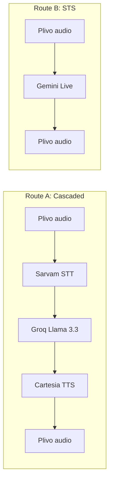
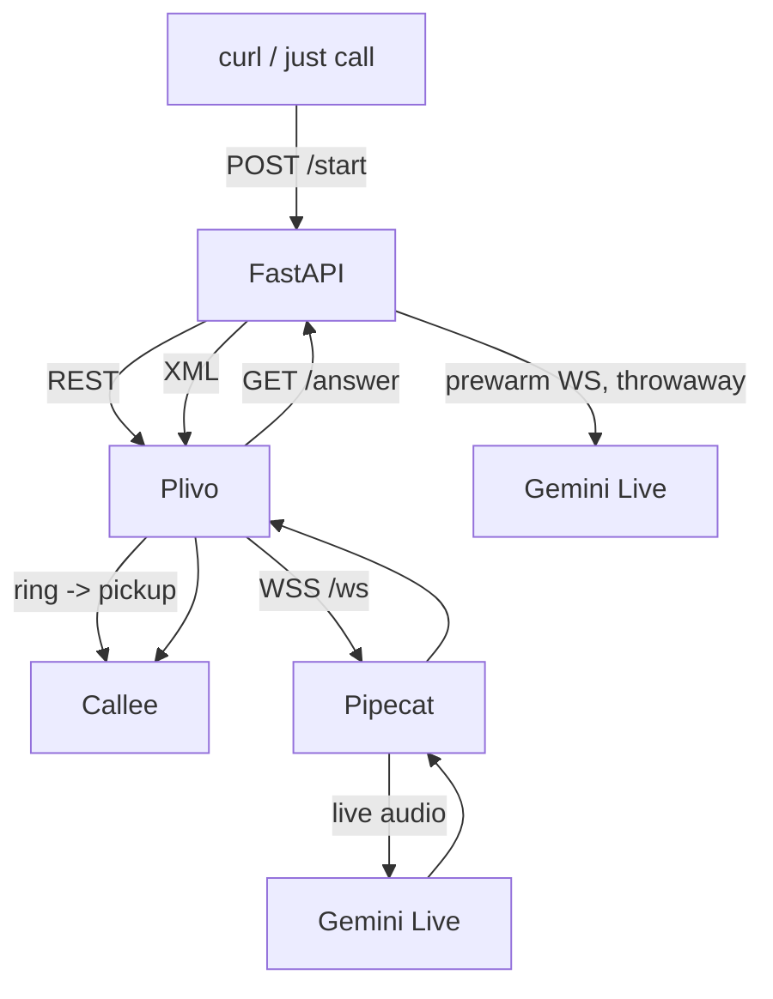
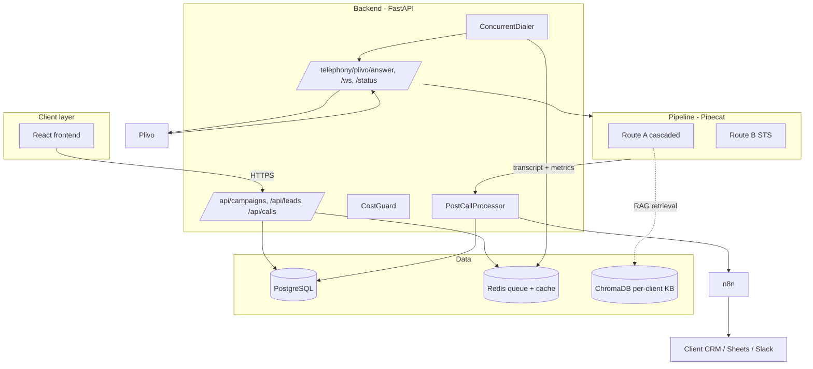

# Aakashvani — Roadmap

> The long-form plan. For day-to-day usage see [README.md](README.md).
>
> Status legend used throughout this document:
> - `done` — built, tested, in main
> - `in progress` — currently being worked on (only one phase at a time)
> - `planned` — designed, not yet started
> - `maybe` — considered, may be cut or deferred indefinitely

---

## Table of contents

1. [Vision](#1-vision)
2. [Two pipelines: cascaded vs STS](#2-two-pipelines-cascaded-vs-sts)
3. [Tech stack](#3-tech-stack)
4. [High-level architecture](#4-high-level-architecture)
5. [Database schema (Phase 1+, draft)](#5-database-schema-phase-1-draft)
6. [Pricing strategy](#6-pricing-strategy)
7. [Compliance and legal](#7-compliance-and-legal)
8. [Phased roadmap](#8-phased-roadmap)
9. [Explicitly deferred](#9-explicitly-deferred)
10. [Context for AI assistants](#10-context-for-ai-assistants)

---

## 1. Vision

A B2B SaaS platform that lets Indian SMBs run AI-powered outbound voice call campaigns. We provide:

- AI bots that make real phone calls on behalf of clients.
- Two calling architectures: cascaded (STT → LLM → TTS) and speech-to-speech (Gemini Live).
- Concurrent dialing: one server placing dozens of calls in parallel.
- Post-call data extraction: structured lead qualification data from every transcript.
- Dynamic script personalization: each lead called by name with CRM context.
- Prepaid minute-pack billing, like a SIM recharge.
- Post-call webhooks → n8n → client's CRM / Sheets / Slack / WhatsApp.

**Unit economics.** A 5-minute AI call costs us ~₹7. A human agent doing the same call costs the client ₹25-40. The AI is consistent, available 24/7, native in Indian languages, and produces structured data after every call. Selling at ₹6-12/min (prepaid pack) gives us a 75-85% margin while still being half the price of a human call centre.

**Target verticals.** Real estate, lending/credit cards, insurance, edtech, healthcare, and any Indian SMB running outbound lead qualification.

### Why build instead of using an existing platform?

| Platform        | Model              | India focus | Self-hosted | Price            |
| --------------- | ------------------ | ----------- | ----------- | ---------------- |
| Vapi            | Per-min SaaS       | No          | No          | $0.05-0.15/min   |
| Retell          | Per-min SaaS       | No          | No          | $0.07/min        |
| Bolna           | Per-min SaaS       | Partial     | No          | Higher           |
| Rapida          | Open source        | Yes         | Yes         | API costs only   |
| **Aakashvani**  | Per-min B2B        | **Yes**     | **Yes**     | **₹6-12/min**    |

Pipecat (BSD license, Python-native, active) is our framework of choice. Rapida is GPL-2.0 with a logo requirement; everything else is closed.

---

## 2. Two pipelines: cascaded vs STS



| Aspect                  | Route A (Cascaded)                              | Route B (STS — Gemini Live)              |
| ----------------------- | ----------------------------------------------- | ---------------------------------------- |
| Latency (round-trip)    | ~1.5-2.5 s                                      | ~0.5-1 s                                 |
| Script adherence        | High — full prompt control, function-calling    | Medium — Gemini interprets the prompt    |
| Auditability            | Easy — STT/LLM/TTS each emit separate frames    | Harder — single black-box model          |
| Indian language quality | Excellent (Sarvam saarika)                      | Good (Marathi, Hindi, English)           |
| Cost / min              | ₹1.48 (verified)                                | TBD — re-derive per audio-token rates    |
| Best for                | Tight outbound sales, qualification flows       | Inbound, complex conversational scenarios |

**Decision is per bot_config, not platform-wide.** Today it's a single env var (`BOT_ROUTE`); Phase 1 moves it to a database column.

---

## 3. Tech stack

### Voice infrastructure

| Component         | Tech                                | Purpose                                 | Status        |
| ----------------- | ----------------------------------- | --------------------------------------- | ------------- |
| Voice framework   | Pipecat 1.1.0 (BSD)                 | Pipeline orchestration                  | done          |
| Telephony         | Plivo                               | Outbound + India PSTN                   | done          |
| Local dev transport | `SmallWebRTCTransport`            | Browser-based testing                   | planned       |

### AI services

| Component         | Provider          | Model                                | Status      |
| ----------------- | ----------------- | ------------------------------------ | ----------- |
| STS               | Google Gemini Live| `gemini-3.1-flash-live-preview`      | done        |
| LLM (cascaded)    | Groq              | `llama-3.3-70b-versatile`            | done        |
| STT (Indian)      | Sarvam            | `saarika:v2.5`                       | done        |
| TTS (cascaded)    | Cartesia          | `sonic-3`                            | done        |
| STT English       | Deepgram          | `nova-3`                             | maybe       |
| TTS English       | Deepgram          | `aura-2`                             | maybe       |
| TTS premium       | ElevenLabs        | `eleven_turbo_v2_5`                  | maybe       |
| VAD               | Gemini server VAD (STS) / Silero (cascaded) | Turn detection             | done        |
| Post-call extraction | Gemini Flash   | `gemini-2.0-flash`                   | planned     |

### Infrastructure

| Component       | Tech                              | Status                                       |
| --------------- | --------------------------------- | -------------------------------------------- |
| Backend         | FastAPI + Python 3.12 + uv        | done                                         |
| Persistence     | SQLite (Phase 0) → PostgreSQL 16  | planned (SQLite next sprint)                 |
| Cache / queue   | Redis 7                           | planned (Phase 2)                            |
| Vector DB       | ChromaDB                          | maybe — only if a client actually needs RAG  |
| Frontend        | None (CLI + curl) → HTMX/Jinja → React | planned                                  |
| Reverse proxy   | nginx + Let's Encrypt             | planned (deploy time)                        |
| Containerization| Docker + Compose                  | planned (deploy time)                        |
| Server          | Hetzner CX32 (Germany)            | planned — consider AWS Mumbai if latency hurts |
| Workflow        | n8n (self-hosted)                 | planned                                      |
| CRM integrations| via n8n                           | planned                                      |
| Monitoring      | Uptime Kuma                       | planned                                      |
| CI/CD           | GitHub Actions                    | planned                                      |

### Dev environment (current)

- Windows 11 + WSL2 Ubuntu 24.04
- Python 3.12.3 in WSL
- `uv` for everything
- ngrok with a reserved free domain
- `just` for command shortcuts

---

## 4. High-level architecture

Today (Phase 0):



Target architecture (after Phase 2):



---

## 5. Database schema (Phase 1+, draft)

This schema is **deliberately not built yet**. Phase 0 uses SQLite with a single `call_logs` table. The full schema below appears when we add multi-tenant support (Phase 2 onwards).

```sql
-- Multi-tenant: every table has client_id once we get there
CREATE TABLE clients (
    id UUID PRIMARY KEY DEFAULT gen_random_uuid(),
    name VARCHAR(255) NOT NULL,
    api_key VARCHAR(255) UNIQUE,
    balance_minutes FLOAT DEFAULT 0,
    max_concurrent_calls INTEGER DEFAULT 5,
    created_at TIMESTAMPTZ DEFAULT NOW()
);

CREATE TABLE bot_configs (
    id UUID PRIMARY KEY DEFAULT gen_random_uuid(),
    client_id UUID REFERENCES clients(id),
    name VARCHAR(255) NOT NULL,
    agent_name VARCHAR(100),
    company_name VARCHAR(255),
    route VARCHAR(20) NOT NULL,            -- 'cascaded' or 'sts'
    telephony_provider VARCHAR(20) DEFAULT 'plivo',
    telephony_number VARCHAR(20),
    llm_model VARCHAR(100),
    stt_provider VARCHAR(50),
    tts_provider VARCHAR(50),
    tts_voice VARCHAR(100),
    language VARCHAR(20) DEFAULT 'en-IN',
    system_prompt TEXT,                    -- supports {lead_name}, {city}, etc.
    temperature FLOAT DEFAULT 0.2,
    extraction_schema JSONB DEFAULT '{}',
    kb_collection VARCHAR(255),
    created_at TIMESTAMPTZ DEFAULT NOW()
);

CREATE TABLE campaigns (
    id UUID PRIMARY KEY DEFAULT gen_random_uuid(),
    client_id UUID REFERENCES clients(id),
    bot_config_id UUID REFERENCES bot_configs(id),
    name VARCHAR(255) NOT NULL,
    status VARCHAR(50) DEFAULT 'draft',   -- draft/running/paused/completed
    max_concurrent_calls INTEGER DEFAULT 5,
    calls_per_minute INTEGER DEFAULT 10,
    scheduled_at TIMESTAMPTZ,
    completed_at TIMESTAMPTZ,
    total_leads INTEGER DEFAULT 0,
    created_at TIMESTAMPTZ DEFAULT NOW()
);

CREATE TABLE leads (
    id UUID PRIMARY KEY DEFAULT gen_random_uuid(),
    campaign_id UUID REFERENCES campaigns(id),
    client_id UUID REFERENCES clients(id),
    phone VARCHAR(20) NOT NULL,            -- E.164
    name VARCHAR(255),
    metadata JSONB DEFAULT '{}',
    status VARCHAR(50) DEFAULT 'pending',  -- pending/calling/completed/failed/dnc
    attempts INTEGER DEFAULT 0,
    last_attempt_at TIMESTAMPTZ,
    created_at TIMESTAMPTZ DEFAULT NOW()
);

CREATE TABLE call_logs (
    id UUID PRIMARY KEY DEFAULT gen_random_uuid(),
    campaign_id UUID REFERENCES campaigns(id),
    lead_id UUID REFERENCES leads(id),
    client_id UUID REFERENCES clients(id),
    call_sid VARCHAR(255),                 -- Plivo call ID
    started_at TIMESTAMPTZ,
    ended_at TIMESTAMPTZ,
    duration_seconds INTEGER,
    route VARCHAR(20),
    outcome VARCHAR(50),
    qualified BOOLEAN DEFAULT FALSE,
    transcript TEXT,
    call_data JSONB DEFAULT '{}',
    audio_in_tokens INTEGER,
    audio_out_tokens INTEGER,
    cost_usd NUMERIC(10,6),
    cost_inr NUMERIC(10,4),
    quality_score INTEGER,
    flagged_for_review BOOLEAN DEFAULT FALSE,
    recording_url TEXT,
    created_at TIMESTAMPTZ DEFAULT NOW()
);

CREATE TABLE webhook_configs (
    id UUID PRIMARY KEY DEFAULT gen_random_uuid(),
    client_id UUID REFERENCES clients(id),
    event VARCHAR(50),
    url TEXT NOT NULL,
    secret VARCHAR(255),
    active BOOLEAN DEFAULT TRUE
);

CREATE TABLE minute_packs (
    id UUID PRIMARY KEY DEFAULT gen_random_uuid(),
    client_id UUID REFERENCES clients(id),
    pack_name VARCHAR(100),
    minutes_purchased FLOAT,
    minutes_remaining FLOAT,
    price_inr NUMERIC(10,2),
    expires_at TIMESTAMPTZ,
    created_at TIMESTAMPTZ DEFAULT NOW()
);

CREATE INDEX idx_leads_campaign_status ON leads(campaign_id, status);
CREATE INDEX idx_call_logs_campaign ON call_logs(campaign_id);
CREATE INDEX idx_call_logs_client_date ON call_logs(client_id, started_at);
```

### Phase 0 minimal schema (SQLite)

```sql
CREATE TABLE call_logs (
    id TEXT PRIMARY KEY,                   -- uuid
    plivo_call_id TEXT,
    lead_name TEXT,
    lead_phone TEXT,
    lead_city TEXT,
    route TEXT,                            -- 'sts' or 'cascade'
    started_at TEXT,                       -- ISO 8601
    ended_at TEXT,
    duration_seconds REAL,
    transcript TEXT,                       -- JSON array of {role, text, ts}
    audio_in_tokens INTEGER,
    audio_out_tokens INTEGER,
    cost_inr REAL,
    outcome TEXT
);
```

That's it. No `clients`, no `campaigns`, no `leads`. We'll add those when we have a paying client #2.

---

## 6. Pricing strategy

Prepaid minute packs (like a SIM recharge). Minutes are for **connected call time only**: no charge for failed dials, no-answers, or busy signals. Packs expire in 90 days.

| Pack         | Minutes | Rate/min | Price (INR) | Our cost | Margin  |
| ------------ | ------- | -------- | ----------- | -------- | ------- |
| Starter      | 500     | ₹12      | ₹6,000      | ~₹740    | 87%     |
| Growth       | 2,000   | ₹10      | ₹20,000     | ~₹2,960  | 85%     |
| Scale        | 5,000   | ₹8       | ₹40,000     | ~₹7,400  | 81%     |
| Pro          | 12,000  | ₹7       | ₹84,000     | ~₹17,760 | 78%     |
| Enterprise   | Custom  | ₹6       | Custom      | —        | 75%+    |

### One-time fees

| Service                          | Fee          |
| -------------------------------- | ------------ |
| Platform setup                   | ₹15,000      |
| Additional bot configuration     | ₹5,000 / bot |
| Knowledge base initial setup     | ₹3,000       |
| Knowledge base update            | ₹2,000 / update |

### Add-ons

| Add-on                       | Client price | Our cost     | Margin |
| ---------------------------- | ------------ | ------------ | ------ |
| WhatsApp messages            | ₹0.50 / msg  | ₹0.30 / msg  | 40%    |
| Premium voice (ElevenLabs)   | +₹2 / min    | +₹0.70 / min | 65%    |
| Indian language (Sarvam)     | +₹1 / min    | +₹0.30 / min | 70%    |

### Per-minute cost (Route A, verified)

| Component              | Rate              | Per minute |
| ---------------------- | ----------------- | ---------- |
| Plivo outbound India   | ₹0.60 / min       | ₹0.60      |
| Sarvam STT             | $0.35 / hr        | ₹0.49      |
| Groq Llama 3.3 70B     | ~$0.79/1M tokens  | ₹0.10      |
| Cartesia TTS sonic-3   | usage-based       | ~₹0.25     |
| Server (amortized)     | —                 | ₹0.05      |
| **Total**              |                   | **~₹1.49** |

Route B (Gemini Live) per-minute cost is **TBD** — the README/business plan quotes ₹0.084/min which doesn't match Gemini Live's audio-token pricing model. Real number needs to come from running a few calls with `enable_usage_metrics=True` and reading the actual token counts off pipecat's `MetricsFrame`. This is a Phase 0 deliverable.

### Why this pricing works

Global competitors charge $0.05-0.15/min = ₹4-12/min. Indian human call-centre agents cost ₹25-40 per connected call (~₹5-8/min at 5-min avg). At ₹6-12/min Aakashvani is cheaper than humans, competitive with global SaaS, with local support and Indian-language quality nobody else has.

---

## 7. Compliance and legal

### TRAI

- **DND registry**: do not call DND-registered numbers. There is no usable public TRAI DND API — we maintain our own opt-out list and require clients to declare their consent source.
- **Calling hours**: 9:00 AM to 9:00 PM IST only. Enforce in `compliance.py`.
- **Caller ID**: must show a registered Plivo number.
- **DPDP Act 2023**: store only necessary lead data, support deletion-on-request, log where each lead's consent originated.

```python
# compliance.py — runs before every dial
def is_call_allowed(phone: str) -> tuple[bool, str]:
    now_ist = datetime.now(tz=pytz.timezone("Asia/Kolkata"))
    if not (9 <= now_ist.hour < 21):
        return False, "outside 9am-9pm IST window"
    if phone in opt_out_list():
        return False, "number on internal DND list"
    return True, "ok"
```

### Data handling

- Phone numbers stored E.164.
- Call recordings stored in Cloudflare R2 (not in DB).
- Transcripts encrypted at rest in Postgres (Phase 2+).
- Per-client data isolation enforced by `client_id` on every query.

---

## 8. Phased roadmap

### Phase 0 — Foundation
**Status:** in progress (current focus)
**Timeline:** 2-3 weeks, started May 2026

**Goal:** Two working bots placing real Plivo calls, with persistent call logs, real cost capture, and a single webhook fire.

| Milestone                                                                       | Status        |
| ------------------------------------------------------------------------------- | ------------- |
| FastAPI server placing outbound calls via Plivo                                 | done          |
| Route A (cascaded) working end-to-end                                           | done          |
| Route B (STS / Gemini Live) working end-to-end as Diya                          | done          |
| First-utterance lag investigated and reduced (~30 s → ~1-2 s)                   | done          |
| Repo renamed to `aakashvani`, `justfile` + `scripts/call.sh` + .env BOT_ROUTE   | done          |
| Pipecat `MetricsFrame` → SQLite call_logs row per call                          | next          |
| Post-call transcript capture from `on_user/assistant_turn_stopped` events       | next          |
| Cost calculation in INR from token counts (not from duration)                   | next          |
| Post-call Gemini Flash extraction → JSON                                        | next          |
| `POST /webhooks/n8n` after every call                                           | next          |
| Browser test path via `SmallWebRTCTransport` (no Plivo minutes during dev)      | next          |

**Deliverable:** Make a real call → see structured extraction + cost in SQLite + n8n receives a webhook.

### Phase 1 — Lead upload + manual campaigns
**Status:** planned
**Timeline:** ~2 weeks after Phase 0

**Goal:** Upload a CSV of leads, hit one endpoint, calls go out sequentially.

- `leads` table in SQLite/Postgres.
- CSV upload endpoint (no AI normalization yet — strict schema).
- Sequential dialer using `asyncio.gather` over a small batch.
- Simple compliance check (9am-9pm IST, basic DND list).
- Per-attempt retry logic (failed → retry in 4hrs, max 3 attempts).
- One Streamlit or Jinja-based page: "upload CSV → start campaign → live progress".

**Explicitly out of scope:** React frontend, multi-tenant, concurrent dialer with Redis queue, AI lead normalization, per-tier concurrency limits.

### Phase 2 — Multi-tenant + billing
**Status:** planned
**Timeline:** ~3-4 weeks

**Goal:** Onboard client #2 without code changes.

- Migrate SQLite → PostgreSQL.
- Add `clients`, `bot_configs`, `minute_packs`, `webhook_configs` tables.
- `client_id` on every query.
- Prepaid minute pack purchase flow (manual at first — bank transfer + admin script).
- `CostGuard` deducts minutes after every call, blocks new calls at 0.
- Admin/client portal with separate logins.
- `bot_config_id` selects route at call time (env var goes away).

### Phase 3 — Real frontend + AI lead ingestion
**Status:** planned
**Timeline:** ~4-6 weeks

- React + Vite dashboard (Campaigns, Bots, Call Logs, Analytics, Settings).
- Concurrent dialer (Redis queue + asyncio tasks).
- AI lead ingestion (Gemini reads spreadsheet headers → column mapping → preview).
- Live call monitor.
- Cost widget per campaign.

### Phase 4 — WhatsApp + recordings
**Status:** planned

- Meta WhatsApp Business API for post-call follow-up.
- Plivo recording → Cloudflare R2 + transcode to opus.
- Audio player in dashboard call log.

### Phase 5 — RAG (only if a client needs it)
**Status:** maybe

- ChromaDB per-client knowledge base.
- Embedder + retriever wired into Route A between user_aggregator and LLM.
- Only build if a real client requests answering complex domain questions.

### Future / explicitly considered

- Voice cloning (ElevenLabs).
- A/B script testing.
- Sentiment analysis.
- Dropout-point analysis (which prompt step do callers hang up at).
- Multi-region deployment (AWS Mumbai for PSTN latency to India).
- Inbound calls (same bots handle return calls).
- Human handoff (bot conferences in a human on demand).

---

## 9. Explicitly deferred

These items are sometimes asked about but are not on the near-term plan:

- **SOC2 / ISO27001.** Required only for enterprise BFSI; revisit when we have a customer asking for it on contract.
- **Per-client dedicated server instances.** Sales objection-handler, not a real differentiator yet. One Hetzner CX32 handles 5-10 clients easily.
- **Native CRM integrations.** Always go through n8n. Avoid writing HubSpot / Salesforce / Zoho code ourselves.
- **iOS / Android client apps.** Web is enough.
- **Bring-your-own LLM.** Power users can fork; not a product feature.
- **Embedded analytics SaaS.** Use Metabase or Superset over Postgres if needed.

---

## 10. Context for AI assistants

If you (an LLM agent) are reading this to help build Aakashvani, here is the cheat sheet.

### What is built today (May 2026)

1. WSL2 + Python 3.12 + uv environment, all imports working.
2. `server.py` — FastAPI app exposing `/start`, `/answer`, `/ws`, `/health`. Picks `bot_sts` or `bot_cascade` from `BOT_ROUTE` env at module load.
3. `bot_sts.py` — Gemini Live STS bot ("Diya", Marathi, Pyramid Constructions). Migrated to the official pipecat pattern (pre-seeded `LLMContext`, default `inference_on_context_initialization=True`, simple `on_client_connected` → `queue_frames([LLMRunFrame()])`). First-utterance latency ~1-2 s.
4. `bot_cascade.py` — Sarvam STT + Groq Llama 3.3 + Cartesia TTS. Has a `push_lead_data` function-call. Uses Silero VAD for turn-taking.
5. `bot.py` — vanilla pipecat outbound example, kept as reference.
6. `_prewarm_gemini` in `server.py` opens a throwaway Gemini Live session during `/start` to warm DNS/TLS/Google backend caches. `/answer` waits up to 3 s for it.
7. `justfile` + `scripts/call.sh` for dev ergonomics.

### Pipecat 1.1.0 import paths (current, not the old ones)

```python
from pipecat.processors.aggregators.llm_context import LLMContext
from pipecat.processors.aggregators.llm_response_universal import (
    LLMContextAggregatorPair,
    LLMUserAggregatorParams,
)
from pipecat.transports.smallwebrtc.transport import SmallWebRTCTransport
from pipecat.transports.smallwebrtc.connection import SmallWebRTCConnection
from pipecat.transports.base_transport import TransportParams
from pipecat.services.google.gemini_live.llm import GeminiLiveLLMService, GeminiVADParams
from pipecat.services.google.llm import GoogleLLMService
from pipecat.services.deepgram.stt import DeepgramSTTService
from pipecat.services.deepgram.tts import DeepgramTTSService
from pipecat.services.sarvam.stt import SarvamSTTService
from pipecat.services.cartesia.tts import CartesiaTTSService
from pipecat.services.groq.llm import GroqLLMService
from pipecat.serializers.plivo import PlivoFrameSerializer
from pipecat.runner.types import RunnerArguments, WebSocketRunnerArguments
from pipecat.runner.utils import parse_telephony_websocket, create_transport
from pipecat.frames.frames import LLMRunFrame
from pipecat.pipeline.pipeline import Pipeline
from pipecat.pipeline.runner import PipelineRunner
from pipecat.pipeline.task import PipelineParams, PipelineTask
```

Deprecated, do not use: `OpenAILLMContext`, `pipecat.transports.services.daily`, `pipecat.transports.network.small_webrtc`.

### Conventions

- `uv run …` for all Python invocations, never `python3`.
- Secrets in `.env`, loaded with `python-dotenv` via `load_dotenv(override=True)` at module load.
- `BOT_ROUTE` env selects the active bot module.
- Pipecat services that have a `.Settings` nested class take their config there, not via direct kwargs (`Settings(model="...", voice="...")`).
- `LLMContextAggregatorPair(context)` returns a tuple — unpack as `user_agg, asst_agg = …`.
- Avoid setting `inference_on_context_initialization=False` on Gemini Live (Gemini 3.x silently skips the realtime-input nudge — bot never speaks).
- Plivo uses 8 kHz µ-law. Set `audio_in_sample_rate=8000` and `audio_out_sample_rate=8000` in `PipelineParams`.
- Use `_lap(t0, label)` style timing logs to debug first-utterance latency.

### Known issues / gotchas

- `pipecat-ai[flows]` extra does not exist — flows are in the base install.
- The free-tier Gemini quota (15 RPM, ~1500/day) runs out during testing; switch accounts or add billing.
- `--reload` re-imports pipecat heavy modules on every save; don't use it when measuring latency.
- After folder rename, `.venv` may have stale shebangs. Run `uv sync` to fix.

### Next deliverables (Phase 0 continuation)

In order:
1. SQLite call-log persistence (`call_logs` table, one row per call).
2. `MetricsFrame` listener → persist `audio_in_tokens` / `audio_out_tokens` / cost.
3. Transcript capture from `on_user_turn_stopped` + `on_assistant_turn_stopped` aggregator events.
4. Post-call Gemini Flash extraction with a JSON schema.
5. `POST` to n8n webhook from `.env`.
6. `SmallWebRTCTransport` browser-test route.

That's all.
