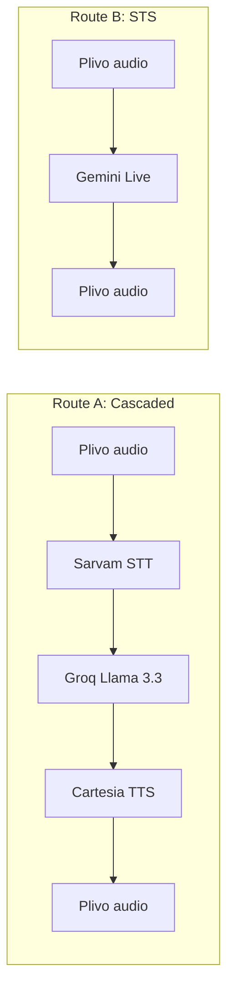
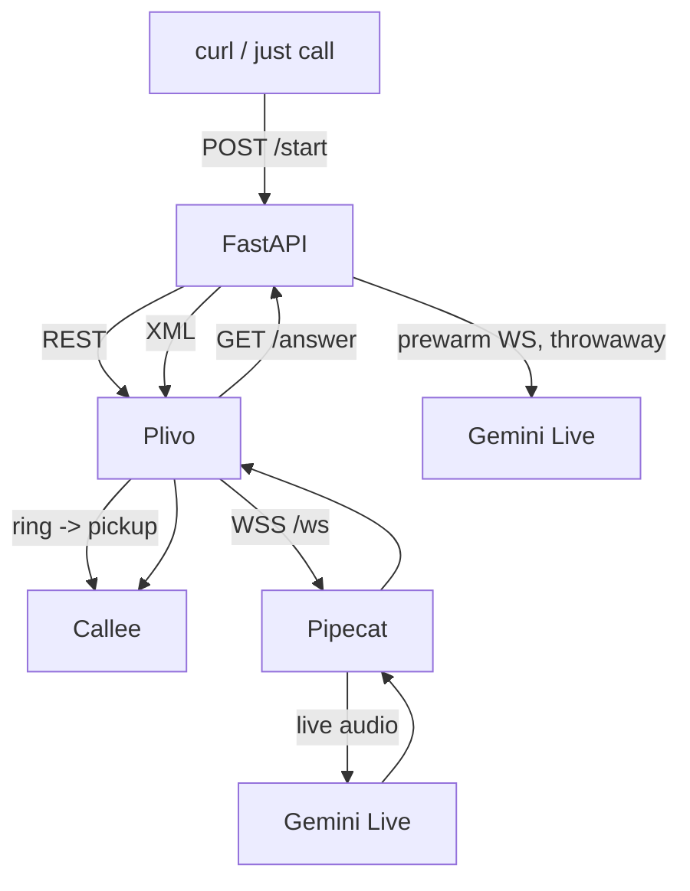
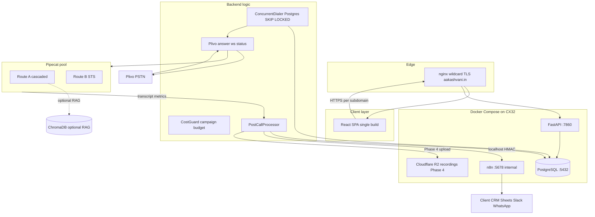

# Aakashvani — Roadmap

> The long-form plan. For day-to-day usage see [README.md](README.md).
>
> **Architecture reference:** [aakash_arch.md](aakash_arch.md) is the source of truth for database schema, credits/billing, script-file configuration, dialer design, and API contracts. This roadmap describes vision, phases, and status. If anything here conflicts with the arch doc, **arch wins**.
>
> Status legend used throughout this document:
> - `done` — built, tested, in main
> - `in progress` — currently being worked on (only one phase at a time)
> - `planned` — designed, not yet started
> - `maybe` — considered, may be cut or deferred indefinitely

---

## Table of contents

1. [Vision](#1-vision)
2. [Two pipelines: cascaded vs STS](#2-two-pipelines-cascaded-vs-sts)
3. [Tech stack](#3-tech-stack)
4. [High-level architecture](#4-high-level-architecture)
5. [API surface](#5-api-surface)
6. [Database schema](#6-database-schema)
7. [Pricing strategy](#7-pricing-strategy)
8. [Compliance and legal](#8-compliance-and-legal)
9. [Phased roadmap](#9-phased-roadmap)
10. [Explicitly deferred](#10-explicitly-deferred)
11. [Context for AI assistants](#11-context-for-ai-assistants)

---

## 1. Vision

Aakashvani is a **managed voice automation service**, not a self-service SaaS. Clients buy outcomes (qualified conversations, structured data, CRM handoff), not tools. Bot scripting, prompt engineering, route and model selection, Plivo number assignment, and extraction schema design are **handled by us**; clients use a frontend to upload leads, start and stop campaigns, watch live progress, inspect call logs and analytics, and manage credits and recharge. CRM integrations are designed and built **by us** using n8n — clients do not configure webhooks or n8n themselves. A structured bot configuration UI is deferred to Phase 3 (see [§9 Phased roadmap](#9-phased-roadmap) — Phase 3).

We provide:

- AI bots that make real phone calls on behalf of clients.
- Two calling architectures: cascaded (STT → LLM → TTS) and speech-to-speech (Gemini Live).
- Concurrent dialing: one server placing dozens of calls in parallel.
- Post-call data extraction: structured lead qualification data from every transcript (schema-driven per script).
- Dynamic script personalization: each lead called by name with CRM context.
- Prepaid **credits** (1 credit = ₹1 at launch; volume packs improve buy rate later).
- Post-call webhooks → n8n → client's CRM / Sheets / Slack / WhatsApp.

**Unit economics.** A 5-minute AI call costs us ~₹7. A human agent doing the same call costs the client ₹25-40. The AI is consistent, available 24/7, native in Indian languages, and produces structured data after every call. Clients are billed in **credits** using ceiling minutes × `bot_config.credits_per_minute`; effective ₹/min depends on pack pricing (typically ₹6-12/min equivalent) with 75-85% margin while still undercutting human call centres.

**Target verticals.** Real estate, lending/credit cards, insurance, edtech, healthcare, and any Indian SMB running outbound lead qualification.

### Why build instead of using an existing platform?

| Platform        | Model              | India focus | Self-hosted | Price            |
| --------------- | ------------------ | ----------- | ----------- | ---------------- |
| Vapi            | Per-min SaaS       | No          | No          | $0.05-0.15/min   |
| Retell          | Per-min SaaS       | No          | No          | $0.07/min        |
| Bolna           | Per-min SaaS       | Partial     | No          | Higher           |
| Rapida          | Open source        | Yes         | Yes         | API costs only   |
| **Aakashvani**  | Per-min managed B2B | **Yes**     | **Yes**     | **₹6-12/min**    |

Pipecat (BSD license, Python-native, active) is our framework of choice. Rapida is GPL-2.0 with a logo requirement; everything else is closed.

### What clients can touch vs what we own

| What clients can touch | What only the Aakashvani team touches |
| ---------------------- | --------------------------------------- |
| Upload leads (CSV) | Bot scripts and prompts |
| Start / stop campaign | Bot config (language, voice, route) |
| Watch live call progress | n8n workflow design and maintenance |
| See call logs and extractions | CRM integration code |
| View analytics | Plivo number management |
| See credit balance | Server and infrastructure |
| Recharge credits | Pipecat pipeline code |

---

## 2. Two pipelines: cascaded vs STS



| Aspect                  | Route A (Cascaded)                              | Route B (STS — Gemini Live)              |
| ----------------------- | ----------------------------------------------- | ---------------------------------------- |
| Latency (round-trip)    | ~1.5-2.5 s                                      | ~0.5-1 s                                 |
| Script adherence        | High — full prompt control, function-calling    | Medium — prompt-led; **no live lead tool** |
| Post-call extraction    | Groq from script `EXTRACTION_SCHEMA` (canonical for CRM/n8n); live `push_lead_data` optional today | Groq from script `EXTRACTION_SCHEMA` after hang-up |
| Auditability            | Easy — STT/LLM/TTS each emit separate frames    | Harder — single black-box model          |
| Indian language quality | Excellent (Sarvam saarika)                      | Good (Marathi, Hindi, English)           |
| Cost / min              | ₹1.48 (verified) → `credits_per_minute` on bot  | TBD — re-derive per audio-token rates    |
| Best for                | Tight outbound sales, qualification flows       | Inbound, complex conversational scenarios |

**Decision is per bot_config, not platform-wide.** Today it's env vars (`BOT_ROUTE`, `STS_SCRIPT`, `CASCADE_SCRIPT` — Phase 0 fallback only); from Phase 2 onwards, `bot_config.route` + `bot_config.script_id` resolve the script module at call time.

---

## 3. Tech stack

### Voice infrastructure

| Component         | Tech                                | Purpose                                 | Status        |
| ----------------- | ----------------------------------- | --------------------------------------- | ------------- |
| Voice framework   | Pipecat 1.1.0 (BSD)                 | Pipeline orchestration                  | done          |
| Telephony         | Plivo                               | Outbound + India PSTN                   | done          |
| Local dev transport | `SmallWebRTCTransport`            | Browser-based testing (no Plivo minutes) | planned (Phase 4) |

### AI services

| Component         | Provider          | Model                                | Status      |
| ----------------- | ----------------- | ------------------------------------ | ----------- |
| STS               | Google Gemini Live| `gemini-3.1-flash-live-preview`      | done        |
| LLM (cascaded)    | Groq              | `llama-3.3-70b-versatile`            | done        |
| STT (Indian)      | Sarvam            | `saarika:v2.5`                       | done        |
| TTS (cascaded)    | Cartesia          | `sonic-3`                            | done        |
| STT English       | Deepgram          | `nova-3`                             | maybe       |
| TTS English       | Deepgram          | `aura-2`                             | maybe       |
| TTS premium       | ElevenLabs        | `eleven_turbo_v2_5`                  | maybe       |
| VAD               | Gemini server VAD (STS) / Silero (cascaded) | Turn detection             | done        |
| Post-call extraction | Groq              | `llama-3.3-70b-versatile` (HTTP); prompt from script `EXTRACTION_SCHEMA` | done |

### Infrastructure

Production target (**Hetzner CX32**: 4 vCPU / 8 GB RAM / ~€14/month) runs **`docker-compose.yml`** with **`fastapi`** (backend, port **7860**), **`postgres`** (5432), **`redis`** (6379 — optional Phase 3 for SSE only), and **`n8n`** (5678 — **same server, internal only**, not exposed to clients). **nginx** terminates TLS (wildcard cert via **certbot**), routes **`*.aakashvani.in`** subdomains to FastAPI and the React SPA, and resolves tenant from the authenticated session (not separate server processes per client). **Cloudflare R2** stores call recordings (Phase 4). Local dev stays WSL2 + ngrok + uvicorn as today.

| Component       | Tech                              | Status                                       |
| --------------- | --------------------------------- | -------------------------------------------- |
| Backend         | FastAPI + Python 3.12 + uv        | done                                         |
| Persistence     | SQLite (Phase 0) → PostgreSQL 16  | SQLite done (Phase 0 calls); Postgres schema + pool done (Phase 2) |
| Cache / pub-sub | Redis 7                           | maybe (Phase 3 SSE live monitor)             |
| Vector DB       | ChromaDB                          | maybe — only if a client actually needs RAG  |
| Frontend        | None (CLI + curl) → React SPA (one build, all subdomains) | planned (Phase 1+)           |
| Reverse proxy   | nginx + wildcard TLS (`*.aakashvani.in`) | planned (deploy time)                 |
| Containerization| Docker Compose (fastapi, postgres, n8n) | postgres service done locally; full stack at deploy |
| Server          | Hetzner CX32 (Germany)            | planned — consider AWS Mumbai if latency hurts |
| Workflow        | n8n on localhost:5678, shared instance; **per-client workflows** built by us | planned |
| Call recordings | Cloudflare R2 (signed URLs)       | planned (Phase 4)                            |
| CRM integrations| via n8n (we design and maintain) | planned                                      |
| Monitoring      | Uptime Kuma                       | planned                                      |
| CI/CD           | GitHub Actions                    | planned                                      |

### Dev environment (current)

- Windows 11 + WSL2 Ubuntu 24.04
- Python 3.12.3 in WSL
- `uv` for everything
- ngrok with a reserved free domain
- `just` for command shortcuts

---

## 4. High-level architecture

> **Multi-tenancy:** enforced by `client_id`. Every DB query must include `WHERE client_id = ?`. There are no per-client deployments. One codebase, one server, complete data isolation in the application layer.

Foundation (Phase 0 — complete):



Target architecture (after Phase 2) — see also [aakash_arch.md §1](aakash_arch.md) and §7:



**Script-file config:** `bot_configs` is a registry (`route`, `script_id`, `credits_per_minute`, Plivo number). Prompts, VAD, `LEAD_SCHEMA`, and `EXTRACTION_SCHEMA` live in `sts_scripts/` / `cascade_scripts/` — see [aakash_arch.md §5](aakash_arch.md).

---

## 5. API surface

### Phase 0 (today)

- `POST /start` — outbound call trigger (dev / single-tenant)
- Plivo webhooks: `/answer`, `/ws`
- `GET /health`
- Post-call POST to `N8N_WEBHOOK_URL` from `.env` after Groq extraction

### Phase 2 target

Routes split by **authentication**: client-facing APIs use a **per-client API token** (hashed in DB); internal APIs use an **admin API key** (localhost + nginx deny for `/internal/`).

**Client-facing** (`/api/*`, Bearer client token) — Phase 2B:

```
GET    /api/campaigns
POST   /api/campaigns/{id}/leads/upload
PATCH  /api/campaigns/{id}/start
PATCH  /api/campaigns/{id}/stop
GET    /api/campaigns/{id}/stats
GET    /api/calls
GET    /api/calls/{session_call_id}
GET    /api/credits
```

**Internal** (`/internal/*`, admin key) — Phase 2A first:

```
POST   /internal/clients
GET    /internal/clients
PATCH  /internal/clients/{id}/credits
POST   /internal/bot-configs
GET    /internal/bot-configs
POST   /internal/campaigns
PATCH  /internal/campaigns/{id}
POST   /internal/webhook-configs
GET    /internal/calls
```

**Webhooks (Phase 2):** per-client, per-event URLs in `webhook_configs`. Events: `lead_qualified`, `lead_not_interested`, `lead_callback`, `lead_failed`, `campaign_completed`. Outbound POSTs signed with HMAC header `X-Aakashvani-Signature: sha256=<hex>` — see [aakash_arch.md §9–10](aakash_arch.md).

---

## 6. Database schema

### Phase 0 — SQLite (today)

Single `call_logs` table at `CALL_LOG_DB_PATH` (default `./data/call_logs.db`). Columns include:

- `session_call_id`, `plivo_call_id`, `route` (`sts` or `cascade` in env/logs today)
- `started_at`, `ended_at`, `duration_ms`
- `transcript_json` — JSON array of `{role, content, timestamp, …}`
- Usage: `usage_prompt_tokens`, `usage_completion_tokens`, `usage_total_tokens`, `usage_tts_characters`, `usage_metrics_json`
- `cost_inr` (STS when USD rates set)
- Post-call: `extraction_json`, `extraction_error`, `extraction_model`

Row inserted at **call end** today. Phase 2 moves to insert-at-start + `in_progress` for live polling.

### Phase 2+ — PostgreSQL 16

**Full schema:** [aakash_arch.md §2](aakash_arch.md).

Summary tables:

| Table | Role |
| ----- | ---- |
| `clients` | Paying client; `balance_credits`, `api_key_hash`, `max_concurrent_calls` |
| `bot_configs` | **Registry only:** `route`, `script_id`, `credits_per_minute`, `telephony_number` |
| `campaigns` | Bot + CSV batch; budget pre-allocation; denorm counters; dialer throttle |
| `leads` | Per-person dial queue; JSONB `metadata`; state machine |
| `call_logs` | One row per **attempt**; audit trail; live transcript when `in_progress` |
| `webhook_configs` | Per-client, per-event n8n URL + HMAC secret |

**Key design points** (from arch §3):

- JSONB `leads.metadata` validated against script `LEAD_SCHEMA` on upload
- Denormalized campaign counters (never `COUNT(*)` on dashboard refresh)
- One `call_logs` row per call attempt; `leads.extraction` holds latest promoted result
- `call_logs` inserted at call **start** for live transcript polling (Phase 2)
- `api_key_hash` (SHA-256) — never store raw API keys
- No `minute_packs` / `credit_packs` table at launch — manual admin top-up in Phase 2

**Route naming:** Postgres uses `sts` | `cascaded`. Phase 0 env/logs may still say `cascade` until `BOT_ROUTE` is retired.

`call_logs.recording_url` is a Phase 4 placeholder (R2 object key, signed URLs on demand).

---

## 7. Pricing strategy

Clients buy **credits**. At launch, **1 credit = ₹1**. Volume packs can improve the buy rate later (e.g. 2000 credits for ₹1800) without changing how billing works internally.

**Billing mechanics:** ceiling minutes × `bot_config.credits_per_minute`:

```
billed_minutes = ceil(duration_seconds / 60)
credits_charged = billed_minutes × credits_per_minute
```

**Campaign budgets:** at campaign start, `clients.balance_credits -= budget_credits` (one atomic deduction). Per call end, `campaigns.budget_used_credits += credits_charged`. On campaign complete, unused budget returns to master balance. See [aakash_arch.md §4](aakash_arch.md).

**CostGuard (Phase 2):** before each dial, require `budget_credits - budget_used_credits >= 2` (covers at least one billed minute).

### Example credit packs (launch pricing — illustrative)

| Pack       | Credits | Price (INR) | Effective ₹/credit |
| ---------- | ------- | ----------- | ------------------ |
| Starter    | 1,000   | ₹1,000      | ₹1.00              |
| Growth     | 2,000   | ₹1,800      | ₹0.90              |
| Scale      | 5,000   | ₹4,000      | ₹0.80              |
| Pro        | 12,000  | ₹8,400      | ₹0.70              |

Packs expire in 90 days. Connected call time only — no charge for failed dials or no-answers.

### One-time fees

| Service                          | Fee          |
| -------------------------------- | ------------ |
| Platform setup (includes first client n8n workflow build) | ₹15,000      |
| n8n workflow change / update     | ₹2,000 / update |
| Additional bot configuration     | ₹5,000 / bot |
| Knowledge base initial setup     | ₹3,000       |
| Knowledge base update            | ₹2,000 / update |

### Billing and credits UI

**Credit balance display:** progress bar + remaining credits on every page (top right). Full detail on `/credits`: balance, pack expiry, usage this month (calls made, credits used, avg duration).

**Recharge flow:** Phase 2 — **manual only**: client pays via bank transfer; admin runs credit top-up via `/internal/clients/{id}/credits`. Phase 3 — **Razorpay** automates `credit_packs` insert via webhook.

### Add-ons

| Add-on                       | Client price | Our cost     | Margin |
| ---------------------------- | ------------ | ------------ | ------ |
| WhatsApp messages            | ₹0.50 / msg  | ₹0.30 / msg  | 40%    |
| Premium voice (ElevenLabs)   | +₹2 / min    | +₹0.70 / min | 65%    |
| Indian language (Sarvam)     | +₹1 / min    | +₹0.30 / min | 70%    |

### Per-minute provider cost (Route A, verified)

| Component              | Rate              | Per minute |
| ---------------------- | ----------------- | ---------- |
| Plivo outbound India   | ₹0.60 / min       | ₹0.60      |
| Sarvam STT             | $0.35 / hr        | ₹0.49      |
| Groq Llama 3.3 70B     | ~$0.79/1M tokens  | ₹0.10      |
| Cartesia TTS sonic-3   | usage-based       | ~₹0.25     |
| Server (amortized)     | —                 | ₹0.05      |
| **Total**              |                   | **~₹1.49** |

Map to `bot_configs.credits_per_minute` (e.g. ~1.49 for cascaded Sarvam+Groq+Cartesia). Route B (Gemini Live) uses env USD/M token rates + `USD_INR` (`pricing_sts.py`).

### Why this pricing works

Global competitors charge $0.05-0.15/min = ₹4-12/min. Indian human call-centre agents cost ₹25-40 per connected call (~₹5-8/min at 5-min avg). Aakashvani undercuts humans with local support and Indian-language quality.

---

## 8. Compliance and legal

### TRAI

- **DND registry**: do not call DND-registered numbers. There is no usable public TRAI DND API — we maintain our own opt-out list and require clients to declare their consent source.
- **Calling hours**: 9:00 AM to 9:00 PM IST only. Enforce in `compliance.py`.
- **Caller ID**: must show a registered Plivo number.
- **DPDP Act 2023**: store only necessary lead data, support deletion-on-request, log where each lead's consent originated.

Lead state machine and DNC-on-upload: [aakash_arch.md §6](aakash_arch.md).

```python
# compliance.py — runs before every dial
def is_call_allowed(phone: str) -> tuple[bool, str]:
    now_ist = datetime.now(tz=pytz.timezone("Asia/Kolkata"))
    if not (9 <= now_ist.hour < 21):
        return False, "outside 9am-9pm IST window"
    if phone in opt_out_list():
        return False, "number on internal DND list"
    return True, "ok"
```

### Data handling

- Phone numbers stored E.164.
- Call recordings stored in Cloudflare R2 (not in DB).
- Transcripts encrypted at rest in Postgres (Phase 2+).
- Per-client data isolation enforced by `client_id` on every query.

---

## 9. Phased roadmap

### Phase 0 — Foundation
**Status:** done (May 2026)
**Timeline:** 2-3 weeks, started May 2026

**Goal:** Two working bots placing real Plivo calls, with persistent call logs, real cost capture, and a single webhook fire.

| Milestone                                                                       | Status        |
| ------------------------------------------------------------------------------- | ------------- |
| FastAPI server placing outbound calls via Plivo                                 | done          |
| Route A (cascaded) working end-to-end                                           | done          |
| Route B (STS / Gemini Live) working end-to-end as Diya                          | done          |
| First-utterance lag investigated and reduced (~30 s → ~1-2 s)                   | done          |
| Repo renamed to `aakashvani`, `justfile` + `scripts/call.sh` + .env BOT_ROUTE   | done          |
| Pipecat `MetricsFrame` → SQLite call_logs row per call                          | done          |
| Post-call transcript capture from `on_user/assistant_turn_stopped` events       | done          |
| Cost calculation in INR from token counts (STS; env USD/M rates + `USD_INR`)  | done          |
| Post-call Groq extraction → `extraction_json` (`Interested` + normalizer)       | done          |
| Outbound JSON POST to n8n workflow URL (`N8N_WEBHOOK_URL` in `.env`)            | done          |
| Max call duration watchdog + `end_call` tool (cascade + STS, `call_limits.py`)   | done          |
| STS Gemini Live context window compression (`GEMINI_CWC_TRIGGER_TOKENS`, Pipecat `ContextWindowCompressionParams`) | done          |
| Gemini Live prewarm: `LiveConnectConfig` + `send_client_content`, `STS_SCRIPT`-aligned model/voice/lang | done          |

**Deliverable:** Make a real call → see structured extraction + cost in SQLite + n8n receives a webhook. **Met.**

### Phase 1 — Lead upload + campaigns + client frontend
**Status:** complete (May 2026) — foundation shipped as Phase 0; client SPA/campaign UI milestones below postponed until after Phase 2  
**Timeline:** React + CSV flows resume after multi-tenant backend

**Goal:** A real client can log in, upload leads, start a campaign, watch it run, and see transcripts and audio for every call. Credits balance is visible and manually rechargeable.

| Milestone | Status |
| --------- | ------ |
| Script modules under `sts_scripts/` / `cascade_scripts/` (prompts, VAD, models) | done |
| `EXTRACTION_SCHEMA` per script + schema-driven `post_call_extract.py` | done |
| `leads` table + CSV upload endpoint (strict schema via `LEAD_SCHEMA`) | planned |
| Sequential / concurrent dialer with retry | planned (Phase 2) |
| Basic compliance check: 9am–9pm IST, internal DND list | planned |
| `/api/campaigns` and lead upload client-facing endpoints | planned |
| `/internal/*` admin endpoints | planned (Phase 2A) |
| React SPA: `/dashboard`, `/campaigns`, `/campaigns/new`, `/calls`, `/calls/{id}`, `/credits` | planned |
| Call detail page: audio player + transcript + extraction fields | planned |
| Credit balance display (manual recharge via bank transfer + admin) | planned |
| n8n workflow for client #1 (built by us, tested end-to-end) | planned |

**Frontend pages (Phase 1 — build after Phase 2 backend):**

| Route | Purpose |
| ----- | ------- |
| `/dashboard` | Live campaign status: calls made, in-progress, completed; credit balance widget top right |
| `/campaigns` | Campaign list → click → detail view |
| `/campaigns/new` | Upload CSV, enter campaign name (bot pre-assigned by us) |
| `/calls` | Paginated call log with filters: date, outcome, language |
| `/calls/{id}` | Call detail (see below) |
| `/credits` | Balance bar, pack history, Recharge button |

**Call detail `/calls/{id}`:** full transcript; extraction JSON as structured fields; metadata (duration, route, outcome). Audio player consumes Phase 4 signed R2 URLs once available.

**Explicitly out of scope for Phase 1:** React analytics charts, bot config UI, Razorpay, multi-tenant Postgres, white-label domains.

### Phase 2 — Multi-tenant + billing
**Status:** in progress (current focus)  
**Timeline:** ~3–4 weeks, starting May 2026

**Goal:** Onboard client #2 without code changes.

**Phase 2 prep (done):**

- `EXTRACTION_SCHEMA` in all active script modules
- Schema-driven `post_call_extract.py`
- README + ROADMAP aligned with [aakash_arch.md](aakash_arch.md)

| Milestone | Status |
| --------- | ------ |
| Postgres migration + schema from [aakash_arch.md §2](aakash_arch.md) | done |
| `clients`, `bot_configs`, `campaigns`, `leads`, `webhook_configs` tables | done |
| Docker Compose `postgres:16` + `just db-*` recipes | done |
| `asyncpg` pool + budget helpers in `db/postgres.py` | done |
| `client_id` on every query | in progress (helpers enforce; APIs not wired) |
| Credits + campaign budget pre-allocation + CostGuard | in progress (allocate/return in `db/postgres.py`; CostGuard dialer pending) |
| `post_call_processor` (lead state machine, counters, webhooks) | planned |
| Concurrent dialer — Postgres `FOR UPDATE SKIP LOCKED` | planned |
| Admin `/internal/*` endpoints first (Phase 2A) | planned |
| Client `/api/*` endpoints (Phase 2B) | planned |
| Live transcript polling (`in_progress`, per-turn writes) | planned |
| Retire `BOT_ROUTE`; `bot_config_id` + `script_id` at call time | planned |
| Manual credit top-up (admin) | planned |
| Subdomain routing: `client-a.aakashvani.in` via nginx | planned |

Build order: [aakash_arch.md §13](aakash_arch.md) (admin-first).

### Phase 3 — Bot config UI + analytics + billing automation
**Status:** planned  
**Timeline:** ~4–6 weeks

**Goal:** Clients configure bot personality within guardrails. Razorpay recharge. Rich analytics.

| Milestone | Status |
| --------- | ------ |
| Razorpay recharge → `credit_packs` automation | planned |
| Bot configuration UI: structured form → backend compiles prompt (no raw editor) | planned |
| `/analytics` page: intent breakdown, duration distribution, cost/day, trends | planned |
| Campaign scheduling (run at specific time / recurring) | planned |
| Live call monitor (SSE stream; optional Redis pub/sub) | planned |

**Bot configuration UI:** clients fill a **structured form**; backend compiles the real system prompt. **Never exposed:** route, model, extraction schema, Plivo number, TTS voice ID, temperature.

### Phase 4 — WhatsApp + recordings + local dev transport
**Status:** planned

| Milestone | Status |
| --------- | ------ |
| Plivo call recording → Cloudflare R2 upload post-call | planned |
| Signed URL generation for audio player (1 hr expiry) | planned |
| Meta WhatsApp Business API for post-call follow-up messages | planned |
| n8n WhatsApp workflow templates | planned |
| Browser test path via `SmallWebRTCTransport` | planned |

Recording flow: [aakash_arch.md](aakash_arch.md) and §11 below.

### Phase 5 — RAG (only if a client requests it)
**Status:** maybe

- ChromaDB per-client knowledge base.
- Embedder + retriever wired into Route A between user_aggregator and LLM.
- Only build if a real client requests answering complex domain questions.

### Future / explicitly considered

- Voice cloning (ElevenLabs).
- A/B script testing.
- Sentiment analysis.
- Dropout-point analysis (which prompt step do callers hang up at).
- Multi-region deployment (AWS Mumbai for PSTN latency to India).
- Inbound calls (same bots handle return calls).
- Human handoff (bot conferences in a human on demand).

---

## 10. Explicitly deferred

These items are sometimes asked about but are not on the near-term plan:

- **Redis dialer queue.** Postgres `FOR UPDATE SKIP LOCKED` is sufficient for concurrent dialing; Redis only reconsidered for Phase 3 SSE.
- **SOC2 / ISO27001.** Required only for enterprise BFSI; revisit when we have a customer asking for it on contract.
- **Per-client dedicated server instances.** One Hetzner CX32 handles 5-10 clients easily.
- **Native CRM integrations.** Always go through n8n.
- **iOS / Android client apps.** Web is enough.
- **Bring-your-own LLM.** Power users can fork; not a product feature.
- **Embedded analytics SaaS.** Use Metabase or Superset over Postgres if needed.
- **`SmallWebRTCTransport` browser dev path.** Deferred to Phase 4. Until then, use `just call` + ngrok.

---

## 11. Context for AI assistants

If you (an LLM agent) are reading this to help build Aakashvani, here is the cheat sheet.

### What is built today (May 2026)

1. WSL2 + Python 3.12 + uv environment, all imports working.
2. `server.py` — FastAPI: `/start`, `/answer`, `/ws`, `/health`. `BOT_ROUTE` env selects `bot_sts` or `bot_cascade` at module load.
3. `bot_sts.py` — Gemini Live STS; loads `sts_scripts/<STS_SCRIPT>`. `end_call` tool, context window compression, prewarm, goodbye hangup fallback.
4. `bot_cascade.py` — Sarvam STT + Groq + Cartesia; loads `cascade_scripts/<CASCADE_SCRIPT>`. Live `push_lead_data` + `end_call`.
5. Script modules export prompts, VAD, models, and **`EXTRACTION_SCHEMA`**. Post-call Groq prompt is built at runtime from that schema (`post_call_extract.py`).
6. SQLite `call_logs` per completed call; n8n webhook via `N8N_WEBHOOK_URL`.
7. `justfile` + `scripts/call.sh` for dev ergonomics.

**Not built yet:** `post_call_processor`, concurrent dialer, `/api/*` and `/internal/*` routes, live transcript polling, Postgres-backed call pipeline (schema + pool exist; `just call` still uses SQLite).

### Script module contract (Phase 2+)

Loaded via `bot_configs.script_id` + `route`:

- `sts` → `sts_scripts.<script_id>`
- `cascaded` → `cascade_scripts.<script_id>`

STS required attributes (see [aakash_arch.md §5](aakash_arch.md)):

```python
_STS_SCRIPT_ATTRS = (
    "build_system_instruction",
    "build_bootstrap_messages",
    "GOODBYE_HANGUP_MARKERS",
    "GEMINI_MODEL", "GEMINI_VOICE", "GEMINI_LANGUAGE",
    "GEMINI_VAD", "GEMINI_TEMPERATURE",
    "EXTRACTION_SCHEMA",
    # LEAD_SCHEMA — Phase 2 upload validation
)
```

`STS_SCRIPT` / `CASCADE_SCRIPT` env vars are **Phase 0 dev fallback only**.

### Pipecat 1.1.0 import paths (current, not the old ones)

```python
from pipecat.processors.aggregators.llm_context import LLMContext
from pipecat.processors.aggregators.llm_response_universal import (
    LLMContextAggregatorPair,
    LLMUserAggregatorParams,
)
from pipecat.transports.smallwebrtc.transport import SmallWebRTCTransport
from pipecat.transports.smallwebrtc.connection import SmallWebRTCConnection
from pipecat.transports.base_transport import TransportParams
from pipecat.services.google.gemini_live.llm import GeminiLiveLLMService, GeminiVADParams
from pipecat.services.google.llm import GoogleLLMService
from pipecat.services.deepgram.stt import DeepgramSTTService
from pipecat.services.deepgram.tts import DeepgramTTSService
from pipecat.services.sarvam.stt import SarvamSTTService
from pipecat.services.cartesia.tts import CartesiaTTSService
from pipecat.services.groq.llm import GroqLLMService
from pipecat.serializers.plivo import PlivoFrameSerializer
from pipecat.runner.types import RunnerArguments, WebSocketRunnerArguments
from pipecat.runner.utils import parse_telephony_websocket, create_transport
from pipecat.frames.frames import LLMRunFrame
from pipecat.pipeline.pipeline import Pipeline
from pipecat.pipeline.runner import PipelineRunner
from pipecat.pipeline.task import PipelineParams, PipelineTask
```

Deprecated, do not use: `OpenAILLMContext`, `pipecat.transports.services.daily`, `pipecat.transports.network.small_webrtc`.

### Conventions

- `uv run …` for all Python invocations, never `python3`.
- Secrets in `.env`, loaded with `python-dotenv` via `load_dotenv(override=True)` at module load.
- Plivo uses 8 kHz µ-law. Set `audio_in_sample_rate=8000` and `audio_out_sample_rate=8000` in `PipelineParams`.
- Use `_lap(t0, label)` style timing logs to debug first-utterance latency.

### Known issues / gotchas

- `pipecat-ai[flows]` extra does not exist — flows are in the base install.
- Free-tier Gemini quota runs out during testing; switch accounts or add billing.
- `--reload` re-imports pipecat heavy modules on every save; don't use it when measuring latency.
- After folder rename, `.venv` may have stale shebangs. Run `uv sync` to fix.

### Next deliverables (Phase 2 — current)

Admin-first build order from [aakash_arch.md §13](aakash_arch.md):

1. ~~Postgres + full schema~~ (done — `docker-compose.yml`, `db/schema/001_initial.sql`, `just db-*`)
2. `/internal/clients`, `/internal/bot-configs`, `/internal/campaigns`, credit top-up, webhook configs
3. `post_call_processor`, lead upload (`LEAD_SCHEMA`), concurrent dialer
4. Client `/api/*` endpoints + React SPA (Phase 2B)

**Phase 0** is complete. **`SmallWebRTCTransport`** is Phase 4.

### Product model cheat sheet

- One backend, one DB, one server. `client_id` isolates all data.
- Clients touch: upload CSV, start/stop campaign, view logs, view credits, recharge.
- We touch: bot scripts, prompts, n8n workflows, CRM integrations, infra.
- Bot config UI in Phase 3 — structured form only, never raw prompt editor.
- `/api/*` = client-facing. `/internal/*` = admin + ops only.

### n8n cheat sheet

- n8n on same server as FastAPI (`localhost:5678`), not exposed to clients.
- Per-client workflows built during onboarding (₹15,000 setup; ₹2,000/update).
- Phase 2: per-event `webhook_configs` with HMAC signing.
- Phase 0 fallback: single `N8N_WEBHOOK_URL` in `.env`.

### Recording flow (Phase 4)

```
Call ends → Plivo recording URL available
  → post_call_processor fetches recording
  → uploads to Cloudflare R2
  → stores R2 key in call_logs.recording_url
  → frontend requests signed URL (1hr) for audio player
  → recording never publicly accessible
```

That's all.
