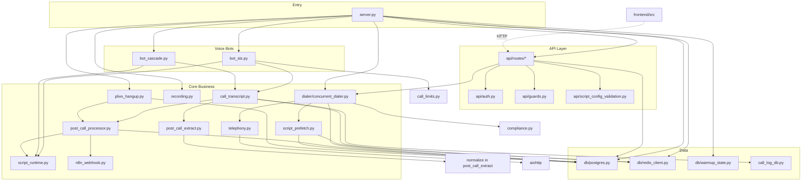

# 17 — Dependency Graph

High-level module ownership and import relationships (verified from import
statements). Arrows: **A → B** means A imports/calls B.

---

## Layer diagram



---

## Logic ownership

| Domain | Owner module |
|--------|--------------|
| HTTP routing | `api/routes/*`, `server.py` telephony |
| Auth | `api/auth.py` |
| Multi-tenant SQL | `db/postgres.py` |
| Campaign counters | `db/postgres.increment_campaign_counters`, `reconcile_campaign_counters` |
| Budget/credits | `db/postgres.allocate_*`, `settle_*`, `try_settle_campaign_budget` |
| Outbound dialing | `dialer/concurrent_dialer.py` |
| TRAI compliance window | `compliance.py` |
| Live voice | `bot_sts.py`, `bot_cascade.py` (Pipecat) |
| Transcript capture | `call_transcript.py` |
| Post-call FSM + billing | `post_call_processor.py` |
| LLM extraction | `post_call_extract.py` |
| Outcome vocabulary | `call_outcomes.py` |
| Script resolution | `script_runtime.py`, `script_prefetch.py` |
| Webhooks | `n8n_webhook.py` |
| Recordings | `recording.py` |
| Rate limiting | slowapi in `server.py` → Redis |
| Background task GC | `background_tasks.py` |

---

## Frontend dependencies

```
App.jsx
  → pages/client/*, pages/admin/*
  → contexts (AdminAuth, AdminData, Toast)
  → api/client.js | api/admin.js → axios → FastAPI
```

No shared state with backend except HTTP + localStorage keys.

---

## External services

| Service | Used by |
|---------|---------|
| PostgreSQL | `db/postgres.py` |
| Redis | `redis_client`, warmup, prefetch, locks, slowapi |
| Plivo REST/WS | `telephony.py`, `bot_*`, `recording.py` |
| Google Gemini Live | `bot_sts.py`, prewarm |
| Groq API | `post_call_extract.py`, `bot_cascade.py` |
| Sarvam / Cartesia | `bot_cascade.py` |
| n8n (HTTP out) | `n8n_webhook.py` |
| Cloudflare R2 | `recording.py` (legacy) |

---

## Scripts / static personas

```
sts_scripts/*  ← imported by script_runtime, server prewarm
cascade_scripts/*  ← imported by script_runtime
```

Dynamic configs in `script_configs` table override static modules when
`bot_configs.script_config_id` is set and prefetch runs.
