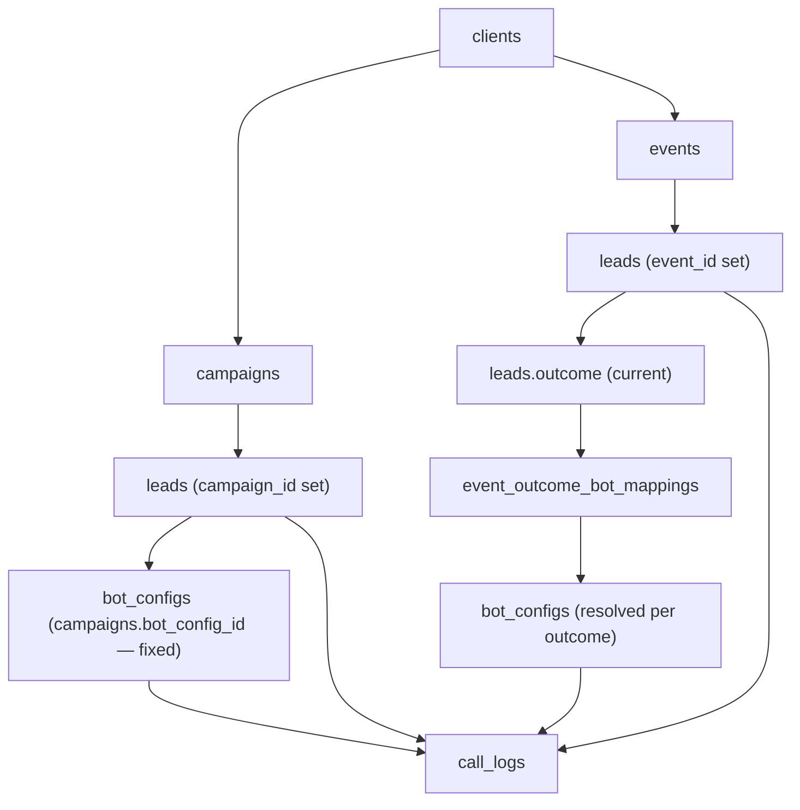
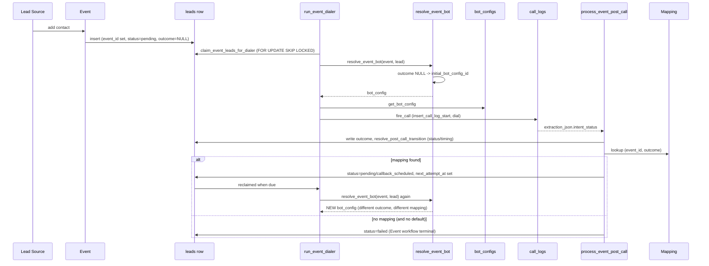
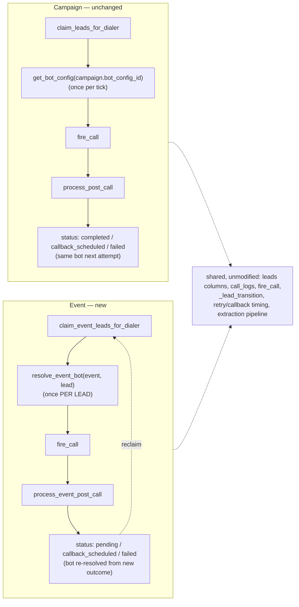
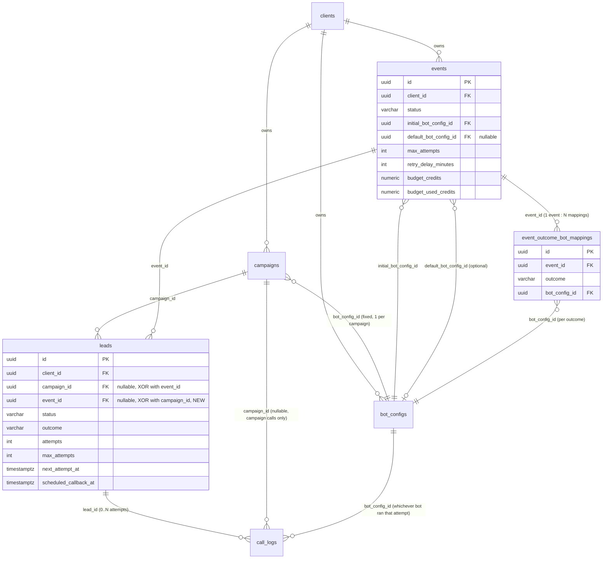

# Event Architecture Workplan

Status: **proposal only — no code changes included in this document.**
Scope: introduce a first-class `Event` concept (outcome-driven, multi-bot
follow-up workflow) alongside the existing `Campaign` concept (fixed-list
cold calling), without altering how Campaigns behave today.

---

## A. Current Architecture

### A.1 Tables that exist today

The project has no ORM layer — every query lives in `db/postgres.py` as raw
`asyncpg` SQL. The schema is defined across `db/schema/001_initial.sql`
through `db/schema/006_script_configs.sql`, applied via the linear Alembic
chain `alembic/versions/001_initial.py` → `010_early_disconnect_outcome.py`.

Nine tables exist: `clients`, `bot_configs`, `campaigns`, `leads`,
`call_logs`, `webhook_configs`, `credit_transactions`, `script_configs`,
`script_config_revisions`. There is **no `campaign_type` column, no
`events` table, and no Event-related route, page, or migration anywhere in
the current codebase.** Every campaign in the current schema is
implicitly a single-bot, fixed-lead-list, cold-calling campaign — the
concept this document calls "Campaign" is simply "the only kind of
campaign that exists right now."

### A.2 Campaign → Lead → Call, end to end

- **Create:** `POST /api/campaigns` (`api/routes/campaigns.py:159`) →
  `db.postgres.create_campaign` (`db/postgres.py:1051`). One
  `bot_config_id` is required and stored directly on the `campaigns` row
  (`campaigns.bot_config_id`, `NOT NULL`). A campaign is exactly one bot,
  for its entire lifetime.
- **Leads in:** CSV upload (`POST /api/campaigns/{id}/leads/upload`,
  `api/routes/campaigns.py:213`) or single add
  (`POST /api/campaigns/{id}/leads`, `api/routes/leads.py:239`) both land
  rows in `leads`, scoped by `leads.campaign_id` (FK, `ON DELETE CASCADE`)
  and `leads.client_id`.
- **Start:** `PATCH /api/campaigns/{id}/start` → `dialer.concurrent_dialer.start_dialer`
  → one asyncio task per campaign (`run_campaign_dialer`,
  `dialer/concurrent_dialer.py:301`), guarded by a Redis lock
  (`dialer_lock:{campaign_id}`, `dialer/dialer_lock.py`) so only one worker
  process dials a given campaign.
- **Claim:** each dialer tick calls `pg_db.claim_leads_for_dialer`
  (`db/postgres.py:1641`) — a single `SELECT ... FOR UPDATE SKIP LOCKED`
  against `leads` filtered on
  `status IN ('pending','callback_scheduled') AND attempts < max_attempts
  AND next_attempt_at <= NOW()`, with two `NOT EXISTS` guards against
  `call_logs` to prevent double-dialing a lead that already has a live or
  just-ended call. Claimed rows flip to `status = 'calling'`,
  `attempts += 1`.
- **Bot selection (current — the single most important fact for this
  workplan):** immediately after claiming a batch of leads, the dialer
  loop does **one** lookup —
  `bot_config = await pg_db.get_bot_config(pool, UUID(str(campaign["bot_config_id"])), client_id)`
  (`dialer/concurrent_dialer.py`, inside `run_campaign_dialer`, right after
  the `claim_leads_for_dialer` call) — and passes that **same** `bot_config`
  into `fire_call()` for **every** lead claimed in that tick. There is no
  per-lead, per-attempt, or per-outcome bot selection anywhere in the
  current codebase. The bot is a property of the campaign, full stop.
- **Dial:** `fire_call()` (`dialer/concurrent_dialer.py`) writes a
  `call_logs` row (`pg_db.insert_call_log_start`) with `in_progress=TRUE`,
  then places the Plivo call. `call_logs.bot_config_id` records which bot
  actually ran that attempt (denormalized copy, not derived at read time).
- **Converse / extract:** Pipecat pipeline runs, transcript is appended to
  `call_logs.transcript` live; Groq/Gemini extraction runs post-call and
  produces `extraction_json.intent_status`, which becomes the
  `outcome` string.
- **Settle:** `post_call_processor.process_post_call` (the function whose
  body is `post_call_processor.py:379` onward in this codebase) is the
  single place that decides what happens to a lead after a call. It:
  1. Classifies `outcome` into **terminal / retry / callback** buckets via
     `script_runtime.outcome_buckets()`, which reads
     `outcome_terminal` / `outcome_retry` / `outcome_callback` from the
     **script config snapshot** captured on the `call_logs` row at dial
     time (`call_data.post_call_snapshot`) — falling back to the global
     defaults in `call_outcomes.py` (`TERMINAL`, `RETRY`, `CALLBACK`,
     `FAILURE`, `SYSTEM_OUTCOMES`) when no snapshot is present.
  2. Computes the next lead `status`
     (`completed` / `callback_scheduled` / `failed`), `next_attempt_at`,
     and `scheduled_callback_at` via `resolve_post_call_transition()`
     (`post_call_processor.py:161`), which itself calls the pure state
     function `_lead_transition()` (`post_call_processor.py:123`).
  3. Writes the new lead state via `pg_db.update_lead_post_call`, updates
     campaign counters (`pg_db.increment_campaign_counters`,
     `db/postgres.py:3549`, a fixed lookup table `_COUNTER_DELTAS` keyed
     by `(from_status, to_status)`), settles billing/budget, and — outside
     the DB transaction — fires an n8n webhook via
     `n8n_webhook.fire_event_webhook` if the outcome maps to one of the
     five fixed webhook events (`lead_qualified`, `lead_not_interested`,
     `lead_callback`, `lead_failed`, `campaign_completed`, per
     `webhook_configs`' `UNIQUE (client_id, event)`).
  4. **At no point does this function choose a different bot.** It only
     ever decides the lead's *status* and *timing* of the next attempt.
     The next attempt (if any) is claimed by the same dialer loop
     described above, which always re-reads `campaign.bot_config_id` —
     i.e. retries on a Campaign today always use the same bot as attempt 1.
- **Complete:** when a campaign's `pending + callback + calling` counters
  all reach zero, `complete_campaign()` releases any stuck leads and
  returns unused budget (`pg_db.return_unused_budget`), idempotent via
  `campaigns.budget_returned_at`.

### A.3 What `leads.status`, `next_attempt_at`, and `scheduled_callback_at`
actually mean today

- `leads.status` — CHECK-constrained to exactly
  `pending | calling | completed | failed | callback_scheduled`
  (the original `dnc` value was removed by
  `alembic/versions/007_remove_dnc.py`; the current CHECK clause therefore
  lives partly outside `db/schema/001_initial.sql` and must be read
  together with that migration).
- `leads.next_attempt_at` — the single timestamp the dialer's claim query
  filters on (`idx_leads_dialer`, a partial index on
  `(campaign_id, next_attempt_at) WHERE status IN ('pending','callback_scheduled')`).
  Used for both "ordinary retry after N minutes" and "explicit callback
  time parsed from extraction."
- `leads.scheduled_callback_at` — set alongside `next_attempt_at`
  specifically when the outcome falls in the "callback" bucket; kept as a
  separate column purely for display/audit (`next_attempt_at` is what the
  dialer actually reads).
- `leads.attempts` / `leads.max_attempts` — a flat counter, incremented on
  every claim, frozen `max_attempts` copied from the campaign at
  lead-creation time. There is no concept of "attempt N used bot X."

### A.4 `call_logs` as the audit trail

One row per call **attempt** (`call_logs.lead_id` → `leads.id`, no
`ON DELETE` clause defined anywhere — see §F.6 for why this matters).
Carries `outcome`, `extraction_json`, `transcript`, `bot_config_id`,
`campaign_id`, billing fields, and `call_data` (a JSONB overflow column
that already carries a `post_call_snapshot` sub-object — the script
config actually used for that specific attempt, captured at dial time so
that later script-config edits never retroactively change how an
in-flight or historical call is interpreted). This table is already a
complete "attempt N, bot X, outcome Y" history — it is *lead-attempt*
history, not merely *campaign* history, because `lead_id` is populated on
every insert.

### A.5 `bot_configs` and `script_configs`

- `bot_configs` — one row = one callable bot. `route` (`sts`/`cascaded`) +
  `script_id` resolve to a Python script file; `credits_per_minute` drives
  billing; optional `script_config_id` FK (added by
  `db/schema/006_script_configs.sql`) points at a `script_configs` row for
  DB-editable prompts/VAD/extraction, versioned via
  `script_config_revisions`.
- Nothing in `bot_configs` or `script_configs` encodes "which bot follows
  which outcome." That relationship does not exist anywhere in the schema
  today.

### A.6 Existing documentation consulted

`docs/system/04_DATABASE_SCHEMA.md`, `docs/system/09_CALL_LIFECYCLE.md`,
`docs/system/03_BACKEND_ARCHITECTURE.md`, and `guides/aakash_arch.md`
describe this same single-bot-per-campaign, fixed-lead-list design — none
of them describe a continuous/Event mode, confirming that no such feature
exists in this codebase snapshot to be studied, reused, or migrated away
from.

---

## B. Problems With Representing "Event" as `campaign_type = continuous`

This project does not currently have a `campaign_type` column, so there is
no existing data or code path to migrate away from. This section instead
explains, from first principles grounded in the architecture above, why
that pattern (seen in some in-progress branches/handoff notes referencing
a "continuous campaign" idea) would be the wrong foundation for what an
Event actually needs to do:

1. **Bot selection is campaign-scoped, not lead-scoped.** The dialer reads
   `campaign.bot_config_id` exactly once per tick and reuses it for every
   claimed lead (§A.2). A "continuous campaign" flag changes *when* leads
   can be added and *whether* the dialer keeps running, but it does not
   touch this single-bot-per-campaign assumption. Layering
   outcome-driven, per-lead bot switching on top of `campaigns` would
   require rewiring the one place in the whole system (the dialer's bot
   lookup) that every batch Campaign also depends on — which is exactly
   the kind of change the isolation requirement in §E forbids.
2. **`campaigns` counters and settlement assume a converging, finite lead
   list.** `total_leads`, `pending_leads`, `completed_leads`, etc., and
   `complete_campaign()` (§A.2) are built around "this campaign finishes
   when its fixed lead list is exhausted." An Event is explicitly
   open-ended (leads trickle in indefinitely, and a lead can cycle through
   multiple bots/outcomes rather than reach one terminal state) — forcing
   that into the same counters/settlement model means either leaving an
   Event permanently "running" (never settling budget) or inventing
   parallel bookkeeping bolted onto a table designed for the opposite
   lifecycle.
3. **`campaign_type` would be a silent behavioral toggle scattered across
   every campaign/lead code path.** Every one of the 12+ backend
   functions and 12 API routes enumerated in §A already assume "a
   campaign row = one bot, one lead list, one budget lifecycle." Making
   Events a variant of that same row means every one of those call sites
   either needs an `if campaign_type == 'continuous':` branch or must be
   trusted to coincidentally do the right thing — which is precisely the
   "scattered conditionals" outcome this workplan is designed to avoid
   (see §E and §H).
4. **The two concepts have genuinely different keys.** A Campaign's
   identity is "this bot, called against this fixed list, once." An
   Event's identity is "this lead's current outcome, mapped to a bot,
   repeated." Modeling the second as a status flag on the first conflates
   two different questions (*which rows are eligible to be claimed?* vs.
   *which bot should this specific claim use?*) that the current schema
   already keeps cleanly separate for Campaigns (`leads.status` answers
   the first; `campaigns.bot_config_id`, a constant, "answers" the second
   only because Campaigns never needed it to vary).

Conclusion: a dedicated `events` table with its own outcome→bot mapping
table is the right foundation *from the start* in this codebase — not a
correction of an existing mistake, but the correct design given that no
Event-related schema exists yet to build on.

---

## C. Target Architecture

```
Campaign  = campaigns table, unchanged, cold calling, one bot, fixed list
Event     = new events table, follow-up workflow, outcome→bot mapping
```

Both concepts share the underlying `leads` and `call_logs` machinery
(claiming, transcript, extraction, billing, retry timing) because that
machinery is already generic — it operates on `leads.status`,
`leads.next_attempt_at`, `leads.attempts`, none of which are
Campaign-specific in how they're read by the dialer's SQL. What is
Campaign-specific is *only* the fixed `bot_config_id` on `campaigns` and
the finite-list settlement logic — and those are exactly the two things
an Event does not inherit, because an Event is not a `campaigns` row at
all under this design.

New tables (details in §F):

- **`events`** — parallel to `campaigns`: one row per Event, owned by a
  `client_id`, with its own status/lifecycle and its own concurrency/
  scheduling knobs, but **no single `bot_config_id`** (an Event has many
  candidate bots, chosen per outcome).
- **`event_outcome_bot_mappings`** — `event_id` → `outcome` → `bot_config_id`,
  one Event has many mappings (`events 1 ── N event_outcome_bot_mappings`).

`leads` gains one nullable `event_id` FK alongside the existing
`campaign_id`, so a lead row belongs to *either* a Campaign *or* an Event,
never both (§F.3 gives the exact constraint). `call_logs` needs no new
foreign key — `call_logs.lead_id` and `call_logs.bot_config_id` already
capture "which lead, which bot, this attempt" for both Campaign and Event
calls without modification.

---

## D. Event Workflow (lead ingestion → repeated follow-ups)

```
Lead Source (client UI "Add Contact", or an external system)
    ↓
Event (events row, status = running)
    ↓
Create Event Lead  (leads row: event_id set, campaign_id NULL, status = 'pending')
    ↓
Determine current bot:
    lead has no prior outcome  →  events.initial_bot_config_id
    lead has a prior outcome   →  event_outcome_bot_mappings lookup on that outcome
    no mapping found           →  events.default_bot_config_id (fallback), else lead stays 'pending' and is not claimed (see §I)
    ↓
Dialer claims lead (same claim_leads_for_dialer query, extended to also select event_id rows — see §H)
    ↓
Call placed with the bot resolved above
    ↓
Outcome extracted (same post_call_processor pipeline)
    ↓
Outcome recorded on the lead (existing leads.outcome column — no new column)
    ↓
Look up event_outcome_bot_mappings for (event_id, outcome)
    ↓
  Found → schedule follow-up: leads.status='callback_scheduled' (or 'pending' for immediate),
          next_attempt_at set (existing retry/callback timing logic, unchanged)
  Not found → outcome is terminal for this Event (no further calls scheduled automatically)
    ↓
Dialer claims again when next_attempt_at is due
    ↓
Bot resolved again from the lead's *now-current* outcome
    ↓
Repeat until a terminal / unmapped outcome is reached, or attempts exhausted
```

This reuses, unmodified in logic: `leads.status`, `leads.next_attempt_at`,
`leads.scheduled_callback_at`, `leads.attempts`/`max_attempts`,
`call_logs` (every column), the retry/callback timing math in
`post_call_processor._lead_transition()`, and the extraction/webhook
pipeline. The only genuinely new step is the "resolve bot from outcome"
lookup, which sits at exactly two points: (1) just before the dialer
fires a call (replacing the single `get_bot_config(campaign.bot_config_id)`
call with a resolver that branches on whether the claimed row is a
Campaign lead or an Event lead), and (2) nowhere else — outcome bucketing,
webhook firing, and billing stay identical for both.

---

## E. Campaign Workflow Protection

Concretely, the following existing functions/routes are **not modified in
behavior** by this plan — only, where explicitly noted in §G/§H, extended
with an additional conditional branch that is unreachable for any row
where `leads.campaign_id IS NOT NULL` (i.e. every Campaign lead that
exists today keeps flowing through the exact same code path it does now):

| Area | File / function | Change |
|---|---|---|
| Campaign CRUD | `api/routes/campaigns.py` (all 12 routes) | none |
| Campaign lead CRUD | `api/routes/leads.py` (all 7 routes) | none |
| Lead claiming | `db.postgres.claim_leads_for_dialer` | extended (see §H) — existing `WHERE campaign_id = $1` branch untouched |
| Dialer loop | `dialer.concurrent_dialer.run_campaign_dialer` | bot-lookup call site changed from a direct `get_bot_config` call to a resolver function; for a Campaign lead the resolver's first branch is `if lead.event_id is None: return get_bot_config(campaign.bot_config_id)` — byte-identical result to today |
| Firing a call | `dialer.concurrent_dialer.fire_call` | none (already takes `bot_config` as a parameter — it does not care how the caller decided on it) |
| Post-call state machine | `post_call_processor.process_post_call`, `resolve_post_call_transition`, `_lead_transition` | none to the status/timing math; one new call added *after* the existing transaction commits (outcome→bot lookup for Event leads only, see §H) |
| Counters/settlement | `increment_campaign_counters`, `maybe_auto_settle_campaign`, `return_unused_budget` | none — these are only ever called with a `campaign_id`, and Event leads never populate `campaign_id`, so these code paths structurally cannot see an Event lead |
| Webhooks | `n8n_webhook.py` | none |
| `call_outcomes.py` | outcome vocabulary | none |
| Frontend Campaigns pages | `frontend/src/pages/client/Campaigns/`, `CampaignDetail/`, `CampaignWorkspace/` | none |

The load-bearing structural guarantee is **§F.3**: `leads.campaign_id` and
`leads.event_id` are mutually exclusive via a CHECK constraint, and every
Campaign-side function already filters/joins on `campaign_id` (never on
"is this an Event lead"), so a row with `event_id` set is simply invisible
to 100% of existing Campaign queries without any of them needing to be
taught to ignore it — there is nothing to accidentally leak.

---

## F. Database Changes

### F.1 New table: `events`

```sql
CREATE TABLE events (
    id                      UUID PRIMARY KEY DEFAULT gen_random_uuid(),
    client_id               UUID NOT NULL REFERENCES clients(id) ON DELETE CASCADE,

    name                    VARCHAR(255) NOT NULL,
    description             TEXT,

    status                  VARCHAR(50) NOT NULL DEFAULT 'draft'
                                CHECK (status IN ('draft', 'running', 'pausing',
                                                  'paused', 'completed', 'cancelled')),
    -- Same vocabulary as campaigns.status (§A) for operational familiarity;
    -- 'completed' for an Event means "manually closed by client/admin",
    -- since an Event has no finite lead list to naturally exhaust.

    -- ── BOT RESOLUTION ─────────────────────────────────────────
    initial_bot_config_id   UUID NOT NULL REFERENCES bot_configs(id),
    -- Bot used for a lead's very first attempt (no prior outcome yet).
    -- Mirrors campaigns.bot_config_id's role for attempt 1 only.

    default_bot_config_id   UUID REFERENCES bot_configs(id),
    -- Fallback bot when a lead's outcome has no matching row in
    -- event_outcome_bot_mappings. NULL = no fallback: an unmapped
    -- outcome is treated as terminal (lead is not re-claimed). See §I.

    -- ── DIALER THROTTLE (same shape as campaigns, independent values) ──
    max_concurrent_calls    INTEGER NOT NULL DEFAULT 5,
    calls_per_minute        INTEGER NOT NULL DEFAULT 10,

    -- ── RETRY POLICY (same shape as campaigns) ──────────────────
    max_attempts            INTEGER NOT NULL DEFAULT 3,
    -- Applies per Event lead, same semantics as leads.max_attempts today
    -- (frozen onto the lead row at creation, exactly as campaigns do).
    retry_delay_minutes     INTEGER NOT NULL DEFAULT 120,

    -- ── BUDGET (same shape as campaigns; see §F.7 for why it's needed
    --    even though an Event has no finite completion) ─────────────
    budget_credits          NUMERIC(12,2) NOT NULL DEFAULT 0,
    budget_used_credits     NUMERIC(12,2) NOT NULL DEFAULT 0,
    budget_returned_at      TIMESTAMPTZ,

    -- ── DENORM COUNTERS (subset of campaigns' — no total/completed
    --    concept since an Event lead can re-enter 'pending') ────────
    total_leads             INTEGER NOT NULL DEFAULT 0,
    pending_leads           INTEGER NOT NULL DEFAULT 0,
    calling_leads           INTEGER NOT NULL DEFAULT 0,
    callback_leads          INTEGER NOT NULL DEFAULT 0,
    failed_leads            INTEGER NOT NULL DEFAULT 0,

    max_call_minutes        INTEGER,
    extraction_schema_override JSONB DEFAULT NULL,

    created_at              TIMESTAMPTZ NOT NULL DEFAULT NOW(),
    updated_at              TIMESTAMPTZ NOT NULL DEFAULT NOW()
);

CREATE INDEX idx_events_client ON events (client_id);
CREATE INDEX idx_events_status ON events (client_id, status);
```

Deliberately **omitted** from `events` versus `campaigns`: `completed_leads`
counter (an Event lead reaching one outcome can re-enter `pending` for the
next bot, so "completed" is not a stable terminal bucket the way it is for
a Campaign — see §I for the actual terminal condition) and
`scheduled_start_at` (not part of this phase's scope; can be added later
without migration risk since it's a simple nullable column, same pattern
`campaigns.scheduled_start_at` used).

### F.2 New table: `event_outcome_bot_mappings`

```sql
CREATE TABLE event_outcome_bot_mappings (
    id              UUID PRIMARY KEY DEFAULT gen_random_uuid(),
    event_id        UUID NOT NULL REFERENCES events(id) ON DELETE CASCADE,
    outcome         VARCHAR(50) NOT NULL,
    -- Free-text, matching the same vocabulary leads.outcome already uses
    -- (Interested, Not_Interested, Callback_Requested, Busy, etc. — see
    -- call_outcomes.py ALL_OUTCOMES — plus any client-defined custom
    -- outcome string their script's extraction schema can produce).
    bot_config_id   UUID NOT NULL REFERENCES bot_configs(id),

    created_at      TIMESTAMPTZ NOT NULL DEFAULT NOW(),
    updated_at      TIMESTAMPTZ NOT NULL DEFAULT NOW(),

    UNIQUE (event_id, outcome)
    -- One bot per outcome per Event — deterministic lookup, no ambiguity.
);

CREATE INDEX idx_event_outcome_bot_mappings_event ON event_outcome_bot_mappings (event_id);
```

This is intentionally its own table (`events 1 ── N event_outcome_bot_mappings`),
not a JSONB column on `events`, for three concrete reasons grounded in how
this codebase already does things elsewhere:

1. `script_configs`/`script_config_revisions` already establish the
   project's convention of "config that needs individual foreign-key
   integrity to `bot_configs` gets its own table," not a JSON blob — a
   JSONB `{outcome: bot_config_id}` map on `events` could silently
   reference a deleted `bot_config_id` with no FK to catch it.
2. A relational table lets the client UI list/add/edit/delete individual
   mappings (§L) with normal CRUD endpoints, matching the pattern
   `webhook_configs` already uses for "per-client rows keyed by a fixed
   category" (`UNIQUE (client_id, event)` there; `UNIQUE (event_id, outcome)`
   here — same shape).
3. `bot_config_id` FK integrity: `ON DELETE` behavior can be reasoned
   about per-mapping-row (see §F.6) instead of needing custom JSONB
   validation code.

### F.3 Changes to `leads`

```sql
ALTER TABLE leads
    ADD COLUMN event_id UUID REFERENCES events(id) ON DELETE CASCADE;

ALTER TABLE leads
    ALTER COLUMN campaign_id DROP NOT NULL;

ALTER TABLE leads
    ADD CONSTRAINT leads_campaign_or_event_xor
        CHECK (
            (campaign_id IS NOT NULL AND event_id IS NULL) OR
            (campaign_id IS NULL AND event_id IS NOT NULL)
        );

-- The existing UNIQUE (campaign_id, phone) only de-duplicates within a
-- Campaign. Add the Event equivalent so the same "silent skip on
-- duplicate phone" behavior (insert_single_lead's ON CONFLICT DO NOTHING,
-- §A) works for Events too:
CREATE UNIQUE INDEX idx_leads_event_phone_unique
    ON leads (event_id, phone) WHERE event_id IS NOT NULL;

CREATE INDEX idx_leads_event ON leads (event_id);

-- Dialer hot-path index, mirroring idx_leads_dialer for the event_id side
-- (see §H — this is required for Event claiming to be index-backed rather
-- than falling back to the existing partial index's campaign_id lead
-- column, which would still work correctly but scan more rows than
-- necessary as Event volume grows):
CREATE INDEX idx_leads_event_dialer
    ON leads (event_id, next_attempt_at)
    WHERE status IN ('pending', 'callback_scheduled');
```

**Why this approach (nullable `campaign_id` + nullable `event_id` + XOR
CHECK) over the alternatives considered:**

- *Alternative considered: a new `event_leads` table, structurally
  separate from `leads`.* Rejected — this would force
  `claim_leads_for_dialer`, `post_call_processor`, every lead-status
  query, and `call_logs.lead_id`'s FK target to be duplicated or made
  polymorphic. The existing `leads` table's columns
  (`status`, `attempts`, `max_attempts`, `next_attempt_at`,
  `scheduled_callback_at`, `metadata`, `outcome`, `extraction`) are
  already 100% generic — none of them mention "campaign" in their
  meaning — so duplicating the table would only duplicate columns that
  don't need to change, at the cost of duplicating every function that
  reads them (§A.2, §A.3 show how deeply `claim_leads_for_dialer` and
  `post_call_processor` are built around this exact column set).
- *Alternative considered: keep `campaign_id NOT NULL`, make Events
  synthesize a `campaigns` row internally.* Rejected — this resurrects
  exactly the `campaign_type` conflation problem described in §B, just
  hidden one layer down (an "internal fake campaign" is still a
  `campaigns` row subject to every Campaign-only assumption in §A.2/§E).
- **Why the XOR CHECK constraint specifically:** it makes "a lead belongs
  to exactly one of Campaign or Event" a database-enforced invariant
  rather than an application convention, so no future bug in either the
  Campaign or Event insert path can accidentally create an ambiguous row.
  This is the single constraint that makes the "Campaign lead can never
  enter Event workflow" isolation guarantee (§I.4, §N) provable rather
  than just asserted.

`leads.campaign_id`'s existing `NOT NULL` must become nullable for this to
work — this is the one schema-level change that touches a Campaign
column. It is safe because: (a) the XOR CHECK guarantees every existing
row (which all have `campaign_id` set, `event_id` NULL by definition
before this migration runs) continues to satisfy `campaign_id IS NOT NULL`,
so no existing data changes meaning; (b) every existing query that reads
`leads.campaign_id` already does so via an explicit `WHERE campaign_id = $1`
or `JOIN campaigns ON campaign_id = campaigns.id`, both of which are
unaffected by the column becoming nullable in the schema (a `NOT NULL`
relaxation never breaks a query that was already filtering on a specific
value); (c) no code path anywhere in `db/postgres.py` inserts a `leads`
row with `campaign_id` omitted today, so no existing INSERT starts
violating the new XOR CHECK.

### F.4 Changes to `call_logs`

**None required.** `call_logs.lead_id` → `leads.id` already works
unmodified for a lead with `event_id` set instead of `campaign_id` set —
the FK target is `leads.id`, not `leads.campaign_id`. `call_logs.campaign_id`
simply stays `NULL` for Event calls (it's already a nullable FK with no
`ON DELETE` clause, per §A.4 — storing `NULL` there for an Event call is
no different from any other row where a nullable FK isn't applicable).
`call_logs.bot_config_id` already records "which bot ran this attempt"
regardless of how that bot was chosen, so Event calls automatically get
correct per-attempt bot history for free — this directly satisfies the
task's requirement in §7 ("reuse call_logs, don't duplicate history
infra") without any DDL change.

One **optional, purely additive** column, not required for correctness
but useful for analytics/debugging without a join:

```sql
ALTER TABLE call_logs ADD COLUMN event_id UUID REFERENCES events(id);
```

Recommendation: **defer this to a later phase.** `call_logs.lead_id JOIN
leads.event_id` already answers "which Event was this call for" without
it; adding it now is optional convenience, not a requirement, and every
day it's deferred is one fewer nullable FK to reason about during the
higher-risk part of this rollout (§M).

### F.5 Changes to `campaigns`

**None.** No column added, no column removed, no constraint changed.

### F.6 Note on the pre-existing `call_logs.lead_id` FK gap

Independent of this Event work, `call_logs.lead_id REFERENCES leads(id)`
has no `ON DELETE` clause anywhere in the current schema (confirmed by
reading every `db/schema/*.sql` file and the full Alembic chain), which
means a hard `DELETE FROM leads` for a lead that already has `call_logs`
rows is rejected by Postgres today, for both Campaign and (once this plan
ships) Event leads alike. This is a pre-existing condition, not introduced
by this plan, and this plan does not propose fixing it — flagged here only
so it's not mistaken for a new risk this design introduces. If lead
deletion for leads with call history is required for Events, it would need
the same fix applied uniformly to both Campaign and Event leads (since
they share one `leads` table and one `call_logs.lead_id` FK), which is
out of scope for this document.

### F.7 Why `events` needs its own budget columns

An Event has no natural "campaign complete, return unused budget" moment
(§B point 2) — but calls still cost credits and `bot_configs.credits_per_minute`
billing still applies. `budget_credits`/`budget_used_credits` on `events`
lets the *existing* budget-check gate
(`dialer.cost_guard.check_campaign_budget`, currently keyed to a
`campaign_id`) be reused via a small generalization (§G) rather than
skipped entirely for Events, which would let an Event dial with no spend
ceiling. `budget_returned_at` is kept nullable and unused by default
(no automatic settlement), populated only if/when a client explicitly
cancels or archives an Event (mirroring `cancel_campaign`'s manual path,
not the automatic `maybe_auto_settle_campaign` one, since there's no
"lead list exhausted" signal to trigger it automatically).

---

## G. Backend Changes

All changes are **additive new functions/files** unless marked "extend."

| # | File | Change |
|---|---|---|
| 1 | `db/schema/008_events.sql` (new) | The three DDL blocks from §F.1–F.3, as one migration file, following the exact pattern of `db/schema/007_*.sql`'s predecessors (plain `.sql` file, executed by an Alembic wrapper — see #2). |
| 2 | `alembic/versions/011_events.py` (new) | `revision="011_events"`, `down_revision="010_early_disconnect_outcome"` — mirrors the `Path(...).read_text()` + statement-split execution pattern every prior migration file in this repo already uses (e.g. `006_script_configs.py`). |
| 3 | `db/postgres.py` — new functions | `create_event`, `get_event`, `get_event_admin`, `list_events`, `update_event_settings`, `update_event_status`; `create_event_outcome_mapping`, `list_event_outcome_mappings`, `update_event_outcome_mapping`, `delete_event_outcome_mapping`, `get_event_outcome_bot`(event_id, outcome) -> bot_config_id or NULL`; `insert_event_lead` (parallel to `insert_single_lead`, sets `event_id` not `campaign_id`); `bulk_insert_event_leads` (parallel to `bulk_insert_leads`); event lead CRUD (`update_event_lead_fields`, `delete_event_lead` — parallel to `update_lead_fields`/`delete_lead`, same `status != 'calling'` guard). **None of these touch existing Campaign functions** — they are new, separate functions, following the same naming convention already established (`*_campaign` vs `*_lead` naming split that exists today). |
| 4 | `db/postgres.py` — `claim_leads_for_dialer` | **Extend, not duplicate.** Today's function is keyed on `campaign_id`. Add a sibling `claim_event_leads_for_dialer(pool, event_id, client_id, slots)` with the identical `FOR UPDATE SKIP LOCKED` shape but `WHERE event_id = $1` instead of `campaign_id = $1`, using `idx_leads_event_dialer` (§F.3). Kept as a separate function (not one function branching internally) so the Campaign version's SQL text — and therefore its query plan and lock behavior, which is the single most concurrency-sensitive query in the system per the code comments in `db/schema/001_initial.sql` §"idx_leads_dialer" — is provably untouched, not just logically equivalent. |
| 5 | `dialer/concurrent_dialer.py` — new `run_event_dialer(...)` | A **new function**, structurally parallel to `run_campaign_dialer` (§A.2), not a branch inside it. Reuses `fire_call()` unmodified (it already just takes a `bot_config` dict + `lead` dict — it has no idea whether either came from a Campaign or an Event). The only new logic inside `run_event_dialer` is the bot resolver (#6) called once per claimed lead (not once per tick, since different leads in the same batch may need different bots — this is the one place Event dialing is structurally more expensive per-tick than Campaign dialing, which is expected and acceptable given Events are lower-volume follow-up workflows, not bulk cold-calling). |
| 6 | `dialer/event_bot_resolver.py` (new file) | `async def resolve_event_bot(pool, event, lead, client_id) -> dict | None`: if `lead["outcome"]` is `NULL` → `get_bot_config(event.initial_bot_config_id)`; else → `get_event_outcome_bot(event_id, lead["outcome"])`; if that returns nothing → `get_bot_config(event.default_bot_config_id)` if set, else `None` (caller treats `None` as "no eligible bot — do not claim/dial this lead," see §I). This is the **only** place outcome→bot logic is implemented — satisfies the "not hardcoded in the dialer" requirement in the task by keeping it in one small, dedicated, testable module rather than inline in `concurrent_dialer.py`. |
| 7 | `post_call_processor.py` | **No change to `_lead_transition`, `resolve_post_call_transition`, or the billing/counter logic.** One new, separate, thin wrapper `process_event_post_call(...)` in a **new file** `event_post_call_processor.py`, calling the same `_lead_transition`/`resolve_post_call_transition` functions (imported, not copied) for status/timing math, but writing counters via a new `increment_event_counters` (parallel to `increment_campaign_counters`, keyed on `event_id`) instead of `increment_campaign_counters`, and skipping the campaign-only settlement calls (`maybe_auto_settle_campaign`, `return_unused_budget`) entirely — an Event has no equivalent auto-settlement in this phase (§F.7). |
| 8 | `dialer/cost_guard.py` | **Extend** `check_campaign_budget` is currently keyed to a campaign row's `budget_credits`/`budget_used_credits`. Generalize the internal helper to accept either a `campaigns` or `events` dict (both now have the same two column names, §F.1) rather than duplicating the budget-remaining math. The public `check_campaign_budget(pool, campaign_id, client_id)` signature is untouched; a new `check_event_budget(pool, event_id, client_id)` is added calling the same generalized helper. |
| 9 | `api/routes/events.py` (new) | See §K. |
| 10 | `api/guards.py` | **Extend, additively.** `require_campaign_modifiable` and `require_lead_editable` are already generic enough (they take a plain dict, not a typed `Campaign` object) to be reused as-is for Events by passing an `events` row instead of a `campaigns` row — no change needed to these two functions at all. |
| 11 | `n8n_webhook.py` | No change. `fire_event_webhook` already takes `lead`/`campaign` dicts loosely (duck-typed access to `.get(...)`) — confirm at implementation time whether Event webhooks are in scope for this phase (§K notes this as a decision point, not assumed here). |

---

## H. Dialer Changes — exactly how bot selection diverges

```
run_campaign_dialer (UNCHANGED)                run_event_dialer (NEW)
        │                                              │
claim_leads_for_dialer                        claim_event_leads_for_dialer
   (campaign_id filter,                          (event_id filter,
    UNCHANGED SQL)                                new sibling query)
        │                                              │
get_bot_config(                               for each claimed lead:
  campaign.bot_config_id)                        resolve_event_bot(event, lead)
  — ONE lookup per tick,                          — ONE lookup PER LEAD,
    same bot_config for                             may differ per lead
    every lead in the batch                          in the same batch
        │                                              │
        └──────────────► fire_call(session, lead, campaign_or_event, bot_config, ...) ◄──────────────┘
                                  (UNCHANGED — already bot-agnostic)
```

`fire_call()` itself needs **zero changes**: it already receives
`bot_config` as an explicit parameter and never inspects where it came
from. The `campaign` parameter it also receives is used only for
`campaign.get("id")`, `campaign.get("client_id")`, `campaign.get("max_call_minutes")`,
`campaign.get("extraction_schema_override")` — all of which `events` rows
also have (§F.1) — so `run_event_dialer` can call the exact same
`fire_call()` passing an `events` row in that parameter slot without any
change to `fire_call`'s body. (The one adjustment needed: `fire_call`
writes `_pg.campaign_id` into the call body for the pipeline to pick up;
for an Event call this should be `_pg.event_id` instead, with
`campaign_id` left empty — a one-line addition to `fire_call`, gated on
whether an `event_id` was passed, not a rewrite.)

**Isolation guarantee, concretely:** `run_campaign_dialer` never calls
`claim_event_leads_for_dialer` or `resolve_event_bot` — those symbols
simply do not appear anywhere in `dialer/concurrent_dialer.py`'s existing
function. A Campaign lead (`event_id IS NULL` by the XOR CHECK, §F.3)
cannot be returned by `claim_event_leads_for_dialer` (`WHERE event_id = $1`
can never match a NULL), and cannot be returned by
`claim_leads_for_dialer` unless it also has a matching `campaign_id` —
which, again by the XOR CHECK, is guaranteed for every Campaign lead and
guaranteed absent for every Event lead. The two claim functions are
therefore provably disjoint on their result sets, not just conventionally
kept separate.

---

## I. Event Lead Lifecycle

No new `leads.status` values are introduced — the existing five
(`pending`, `calling`, `completed`, `failed`, `callback_scheduled`,
per §A.3) are reused with the following Event-specific meaning where it
differs from a Campaign lead:

| Status | Campaign meaning (unchanged) | Event meaning |
|---|---|---|
| `pending` | waiting for dialer, uses `campaign.bot_config_id` | waiting for dialer; bot resolved from current `outcome` (or `initial_bot_config_id` if `outcome IS NULL`) at claim time, not fixed |
| `calling` | live call in progress | same |
| `callback_scheduled` | retry/callback wait, same bot next attempt | retry/**follow-up** wait — the *next* attempt may use a **different** bot, resolved fresh from the new `outcome` written by the just-finished call |
| `failed` | attempts exhausted, no qualified outcome | attempts exhausted **or** `resolve_event_bot` returned `None` (outcome has no mapping and no `default_bot_config_id` is configured) — this is the Event's terminal state for "nothing left to do with this lead" |
| `completed` | one of the two fixed terminal outcomes (`Interested`/`Not_Interested`) reached | **not automatically reached by an Event lead** — see below |

**Why Event leads don't naturally land in `completed`:** for a Campaign,
`completed` means "outcome was in the terminal bucket, we're done." For
an Event, reaching e.g. `Interested` is often the *start* of the next
follow-up stage (per the task's own example: `Interested → Appointment Bot`),
not the end. This plan therefore has `process_event_post_call` (§G.7)
route every outcome back through the mapping lookup **before** deciding
terminality: if a mapping exists for that outcome, the lead is set to
`pending` (or `callback_scheduled` with a delay, using the exact same
`_lead_transition`/retry-delay logic as Campaigns) so it gets re-claimed
and dialed with the next-stage bot; only when **no mapping exists** (and
no `default_bot_config_id` fallback is configured) does the lead move to
`failed` — reusing the existing `failed` status to mean "Event workflow
for this lead has nowhere left to go," rather than inventing a new status
value the task explicitly asked not to do.

If a genuinely explicit "Event lead reached a designed end-state" signal
turns out to be needed in practice (e.g. a client wants to distinguish "no
mapping configured, this might be a mistake" from "this outcome is
deliberately terminal"), the cleanest reuse of existing infrastructure is
letting an Event's `event_outcome_bot_mappings` row carry
`bot_config_id = NULL` as an explicit "map this outcome to intentional
completion" marker — `resolve_event_bot` would treat a matched row with
`bot_config_id = NULL` as terminal (Event's `completed`-equivalent),
distinct from *no row at all* (fallback to `default_bot_config_id`, or
`failed` if none). This is a two-line addition (`bot_config_id` becomes
nullable in §F.2, and the resolver checks for that case) that can be
deferred to a later phase without any migration risk — flagged here as a
design option, not committed to in this phase's scope.

---

## J. Outcome → Bot Mapping — examples vs. fixed vocabulary

**Actually fixed today** (from `call_outcomes.py`, read directly — this is
the authoritative, current vocabulary, not a guess):

```
TERMINAL = {Interested, Not_Interested}
CALLBACK = {Callback_Requested, Early_Disconnect}
RETRY    = {Busy, No_Answer, Rejected, Carrier_Failed, Wrong_Requirement, Unknown}
FAILURE  = {Max_Attempts_Reached, Campaign_Cancelled}
```

Additionally, any `script_configs` row can define its own
`outcome_terminal`/`outcome_retry`/`outcome_callback` lists (§A.2), and a
script's extraction schema can in principle produce any string as
`intent_status` — so the *actual* set of outcome strings an Event's
mappings need to cover is: (a) the fixed vocabulary above, plus (b)
whatever custom outcome values the specific bot(s) used in that Event's
mappings are configured to extract. There is currently no concept of
"Potential Interested" or "Appointment Booked" anywhere in the codebase —

**These are illustrative examples from the task description, not existing
outcomes:**

```
Interested            → Appointment Bot        (example — would need a bot/script
                                                  whose script_config produces this
                                                  transition; Interested itself IS
                                                  a real, fixed outcome today)
Potential Interested  → Conversion Bot          (example — "Potential Interested" is
                                                  not in the current outcome vocabulary;
                                                  would require a client's script config
                                                  to define it as a custom extraction value)
Callback_Requested    → Callback Bot            (Callback_Requested IS a real, fixed
                                                  outcome today — CALLBACK bucket)
No_Answer             → Retry Bot               (No_Answer IS a real, fixed SYSTEM_OUTCOME
                                                  today, produced by dialer/Plivo-status
                                                  mapping, not script extraction)
```

Because `event_outcome_bot_mappings.outcome` is a free-text VARCHAR (§F.2,
matching how `leads.outcome` and `webhook_configs.event` are already
free-text in this schema, not enums), a client can configure a mapping
for `Potential Interested` today without any schema change — it simply
won't ever be *reached* unless some bot's script config is set up to
extract that exact string. This is a client-configuration concern, not a
schema limitation, and is out of scope for this document to prescribe.

---

## K. API Changes

### New routes (`api/routes/events.py`)

Modeled directly on the existing `campaigns.py`/`leads.py` route shapes
(§A.2's endpoint list) so the client-facing API surface is symmetrical
and predictable:

| Method | Path | Mirrors |
|---|---|---|
| `GET` | `/api/events` | `GET /api/campaigns` |
| `POST` | `/api/events` | `POST /api/campaigns` |
| `GET` | `/api/events/{event_id}/stats` | `GET /api/campaigns/{id}/stats` |
| `PATCH` | `/api/events/{event_id}` | `PATCH /api/campaigns/{id}` |
| `PATCH` | `/api/events/{event_id}/start` | `PATCH /api/campaigns/{id}/start` |
| `PATCH` | `/api/events/{event_id}/stop` | `PATCH /api/campaigns/{id}/stop` |
| `PATCH` | `/api/events/{event_id}/cancel` | `PATCH /api/campaigns/{id}/cancel` |
| `GET` | `/api/events/{event_id}/leads` | `GET /api/campaigns/{id}/leads` |
| `POST` | `/api/events/{event_id}/leads` | `POST /api/campaigns/{id}/leads` |
| `PATCH` | `/api/events/{event_id}/leads/{lead_id}` | `PATCH /api/campaigns/{id}/leads/{lead_id}` |
| `DELETE` | `/api/events/{event_id}/leads/{lead_id}` | `DELETE /api/campaigns/{id}/leads/{lead_id}` |
| `GET` | `/api/events/{event_id}/calls` | `GET /api/campaigns/{id}/calls` |
| `GET` | `/api/events/{event_id}/outcome-mappings` | new — list an Event's mappings |
| `POST` | `/api/events/{event_id}/outcome-mappings` | new — create one `{outcome, bot_config_id}` mapping |
| `PATCH` | `/api/events/{event_id}/outcome-mappings/{mapping_id}` | new — change the mapped bot |
| `DELETE` | `/api/events/{event_id}/outcome-mappings/{mapping_id}` | new — remove a mapping |

### Existing routes

**No existing route in `api/routes/campaigns.py`, `leads.py`, or
`calls.py` changes signature, behavior, or response shape.** `calls.py`'s
existing `GET /api/calls/{session_call_id}` already works unmodified for
an Event call, since it looks up `call_logs` by `session_call_id` with no
awareness of `campaign_id` vs. `event_id` at all.

---

## L. Frontend Changes

Following the existing Campaigns UI's file layout convention exactly
(`frontend/src/pages/client/Campaigns/`, `CampaignDetail/`) so an Event UI
is immediately familiar to anyone who has worked on the Campaigns pages:

- **`frontend/src/pages/client/Events/`** (new directory) — Events list
  page (mirrors `pages/client/Campaigns/`), "New Event" creation form
  (name, description, initial bot, default bot, concurrency/retry
  settings — same field set as the existing Campaign creation form minus
  the CSV-upload-first-leads step, plus the two bot pickers).
- **`frontend/src/pages/client/EventDetail/`** (new) — mirrors
  `CampaignDetail/`: header with status/Start/Pause controls, leads table
  (Add Contact, per-row edit/delete, same interaction pattern as the
  Campaign leads table), and a calls tab reusing the exact same call-detail
  drawer component the Campaign pages already use (no new component needed
  for viewing a transcript/recording — `call_logs` is identical either
  way, §F.4).
- **Outcome → Bot mapping UI** (new, within `EventDetail/`) — a simple
  table: one row per configured outcome, a dropdown of the client's
  `bot_configs` (reusing whatever bot-picker component the existing
  Campaign creation form already uses to select `bot_config_id`), add/
  remove row controls. This is the one genuinely new piece of frontend UI
  this feature requires — everything else is a structural copy of an
  existing Campaign page pointed at `/api/events/*` instead of
  `/api/campaigns/*`.
- **Event workflow visualization** — a simple read-only diagram (outcome
  → bot chain, e.g. rendered as a small flow list, not necessarily a full
  graph widget) on the Event detail page showing the currently configured
  mappings — a presentation concern only, no new data beyond what
  `GET /api/events/{id}/outcome-mappings` already returns.
- **Navigation** — one new sidebar entry ("Events"), alongside the
  existing Campaigns entry, in whatever `constants/sidebar.js`-equivalent
  file this project uses, and one new set of `/app/events` /
  `/app/events/{id}` routes in `App.jsx`, added alongside the existing
  `/app/campaigns*` routes without touching them.

**No existing Campaign frontend file is modified.**

---

## M. Migration Plan

Because this codebase currently has **zero** rows of any "continuous
campaign" data (§A.1 — no `campaign_type` column exists to have such rows
tagged with in the first place), the data-migration risk this task
anticipates (§11 of the task prompt — "existing `continuous` rows migrate
into events") **does not apply to this codebase as inspected.** Should a
different environment/branch of this project already have such rows
(e.g. a separate in-progress feature branch that did build a
`campaign_type` column, referenced in project handoff notes but not
present in the code studied for this document), the migration for that
specific case would be a **second, later** migration script — written and
reviewed only after confirming exactly which rows and columns exist in
that environment, per the "do not assume this migration is required
until you inspect the actual data model" instruction — and is explicitly
**not** designed here, so as not to write a migration against schema that
was not actually observed.

For **this** codebase, the safe rollout order is:

1. **Phase 0 — schema only.** Apply `db/schema/008_events.sql` /
   `alembic/versions/011_events.py` (§G.1–2). Creates `events`,
   `event_outcome_bot_mappings`, and the `leads`/`event_id` additions.
   Zero behavioral change — no code yet reads or writes the new columns/
   tables. Fully reversible (`DROP TABLE`/`DROP COLUMN`, all new and
   unreferenced).
2. **Phase 1 — backend, dark.** Ship `db/postgres.py` new functions,
   `dialer/event_bot_resolver.py`, `run_event_dialer`,
   `event_post_call_processor.py` (§G items 3, 4, 5, 6, 7), and
   `api/routes/events.py` (§K), but do not surface any Event UI yet.
   Verified via the isolation test suite (§N) and manual API calls only.
   Campaign behavior is provably unaffected because none of the modified
   files are Campaign files, and the one touched shared file
   (`api/guards.py`, §G.10) had no code changed, only new call sites
   added elsewhere.
3. **Phase 2 — frontend.** Ship the Events UI (§L) behind whatever
   feature-flag/staged-rollout mechanism this project's deployment
   process already uses (out of scope to prescribe here — follow existing
   deployment conventions in `guides/deployment.md`).
4. **Phase 3 — pilot.** Enable for one client, one Event, monitor
   `event_outcome_bot_mappings` lookups and dialer bot resolution in logs
   before wider rollout.

At every phase, Campaign creation/dialing/settlement can be exercised
end-to-end with zero Event-related tables populated, proving no
regression was introduced structurally, not just tested for one.

---

## N. Testing Plan

### Campaign (regression — must all still pass unchanged)

- Create campaign → upload CSV → start → dialer claims leads → correct
  single `bot_config_id` used for every claimed lead in a tick (assert
  `get_bot_config` called exactly once per tick, not per lead — this is
  the specific invariant that would silently break if `run_campaign_dialer`
  were accidentally routed through the new per-lead resolver).
- Retry: a `Busy`/`Unknown` outcome reschedules with the **same**
  `bot_config_id` on the next attempt (no outcome-mapping lookup ever
  occurs for a Campaign lead — assert `event_outcome_bot_mappings` is
  never queried during a Campaign-only test run).
- Callback: extraction with `callback_time` sets `next_attempt_at`/
  `scheduled_callback_at` identically to current behavior.
- Terminal outcome → `completed`, counters increment, webhook fires,
  campaign auto-settles when list exhausted, budget returned exactly once
  (`budget_returned_at` idempotency).
- Existing campaign API responses byte-for-byte unchanged (snapshot test
  against current `GET /api/campaigns/{id}/stats` shape).

### Event

- Create Event with `initial_bot_config_id` + at least one outcome
  mapping. Add one Event lead. Confirm it's claimed only by
  `claim_event_leads_for_dialer`, never by `claim_leads_for_dialer`.
- First call uses `initial_bot_config_id`.
- Outcome with a configured mapping → lead re-enters `pending`/
  `callback_scheduled` (per §I) → next claim resolves the **mapped** bot,
  not the initial one.
- Outcome with **no** mapping and no `default_bot_config_id` → lead moves
  to `failed`, is never reclaimed.
- Outcome with no mapping but a `default_bot_config_id` set → lead's next
  attempt uses the default bot.
- Multiple sequential follow-ups (Bot A → outcome X → Bot B → outcome Y →
  Bot C) — assert `call_logs` shows three rows, correct `bot_config_id`
  each, correct `outcome` each, all sharing one `lead_id`.
- `max_attempts` exhaustion on an Event lead → `failed`, same as Campaign
  semantics.
- Callback-bucket outcome (`Callback_Requested`) on an Event lead with a
  `Callback_Requested` mapping configured → both the retry-timing logic
  (`_lead_transition`, unmodified) **and** the bot-remap logic fire
  together correctly (this is the one case where an Event genuinely
  exercises more combined logic than a Campaign ever does, and needs its
  own explicit test).
- Two Events for the same client, each with different mappings for the
  same outcome string → each Event's leads resolve strictly against their
  own `event_id`'s mappings (`UNIQUE (event_id, outcome)` + the resolver
  always scoping by `event_id`).
- Two different clients, same outcome string, different mappings → no
  cross-client leakage (every new function takes `client_id` and every
  new table has a `client_id`-rooted ownership chain: `events.client_id`
  directly, `event_outcome_bot_mappings` transitively via `events`).
- Missing/invalid mapping edge case: `bot_config_id` in a mapping row
  points at a bot that's since been deactivated (`bot_configs.active = FALSE`)
  — decide and test the intended behavior (skip the lead this tick and
  retry later, vs. hard-fail the lead) before implementation, since this
  is a genuine design decision not settled by this document.

### Isolation (the most important category — directly answers §9 of the
task)

- A `leads` row with `campaign_id` set can never be returned by
  `claim_event_leads_for_dialer` (assert via direct SQL test against the
  `WHERE event_id = $1` clause with a Campaign-only fixture — should
  return zero rows structurally, not just by chance).
- A `leads` row with `event_id` set can never be returned by
  `claim_leads_for_dialer` (same, inverted).
- Attempting to `INSERT INTO leads` with both `campaign_id` and
  `event_id` set (or neither set) fails the `leads_campaign_or_event_xor`
  CHECK constraint at the database level — test this directly against
  Postgres, not just through the application's insert functions, since
  the guarantee needs to hold even against a hypothetical future bug that
  bypasses `insert_single_lead`/`insert_event_lead`.
- Running a full Campaign dialer test suite with `events` and
  `event_outcome_bot_mappings` tables populated with unrelated fixture
  data present (but for a different client) produces **identical**
  results to running it with those tables empty — proves Campaign code
  paths don't even query the new tables, not just that they'd get correct
  results if they did.
- Running a full Event dialer test suite with `campaigns` populated with
  unrelated fixture Campaign data present produces identical results to
  running it with `campaigns` empty — the same guarantee in reverse.

---

## O. Rollback Plan

Because every backend change in this plan is either a brand-new file or a
brand-new function in an existing file (§G — no existing Campaign
function's body is edited), rollback at each phase is straightforward and
does not require reverting any Campaign-touching commit:

1. **Phase 3/pilot rollback:** disable the Event feature flag /
   unpublish the Events nav entry. No data loss — Event rows remain in
   the DB, simply unreachable from the UI. Campaigns entirely unaffected
   (they were never touched).
2. **Phase 2 rollback:** revert the frontend Events directory addition
   (a self-contained new directory, §L) and the two new routes in
   `App.jsx`. No backend change needed.
3. **Phase 1 rollback:** revert the new backend files/functions
   (§G items 3–10 are all either new files or new functions — reverting
   means deleting those additions, not un-editing shared logic, since
   §G.10/§G.8 explicitly note no existing function body changed). The one
   file with any modification, `dialer/concurrent_dialer.py`'s
   `fire_call`, gets a one-line, easily-revertible addition (§H, the
   `_pg.event_id` line) — reverting that line alone fully restores prior
   behavior.
4. **Phase 0 rollback (schema):** `alembic downgrade` one revision drops
   `event_outcome_bot_mappings`, `events`, and the three `leads`
   additions (`event_id` column, the XOR CHECK, the two new indexes),
   restoring `leads.campaign_id` to `NOT NULL` — safe specifically
   *because* no Event lead can exist without Phase 1's insert functions
   having run, and if Phase 0 is being rolled back then Phase 1 hasn't
   shipped yet in any correctly-ordered rollout, so no `leads` row will
   ever have `event_id IS NOT NULL, campaign_id IS NULL` at the time this
   downgrade runs. (If rollback is ever needed *after* Event leads exist
   in production, that downgrade must additionally decide what happens to
   those specific rows — reassign to a Campaign, archive, or hard-delete —
   which is a data decision to make at that time, not a mechanical schema
   downgrade, and is intentionally not pre-decided here.)

At every rollback stage, no Campaign migration, function, route, or UI
file is ever reverted, because none was ever changed.

---

## P. Diagrams

### P.1 High-level architecture



### P.2 Event workflow (lead ingestion → repeated follow-up)



### P.3 Campaign vs Event — where they diverge



### P.4 Database ER diagram



---

## Q. Open decisions not settled by this document (flagged, not assumed)

1. Whether `event_outcome_bot_mappings.bot_config_id` should be nullable
   to represent "intentional terminal outcome" (§I) — proposed as a
   future-phase option, not committed here.
2. Behavior when a mapped `bot_config_id` becomes `active = FALSE` after
   the mapping was created (§N) — needs a product decision, not just an
   engineering one.
3. Whether Event-specific n8n webhook events are needed in this phase, or
   whether the existing five fixed events are sufficient for Events too
   (§G.11) — deferred pending client requirements.
4. Whether `call_logs.event_id` (§F.4) is worth adding in this phase or a
   later one — recommended deferred, not blocking.
5. Whether a genuinely separate `admin_key`-protected external ingestion
   endpoint (comparable in spirit to how external Campaign lead sources
   might work) is needed for Events, analogous to how an external system
   might push leads server-to-server — not designed here since no such
   pattern exists in the current Campaign implementation to mirror; would
   need its own review if required.

None of these open items block Phase 0/1 of the migration plan (§M) —
they only affect later-phase polish and can each be resolved
independently without reopening the core schema decisions in §F.
