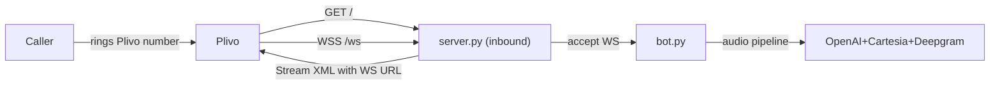
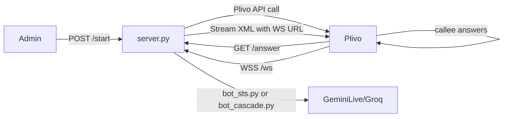
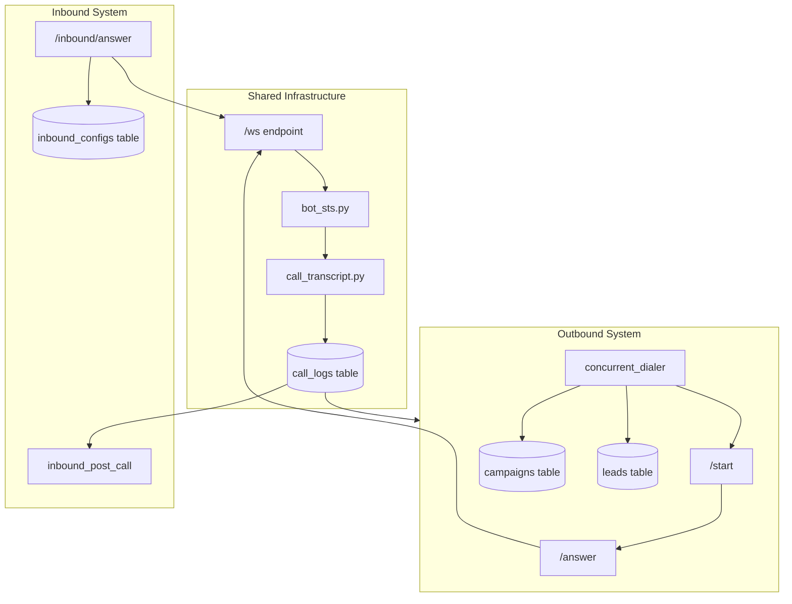

# Aakashvani — SPA, Admin Panel & Inbound Integration Briefing

> **Date:** 2 June 2026  
> **Context:** Phase 2 backend is done. Two people ready to work: you (admin panel) + coworker (client SPA). Plus: evaluating Pipecat/Plivo inbound integration.

---

## Table of Contents

1. [Readiness Assessment — Can You Start?](#1-readiness-assessment)
2. [Briefing for Your Coworker — Client SPA](#2-client-spa-briefing)
3. [Briefing for You — Admin Panel](#3-admin-panel-briefing)
4. [Shared Concerns — Both Must Read](#4-shared-concerns)
5. [Inbound Bot Integration — Full Analysis](#5-inbound-bot-integration)
6. [Architectural Issues & Recommendations](#6-architectural-issues)

---

## 1. Readiness Assessment

> [!TIP]
> **Yes, you're ready to start both.** The backend is solid.

### What's built and stable

| Layer | Status | Key files |
|-------|--------|-----------|
| **Auth — Admin** | ✅ Done | `X-Admin-Key` header, `require_admin` dep in [auth.py](file:///home/satyam/aakashvani/api/auth.py) |
| **Auth — Client** | ✅ Done | `Bearer` token → SHA-256 lookup, `get_client_from_token` dep |
| **Admin API (`/internal/*`)** | ✅ Done | [internal.py](file:///home/satyam/aakashvani/api/routes/internal.py) — clients, bot-configs, campaigns, credits, webhooks, calls |
| **Client API (`/api/*`)** | ✅ Done | [campaigns.py](file:///home/satyam/aakashvani/api/routes/campaigns.py), [leads.py](file:///home/satyam/aakashvani/api/routes/leads.py), [calls.py](file:///home/satyam/aakashvani/api/routes/calls.py), [credits.py](file:///home/satyam/aakashvani/api/routes/credits.py) |
| **DB schema (Postgres)** | ✅ Done | `clients`, `bot_configs`, `campaigns`, `leads`, `call_logs`, `webhook_configs` — [001_initial.sql](file:///home/satyam/aakashvani/db/schema/001_initial.sql) |
| **Query layer** | ✅ Done | 63 KB [postgres.py](file:///home/satyam/aakashvani/db/postgres.py) — all CRUD, counters, budget, dialer, billing |
| **Dialer** | ✅ Done | [concurrent_dialer.py](file:///home/satyam/aakashvani/dialer/concurrent_dialer.py) — `FOR UPDATE SKIP LOCKED` |
| **Post-call pipeline** | ✅ Done | [post_call_processor.py](file:///home/satyam/aakashvani/post_call_processor.py) — lead state machine, billing, counters, webhooks |
| **CORS** | ✅ Done | `allow_origins=["*"]` in [server.py](file:///home/satyam/aakashvani/server.py#L226-L231) — wide open for dev |

### What's NOT built (your work)

- ❌ No frontend at all (no React, no HTML pages)
- ❌ No pre-upload data cleaning report (API exists, but no dry-run mode yet)
- ❌ No single test call from SPA
- ❌ No `draft`-only enforcement on `PATCH .../start` (currently accepts `draft` OR `paused`)
- ❌ No recording playback (Phase 4)
- ❌ No Razorpay (Phase 3)

---

## 2. Client SPA Briefing

> **Send this section to your coworker.**

### 2.1 Auth Model

```
Authorization: Bearer <client_api_key>
```

- Key created via admin `POST /internal/clients` — shown **once**, hashed (SHA-256) in DB
- Every `/api/*` route validates via [get_client_from_token](file:///home/satyam/aakashvani/api/auth.py#L35-L53)
- Admin key explicitly rejected on client routes (line 46-47)
- Store token in `localStorage` or secure cookie — no JWT, no refresh tokens, no OAuth yet
- For the SPA login: since there's no login endpoint, the simplest approach is a token-entry screen ("paste your API key") — this matches the managed service model

### 2.2 Pages to Build

| Route | Purpose | Primary API |
|-------|---------|-------------|
| `/dashboard` | Live overview: active campaigns, credit balance, calls in progress | `GET /api/campaigns` + `GET /api/credits` |
| `/campaigns` | Campaign list with status badges, counters | `GET /api/campaigns` |
| `/campaigns/new` | Create campaign (admin pre-creates via `/internal/campaigns` — but client uploads leads here) | N/A — campaigns are admin-created, client sees them in draft |
| `/campaigns/:id` | Campaign detail — lead table, counters, start/stop/cancel buttons | `GET /api/campaigns/:id/stats`, `GET /api/campaigns/:id/leads` |
| `/campaigns/:id` (draft) | Draft workspace: upload CSV, edit/delete/add leads, test call, start | Upload + CRUD leads + `PATCH .../start` |
| `/calls` | Paginated call log with filters | `GET /api/calls?limit=50&offset=0` |
| `/calls/:id` | Call detail: transcript viewer, extraction fields, metadata | `GET /api/calls/:session_call_id` |
| `/credits` | Balance bar, usage summary | `GET /api/credits` |

### 2.3 Full API Contract Reference

#### Campaigns

```
GET    /api/campaigns                           → { campaigns: [...] }
GET    /api/campaigns/:id/stats                  → { stats: { ...campaign with counters } }
POST   /api/campaigns/:id/leads/upload           → multipart file upload → { leads_uploaded, invalid_phones, ... }
PATCH  /api/campaigns/:id/start                  → { status: "running", ... }
PATCH  /api/campaigns/:id/stop                   → { status: "paused", ... }
PATCH  /api/campaigns/:id/cancel                 → { campaign_id, status: "cancelled", ... }
```

#### Leads (all under `/api/campaigns/:campaign_id/leads`)

```
GET    .../leads?limit=50&offset=0&status=pending  → { leads: [...] }
GET    .../leads/:lead_id                           → { lead: {...} }
POST   .../leads                                    → { lead: {...}, dnc: bool }  (single add)
PATCH  .../leads/:lead_id                           → { lead: {...} }  (edit name/lead_type/metadata)
DELETE .../leads/:lead_id                           → { deleted: true, counters: {...} }
PATCH  .../leads/:lead_id/status                    → { lead: {...}, transition: "..." }
```

#### Calls & Credits

```
GET    /api/calls?limit=50&offset=0              → { calls: [...] }
GET    /api/calls/:session_call_id               → { calls: [row] }
GET    /api/credits                               → { balance_credits, max_concurrent_calls }
```

### 2.4 Critical Things to Know

> [!IMPORTANT]
> **These will bite you if ignored.**

1. **Campaign lifecycle:** `draft → running → paused ↔ running → completed/cancelled`. Lead mutations only allowed in `draft` or `paused`. The backend enforces this via [require_campaign_modifiable](file:///home/satyam/aakashvani/api/guards.py#L8-L28).

2. **Live transcript polling:** `call_logs` has `in_progress: true` while a call is live. The transcript JSON array grows turn-by-turn. Poll `GET /api/calls/:session_call_id` every 3s while `in_progress` is true. Stop polling when it flips to false. There's a partial index [idx_call_logs_live](file:///home/satyam/aakashvani/db/schema/001_initial.sql#L524-L526) optimized for this.

3. **CSV upload:** The upload endpoint expects a `multipart/form-data` file. It validates against `LEAD_SCHEMA` from the bot's script module. Phone numbers are normalized to E.164. DNC numbers are auto-flagged.

4. **Denormalized counters:** Campaign objects have `total_leads`, `pending_leads`, `calling_leads`, `completed_leads`, etc. — use these for dashboards. **Never** `COUNT(*)` on the frontend.

5. **Campaign start returns extra info:** The response includes `released_calling_leads` and `bumped_pending_retry` counts — show these as notifications.

6. **Error codes to handle:**
   - `401` — invalid/missing token
   - `403` — admin key used on client route
   - `404` — campaign/lead not found
   - `409` — wrong lifecycle state (can't modify running campaign, lead is calling, invalid status transition)
   - `422` — validation errors (bad phone, invalid lead_type)
   - `503` — Postgres not available

7. **No pagination metadata yet:** The API returns `leads` array with `limit` and `offset` echoed back, but no `total_count`. You'll need to infer "has more" from `len(leads) == limit`. (Suggest adding `total_count` to the API.)

### 2.5 Tech Stack Recommendation

- **Vite + React** (or Next.js if SSR matters — it doesn't for a dashboard)
- **React Router** for client-side routing
- Deploy as static build behind nginx alongside the API
- Use `fetch` or `axios` with an interceptor that injects the Bearer token

### 2.6 What NOT to Build Yet

- ❌ Bot configuration UI (Phase 3)
- ❌ Razorpay recharge (Phase 3 — show balance only, with a "Contact us to recharge" placeholder)
- ❌ Analytics charts (Phase 3)
- ❌ Audio player (Phase 4 — no recordings yet)
- ❌ SSE/WebSocket live monitor (Phase 3)

---

## 3. Admin Panel Briefing

### 3.1 What You Own

The admin panel is an **internal tool** (not client-facing). It manages the platform:

- Create clients
- Create bot configs
- Create campaigns
- Top up credits
- Configure webhooks
- View all calls (cross-client)
- Monitor system health

### 3.2 Admin API Endpoints (Already Built)

All under `/internal/*`, authenticated via `X-Admin-Key` header:

```
POST   /internal/clients                         → create client, get one-time API key
GET    /internal/clients                          → list all clients
PATCH  /internal/clients/:id/credits              → add credits (amount + note)

POST   /internal/bot-configs                      → create bot config (client_id, route, script_id, etc.)
GET    /internal/bot-configs                       → list all bot configs

POST   /internal/campaigns                        → create campaign (client_id, bot_config_id, budget, throttle)
PATCH  /internal/campaigns/:id                     → update campaign settings (needs client_id in body)

POST   /internal/webhook-configs                   → upsert webhook config (client_id, event, url, secret)

GET    /internal/calls?limit=50&offset=0           → list all calls (all clients)
```

### 3.3 Admin Panel Pages

| Route | Purpose |
|-------|---------|
| `/admin/clients` | Client list with balance, active status |
| `/admin/clients/:id` | Client detail: balance, campaigns, bot configs, credit history |
| `/admin/clients/new` | Create client form → **display API key once** |
| `/admin/credits/:client_id` | Credit top-up form |
| `/admin/bot-configs` | Bot config list |
| `/admin/bot-configs/new` | Create bot config (dropdowns for route, script_id validated) |
| `/admin/campaigns` | All campaigns across clients |
| `/admin/campaigns/new` | Create campaign for a client |
| `/admin/calls` | Cross-client call log |
| `/admin/webhooks` | Webhook config management |

### 3.4 Things You Need to Handle

> [!WARNING]
> **API key display:** When you create a client, the response includes `api_key` in plaintext — **this is shown once and never again**. Your UI MUST display it prominently with a copy button and a warning. After navigation, it's gone forever.

1. **Credit top-up note:** Always include a `note` field (e.g., "Bank transfer received 1-Jun-2026"). This is audit trail.

2. **Bot config script_id validation:** Must match `^[a-z][a-z0-9_]*$`. List available scripts from filesystem (`sts_scripts/` and `cascade_scripts/`). Currently no API endpoint for this — either hardcode known scripts or add one.

3. **Campaign creation requires budget pre-allocation:** `budget_credits` is deducted from `clients.balance_credits` atomically. If the client doesn't have enough, creation fails with 400.

4. **PATCH campaigns needs `client_id` in body** — this is a known quirk (noted in ROADMAP as a "handoff item"). Admin patches campaigns by passing the client_id they belong to.

### 3.5 Missing API Endpoints You Might Want

| Need | Status | Suggestion |
|------|--------|------------|
| List available script modules | ❌ Not built | `GET /internal/scripts` — scan `sts_scripts/` + `cascade_scripts/` |
| Client credit history/ledger | ❌ Not built | Query credit transactions (no table for this yet) |
| System health dashboard | ❌ Not built | `GET /health` exists but minimal — add dialer status, active calls count |
| Bulk operations | ❌ Not built | Bulk credit top-up, bulk campaign ops |

---

## 4. Shared Concerns — Both Must Read

### 4.1 Coordinate on These

1. **Same codebase or separate repos?** Recommend: **separate repos** for client SPA and admin panel, both deployed as static builds behind nginx. They share no code beyond API client utils.

2. **API base URL:** In dev, both hit `http://localhost:7860`. In prod, nginx routes:
   - `*.aakashvani.in` → React SPA (client)
   - `admin.aakashvani.in` → Admin panel
   - Both proxy `/api/*` and `/internal/*` to FastAPI on port 7860

3. **CORS is wide open (`*`)** in dev. In prod, lock it down to specific origins.

4. **Date formats:** All timestamps from the API are ISO 8601 UTC (`2026-05-16T10:00:01Z`). Convert to IST for Indian clients on the frontend.

5. **UUID everywhere:** All IDs are UUIDs (v4). Type them as `string` in your frontend models.

6. **No WebSocket on the frontend yet.** All data is REST polling. SSE/WS for live updates is Phase 3.

### 4.2 Suggested Shared Design System

Since both panels serve the same platform:
- Use the same color palette, typography (Inter/Outfit), and component library
- Dark mode default for admin, light mode for client (or user preference)
- Credit balance widget in both (top-right header)

### 4.3 API Error Handling Pattern

```typescript
// Shared error handler
async function apiCall(url: string, options: RequestInit) {
  const res = await fetch(url, options);
  if (!res.ok) {
    const body = await res.json().catch(() => ({ detail: res.statusText }));
    throw new ApiError(res.status, body.detail || body);
  }
  return res.json();
}
```

Common error codes: `401` (auth), `403` (wrong auth type), `404` (not found), `409` (lifecycle conflict), `422` (validation), `503` (DB down).

---

## 5. Inbound Bot Integration — Full Analysis

### 5.1 Is Integration Possible?

> [!TIP]
> **Yes, integration is absolutely possible** — and it's architecturally clean because the Pipecat Plivo inbound pattern is almost identical to what you already have. The key insight: your existing `/ws` endpoint + `bot_sts.py` pipeline is 90% of what inbound needs.

### 5.2 How The Pipecat Plivo Inbound Sample Works

The sample code you shared does this:



Your existing outbound flow:



**The critical overlap:** Both end up at the same place — a WebSocket with Plivo audio, a `PlivoFrameSerializer`, and a Pipecat pipeline. The only differences are:

1. **Trigger:** Outbound = `POST /start` calls Plivo API. Inbound = Plivo calls your webhook.
2. **Number resolution:** Outbound = caller number from campaign. Inbound = which Plivo number was called (maps to a bot config).
3. **Lead context:** Outbound = lead metadata from CSV. Inbound = caller's phone number only (no pre-loaded context).
4. **No campaign/budget:** Inbound calls are not part of a campaign dialer cycle.

### 5.3 Integration with Gemini STS Route — Specifically

**This works beautifully with STS.** Here's why:

- The STS pipeline in [bot_sts.py](file:///home/satyam/aakashvani/bot_sts.py) doesn't depend on campaign/lead context for the audio pipeline itself
- `LeadContext.from_body(body)` gracefully handles empty bodies (defaults to empty name)
- The script's `build_system_instruction(ctx)` and `build_bootstrap_messages(ctx)` already accept a context object — for inbound, you'd pass a minimal context with just the caller's phone number
- Gemini Live is the **best route for inbound** (as noted in your ROADMAP: "Best for: Inbound, complex conversational scenarios")
- The `PlivoFrameSerializer` is identical for inbound and outbound — same 8kHz µ-law codec

### 5.4 Proposed Architecture — Inbound Under `clients` Table

> [!IMPORTANT]
> Keeping inbound **under the `clients` table but separate from outbound campaigns** is the right call.

#### New DB Objects

```sql
-- Inbound bot configs — links a Plivo DID to a bot + client
-- Separate from outbound bot_configs to avoid confusion
-- One DID can only be assigned to one inbound config at a time
CREATE TABLE inbound_configs (
    id                  UUID PRIMARY KEY DEFAULT gen_random_uuid(),
    client_id           UUID NOT NULL REFERENCES clients(id) ON DELETE CASCADE,
    
    -- The Plivo DID that triggers this inbound bot
    plivo_did           VARCHAR(20) NOT NULL UNIQUE,
    -- e.g., '+912240001234'
    
    -- Which script to run (reuses existing script module system)
    route               VARCHAR(20) NOT NULL CHECK (route IN ('sts', 'cascaded')),
    script_id           VARCHAR(100) NOT NULL,
    
    -- Billing
    credits_per_minute  NUMERIC(6,2) NOT NULL,
    
    -- Optional: max call duration for inbound
    max_call_minutes    INTEGER DEFAULT 30,
    
    -- Whether this inbound config is active
    active              BOOLEAN DEFAULT TRUE,
    
    created_at          TIMESTAMPTZ DEFAULT NOW()
);

-- Inbound call logs — same structure as outbound call_logs
-- but campaign_id and lead_id are NULL (no campaign context)
-- The existing call_logs table already supports NULL campaign_id and lead_id!
-- So you can actually REUSE call_logs as-is.
```

#### Why Reuse `call_logs` (Not a New Table)

Looking at [call_logs schema](file:///home/satyam/aakashvani/db/schema/001_initial.sql#L324-L438):

```sql
campaign_id  UUID REFERENCES campaigns(id),  -- already NULLABLE
lead_id      UUID REFERENCES leads(id),       -- already NULLABLE
```

Both are already nullable! You can insert inbound calls into `call_logs` with:
- `campaign_id = NULL`
- `lead_id = NULL` 
- `client_id = <resolved from inbound_config>`
- A new column or `call_data` JSONB field: `{"direction": "inbound", "inbound_config_id": "...", "caller_phone": "+91..."}`

#### Server-Side Changes

```python
# New route in server.py — Plivo webhook for inbound calls

@app.api_route("/inbound/answer", methods=["GET", "POST"])
async def inbound_answer(
    request: Request,
    CallUUID: str = Query(None),
    From: str = Query(None),  # caller's phone
    To: str = Query(None),    # your Plivo DID
):
    """
    Plivo hits this when someone calls your DID.
    Resolves which client+bot to use from the 'To' number.
    Returns <Stream> XML pointing to /inbound/ws.
    """
    pool = getattr(request.app.state, "pool", None)
    if pool is None:
        raise HTTPException(503, "DB not available")
    
    # Look up inbound_config by the DID that was called
    config = await pg_db.get_inbound_config_by_did(pool, To)
    if config is None:
        # No config for this number — play a sorry message or reject
        xml = '<?xml version="1.0"?><Response><Speak>Sorry, this number is not configured.</Speak></Response>'
        return HTMLResponse(content=xml, media_type="application/xml")
    
    # Generate session call ID
    call_id = str(uuid.uuid4())
    
    # Create call_log row immediately (in_progress=True)
    await pg_db.insert_inbound_call_log(pool, call_id, config, From, CallUUID)
    
    # Optionally prewarm Gemini (same as outbound)
    if config["route"] == "sts":
        event = asyncio.Event()
        _warmup_ready[call_id] = event
        asyncio.create_task(_prewarm_gemini(call_id))
        try:
            await asyncio.wait_for(event.wait(), timeout=3.0)
        except asyncio.TimeoutError:
            pass
        finally:
            _warmup_ready.pop(call_id, None)
    
    # Build body_data with inbound context
    body_data = {
        "phone_number": From,
        "direction": "inbound",
        "inbound_config_id": str(config["id"]),
        "_session_call_id": call_id,
        "_pg": {
            "client_id": str(config["client_id"]),
            "bot_config_id": str(config["id"]),  # inbound_config acts as bot_config
            "route": config["route"],
            "script_id": config["script_id"],
            "credits_per_minute": float(config["credits_per_minute"]),
            "max_call_minutes": config.get("max_call_minutes"),
            # No lead_id, no campaign_id
        },
    }
    
    host = request.headers.get("host", "localhost")
    ws_url = f"wss://{host}/ws"
    encoded = base64.b64encode(json.dumps(body_data).encode()).decode()
    ws_url += f"?call_id={call_id}&body={urllib.parse.quote(encoded)}"
    
    xml = f"""<?xml version="1.0" encoding="UTF-8"?>
<Response>
  <Stream bidirectional="true" keepCallAlive="true" contentType="audio/x-mulaw;rate=8000">
    {ws_url}
  </Stream>
</Response>"""
    
    return HTMLResponse(content=xml, media_type="application/xml")
```

#### Key Design Decision: Reuse `/ws` or New `/inbound/ws`?

**Recommend: Reuse the existing `/ws` endpoint.** Here's why:

1. The existing `/ws` already resolves the bot dynamically via `_resolve_bot(body_data)` based on `_pg.route`
2. The `bot_sts.py` and `bot_cascade.py` already handle arbitrary body data
3. The transcript + extraction pipeline works the same way
4. You just need the inbound answer webhook to construct the right `body_data`

The only change needed in `bot_sts.py`:
- Make `process_post_call` handle `lead_id=None` gracefully (skip lead state machine, just finalize `call_logs`)
- Or create a lighter `process_inbound_post_call` that only does billing

### 5.5 Billing for Inbound

Two options:

| Option | How it works | Pros | Cons |
|--------|-------------|------|------|
| **A: Deduct from client balance directly** | `credits_charged` deducted from `clients.balance_credits` at call end | Simple, no campaign overhead | No budget cap — a flood of inbound calls could drain balance |
| **B: Inbound "pool" budget** | Admin sets an `inbound_monthly_budget` on client; tracked separately | Budget safety | More complexity, another counter to manage |

**Recommendation:** Start with **Option A** (direct deduction). Add a soft safeguard: if `clients.balance_credits < 5`, reject new inbound calls with a "credits exhausted" voice message. You can add budget caps later.

### 5.6 How to Keep Inbound Separate from Outbound



**Separation boundaries:**
- `call_logs.campaign_id IS NULL` = inbound call
- `call_logs.call_data->>'direction' = 'inbound'` = inbound call  
- No leads table involvement for inbound
- No dialer involvement for inbound
- Shared: pipeline, transcript, extraction, billing deduction from `clients.balance_credits`

### 5.7 Implementation Checklist

```
□ 1. Create `inbound_configs` table (Alembic migration)
□ 2. Add `pg_db.get_inbound_config_by_did()` query function
□ 3. Add `pg_db.insert_inbound_call_log()` (call_logs with campaign_id=NULL)
□ 4. Add `pg_db.deduct_inbound_credits()` (direct balance deduction)
□ 5. Add `/inbound/answer` route in server.py
□ 6. Modify `call_transcript.py` finalize to handle no pg_ctx lead_id
□ 7. Create `inbound_post_call.py` — lighter version of post_call_processor
□ 8. Add admin endpoints: POST/GET /internal/inbound-configs
□ 9. Configure Plivo DID to point answer_url to /inbound/answer
□ 10. Write an inbound-specific script (e.g., sts_scripts/inbound_support.py)
□ 11. Test end-to-end: call DID → hear bot → transcript in call_logs
```

---

## 6. Architectural Issues & Recommendations

### 6.1 Issues in the Current System

> [!WARNING]
> **Address before going to production.**

| # | Issue | Severity | Where |
|---|-------|----------|-------|
| 1 | **`credits_per_minute` not snapshotted** | Medium | [post_call_processor.py:138](file:///home/satyam/aakashvani/post_call_processor.py#L138) reads live from `bot_configs` — if you change the rate mid-campaign, already-running calls bill at the new rate |
| 2 | **No `total_count` in paginated responses** | Low | [leads.py](file:///home/satyam/aakashvani/api/routes/leads.py) and [calls.py](file:///home/satyam/aakashvani/api/routes/calls.py) — SPA can't show "page X of Y" |
| 3 | **`PATCH /api/campaigns/:id/start` accepts `paused`** | Medium | [campaigns.py:171](file:///home/satyam/aakashvani/api/routes/campaigns.py#L171) — ROADMAP says Phase 2 priority #4 is "draft-only start" |
| 4 | **No rate limiting on API** | High | No `slowapi` or similar — a misbehaving client could hammer the server |
| 5 | **Admin PATCH campaigns requires `client_id` in body** | Low | [internal.py:174](file:///home/satyam/aakashvani/api/routes/internal.py#L174) — should look up from campaign |
| 6 | **No script listing endpoint** | Low | Admin panel needs to know valid `script_id` values |
| 7 | **`call_transcript.py` finalize assumes `_pg.lead_id` exists** | Medium | [call_transcript.py:416](file:///home/satyam/aakashvani/call_transcript.py#L416) — will crash on inbound calls without a lead |
| 8 | **CostGuard is soft** | Low | Documented: possible ~1 call budget overshoot under concurrent dialer — acceptable |

### 6.2 Design Choices for Inbound

| Decision | Options | Recommendation |
|----------|---------|----------------|
| **Separate WebSocket endpoint?** | `/ws` (shared) vs `/inbound/ws` (new) | **Shared `/ws`** — less code duplication, body_data differentiates |
| **Separate call_logs table?** | Reuse `call_logs` vs new `inbound_call_logs` | **Reuse `call_logs`** — schema already supports NULL campaign_id/lead_id |
| **Separate bot files?** | New `bot_inbound_sts.py` vs reuse `bot_sts.py` | **Reuse `bot_sts.py`** — script module system handles different prompts |
| **Inbound scripts location** | Under `sts_scripts/` | Yes — e.g., `sts_scripts/inbound_realestate.py` with inbound-focused prompts |
| **Prewarm for inbound?** | Yes/No | **Yes** — caller is waiting, every second matters. Prewarm in the `/inbound/answer` handler before returning XML |
| **Extraction for inbound?** | Same Groq extraction? | **Yes** — use `EXTRACTION_SCHEMA` from the script, same pipeline. Inbound calls produce transcripts, transcripts get extracted |
| **Webhook for inbound?** | Per-event webhooks | **Yes** — fire `inbound_call_completed` event to n8n. Client can route to CRM/Slack/WhatsApp |

### 6.3 Inbound-Specific Script Differences

An inbound script (`sts_scripts/inbound_support.py`) differs from outbound in:

1. **System prompt:** "You are receiving a call from a customer" instead of "You are calling a lead"
2. **Bootstrap messages:** Don't say "Hello, am I speaking to {lead_name}?" — instead say "Thank you for calling, how can I help you?"
3. **No lead context injection** — the caller is unknown
4. **Extraction schema:** Different fields — instead of `intent_status: Interested/Not_Interested`, extract `inquiry_type`, `customer_issue`, `resolution_status`
5. **Goodbye markers:** Same concept, different phrases (customer says "bye" vs sales agent signs off)
6. **No `push_lead_data` tool** — there's no lead to push to

### 6.4 Production Deployment Considerations

```
nginx config needed:
  *.aakashvani.in           → React SPA (client)
  admin.aakashvani.in       → Admin panel
  api.aakashvani.in/api/*   → FastAPI client routes
  api.aakashvani.in/internal/* → FastAPI admin routes (allow 127.0.0.1 only)
  
  # Plivo webhooks (must be publicly accessible):
  api.aakashvani.in/answer          → outbound answer
  api.aakashvani.in/inbound/answer  → inbound answer
  api.aakashvani.in/ws              → WebSocket (both directions)
  api.aakashvani.in/plivo-hangup    → hangup webhook
```

> [!CAUTION]
> **`/internal/*` MUST be firewalled** in production. Never expose admin endpoints to the public internet. nginx `allow 127.0.0.1; deny all;` on the `/internal/` location.

---

## Quick Reference: Who Builds What

| Item | You (Admin Panel) | Coworker (Client SPA) |
|------|-------------------|----------------------|
| Client CRUD | ✅ | ❌ |
| Bot config CRUD | ✅ | ❌ |
| Campaign creation | ✅ | ❌ |
| Credit top-up | ✅ | ❌ |
| Webhook config | ✅ | ❌ |
| Cross-client call viewer | ✅ | ❌ |
| Inbound config mgmt | ✅ | ❌ |
| Campaign list/detail | ❌ | ✅ |
| Lead upload + CRUD | ❌ | ✅ |
| Start/stop/cancel campaigns | ❌ | ✅ |
| Call log + transcript viewer | ❌ | ✅ |
| Credit balance display | ❌ | ✅ |
| Dashboard overview | ❌ | ✅ |
