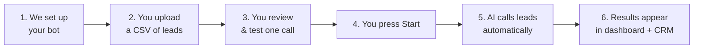
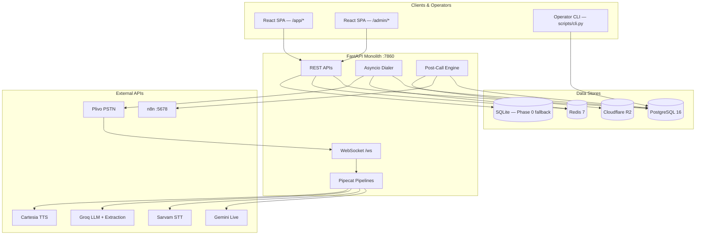
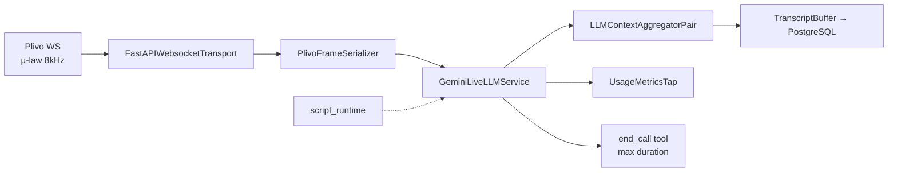
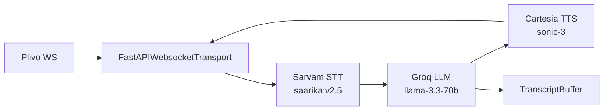
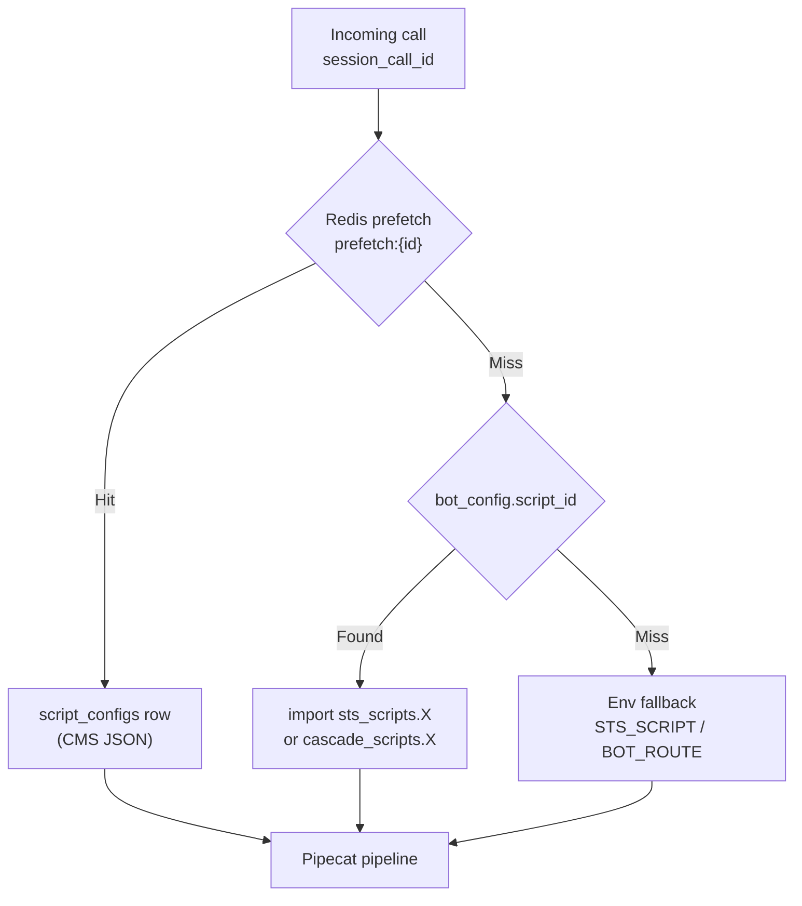
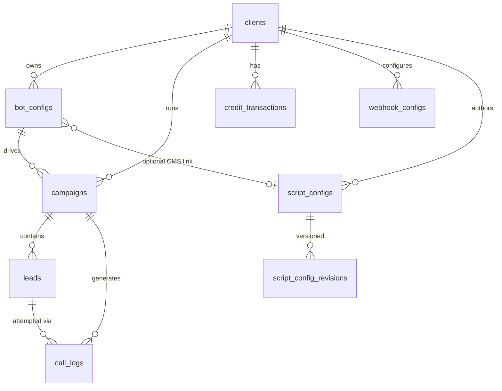
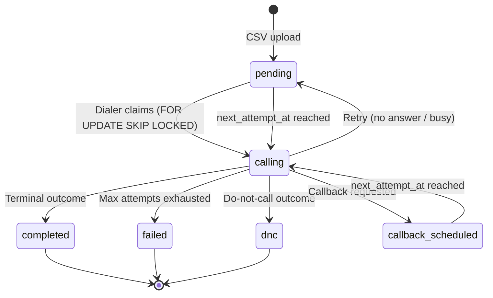
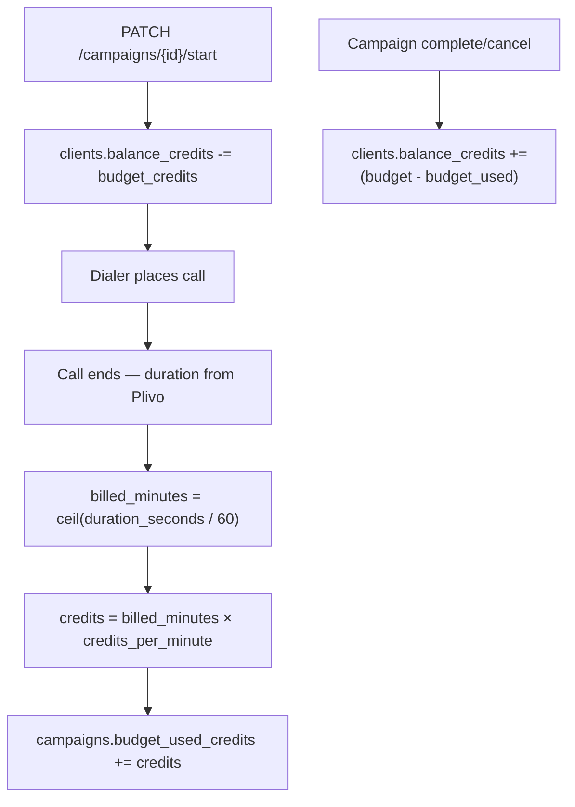
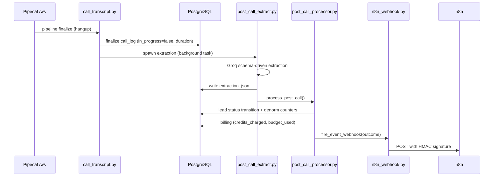

# Aakashvani — Complete Introduction

> **The single starting point for understanding this project.**
> Written for business stakeholders, operators, and engineers. Read the section that matches your role — or read both for the full picture.

---

## How to use this document

| If you are… | Start here |
|-------------|------------|
| A **client**, investor, or non-technical teammate | [Part 1 — For Everyone (Non-Technical)](#part-1--for-everyone-non-technical) |
| An **engineer**, DevOps person, or technical operator | [Part 2 — For Technical People](#part-2--for-technical-people) |
| Looking for **deep schema / API contracts** | [guides/aakash_arch.md](aakash_arch.md) (source of truth) |
| Setting up your **local machine** | [README.md](../README.md) |
| Understanding **long-term vision & phases** | [ROADMAP.md](../ROADMAP.md) |

**Document hierarchy (when docs disagree):**

1. `guides/aakash_arch.md` — database, billing, API contracts
2. `ROADMAP.md` — vision, phases, pricing strategy
3. `README.md` — how to run locally
4. This file — overview and onboarding

---

# Part 1 — For Everyone (Non-Technical)

## What is Aakashvani?

**Aakashvani** (आकाशवाणी — “voice from the sky”) is a **managed AI phone-calling service** built for Indian small and medium businesses (SMBs).

In simple terms: **we make AI bots that call your leads on the phone**, have real conversations in Indian languages (Hindi, Marathi, English, and more), and hand you structured results — who is interested, who wants a callback, who said no, and why.

### What Aakashvani is NOT

- **Not a DIY chatbot builder** — clients do not write prompts or configure AI models themselves.
- **Not a generic global SaaS** — it is built for India: local languages, TRAI calling rules, INR billing, Indian phone numbers.
- **Not a replacement for your CRM** — it feeds your CRM (via automated workflows we set up for you).

### What clients buy

Clients buy **outcomes**, not software:

| Outcome | What it means |
|---------|---------------|
| **Qualified conversations** | AI calls leads and determines interest level |
| **Structured data** | Every call produces JSON fields (budget, location, intent, callback time, etc.) |
| **CRM handoff** | Results automatically flow into the client’s Sheets, CRM, Slack, or WhatsApp |
| **Operational visibility** | Live call progress, transcripts, and call history in a web dashboard |

### What the Aakashvani team owns

| We handle | You (client) handle |
|-----------|---------------------|
| Bot personality, scripts, and voice | Upload your lead list (CSV) |
| Which AI technology to use | Start, pause, or stop campaigns |
| Phone number (Plivo) setup | Watch calls and read results |
| CRM / n8n workflow integration | Maintain your credit balance |
| Server, database, and security | Provide leads with proper consent |

Think of it like hiring a **managed call centre powered by AI** — you bring the leads, we run the calls and deliver the data.

---

## Who is it for?

**Target industries:**

- Real estate (property inquiries, site visits)
- Insurance (policy renewals, lead qualification)
- Edtech (course inquiries, demo scheduling)
- Lending / credit cards (application follow-ups)
- Healthcare (appointment reminders, intake)
- Any Indian SMB doing **outbound lead qualification**

**Typical client profile:** A business that today pays human call-centre agents ₹25–40 per connected call and wants faster, cheaper, 24/7 coverage with consistent quality and structured output after every conversation.

---

## How a campaign works (plain English)

Here is the end-to-end journey, step by step:



### Step 1 — Onboarding (done by Aakashvani team)

Before a client ever logs in, our team:

1. Creates the client account and assigns an API key (for dashboard login).
2. Configures a **bot** — language, voice, conversation script, what questions to ask.
3. Sets up an **n8n workflow** that sends call results to the client’s CRM, Google Sheet, Slack, etc.
4. Assigns a Plivo phone number that appears as caller ID.
5. Tops up initial credits.

**One-time setup fee (planned pricing):** ₹15,000 — includes first CRM workflow build.

### Step 2 — Upload leads

The client uploads a CSV file with phone numbers and any extra columns the bot needs (name, city, budget, etc.).

Before leads are saved, the system:

- Validates phone numbers and converts them to international format (+91…).
- Checks required fields against the bot’s schema.
- Flags duplicates and invalid rows.
- Shows a **pre-upload report** so bad data does not waste credits.

### Step 3 — Review in draft mode

While the campaign is in **draft** status, the client can:

- Edit individual lead details.
- Delete bad leads.
- Manually add a single lead.
- Run **one test call** to hear the bot before going live.

Nothing is dialed automatically until the client explicitly starts the campaign.

### Step 4 — Start the campaign

When the client presses **Start**:

1. Credits are reserved from the client’s balance (campaign budget).
2. The **dialer** begins calling leads one after another (or several in parallel, within limits).
3. Calls only happen between **9:00 AM and 9:00 PM IST** (Indian telecom rules).
4. The client can watch live progress in the dashboard.

### Step 5 — What happens on each call

1. The lead’s phone rings. Caller ID shows a registered Indian number.
2. When they answer, an **AI voice** greets them — often by name — and follows the script.
3. The conversation is recorded as a **live transcript** (visible in the dashboard while the call is in progress).
4. When the call ends, AI reads the transcript and extracts structured fields (e.g. “Interested: Yes”, “Budget: 80L”, “Callback: tomorrow 4pm”).
5. The lead’s status updates (completed, callback scheduled, failed, do-not-call, etc.).
6. If configured, a **webhook** fires to n8n → client’s CRM gets updated automatically.

### Step 6 — Review results

The client can:

- See all calls with transcripts and extracted data.
- Filter by outcome, date, or campaign.
- Check credit usage and remaining balance.
- Pause or stop the campaign at any time.

Unused campaign budget is returned to the client’s balance when the campaign completes or is cancelled.

---

## The two types of AI voice

Aakashvani supports two calling technologies. **Clients do not choose this** — we assign the best route per bot during setup.

| | **Route A — Cascaded** | **Route B — Speech-to-Speech (STS)** |
|---|------------------------|--------------------------------------|
| **How it works** | Listen → Think → Speak (3 separate AI steps) | Single AI handles listening and speaking together |
| **Speed** | ~1.5–2.5 seconds per response | ~0.5–1 second per response |
| **Best for** | Tight sales scripts, precise qualification flows | Natural, flowing conversations |
| **Indian languages** | Excellent (dedicated Indian speech engine) | Good (Hindi, Marathi, English) |
| **Analogy** | Like a translator reading, thinking, then speaking | Like talking directly to a fluent speaker |

Both routes produce the same end result: a transcript and structured extraction after the call.

---

## Credits and pricing (business view)

### How credits work

- Clients buy **credits** upfront (prepaid model).
- At launch: **1 credit = ₹1**.
- Volume packs can offer better rates later (e.g. 2,000 credits for ₹1,800).
- Clients only pay for **connected call time** — failed dials and no-answers are free.

### How calls are charged

Billing uses **ceiling minutes**:

| Call duration | Billed as |
|---------------|-----------|
| 30 seconds | 1 minute |
| 61 seconds | 2 minutes |
| 5 minutes 1 second | 6 minutes |

Each bot has a per-minute credit rate (set by us, not visible to clients). Clients see total credits consumed.

### Campaign budgets

When a campaign starts, credits are **reserved** from the client’s balance. As calls complete, credits are deducted from that reservation. When the campaign ends, any unused reserved credits go back to the client’s main balance.

### Example credit packs (illustrative)

| Pack | Credits | Price | Effective rate |
|------|---------|-------|----------------|
| Starter | 1,000 | ₹1,000 | ₹1.00 / credit |
| Growth | 2,000 | ₹1,800 | ₹0.90 / credit |
| Scale | 5,000 | ₹4,000 | ₹0.80 / credit |
| Pro | 12,000 | ₹8,400 | ₹0.70 / credit |

### Why it is cheaper than humans

| | Human call-centre agent | Aakashvani AI |
|---|-------------------------|---------------|
| Cost per 5-min call | ₹25–40 | ~₹7 (our cost) |
| Client price | ₹5–8 / min equivalent | ₹6–12 / min |
| Availability | Shift hours | 24/7 |
| Consistency | Varies by agent | Same script every time |
| Data output | Manual notes | Structured JSON every call |
| Languages | Limited | Hindi, Marathi, English, more |

### One-time and add-on fees (planned)

| Service | Fee |
|---------|-----|
| Platform setup (includes first CRM workflow) | ₹15,000 |
| n8n workflow update | ₹2,000 / update |
| Additional bot configuration | ₹5,000 / bot |
| WhatsApp follow-up message | ₹0.50 / message |
| Premium voice | +₹2 / min |

---

## Lead outcomes (what happens after a call)

Every call produces an **outcome** that updates the lead’s status:

| Outcome | What it means | Lead status |
|---------|---------------|-------------|
| **Qualified / Interested** | Lead wants to proceed | Completed ✓ |
| **Not interested** | Lead declined | Completed ✓ |
| **Callback requested** | Lead asked to be called back later | Scheduled for retry |
| **No answer / busy** | Could not connect | Retried (up to max attempts) |
| **Failed** | Max retries exhausted | Failed ✗ |
| **Do not call (DNC)** | Lead opted out | Permanently blocked |

The system automatically retries no-answers based on campaign settings (delay between attempts, maximum attempts).

---

## Compliance and trust

Aakashvani is designed for **legal, responsible outbound calling** in India:

| Rule | How we enforce it |
|------|-------------------|
| **Calling hours** | No calls before 9 AM or after 9 PM IST |
| **Do-not-call** | Internal opt-out list; DNC outcomes block future dials |
| **Caller ID** | Always shows a registered Plivo number |
| **Consent** | Clients must declare lead consent source; we store only necessary data |
| **Data privacy (DPDP Act 2023)** | Per-client data isolation; deletion on request supported |
| **Recordings** | Stored securely (not in the main database); access via time-limited links |

---

## Dashboards — what clients and admins see

### Client dashboard (`/app`)

| Page | Purpose |
|------|---------|
| **Dashboard** | Overview of campaigns, credit balance, recent activity |
| **Campaign detail** | Lead list, upload, draft editing, test call, start/stop |
| **Call logs** | All calls with transcripts and extracted data |
| **Settings** | Account settings |

Clients log in with an **API key** (like a password, shown once at account creation).

### Admin dashboard (`/admin`)

| Page | Purpose |
|------|---------|
| **Overview** | System-wide stats |
| **Clients** | Create clients, top up credits, manage accounts |
| **Client detail** | Per-client bots, campaigns, webhooks |
| **Bot configs** | Register bots (route, script, phone number, pricing) |
| **Script configs (CMS)** | Edit bot scripts, prompts, schemas with version history |
| **Campaigns** | Cross-tenant campaign management |
| **Calls** | Cross-tenant call inspection |
| **Webhooks** | Configure per-client CRM event URLs |
| **Diagnostics** | System health and debugging |

Admins use a separate **admin key** (never shared with clients).

---

## Project status (where we are today)

| Phase | What was built | Status |
|-------|----------------|--------|
| **Phase 0–1** | AI voice pipelines, real phone calls via Plivo, post-call data extraction | ✅ Done |
| **Phase 2** | Multi-client accounts, billing, campaign dialer, client + admin dashboards | ✅ Done |
| **Phase 3** | Bot configuration CMS (edit scripts in UI, revisions, rollbacks) | ✅ Done |
| **Phase 4** | Inbound calls, WhatsApp follow-ups, call recordings, browser testing | 🚧 In progress |
| **Phase 5** | Online payments (Razorpay), knowledge-base AI (if needed) | 📋 Planned |

---

## Glossary (plain English)

| Term | Meaning |
|------|---------|
| **Lead** | A person to be called (phone number + optional details) |
| **Campaign** | A batch of leads + one bot + a budget, run together |
| **Bot / Bot config** | The AI caller — its script, voice, language, and phone number |
| **Credits** | Prepaid currency used to pay for calls (1 credit ≈ ₹1) |
| **Transcript** | Word-for-word text of what was said on the call |
| **Extraction** | Structured data pulled from the transcript (intent, budget, etc.) |
| **Dialer** | The system that automatically places calls from a campaign |
| **Webhook** | An automatic notification sent to another system (e.g. CRM) when something happens |
| **n8n** | Internal workflow tool that routes call results to client systems |
| **Plivo** | Telecom provider that connects AI to real phone networks |
| **Draft** | Campaign state before going live — leads can still be edited |
| **STS** | Speech-to-Speech — fast, single-model AI voice |
| **Cascaded** | Multi-step AI voice (listen → think → speak) |
| **DNC** | Do Not Call — lead opted out permanently |
| **IST** | Indian Standard Time — all calling windows use this timezone |
| **E.164** | International phone format (e.g. +919876543210) |

---

## Frequently asked questions (non-technical)

**Q: Can I edit the bot’s script myself?**
No. Scripts are managed by the Aakashvani team (or via the admin CMS). This ensures quality, compliance, and consistent results. Clients can request changes; we implement them.

**Q: What file format do I upload for leads?**
CSV or Excel. Required column: phone number. Additional columns depend on the bot (name, city, budget, etc.) — we tell you during onboarding.

**Q: What happens if I run out of credits mid-campaign?**
The dialer pauses automatically. Top up credits and resume.

**Q: Can the bot handle Hindi and Marathi?**
Yes. Both voice routes support Indian languages. Route selection is optimized per use case by our team.

**Q: Do you call DND (Do Not Disturb) numbers?**
No. We maintain opt-out lists and enforce compliance checks before every dial.

**Q: How fast can you onboard a new client?**
After initial setup (bot + CRM workflow), a client can upload leads and start calling the same day.

**Q: Where is my data stored?**
In a secure PostgreSQL database with strict per-client isolation. Recordings (when enabled) go to Cloudflare R2 storage.

**Q: Can I listen to call recordings?**
Call recording playback is part of Phase 4 (in progress). Transcripts and extracted data are available today.

---

# Part 2 — For Technical People

## System overview

Aakashvani is a **modular monolith**: a single FastAPI Python application that handles REST APIs, WebSocket voice pipelines, an asyncio campaign dialer, and post-call processing — all in one deployable unit.



### Key architectural decisions

| Decision | Choice | Why |
|----------|--------|-----|
| Deployment | Modular monolith | Low ops complexity; voice latency sensitive to network hops |
| Multi-tenancy | Shared DB, `client_id` on every query | No per-client deployments; scales to 5–10 clients per server easily |
| Job queue | PostgreSQL `FOR UPDATE SKIP LOCKED` | Transactional lead claiming without Kafka/RabbitMQ |
| Distributed state | Redis | Warmup signals, script prefetch, dialer locks, rate limits |
| Voice framework | Pipecat 1.x (BSD) | Python-native, frame-based streaming, Plivo integration |
| CRM integration | n8n webhooks (HMAC-signed) | Flexible per-client workflows without custom CRM code |
| Config | DB CMS + Python script modules | Phase 3 CMS with 3-tier runtime resolution |

---

## Technology stack

### Voice and AI

| Component | Technology | Role |
|-----------|------------|------|
| Voice orchestration | Pipecat 1.1.0 | Frame-based pipeline over WebSocket |
| Telephony | Plivo Voice API | PSTN outbound; 8 kHz µ-law bidirectional stream |
| STS pipeline | Google Gemini Live (`gemini-3.1-flash-live-preview`) | Low-latency speech-to-speech |
| Cascaded STT | Sarvam AI (`saarika:v2.5`) | Indian language speech-to-text |
| Cascaded LLM | Groq (`llama-3.3-70b-versatile`) | In-call reasoning (cascaded route) |
| Cascaded TTS | Cartesia (`sonic-3`) | Text-to-speech |
| Post-call extraction | Groq (`llama-3.3-70b-versatile`) | Schema-driven JSON from transcript |
| VAD | Gemini server VAD (STS) / Silero (cascaded) | Turn detection |

### Backend

| Component | Technology |
|-----------|------------|
| Runtime | Python 3.12+ |
| Web framework | FastAPI + uvicorn |
| Validation | Pydantic v2 |
| Database driver | asyncpg |
| Migrations | Alembic |
| HTTP client | aiohttp |
| Rate limiting | slowapi + Redis |
| Package manager | uv (`pyproject.toml`, `uv.lock`) |
| Task runner | just (`justfile`) |

### Data and infrastructure

| Component | Technology | Port |
|-----------|------------|------|
| Primary database | PostgreSQL 16 | 5432 |
| Cache / coordination | Redis 7 | 6379 |
| Workflow engine | n8n | 5678 (internal) |
| Recordings | Cloudflare R2 (boto3) | — |
| Dev tunnel | ngrok | — |
| Phase 0 fallback | SQLite (`call_log_db.py`) | — |

### Frontend

| Component | Technology |
|-----------|------------|
| Framework | React 19 |
| Build tool | Vite 8 |
| Styling | Tailwind CSS 4 |
| Routing | React Router 7 |
| API clients | `frontend/src/api/client.js`, `admin.js` |

### Production target (planned)

- **Server:** Hetzner CX32 (4 vCPU / 8 GB RAM)
- **Orchestration:** Docker Compose (fastapi + postgres + redis + n8n)
- **TLS:** nginx + certbot wildcard `*.aakashvani.in`
- **Monitoring:** Uptime Kuma (planned)
- **CI/CD:** GitHub Actions (planned — not in repo yet)

---

## Repository structure

```
aakashvani/
├── server.py                 # FastAPI entry point — routes, lifespan, CORS
├── bot_sts.py                # Gemini Live Pipecat pipeline
├── bot_cascade.py            # Sarvam→Groq→Cartesia Pipecat pipeline
├── post_call_processor.py    # Lead state machine, billing, webhooks
├── post_call_extract.py      # Groq schema-driven extraction
├── call_transcript.py        # Live transcript buffer + finalize
├── call_limits.py            # Max duration, end_call tool, goodbye hangup
├── call_metrics.py           # Token/TTS usage accumulation
├── telephony.py              # Plivo outbound call helper
├── plivo_hangup.py           # Hangup webhook handling
├── recording.py              # Plivo recording → R2 upload
├── compliance.py             # 9am–9pm IST, internal DND
├── n8n_webhook.py            # HMAC-signed outbound webhooks
├── script_runtime.py         # 3-tier script resolution
├── script_prefetch.py        # Redis-backed config prefetch
├── background_tasks.py       # Async task queue (extraction, webhooks)
├── call_log_db.py            # SQLite fallback (Phase 0)
│
├── api/
│   ├── auth.py               # Bearer + admin key validation
│   ├── guards.py             # Campaign modifiability checks
│   ├── script_config_validation.py
│   └── routes/
│       ├── campaigns.py      # Client campaign CRUD + upload + start/stop
│       ├── leads.py          # Draft lead management
│       ├── calls.py          # Call list + live polling
│       ├── credits.py        # Balance
│       ├── internal.py       # Admin: clients, bots, campaigns, webhooks
│       └── internal_script_configs.py  # CMS CRUD, revisions, test dial
│
├── dialer/
│   ├── concurrent_dialer.py  # Campaign loop, FOR UPDATE SKIP LOCKED
│   ├── cost_guard.py         # Pre-dial budget checks
│   ├── plivo_balance.py      # USD balance cache
│   ├── dialer_lock.py        # Redis distributed lock
│   └── maintenance.py        # Stale call_log sweeper
│
├── db/
│   ├── postgres.py           # ~2200 lines asyncpg query layer
│   ├── redis_client.py
│   ├── warmup_state.py       # Gemini prewarm Redis signals
│   └── schema/               # SQL reference files
│
├── sts_scripts/              # Gemini Live bot scripts
│   ├── pyramid_mr.py         # Marathi
│   ├── pyramid_hi.py         # Hindi
│   ├── pyramid_bilingual.py
│   └── bot_template.py
│
├── cascade_scripts/          # Cascaded bot scripts
│   └── prowave.py
│
├── lead_upload/              # CSV/Excel parse, validate, normalize
├── alembic/versions/         # 001–006 migrations
├── frontend/                 # React SPA (client + admin)
├── scripts/cli.py            # Operator CLI (direct Postgres)
├── tests/                    # pytest suite
├── guides/                   # Documentation (you are here)
├── fixtures/                 # Test CSV data
├── docker-compose.yml        # postgres, redis, n8n
├── Dockerfile                # Pipecat-base image
├── justfile                  # Dev/ops shortcuts
├── pyproject.toml
└── env.example
```

---

## Entry points and processes

### Main server

```bash
uv run uvicorn server:app --host 0.0.0.0 --port 7860
# or: just dev
```

**Lifespan startup (`server.py`):**
1. Initialize SQLite (`call_log_db.init_db`)
2. Create asyncpg connection pool (if `DATABASE_URL` set)
3. Connect Redis (if `REDIS_URL` set)
4. Resume running campaigns (auto-restart dialer tasks)
5. Start stale call_log sweeper (if enabled)

### HTTP routes

| Route | Method | Auth | Purpose |
|-------|--------|------|---------|
| `/health` | GET | None | Health check |
| `/start` | POST | None | Manual outbound call (Phase 0 / dev) |
| `/answer` | GET/POST | Plivo callback | Return XML to stream audio to WebSocket |
| `/ws` | WebSocket | URL secrecy | Pipecat voice pipeline |
| `/plivo-hangup` | GET/POST | Plivo callback | Call end events |
| `/plivo-recording` | GET/POST | Plivo callback | Recording completion |
| `/api/campaigns` | GET/POST/PATCH | Bearer | Client campaign ops |
| `/api/campaigns/{id}/leads/*` | GET/POST/PATCH/DELETE | Bearer | Lead upload + draft management |
| `/api/calls` | GET | Bearer | Call list + detail (live poll) |
| `/api/credits` | GET | Bearer | Credit balance |
| `/internal/*` | Various | `X-Admin-Key` | Admin operations |
| `/internal/script-configs/*` | Various | Admin key | CMS CRUD, revisions, test dial |

### Background workers (in-process asyncio)

| Worker | Module | Trigger |
|--------|--------|---------|
| Campaign dialer | `dialer/concurrent_dialer.py` | Campaign start / server resume |
| Gemini prewarm | `server.py::_prewarm_gemini` | `/start` or dialer fire_call |
| Stale call sweeper | `dialer/maintenance.py` | Periodic timer |
| Background tasks | `background_tasks.py` | Post-call extraction, webhooks |

**No separate worker process.** Horizontal scaling requires shared Postgres + Redis and Redis dialer locks.

---

## Voice pipeline architecture

### Route B — STS (Speech-to-Speech)



**File:** `bot_sts.py`
**Scripts:** `sts_scripts/<script_id>.py`
**Latency:** ~0.5–1s round-trip
**Qualification:** Post-call only (Groq extraction after hangup — no live lead tool in STS)

### Route A — Cascaded



**File:** `bot_cascade.py`
**Scripts:** `cascade_scripts/<script_id>.py`
**Latency:** ~1.5–2.5s round-trip
**Qualification:** Post-call Groq extraction (canonical); optional live `push_lead_data` tool

### Pipecat audio settings

```python
# Always 8 kHz for Plivo
PipelineParams(audio_in_sample_rate=8000, audio_out_sample_rate=8000)
```

### Gemini prewarm (latency optimization)

On call initiation, a background task opens a throwaway Gemini Live session while Plivo dials. `/answer` waits up to 3 seconds on Redis `warmup:{call_id}` before returning stream XML. This reduces first-utterance lag from ~30s to ~1–2s.

---

## Script configuration (3-tier resolution)

`script_runtime.py` resolves bot configuration at call time:



**Phase 3 CMS tables:**
- `script_configs` — current config JSON (prompts, VAD, schemas, outcome buckets)
- `script_config_revisions` — versioned snapshots for rollback

**Script module contract (STS):**

```python
_STS_SCRIPT_ATTRS = (
    "build_system_instruction",
    "build_bootstrap_messages",
    "GOODBYE_HANGUP_MARKERS",
    "GEMINI_MODEL", "GEMINI_VOICE", "GEMINI_LANGUAGE",
    "GEMINI_VAD", "GEMINI_TEMPERATURE",
    "EXTRACTION_SCHEMA",
)
```

`STS_SCRIPT` / `CASCADE_SCRIPT` env vars are **Phase 0 dev fallback only**.

---

## Database schema

### Entity-relationship diagram



### Tables

| Table | Purpose |
|-------|---------|
| `clients` | Tenant: `api_key_hash` (SHA-256), `balance_credits`, `max_concurrent_calls` |
| `bot_configs` | Registry: `route` (sts\|cascaded), `script_id`, `credits_per_minute`, `telephony_number` |
| `script_configs` | CMS: prompts, VAD, extraction/lead schemas, outcome buckets (JSONB) |
| `script_config_revisions` | Version history for rollback |
| `campaigns` | Batch run: budget pre-allocation, denorm counters, dialer throttle |
| `leads` | Dial queue: phone (E.164), status state machine, `metadata` JSONB |
| `call_logs` | One row per attempt: live transcript, billing, extraction |
| `webhook_configs` | Per-client, per-event n8n URL + HMAC secret |
| `credit_transactions` | Manual top-up ledger |

### Migrations (Alembic)

| Version | File | Change |
|---------|------|--------|
| 001 | `001_initial.py` | Core schema |
| 002 | `002_compat.py` | Compatibility fixes |
| 003 | `003_campaign_settlement.py` | Campaign budget settlement |
| 004 | `004_campaign_max_call_minutes.py` | Per-campaign call duration limit |
| 005 | `005_credit_ledger.py` | Credit transaction ledger |
| 006 | `006_script_configs.py` | Script CMS tables |

Run: `just db-migrate`

### Critical indexes

```sql
-- Dialer lead claiming
idx_leads_dialer ON (campaign_id, next_attempt_at)
  WHERE status IN ('pending', 'callback_scheduled')

-- Live call polling
idx_call_logs_live ON (session_call_id) WHERE in_progress = TRUE
```

---

## Lead state machine



**Post-call transition logic:** `post_call_processor.py::_lead_transition()` uses configurable outcome buckets from script config (terminal, retry, callback sets).

---

## Billing system (technical)

### Credit flow



### CostGuard (pre-dial)

Before every dial, `dialer/cost_guard.py` checks:

1. `budget_credits - budget_used_credits >= MIN_REMAINING_CREDITS` (default: 2)
2. Client `balance_credits` sufficient
3. Plivo USD balance above `PLIVO_MIN_BALANCE_USD` (cached, default 30s TTL)

### Provider cost reference (Route A, verified)

| Component | Per minute |
|-----------|------------|
| Plivo outbound India | ₹0.60 |
| Sarvam STT | ₹0.49 |
| Groq Llama 3.3 70B | ₹0.10 |
| Cartesia TTS | ~₹0.25 |
| Server amortized | ₹0.05 |
| **Total** | **~₹1.49** |

Mapped to `bot_configs.credits_per_minute`.

---

## Campaign dialer (concurrent)

**File:** `dialer/concurrent_dialer.py`

### Dial loop (simplified)

```
1. acquire_dialer_lock(campaign_id)     [Redis]
2. WHILE campaign.status == 'running':
   a. check_plivo_balance()
   b. check_campaign_budget()           [CostGuard]
   c. SELECT lead FOR UPDATE SKIP LOCKED [PostgreSQL]
   d. compliance.is_call_allowed(phone) [9am-9pm IST]
   e. render_script_config() → register_prefetched_config() [Redis]
   f. INSERT call_log (in_progress=true)
   g. make_plivo_call() with _pg context in body_data
   h. Respect max_concurrent_calls + calls_per_minute throttle
3. ON all leads terminal → complete_campaign() + return unused budget
4. release_dialer_lock()
```

### Redis keys

| Key | Purpose |
|-----|---------|
| `warmup:{call_id}` | Gemini prewarm ready signal |
| `prefetch:{session_call_id}` | CMS script config for dialer calls |
| `pgctx:{session_call_id}` | PostgreSQL tenant context recovery |
| `dialer_lock:{campaign_id}` | Distributed dialer exclusivity |

---

## Post-call processing pipeline



### Webhook events

| Event | Trigger |
|-------|---------|
| `lead_qualified` | Terminal positive outcome |
| `lead_not_interested` | Terminal negative outcome |
| `lead_callback` | Callback scheduled |
| `lead_failed` | Max retries exhausted |
| `campaign_completed` | All leads terminal |

**Signature:** `X-Aakashvani-Signature: sha256=<hex>` (HMAC-SHA256 of body with per-config secret).

---

## Security model

| Layer | Mechanism |
|-------|-----------|
| Client API | `Authorization: Bearer <key>` → SHA-256 → `clients.api_key_hash` |
| Admin API | `X-Admin-Key` header = `ADMIN_API_KEY` env |
| Webhooks (outbound) | HMAC-SHA256 body signature |
| Multi-tenancy | Every query: `WHERE client_id = $n` |
| Script ID validation | Regex `[a-z][a-z0-9_]*` — prevents path traversal |
| Rate limiting | slowapi + Redis storage |
| API keys | Never stored raw; shown once on creation |
| Telephony webhooks | URL secrecy (ngrok domain); no auth header |

---

## Frontend architecture

Single React 19 SPA with two workspaces in one build:

### Client routes (`/app`)

| Route | Component | Purpose |
|-------|-----------|---------|
| `/login` | `Login` | API key entry |
| `/app` | `Dashboard` | Campaign overview |
| `/app/campaigns/:id` | `CampaignDetail` | Leads, upload, start/stop, live polling |
| `/app/calls` | `CallLogs` | Paginated call history |
| `/app/settings` | `Settings` | Account settings |

**Auth:** Bearer key in `localStorage`
**Live calls:** Poll `GET /api/calls/{session_call_id}` every ~3s until `in_progress=false`

### Admin routes (`/admin`)

| Route | Component |
|-------|-----------|
| `/admin/login` | `AdminLogin` |
| `/admin` | `AdminOverview` |
| `/admin/clients` | `AdminClients` |
| `/admin/clients/:id` | `AdminClientDetail` |
| `/admin/bot-configs` | `AdminBotConfigs` |
| `/admin/script-configs` | `AdminScriptConfigs` |
| `/admin/campaigns` | `AdminCampaigns` |
| `/admin/calls` | `AdminCalls` |
| `/admin/webhooks` | `AdminWebhooks` |
| `/admin/diagnostics` | `AdminDiagnostics` |

**Auth:** `AdminAuthContext` — admin key in memory only (not persisted).

**API mapping:** `frontend/src/api/admin.js` maps `/admin/` calls to `/internal/` backend routes.

---

## Local development setup

### Prerequisites

- Python 3.12+, uv, Docker, ngrok, just, Node.js 18+
- WSL2 + Docker Desktop (Windows users)

### Quick start

```bash
cp env.example .env          # Fill in API keys
just db-up                   # Postgres + Redis
just db-migrate              # Alembic migrations
just db-seed                 # Dev tenant
uv sync
just dev                     # Backend :7860
just tunnel                  # ngrok (separate terminal)
cd frontend && npm install && npm run dev
```

### Required environment variables

| Variable | Required for |
|----------|--------------|
| `DATABASE_URL` | Phase 2+ multi-tenant |
| `REDIS_URL` | Dialer locks, warmup, rate limits |
| `ADMIN_API_KEY` | Admin API |
| `PLIVO_AUTH_ID`, `PLIVO_AUTH_TOKEN`, `PLIVO_PHONE_NUMBER` | Real calls |
| `GOOGLE_API_KEY` | STS pipeline |
| `GROQ_API_KEY` | Post-call extraction + cascaded LLM |
| `SARVAM_API_KEY`, `CARTESIA_API_KEY` | Cascaded pipeline |
| `NGROK_URL` | Plivo webhooks in dev |

See `env.example` for the full list.

### Docker Compose services

| Service | Image | Port |
|---------|-------|------|
| postgres | postgres:16 | 5432 |
| redis | redis:7 | 6379 |
| n8n | n8nio/n8n:latest | 127.0.0.1:5678 |

FastAPI runs on the host (not in Docker locally).

### Test call paths

```bash
# Phase 0 — SQLite only, no Postgres
just test-call +91XXXXXXXXXX "Test Lead" "Pune"

# CMS-driven test call (Phase 3)
just cms-call <script-config-uuid> +91XXXXXXXXXX sts

# Full E2E campaign
# See guides/TESTING.md
```

---

## Operator CLI

Direct Postgres access without running the HTTP server:

```bash
just show-client "pyr"                    # Client balance, bots, campaigns
just show-campaign "Renewal"              # Budget, counters
just campaign-calls "Renewal" --limit 10  # Recent call_logs
just show-call <session_id> --full        # Full transcript + extraction
just reset-lead <phone> --campaign "X"    # Reset lead to pending
just failed-extractions                   # Calls with extraction errors
just rerun-extraction <session_id>        # Re-run Groq on stored transcript
```

Full reference: [guides/CLI_GUIDE.md](CLI_GUIDE.md)

---

## Testing

| Test suite | Path | Coverage |
|------------|------|----------|
| Phase 2 APIs | `tests/test_phase2.py` | Multi-tenant endpoints |
| E2E campaign | `tests/test_e2e.py` | Full dial flow |
| Script configs | `tests/test_script_configs.py` | CMS validation |
| Redis state | `tests/test_redis.py` | Warmup, prefetch, locks |
| Post-call | `tests/test_post_call.py` | State machine, billing |

```bash
just test-phase2
# or: uv run pytest
```

E2E walkthrough: [guides/TESTING.md](TESTING.md)

---

## API reference (summary)

### Client API (`/api/*`, Bearer token)

```
GET    /api/campaigns
POST   /api/campaigns
PATCH  /api/campaigns/{id}
PATCH  /api/campaigns/{id}/start
PATCH  /api/campaigns/{id}/stop
PATCH  /api/campaigns/{id}/cancel
GET    /api/campaigns/{id}/stats
POST   /api/campaigns/{id}/leads/upload
GET    /api/campaigns/{id}/leads
POST   /api/campaigns/{id}/leads
PATCH  /api/campaigns/{id}/leads/{lead_id}
DELETE /api/campaigns/{id}/leads/{lead_id}
GET    /api/calls
GET    /api/calls/{session_call_id}
GET    /api/calls/{session_call_id}/recording
GET    /api/credits
```

### Admin API (`/internal/*`, X-Admin-Key)

```
POST   /internal/clients
GET    /internal/clients
PATCH  /internal/clients/{id}/credits
POST   /internal/bot-configs
POST   /internal/campaigns
PATCH  /internal/campaigns/{id}/start
POST   /internal/webhook-configs
GET    /internal/calls
GET    /internal/stats
GET    /internal/health

# Script CMS
GET    /internal/script-configs
POST   /internal/script-configs
PATCH  /internal/script-configs/{id}
GET    /internal/script-configs/{id}/revisions
POST   /internal/script-configs/{id}/rollback
POST   /internal/script-configs/{id}/test-dial
POST   /internal/script-configs/{id}/test-extraction
```

Full contracts: [guides/aakash_arch.md](aakash_arch.md)

---

## Compliance implementation

```python
# compliance.py — runs before every dial
def is_call_allowed(phone: str) -> tuple[bool, str]:
    # 1. Check 9:00 AM – 9:00 PM IST window
    # 2. Check internal DND list (INTERNAL_DND_NUMBERS env)
    # 3. Return (allowed, reason)
```

If blocked by time window, lead is deferred to `next_attempt_at = next_compliant_time()` without burning an attempt.

---

## Phase roadmap (technical milestones)

| Phase | Key deliverables | Status |
|-------|------------------|--------|
| **0** | Plivo calls, STS + cascaded pipelines, SQLite logs, n8n webhook | ✅ Done |
| **1** | Script modules, EXTRACTION_SCHEMA, LEAD_SCHEMA | ✅ Done |
| **2** | Postgres multi-tenant, dialer, billing, client + admin APIs, React SPA | ✅ Done |
| **3** | Script CMS, revisions, rollbacks, admin UI | ✅ Done |
| **4** | Inbound DID routing, WhatsApp API, R2 recordings, WebRTC dev transport | 🚧 In progress |
| **5** | Razorpay automation, ChromaDB RAG (if requested) | 📋 Planned |

### Phase 4 technical scope (current focus)

| Item | Description |
|------|-------------|
| `inbound_configs` table | Map Plivo DID → client + bot |
| `/inbound/answer` webhook | Resolve config, stream to `/ws` |
| Inbound billing | Direct deduction from `clients.balance_credits` |
| WhatsApp Business API | Post-call follow-up messages via n8n |
| `SmallWebRTCTransport` | Browser-based testing without Plivo minutes |
| R2 recording pipeline | Plivo recording → upload → presigned URL (1hr) |

### Explicitly deferred

- Redis job queue (Postgres SKIP LOCKED is sufficient)
- Per-client dedicated servers
- Native CRM integrations (always via n8n)
- SOC2 / ISO27001 (enterprise only)
- Mobile apps
- CI/CD (GitHub Actions — planned, not in repo)

---

## Known gotchas (for developers)

| Issue | Workaround |
|-------|------------|
| Gemini free-tier quota exhaustion | Switch API key or add billing |
| `--reload` distorts latency measurements | Run without reload when benchmarking |
| `pipecat-ai[flows]` extra does not exist | Flows are in base install |
| Route naming | DB uses `cascaded`; env may say `cascade` (Phase 0 legacy) |
| Stale `.venv` shebangs after folder rename | Run `uv sync` |
| Doc conflicts | `aakash_arch.md` wins over README/ROADMAP |

### Pipecat 1.1.0 import paths (current)

```python
from pipecat.processors.aggregators.llm_context import LLMContext
from pipecat.processors.aggregators.llm_response_universal import (
    LLMContextAggregatorPair, LLMUserAggregatorParams,
)
from pipecat.services.google.gemini_live.llm import GeminiLiveLLMService
from pipecat.services.sarvam.stt import SarvamSTTService
from pipecat.services.cartesia.tts import CartesiaTTSService
from pipecat.services.groq.llm import GroqLLMService
from pipecat.serializers.plivo import PlivoFrameSerializer
from pipecat.runner.types import WebSocketRunnerArguments
```

**Deprecated:** `OpenAILLMContext`, `pipecat.transports.services.daily`

### Conventions

- Always `uv run …` for Python — never bare `python3`
- Secrets in `.env`, loaded via `load_dotenv(override=True)` at module import
- Plivo audio: always 8 kHz µ-law in `PipelineParams`
- Use `_lap(t0, label)` timing logs for latency debugging

---

## Documentation index

| Document | Audience | Contents |
|----------|----------|----------|
| **guides/intro.md** (this file) | Everyone | Full project introduction |
| [guides/aakash_arch.md](aakash_arch.md) | Engineers | Schema, billing, API contracts (source of truth) |
| [ROADMAP.md](../ROADMAP.md) | Product / eng | Vision, phases, pricing, compliance |
| [README.md](../README.md) | Engineers | Local setup, quick commands |
| [guides/TESTING.md](TESTING.md) | Engineers | E2E test walkthrough |
| [guides/CLI_GUIDE.md](CLI_GUIDE.md) | Operators | Full CLI reference |
| [env.example](../env.example) | Engineers | Environment variable template |
| [handoff/log.md](../handoff/log.md) | Agents | Development session history |

---

## Quick reference card

```
┌─────────────────────────────────────────────────────────────┐
│  AAKASHVANI — Technical Quick Reference                     │
├─────────────────────────────────────────────────────────────┤
│  Backend     :7860  (uvicorn server:app)                    │
│  Frontend    Vite dev server (frontend/)                    │
│  Postgres    :5432  Redis :6379  n8n :5678                  │
│  Voice WS    /ws    Plivo WH  /answer /plivo-hangup         │
│  Client API  /api/*         Bearer token                    │
│  Admin API   /internal/*    X-Admin-Key                     │
│  Dialer      asyncio in-process, Redis lock                 │
│  Queue       PostgreSQL FOR UPDATE SKIP LOCKED              │
│  Routes      sts (Gemini) | cascaded (Sarvam+Groq+Cartesia) │
│  Billing     ceiling minutes × credits_per_minute           │
│  Compliance  9am–9pm IST, internal DND                      │
│  CRM         n8n webhooks, HMAC signed                      │
└─────────────────────────────────────────────────────────────┘
```

---

*Last updated: June 2026. For schema or API conflicts, see [guides/aakash_arch.md](aakash_arch.md).*
