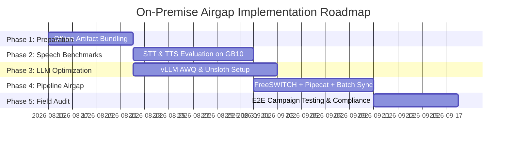

# On-Premise Airgapped Architecture & Implementation Plan: Regulated Bank Deployment

> **Target Client:** Regulated Financial Institution (Bank)  
> **Deployment Constraint:** 100% On-Premise, Airgapped Deployment (No Cloud APIs, No Third-Party Telemetry)  
> **Hardware Platform:** Dell Pro Max Workstation with NVIDIA GB10 (Grace Blackwell Superchip)  
> **Primary Use Case:** Campaign-Driven Outbound AI Voice Agent (Indic Languages: Hindi, Marathi, English)

---

## Table of Contents

1. [Executive Summary](#1-executive-summary)
2. [Current Platform Capabilities (What We Have Today)](#2-current-platform-capabilities-what-we-have-today)
3. [Client Profile & Airgap Compliance Requirements](#3-client-profile--airgap-compliance-requirements)
4. [Hardware & Resource Constraints (NVIDIA GB10)](#4-hardware--resource-constraints-nvidia-gb10)
5. [Target System Architecture & Network Boundaries](#5-target-system-architecture--network-boundaries)
6. [Technology Stack Selection & Trade-Off Analysis](#6-technology-stack-selection--trade-off-analysis)
   - [6.1 Telephony & Streaming](#61-telephony--streaming)
   - [6.2 Orchestration Engine](#62-orchestration-engine)
   - [6.3 LLM Serving & Quantization](#63-llm-serving--quantization)
   - [6.4 Speech-to-Text (STT)](#64-speech-to-text-stt)
   - [6.5 Text-to-Speech (TTS)](#65-text-to-speech-tts)
   - [6.6 Explicitly Rejected Technologies](#66-explicitly-rejected-technologies)
7. [Airgap Security & Governance Architecture](#7-airgap-security--governance-architecture)
8. [Open Technical Items & Verification Matrix](#8-open-technical-items--verification-matrix)
9. [Sequenced Phased Implementation Roadmap](#9-sequenced-phased-implementation-roadmap)
10. [Reference Library & Learning Path](#10-reference-library--learning-path)

---

## 1. Executive Summary

This document defines the production architecture, technology selections, security boundaries, and phased deployment roadmap for delivering **Aakashvani** into a regulated financial institution.

Due to strict banking regulations, the client mandates a **100% airgapped, on-premise installation** with zero external cloud dependencies, zero external telemetry, and zero live database connectivity between the AI voice runtime and the core banking database during call execution.

By leveraging an **outbound campaign-driven workflow**, customer context and script parameters are pre-staged into a isolated local database prior to calling. Call outcomes and extracted dispositions are written locally and synced back to the core database via scheduled, reviewable batch processes. This design cleanly eliminates live database access risks during calls while delivering low-latency, Indic-language voice interactions using dedicated NVIDIA Grace Blackwell (GB10) hardware.

---

## 2. Current Platform Capabilities (What We Have Today)

Aakashvani is a production-tested AI voice automation platform engineered specifically for outbound voice campaigns in Indian languages.

```
+-----------------------------------------------------------------------------------+
|                            EXISTING AAKASHVANI BASELINE                          |
+-----------------------------------------------------------------------------------+
|                                                                                   |
|  [ FreeSWITCH SIP ] <---> [ mod_audio_fork (WebSocket) ] <---> [ Pipecat Core ]   |
|                                                                        |          |
|                                                                        v          |
|  [ React/Next Dashboard ] <---> [ FastAPI Backend Engine ] <---> [ Local Storage ] |
|                                                                                   |
+-----------------------------------------------------------------------------------+
```

### Core Architecture Highlights

* **Telephony & Real-Time Audio Streaming:**
  * Uses **FreeSWITCH** for SIP/RTP trunking.
  * Captures and streams bidirectional audio frames via **`mod_audio_fork`** over low-latency WebSockets.
  * Battle-tested and verified on actual live phone calls.
* **Orchestration Layer:**
  * Built on **Pipecat**, a self-hosted, transport-agnostic pipeline framework handling continuous STT $\rightarrow$ LLM $\rightarrow$ TTS conversational turns.
* **Backend & Business Logic:**
  * **FastAPI** backend controlling campaign lifecycles, lead staging, state-machine script execution, post-call JSON data extraction, and call metrics.
* **Operations & Dashboard:**
  * Web interface for campaign management, lead list CSV uploading, real-time active call transcript slide-outs, and disposition analytics.

---

## 3. Client Profile & Airgap Compliance Requirements

| Requirement Dimension | Bank Compliance Specification |
| :--- | :--- |
| **Deployment Mode** | Full on-premise, 100% airgapped deployment within the bank's secure data center. |
| **Network Connectivity** | Zero cloud APIs, zero third-party telemetry, zero external internet outbound/inbound access. |
| **Database Isolation** | **Zero live network access** (API, DB driver, VPN) from the voice system to the core banking DB during call handling. |
| **Sync Mechanism** | One-way scheduled batch transfer in both directions (Campaign Data IN / Dispositions OUT). |
| **Auditability** | Every batch sync operation must generate human-reviewable logs detailing what data crossed the boundary and when. |
| **Internal Security** | Mandatory TLS and authentication on internal traffic (LAN link between GPU rig, voice rig, FreeSWITCH). |
| **Admin Protection** | FreeSWITCH ESL / event sockets isolated from Ops client rigs; reachable only via authenticated backend API. |

---

## 4. Hardware & Resource Constraints (NVIDIA GB10)

The AI inference stack runs on specialized, high-density hardware deployed inside the bank's server room.

### Hardware Profile: Dell Pro Max (NVIDIA GB10)

* **Compute Unit:** NVIDIA Grace Blackwell Superchip (GB10).
* **CPU:** 20-core ARM Grace CPU (`aarch64` architecture).
* **GPU:** NVIDIA Blackwell GPU architecture.
* **Unified Memory:** 128 GB LPDDR5x unified memory operating at ~273 GB/s bandwidth.
* **Operating System:** DGX OS on Ubuntu (`aarch64` Linux).
* **CUDA Environment:** CUDA 13.0 verified via `nvidia-smi` on physical hardware.

### 10GB GPU Budget Allocation

To maintain strict latency SLA for real-time conversation turns without memory thrashing, the GPU budget for concurrent AI models is capped at **10 GB total VRAM**:

$$\text{Total GPU Budget (10 GB)} = \text{LLM Budget (~4.5–5.0 GB)} + \text{STT Budget (~2.0 GB)} + \text{TTS Budget (~2.5–3.0 GB)}$$

```
+-------------------------------------------------------------------------------+
|                        10GB GPU MEMORY ALLOCATION                              |
+-------------------------------------------------------------------------------+
| [ LLM: Llama 3.3 INT4 AWQ ]  | [ STT: IndicConformer ]  | [ TTS: Indic-TTS ] |
|        ~4.5 GB - 5.0 GB      |        ~2.0 GB           |    ~2.5 GB - 3.0 GB |
+-------------------------------------------------------------------------------+
| <--------------------------- Total Headroom: ~10 GB -------------------------> |
+-------------------------------------------------------------------------------+
```

> **Critical Note on Quantization:** Running LLM at INT8 (~8.5 GB) leaves only ~1.5 GB total for STT and TTS combined, which leads to VRAM exhaustion and pipeline failures. Therefore, **INT4 AWQ quantization is mandatory** for the LLM.

---

## 5. Target System Architecture & Network Boundaries

The deployment is split across two dedicated physical machines to establish an airgap boundary between the voice pipeline and the bank's core network.

```
                             PSTN / SIP Trunk
                                    |
                                    v
   +--------------------+       +------------------------+   :   +------------------+
   |   GPU Rig (GB10)   |  LAN  |  Voice + Backend Rig   |   :   |  Core Database   |
   |--------------------|<----->|------------------------|   :   |------------------|
   | STT Engine         |       | Pipecat Orchestration  |   :   | Isolated Bank DB |
   | LLM (10GB Budget)  |       | FreeSWITCH (SIP/RTP)   |   :   | No Live Access   |
   | TTS Engine         |       | Aakashvani Backend     |------>|                  |
   +--------------------+       | Staged Local Database  |  one-way, batch sync
                                +-----------^------------+   :
                                            |
                                     Ops Client Rigs
                                 (Dashboard / Monitoring)
```

### Boundary & Data Flow Rules

1. **Pre-Call Campaign Staging (Batch Sync IN):**
   * Scheduled job exports campaign metadata, customer contact details, product parameters, and script variables from Core DB to the **Staged Local Database**.
   * Batch exports are logged and subject to human compliance review prior to execution.
2. **In-Call Conversational Execution (Fully Staged):**
   * FreeSWITCH receives/places calls, streaming audio over WebSocket to Pipecat on the Voice + Backend Rig.
   * Pipecat queries the local staged database for customer context.
   * Pipecat dispatches STT/LLM/TTS inference requests to the GPU Rig over a high-speed, authenticated internal LAN.
   * **Zero network calls touch the Core DB during call execution.**
3. **Post-Call Outcome Synchronization (Batch Sync OUT):**
   * Post-call extraction pipelines record dispositions, intent classifications, call transcripts, and metadata into local storage.
   * Dispositions are batched and transferred across the airgap back to the Core DB on a fixed schedule.
4. **Ops Client Boundary:**
   * Internal ops client dashboards communicate strictly with the Aakashvani Backend API over HTTPS/RBAC. Ops rigs cannot access FreeSWITCH ESL directly or reach the GPU Rig.

---

## 6. Technology Stack Selection & Trade-Off Analysis

### 6.1 Telephony & Streaming
* **Selected:** **FreeSWITCH + `mod_audio_fork`**
  * *Rationale:* Lightweight, fully open-source, proven in existing deployments, streams audio over WebSockets directly into Pipecat.
* **Watchlist:** **`AreevAI/flowcat`**
  * *Rationale:* A high-performance Rust implementation of the Pipecat pipeline with built-in SIP/RTP and explicit air-gap support. Kept on radar for future evaluation.

### 6.2 Orchestration Engine
* **Selected:** **Pipecat** (Self-Hosted Python Framework)
  * *Rationale:* Transport-agnostic, low latency, native integration with custom STT/LLM/TTS services over WebSockets.

### 6.3 LLM Serving & Quantization
* **Selected:** **Llama 3.3 (8B/70B variants) via vLLM (INT4 AWQ)**
  * *Target Footprint:* ~4.5 GB – 5.0 GB VRAM.
  * *Fine-Tuning Stack:* **Unsloth** for memory-efficient QLoRA/LoRA fine-tuning on constrained hardware; HuggingFace PEFT; Axolotl for config-driven training pipelines.

### 6.4 Speech-to-Text (STT)
* **Baseline Engine:** **`faster-whisper`** (CTranslate2-backed Whisper implementation for general multilingual support).
* **Indic Specialized Engine:** **AI4Bharat `IndicConformer` / `IndicWhisper`** (Superior accuracy for Hindi/Marathi; requires HF license acceptance and local checkpoint pre-downloading).

### 6.5 Text-to-Speech (TTS)
* **Primary Candidate:** **AI4Bharat `Indic-TTS` (FastPitch + HiFi-GAN)**
  * *Rationale:* Non-autoregressive model architecture offering predictable, fast generation and the safest path to sub-300ms Time-To-First-Audio-Chunk (TTFT).
* **Secondary Candidate:** **OmniVoice (`k2-fsa/OmniVoice`)**
  * *Rationale:* Apache 2.0 license, pretrained on 117h Hindi and 157h Marathi data. Needs latency benchmarking on GB10 due to diffusion-LM architecture.
* **CPU Fallback Engine:** **Piper TTS** with Hear2Read Hindi/Marathi voices.
  * *Rationale:* Lightweight CPU-bound synthesis; guarantees fallback voice capability if GPU memory saturates.

### 6.6 Explicitly Rejected Technologies

| Technology | Rejection Reason |
| :--- | :--- |
| **Azure Speech Services (TTS)** | Requires Windows host OS (GB10 runs Linux DGX OS) and relies on cloud API endpoints. Violates airgap mandate. |
| **ElevenLabs / OpenAI Voice** | Cloud APIs with restricted/non-commercial licenses. Fails compliance review. |
| **LiveKit / LiveKit Agents** | Introduces WebRTC/SFU server overhead unnecessary for pure SIP outbound calling. Requires total rewrite of working Pipecat orchestration. |

---

## 7. Airgap Security & Governance Architecture

To ensure strict defense-in-depth within the airgapped environment, the following security controls are implemented:

```
+---------------------------------------------------------------------------------+
|                         DEFENSE-IN-DEPTH SECURITY MATRIX                        |
+---------------------------------------------------------------------------------+
|                                                                                 |
| 1. Network Boundary: Airgap between Voice Rig & Core DB (Scheduled Sync Only)   |
| 2. Encryption: mTLS on internal LAN (GPU Rig <---> Voice Rig)                   |
| 3. Interface Isolation: FreeSWITCH ESL locked; accessible only via Backend API  |
| 4. Identity & Auth: Strict RBAC & API Key auth for Ops Client Rigs              |
| 5. Secrets Management: Manual credential staging & periodic rotation            |
| 6. Audit Logging: Cryptographically verifiable logs for all batch sync jobs     |
|                                                                                 |
+---------------------------------------------------------------------------------+
```

1. **Internal Transport Security:** Mandatory mutual TLS (mTLS) and token authentication across the internal LAN between the Voice + Backend Rig and the GPU Rig.
2. **Management Interface Hardening:** FreeSWITCH Event Socket Library (ESL) interfaces bound to `127.0.0.1` and accessible strictly via backend service proxies.
3. **Manual Secrets Staging:** Internal DB credentials and service tokens managed via local environment configuration files; rotated manually per bank security schedules.
4. **Ops Client Boundary:** Web dashboard clients treated as external untrusted entities requiring strict API token authentication (`X-Admin-Key` / Bearer token).

---

## 8. Open Technical Items & Verification Matrix

The following tasks represent critical verification benchmarks required before final system lock-in:

| # | Verification Task | Test Objective | Target Threshold | Status |
| :-: | :--- | :--- | :--- | :-: |
| **1** | **TTS TTFT Benchmark** | Measure first audio chunk latency of OmniVoice vs AI4Bharat Indic-TTS on GB10. | $< 300\text{ ms}$ TTFT | `PENDING` |
| **2** | **LLM Quantization Evaluation** | Test INT4 AWQ vs INT8 Llama 3.3 accuracy on actual bank campaign call scripts. | Zero slot-filling regressions | `PENDING` |
| **3** | **ARM64 Wheel Audit** | Verify `manylinux_aarch64` wheel availability for all Python packages prior to airgapping. | 100% offline wheel mirror | `PENDING` |
| **4** | **Language Support Check** | Perform repo verification for Hindi/Marathi text normalization and phonemizer support. | Verified Hindi & Marathi | `PENDING` |
| **5** | **Gated HF Checkpoint Staging** | Accept licenses on HuggingFace and download `IndicF5` / `Indic-TTS` weights to local disk. | Local weights cached | `PENDING` |

---

## 9. Sequenced Phased Implementation Roadmap



### Phase 1: Offline Artifact Staging & Bundle Preparation
* Mirror all required Python packages as `manylinux_aarch64` wheels on an internet-connected staging server.
* Execute `huggingface-cli download` for all target model snapshots (`faster-whisper`, `IndicConformer`, `Indic-TTS`, `Llama-3.3-70B-Instruct-AWQ`).
* Package system dependencies into local `.deb` caches (`ffmpeg`, `libsndfile1`, CUDA 13 runtime libraries).
* Export base Docker images via `docker save` for transport on encrypted physical storage media.

### Phase 2: Speech Infrastructure Benchmarking on GB10
* Deploy `faster-whisper` and `IndicConformer` on the GB10 GPU; evaluate ASR word error rate (WER) on benchmark Hindi/Marathi call audio samples.
* Deploy AI4Bharat `Indic-TTS` and `OmniVoice` on GB10; measure Time-To-First-Audio-Chunk (TTFT) and Real-Time Factor (RTF).
* Configure Piper TTS with Hear2Read Hindi/Marathi voices as the automatic CPU fallback pathway.

### Phase 3: LLM Quantization & Fine-Tuning Pipeline
* Deploy vLLM on the GB10 GPU configured for INT4 AWQ tensor parallelism.
* Benchmark INT4 inference latency and memory footprint against the 10GB GPU budget.
* Setup **Unsloth** QLoRA pipeline for local fine-tuning on bank-specific domain scripts, slot-filling tasks, and domain terminology.

### Phase 4: Airgap Architecture Integration & Security Hardening
* Integrate FreeSWITCH `mod_audio_fork` WebSocket audio stream with Pipecat orchestration on the Voice + Backend Rig.
* Implement scheduled, logged one-way batch sync scripts between the Staged Local DB and mock Core DB interfaces.
* Enforce mTLS across internal LAN links and lock down FreeSWITCH ESL access.

### Phase 5: Field Testing & Compliance Audit Sign-Off
* Execute full end-to-end simulated outbound campaign calls using pre-staged customer context.
* Validate disposition capture and batch sync return logging under compliance observation.
* Finalize security sign-off and operational handover documentation.

---

## 10. Reference Library & Learning Path

For team members expanding from orchestration to on-premise model serving and fine-tuning, consult these technical resources:

1. **LLM Serving & Quantization:**
   * [vLLM Documentation](https://docs.vllm.ai) – Continuous batching, PagedAttention, and AWQ/GPTQ quantization setup.
   * [AutoAWQ Repository](https://github.com/casper-hansen/AutoAWQ) – Activation-aware Weight Quantization mechanics for instruction following.
   * [llama.cpp Repository](https://github.com/ggerganov/llama.cpp) – GGUF quantization mechanics and CPU fallback execution.
   * [Hugging Face Quantization Guide](https://huggingface.co/docs/transformers/main/en/quantization) – Comparative breakdown of bitsandbytes, AWQ, and GPTQ.

2. **Fine-Tuning Frameworks:**
   * [Unsloth AI](https://github.com/unslothai/unsloth) – Ultra-fast, memory-efficient LoRA/QLoRA fine-tuning for VRAM-constrained hardware.
   * [Hugging Face PEFT Documentation](https://huggingface.co/docs/peft) – Parameter-efficient fine-tuning principles.
   * [Axolotl Repository](https://github.com/OpenAccess-AI-Collective/axolotl) – YAML config-driven LLM fine-tuning pipelines.

3. **Speech Recognition & Synthesis:**
   * [faster-whisper Documentation](https://github.com/SYSTRAN/faster-whisper) – Fast CTranslate2 Whisper inference.
   * [NVIDIA NeMo Toolkit](https://docs.nvidia.com/deeplearning/nemo/user-guide/docs/en/main/) – ASR fine-tuning workflows (Conformer/TDT) optimized for NVIDIA hardware.
   * [AI4Bharat Indic-TTS](https://github.com/AI4Bharat/Indic-TTS) & [IndicF5](https://github.com/AI4Bharat/IndicF5) – Architectures and data formatting for Indic speech models.

4. **Hardware & Orchestration:**
   * [NVIDIA DGX & GB10 Developer Docs](https://developer.nvidia.com) – ARM64 Grace Blackwell optimization notes.
   * [Pipecat Documentation & Examples](https://docs.pipecat.ai) – Advanced pipeline construction patterns for real-time conversational agents.
