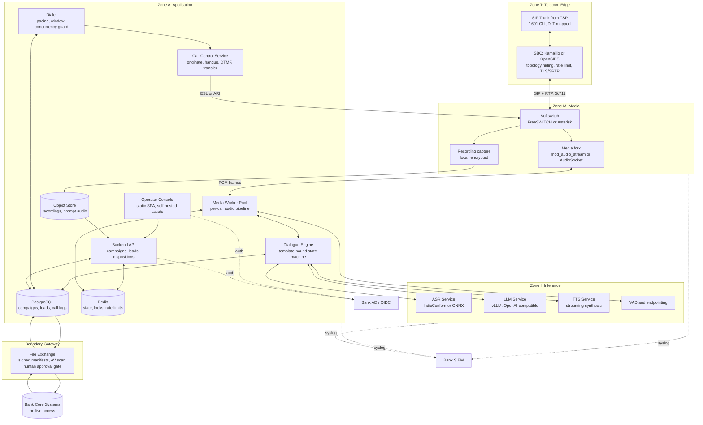
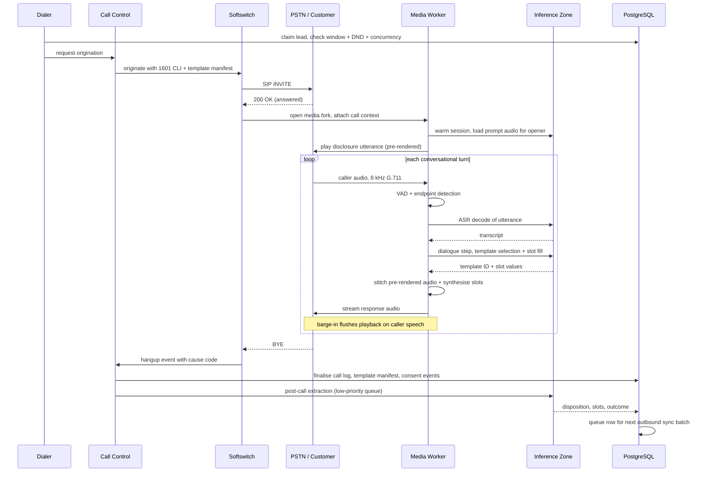
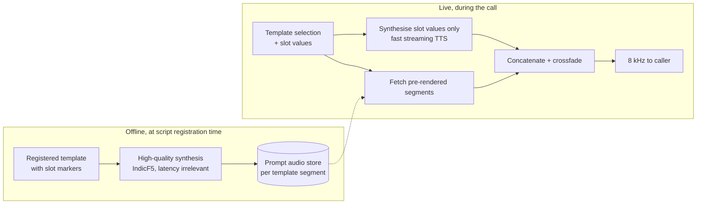
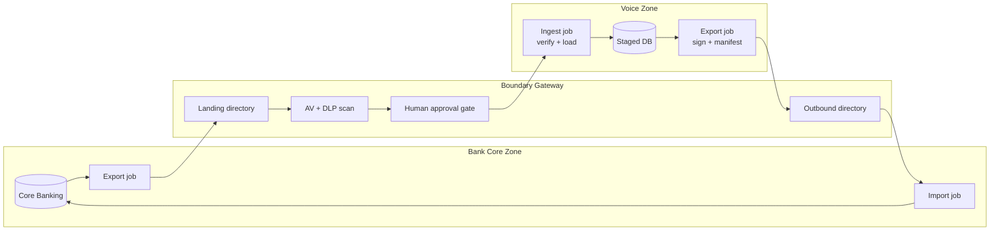
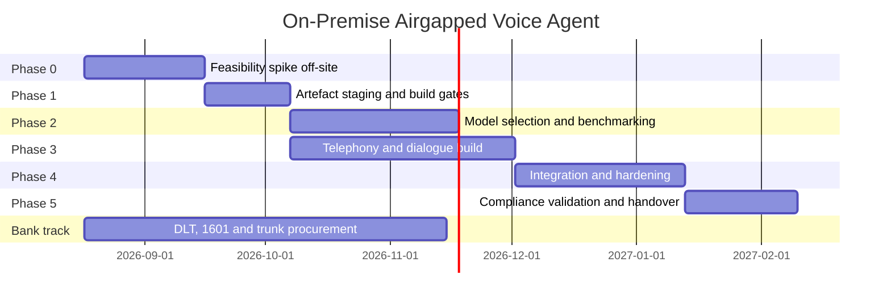

# On-Premise Airgapped Voice Agent: Deployment Blueprint

> **Client class:** RBI-regulated commercial bank
> **Deployment constraint:** 100% on-premise, airgapped. No cloud APIs, no third-party telemetry, no outbound internet from the runtime.
> **Workload:** Outbound campaign-driven conversational voice agent, Hindi / Marathi / English.
> **Document status:** Design blueprint, pre-implementation. Every performance number here is either sourced or explicitly marked as an estimate requiring measurement.

---

## Table of Contents

1. [Executive Summary](#1-executive-summary)
2. [Scope, Non-Goals and Design Principles](#2-scope-non-goals-and-design-principles)
3. [Regulatory and Compliance Envelope](#3-regulatory-and-compliance-envelope)
4. [Complete System Architecture](#4-complete-system-architecture)
5. [Telephony Subsystem](#5-telephony-subsystem)
6. [Speech and Language Subsystem](#6-speech-and-language-subsystem)
7. [Minimum Viable Resource Footprint](#7-minimum-viable-resource-footprint)
8. [Capacity and Concurrency Model](#8-capacity-and-concurrency-model)
9. [Hardware Requirements by Concurrency Tier](#9-hardware-requirements-by-concurrency-tier)
10. [Realistic Expectations](#10-realistic-expectations)
11. [Airgap Operations and Security](#11-airgap-operations-and-security)
12. [Benchmark and Verification Matrix](#12-benchmark-and-verification-matrix)
13. [Phased Roadmap](#13-phased-roadmap)
14. [Risk Register](#14-risk-register)
15. [Open Questions for the Bank](#15-open-questions-for-the-bank)
16. [Reference Library](#16-reference-library)
17. [Appendix: Relationship to the Existing Aakashvani Cloud Platform](#17-appendix-relationship-to-the-existing-aakashvani-cloud-platform)

---

## 1. Executive Summary

This document specifies a self-contained, airgapped, outbound AI voice agent for deployment inside a bank's data centre. Every component — SIP switching, speech recognition, language model, speech synthesis, orchestration, database, and operator console — runs on hardware the bank owns, on a network segment with no route to the internet.

Four findings shape the entire design and should be read before anything else.

**Bandwidth, not memory, is the binding constraint on inference hardware.** The NVIDIA GB10 has 128 GB of unified memory but only 273 GB/s of memory bandwidth. Token generation streams the model's active weights through that bus once per token, so decode speed is capped at roughly `bandwidth / active_bytes`. Published measurements on this exact chip show a dense 70B model at FP8 decoding at 2.7 tok/s, and a 31B model at INT4 at 10.6 tok/s. A voice agent needs roughly 30 tok/s per active speaker. This rules out large dense models entirely and makes model *architecture* the highest-leverage decision in the build.

**The complete software stack fits in a small memory allocation.** Section 7 costs out every resident component. The floor to run the entire pipeline — LLM, three ASR models, four TTS voices, and all runtime overhead — is approximately **8 GB** with a 4B-class model and **12 GB** with an 8B-class model. This matters because the bank's GPU allocation is not yet agreed. The important nuance is that asking for **24 GB rather than 12 GB** unlocks a small-active mixture-of-experts model, which on this hardware is simultaneously *faster* and *higher quality* than the 8B dense model that fits in 12 GB. The extra 12 GB is the cheapest quality upgrade available in the whole project.

**Memory can be shared. Bandwidth cannot.** If the GB10 is shared with other bank workloads, a co-tenant batch job will consume memory bandwidth and destroy the voice latency SLA, regardless of how much memory we were allocated. GB10 does not expose MIG partitioning, so there is no hardware mechanism to fence this off. The commercial ask must therefore be for a guaranteed bandwidth share or exclusive scheduling windows, not just a memory quota.

**India telecom regulation constrains the product, not just the deployment.** TRAI now requires RBI-regulated entities to place outbound service and transactional calls from the 1600-series, with the entity registered on a DLT platform and **every voice script pre-registered as a content template**. A freely generating language model is not compatible with pre-registered templates without deliberate constraint. This pushes the design toward template-bound generation with a fixed, auditable utterance inventory — which, conveniently, also produces the lowest-latency and highest-quality speech synthesis path available on-premise (Section 6.4).

---

## 2. Scope, Non-Goals and Design Principles

### 2.1 In scope

- Outbound, campaign-driven conversational calls in Hindi, Marathi and English.
- Full SIP/RTP telephony built from scratch on open-source software, terminating on a bank-procured SIP trunk.
- Locally-served speech recognition, language modelling and speech synthesis.
- Campaign management, lead staging, script execution, disposition capture and an operator console.
- A controlled, auditable, one-way data exchange with the bank's core systems.

### 2.2 Explicitly out of scope for the first release

- Inbound call handling. The 1600-series is outbound-only; customers cannot call back on it, so inbound needs a separate number range and a separate compliance path.
- Live lookups against core banking systems during a call. All customer context is pre-staged.
- Real-time agent handoff to a human. Warm transfer is a Phase 3 candidate (Section 5.8), not a launch feature.
- Any promotional or marketing calling. The 1600-series permits service and transactional calls only.

### 2.3 Design principles

1. **Nothing leaves the boundary at runtime.** No component may perform a DNS lookup, licence check, telemetry post, model download or package fetch during operation. This is verified by running the full stack on a host with no default route.
2. **Every third-party dependency has a named licence and an offline artefact.** Anything that cannot be mirrored to local disk cannot be deployed.
3. **Latency budgets are allocated, not hoped for.** Each pipeline stage has a p95 target (Section 10.1) and is instrumented against it.
4. **Degrade, do not fail.** Every AI component has a defined fallback path and the system has a defined behaviour when the GPU is unavailable.
5. **Assume the auditor reads the code.** Compliance artefacts — template IDs, consent records, sync manifests — are first-class data model entities, not log lines.

---

## 3. Regulatory and Compliance Envelope

This section is a summary for architects. It is not legal advice and must be reviewed by the bank's compliance function before build sign-off.

### 3.1 TRAI 1600-series mandate

TRAI Direction dated 19 November 2025 mandates phase-wise adoption of the 1600 numbering series for service and transactional voice calls by RBI, SEBI and PFRDA regulated entities. For commercial banks — public sector, private sector and foreign — the mandatory adoption date was **1 January 2026**, which has passed. Large NBFCs, payments banks and small finance banks followed on 1 February 2026, and remaining NBFCs, co-operative banks and regional rural banks on 1 March 2026. A follow-up direction dated 16 December 2025 extended the mandate to IRDAI-regulated insurers.

Architectural consequences:

- **CLI must be the allocated 1601xxxxxxx number on every call.** Under Section 42 of the Telecommunications Act 2023 and TCCCPR, no masking, overlay, or virtual-number routing over the 1601 number is permitted. The SIP trunk contract must specify that the trunk presents the 1601 CLI, not the carrier's own network CLI, and this must be validated during acceptance testing with a real handset.
- **The series is outbound-only.** Design must not assume a customer can return the call on the displayed number. Any callback instruction in a script must reference a separate published helpline.
- **Service and transactional purposes only.** Promotional content on a 1600 number is a violation. Script content review must gate on this.

### 3.2 DLT registration and content templates

Under TCCCPR 2018 and the November 2025 Direction, the bank must register as a Principal Entity on a TRAI-approved DLT platform, obtain an Entity ID, and **pre-register every voice script as a content template with a unique Template ID**, which accompanies each call in the signalling layer. Penalties reach ₹10,00,000 per violation instance, with risk of blacklisting across telecom resources.

This is the single most consequential regulatory constraint on the AI design. A language model that generates free-form text cannot demonstrate that what it said matches a registered template. Three mitigations, in decreasing order of preference:

1. **Template-bound generation.** The model selects among, and fills slots within, a fixed inventory of registered utterances. It does not author sentences. Every emitted utterance carries its Template ID into the call log.
2. **Constrained decoding.** Grammar- or schema-constrained generation restricting output to registered phrasings. More flexible, harder to prove exhaustively.
3. **Post-hoc similarity checking.** Emitted text is scored against registered templates and flagged on divergence. This is a detection control, not a prevention control, and is the weakest option for an audit.

The blueprint assumes option 1 for launch. Section 6.4 shows this also produces the best latency and audio quality, so it is not purely a compliance tax.

**Data model requirement:** the call log schema must carry `dlt_entity_id`, `dlt_template_id` per utterance, and a per-call template manifest. Add this at schema design time, not retrofitted.

### 3.3 RBI FREE-AI framework

The RBI's Framework for Responsible and Ethical Enablement of Artificial Intelligence, published 13 August 2025, sets out 7 Sutras, 6 pillars and 26 recommendations. It is currently advisory but is explicitly intended to inform binding Master Directions. Directly relevant obligations:

- **Board-approved AI policy** covering governance, accountability and AI risk appetite, with an AI governance committee holding technical competence.
- **Three-lines-of-defence** applied to AI systems specifically: business owns the system, risk and compliance provide independent challenge, internal audit provides assurance.
- **Risk-based AI audit framework** (Recommendation 24) covering data inputs, model and algorithm, and decision outputs. Independent third-party audits for high-risk or complex use cases; review at least biennially.
- **AI incident reporting mechanism** and an internal AI inventory.
- **Disclosures** in the annual report and on the website (Recommendation 25).

What this means for the build: the system must be able to produce, on demand, the model version, prompt/template version, and decision trace for any individual call. Model artefacts need content hashes recorded per call. Retrofitting this is expensive; designing it in is nearly free.

### 3.4 DPDP and consent

The Digital Personal Data Protection Act 2023 regime requires a lawful basis for processing, notice, and honouring data-principal rights. For a voice agent this concretely means:

- **Bot disclosure** at the start of the call, as a registered template utterance.
- **Recording consent** captured and stored as a discrete, timestamped, replayable event — not inferred from the fact that the call continued.
- **Erasure capability**: given a customer identifier, the system must be able to locate and purge recordings, transcripts and derived extractions across all stores including backups. Design the recording store with a deletable key structure from day one.
- **Retention schedule** agreed with the bank per data class. Recordings, transcripts and extractions may have different retention periods.

### 3.5 Compliance controls the system must implement

| Control | Where it lives |
| :--- | :--- |
| 1601 CLI assertion and per-call verification | SIP profile config; verified in acceptance test |
| Template ID stamped on every emitted utterance | Dialogue engine; persisted in call log |
| Calling-window enforcement (09:00–21:00 IST) | Dialer, hard gate before origination |
| DND / preference scrubbing against bank-supplied list | Lead staging, pre-campaign |
| Bot disclosure as first registered utterance | Script definition, non-removable |
| Consent event capture | Discrete call-log event with timestamp and audio offset |
| Model and template version hash per call | Call log metadata |
| Immutable audit log of all boundary data transfers | Sync subsystem, Section 11.4 |

---

## 4. Complete System Architecture

### 4.1 Zone model

The deployment is partitioned into four security zones. The bank's network team owns the enforcement points between them.

- **Zone T (Telecom edge).** SIP trunk demarcation and session border control. The only zone with an external network relationship, and that relationship is a private telco circuit, not the internet.
- **Zone M (Media).** Softswitch, RTP media handling, call recording capture.
- **Zone A (Application).** Orchestration, dialogue engine, campaign and lead management, database, operator console backend.
- **Zone I (Inference).** GPU-served speech and language models. No inbound path except from Zone A.

The bank's **core banking zone is outside all four** and is reached only through the file-exchange gateway described in Section 11.4. There is no live network path from any zone above to core banking.

### 4.2 Complete architecture



### 4.3 Call lifecycle



### 4.4 Network flow matrix

Every permitted flow. Anything not listed is denied by default.

| From | To | Protocol / Port | Direction | Notes |
| :--- | :--- | :--- | :--- | :--- |
| TSP trunk | SBC | SIP 5060/5061, RTP 16384-32768/udp | Bidirectional | TLS + SRTP if the TSP supports it; otherwise document the gap |
| SBC | Softswitch | SIP 5080, RTP range | Bidirectional | Private VLAN, no other consumers |
| Softswitch | Media Worker | WSS 8443 or TCP 8090 | Outbound from switch | Media fork transport |
| Call Control | Softswitch | ESL 8021 or ARI 8088 | Outbound to switch | Bound to management VLAN only, never `0.0.0.0` |
| Media Worker | Inference | HTTPS 8000 (LLM), 8001 (ASR), 8002 (TTS) | Outbound only | mTLS, client cert per service |
| Application | PostgreSQL | 5432 | Outbound | TLS, cert auth |
| Application | Redis | 6379 | Outbound | TLS, ACL-scoped users |
| Application | Object store | 9000 | Outbound | TLS, scoped credentials |
| Operator console | Backend API | 443 | Inbound to Zone A | Reverse proxy, OIDC-gated |
| All zones | Bank SIEM | 514/6514 syslog | Outbound | CEF or JSON |
| Application | Boundary gateway | SFTP/22 to landing directory | Outbound write only | No read path back into core |
| Everything | Internet | — | **Denied** | No default route, verified by test |

---

## 5. Telephony Subsystem

Built entirely from open-source components, with no cloud telephony provider in the path.

### 5.1 Session border controller

Place **Kamailio** or **OpenSIPS** between the TSP trunk and the softswitch. This is standard practice and banks' network teams expect it. It provides topology hiding, registration and rate limiting, SIP-level access control, protocol normalisation against carrier quirks, and a clean TLS/SRTP termination point. It also decouples trunk changes from softswitch configuration.

At single-digit concurrency the SBC may be co-resident with the softswitch on the same host in separate containers. It should not be omitted; retrofitting an SBC after the trunk is live is disruptive.

### 5.2 Softswitch selection

This is the most consequential open decision in the telephony layer, driven by an inconvenient licensing fact.

**The historical FreeSWITCH audio-forking module is gone.** `mod_audio_fork` lived in the `drachtio-freeswitch-modules` repository, which now 404s. Remaining forks are unmaintained, and the module required a custom FreeSWITCH build with libwebsockets support that binary installs do not provide. Any tutorial or design referencing it is stale.

**Its successor is commercially licensed.** `amigniter/mod_audio_stream` is actively maintained, works against stock binary FreeSWITCH, ships as a prebuilt Debian 12 package, and supports full-duplex audio with playback control. It is a **commercial product**, free for use up to **10 concurrent streaming channels**. Above that, licensing must be purchased, and the source is not public at the free tier. A 30-day unlimited trial is available for load testing.

| Option | Licence position | Concurrency ceiling | Assessment |
| :--- | :--- | :--- | :--- |
| FreeSWITCH + `mod_audio_stream` (free tier) | FreeSWITCH MPL; module free ≤10 channels | **10 hard cap** | Viable only for a pilot |
| FreeSWITCH + `mod_audio_stream` (commercial) | Paid, closed source at free tier | Vendor-tested to 5000+ | Introduces a closed-source dependency and a vendor relationship into an airgapped bank appliance. Expect procurement and source-escrow questions |
| **Asterisk + AudioSocket** | Asterisk GPLv2, AudioSocket is a built-in channel driver | **No licence cap** | Recommended above 10 channels. Simple TCP protocol: 3-byte header (1 type, 2 length) then signed 16-bit LE PCM at 8 kHz |
| Asterisk + ARI `externalMedia` | GPLv2 | No cap | True RTP duplex, more universal than AudioSocket across builds, but requires RTP timing discipline in the bridge |
| FreeSWITCH + custom in-house module | MPL, fully ours | No cap | Highest control, highest cost. Only justified if FreeSWITCH is mandatory for other reasons |

**Recommendation: Asterisk with AudioSocket** as the default path, with ARI `externalMedia` as the fallback if AudioSocket framing proves fragile under load in the target Asterisk build. The decisive factors are the absence of a per-channel licence, the absence of a closed-source component in an airgapped bank appliance, and the fact that our concurrency target is well within Asterisk's comfortable range.

Choose FreeSWITCH only if the deployment stays permanently at or below 10 concurrent channels, or if the bank separately requires FreeSWITCH-specific capabilities such as high-density conferencing.

**Licence note for appliance delivery:** Asterisk is GPLv2. Because AudioSocket is a network socket protocol, our application communicating over it is at arm's length and is not a derivative work. However, if we ship Asterisk binaries as part of an appliance, we are distributing GPLv2 software and incur source-offer obligations for Asterisk itself. FreeSWITCH's MPL is more permissive here. Flag for legal review; it is a paperwork issue, not a blocker.

**Additional artefact for airgap:** prebuilt FreeSWITCH Debian binaries now require a free SignalWire account and a Personal Access Token to download. The source on GitHub requires no token. Either way, packages must be mirrored before the airgap is closed. Asterisk has no equivalent gate.

### 5.3 Media path and codecs

Indian PSTN trunks are narrowband. Plan for **G.711 A-law at 8 kHz** as the negotiated codec and avoid transcoding in the softswitch — decode to linear PCM once, in the media worker.

```
Customer  --G.711 A-law 8kHz--> SBC --> Softswitch
                                          |
                                    media fork
                                          v
                              Media Worker (Zone A)
                                          |
                    +---------------------+---------------------+
                    |                                           |
          upsample 8k -> 16k                          downsample 24k -> 8k
                    |                                           |
                    v                                           ^
              ASR (16 kHz)                                TTS (22.05/24 kHz)
```

Resampling points are explicit design decisions, not incidental:

- **Uplink 8 kHz → 16 kHz** for ASR. The ASR models expect 16 kHz mono. Upsampling does not restore the missing 4–8 kHz band, so published accuracy figures do not transfer. This is a benchmark gate (Section 12).
- **Downlink TTS native rate → 8 kHz** for playback. Apply a low-pass filter before decimation to avoid aliasing artefacts that sound like harshness on a phone.
- Use `soxr` (high quality) or `libsamplerate`. Cost is roughly 1–2% of a CPU core per stream; negligible, but it is CPU, not GPU, and belongs in the app-rig sizing.

If the TSP can offer **G.722 or Opus wideband**, ASR accuracy improves materially. Ask the question during trunk procurement; most Indian carriers will say no, but the upside is large enough to be worth one email.

### 5.4 Call origination

Origination is a local switch command, not a REST call to a provider.

- **Asterisk:** ARI `POST /channels` or AMI `Originate`, with the `CALLERID(num)` set to the allocated 1601 number and the DLT template manifest carried in channel variables for CDR correlation.
- **FreeSWITCH:** ESL `originate` with `origination_caller_id_number` set likewise.

The Call Control Service is the only component permitted to talk to the switch's management interface. That interface binds to the management VLAN address, never `0.0.0.0`, and is firewalled to the Call Control host.

### 5.5 Call events and disposition

Replace webhook-based event handling with a persistent event subscription — ARI WebSocket events, or ESL in event-socket mode. Events consumed:

- `ChannelStateChange` / `CHANNEL_ANSWER` for answer detection.
- `ChannelHangupRequest` and `ChannelDestroyed` / `CHANNEL_HANGUP_COMPLETE` with the SIP cause code, mapped to dispositions (busy, no-answer, rejected, congestion, normal clearing).
- `ChannelDtmfReceived` / `DTMF` for keypad input.

Because the event stream is persistent rather than a per-call callback, connection loss is a system-level failure mode with a defined recovery path: on reconnect, reconcile live channels against the database and settle any orphaned call records. This must be built, not assumed.

### 5.6 Recording

Record locally with `MixMonitor` (Asterisk) or `uuid_record` (FreeSWITCH). Recommended configuration:

- **Dual-channel** recording with caller and agent on separate channels. Auditors want to hear who said what without relying on diarisation.
- **Encrypted at rest** with per-object keys, written to the on-premise object store.
- **Opus at 24 kbps stereo** as the storage format unless the bank requires lossless for dispute resolution — ask this explicitly, it changes storage sizing by 5×.
- **Key structure keyed by customer identifier** so DPDP erasure requests can be executed without a full scan.

Recording must start only after the consent utterance and its response are captured, or the bank's policy must explicitly cover recording the consent exchange itself. Confirm with compliance.

### 5.7 DTMF

Required for a bank workload — confirmations, menu selections, and any numeric capture that speech recognition should not be trusted with. Negotiate **RFC 2833 / RFC 4733** DTMF on the trunk and confirm the SBC passes it through without re-signalling. In-band DTMF over a compressed codec is unreliable; SIP INFO is a fallback only.

DTMF is a first-class dialogue input: the dialogue engine must accept a digit event as a turn, cancel any in-flight speech synthesis, and advance state.

### 5.8 Barge-in, transfer and answering-machine detection

**Barge-in** is required for a natural agent. When the caller starts speaking, queued playback must be flushed immediately, not after the current buffer drains. Asterisk AudioSocket handles this by stopping the audio stream from the application side; FreeSWITCH offers `uuid_break`. Target cut-off latency is under 150 ms from voice onset, and it must be measured (Section 12).

**Warm transfer to a human agent** is a Phase 3 candidate. Both platforms support attended transfer natively; the work is in the dialogue engine deciding when to escalate and in the operator console presenting call context to the receiving agent.

**Answering-machine detection** materially affects campaign economics — talking to voicemail wastes a channel and produces a garbage disposition. Options:

- Asterisk `AMD()` application: built in, GPLv2, tunable, well understood.
- FreeSWITCH `mod_avmd`: open source, voicemail-beep detection.
- FreeSWITCH `mod_amd`: a SignalWire **commercial** module. Avoid.
- Pipeline-based detection using VAD and ASR characteristics — long uninterrupted speech with no turn-taking. Slower to trigger but avoids a module dependency.

Recommendation: start with Asterisk `AMD()`, tune against recorded samples from the bank's actual customer base, and treat the tuned parameter set as a deliverable. Default AMD parameters perform poorly on Indian voicemail greetings.

---

## 6. Speech and Language Subsystem

### 6.1 Voice activity detection and endpointing

**Silero VAD** via ONNX Runtime. Roughly 2 MB, runs on CPU with negligible cost, permissive licence, and runs on aarch64 and x86 alike. No GPU allocation required.

Endpointing — deciding that the caller has finished speaking — deserves more attention than it usually gets, because as Section 10.1 shows it is the **largest single term in the response latency budget**, larger than speech synthesis. A naive fixed silence threshold of 700 ms adds 700 ms to every turn. Tuning to 300 ms makes the agent feel responsive but causes it to interrupt customers who pause mid-sentence, which is common in Hindi and Marathi.

Design for a **tunable, per-state endpoint threshold**: short after a yes/no question, long after an open question that invites a considered answer. Treat the threshold table as a tuned deliverable validated against real call recordings, not a constant.

### 6.2 Automatic speech recognition

**Selected: AI4Bharat IndicConformer, served through ONNX Runtime.**

| Property | Value |
| :--- | :--- |
| Architecture | Hybrid CTC / RNN-T Conformer, 120M parameter encoder, 17 blocks, 512 model dim |
| Languages | Per-language checkpoints including Hindi and Marathi |
| Licence | MIT — commercial use permitted |
| Expected input | 16 kHz mono |
| Serving | Export to ONNX, serve via `sherpa-onnx` or ONNX Runtime directly |

Serving through ONNX rather than NeMo/PyTorch is a deliberate choice for an airgapped ARM64 deployment. It removes the entire PyTorch and NeMo dependency tree from the runtime, which is the single largest source of aarch64 wheel-availability pain. `sherpa-onnx` supports x86_64, aarch64, and CUDA on Jetson-class hardware, and community ONNX exports of IndicConformer already exist under MIT. We should nonetheless perform and validate our own export rather than trusting a third-party conversion.

Three constraints to design around:

1. **IndicConformer is an offline model, not a streaming one.** It decodes a complete utterance. Combined with VAD endpointing this is acceptable — the endpoint decision gates the decode — but it means transcription latency is added *after* endpointing, not overlapped with it. If measurements show this is too slow, NeMo cache-aware streaming FastConformer is the architectural alternative, at the cost of a WER increase and a return to the PyTorch dependency.
2. **8 kHz telephony audio is out of distribution.** The model expects 16 kHz. Published WER figures are on clean wideband audio and will not transfer. Mitigations in preference order: measure on real narrowband call audio first; if unacceptable, fine-tune on band-limited audio simulated by downsample-upsample of IndicVoices; if still unacceptable, escalate to wideband trunk negotiation.
3. **Code-switching is the hard case.** Indian banking conversations routinely mix Hindi and English mid-sentence. Per-language checkpoints handle this poorly. Options are a language-identification front end routing to the right model (adds latency, fails on intra-sentence switching), a Hinglish-specific fine-tune, or accepting degraded accuracy on mixed speech. This is called out again in Section 10 and Section 14 because it is the most likely cause of disappointing field results.

### 6.3 Language model

**The hardware makes this decision.** Decode throughput is `memory_bandwidth / active_bytes_per_token`. On GB10's 273 GB/s, measured results are unambiguous:

| Model class | Active bytes/token | Theoretical ceiling | Measured on GB10 | Usable for voice? |
| :--- | :--- | :--- | :--- | :--- |
| Dense 70B FP8 | ~70 GB | 3.9 tok/s | **2.7 tok/s** | No |
| Dense 70B INT4 | ~40 GB | 6.8 tok/s | ~6.5 tok/s | No |
| Dense 31B INT4 | ~16 GB | 17 tok/s | **10.6 tok/s** | No |
| Dense 8B INT4 | ~5 GB | ~54 tok/s | ~30-40 tok/s (est.) | Marginal |
| Dense 4B INT4 | ~2.3 GB | ~118 tok/s | ~60-80 tok/s (est.) | Yes |
| MoE ~30B / 3B active INT4 | ~1.7 GB | ~160 tok/s | 24-42 tok/s measured on comparable MoE | **Yes, best quality/speed point** |

Two conclusions follow. First, **any dense model above roughly 8B is unusable for real-time voice on this hardware**, full stop. Second, **a small-active mixture-of-experts model is strictly better than a dense model of comparable quality**, because it holds the full expert set in the plentiful 128 GB while streaming only the active experts per token.

**Model candidates**, in priority order. Apache 2.0 is strongly preferred because bank legal will scrutinise non-OSI model licences.

| Candidate | Licence | Approx INT4 size | Notes |
| :--- | :--- | :--- | :--- |
| Qwen3-30B-A3B class MoE | Apache 2.0 | ~15-17 GB resident, ~1.7 GB active | Best quality-per-token-latency on this hardware. Requires the larger memory allocation |
| Qwen3-8B | Apache 2.0 | ~5 GB | Safe dense fallback within a minimal allocation |
| Qwen3-4B | Apache 2.0 | ~2.3 GB | Floor option; fastest, lowest quality |
| Sarvam-M class Indic-tuned model | Apache 2.0 — **verify** | ~12 GB | Indic-focused instruction tuning is directly relevant. Evaluate on bank scripts |
| Llama 3.1 8B | Llama Community Licence | ~5 GB | Not an OSI licence. Expect legal friction |

**Note on model size and task fit.** The dialogue engine is a template-bound state machine doing slot filling and intent classification over a narrow, pre-registered script inventory. This is not an open-ended reasoning task. A 4B model fine-tuned on the bank's actual scripts will very likely outperform a general 30B model on this specific job, at a fraction of the latency. Fine-tuning is a first-class option, not a fallback, and should be benchmarked in Phase 2 rather than deferred.

**Quantization on GB10.** The doc-level guidance "INT4 AWQ is mandatory" is incorrect. The actual position:

- **NVFP4** is the Blackwell-native 4-bit format and measures roughly 20% faster than AWQ INT4 on GB10. However, GB10's SM 12.1 is **missing the `cvt.rn.satfinite.e2m1x2.f32` PTX instruction** that NVFP4 quantization normally uses, so it requires a patched build with a software E2M1 conversion path. Community builds achieving this exist.
- **FP8** is the safe default. It is well supported on SM121 via FlashInfer and requires no patching.
- **AWQ INT4** works and is the conservative 4-bit option.

Benchmark all three (Section 12). Do not commit to one in the architecture.

**The vLLM build gate — the most likely thing to brick this deployment.** GB10 reports compute capability **SM 12.1 (sm_121)**. Published vLLM aarch64 wheels and Docker images historically contained **zero sm_121 cubins**, because the build scripts never passed `12.1` in `TORCH_CUDA_ARCH_LIST` even though `CMakeLists.txt` supported it. The symptom is a startup crash or a silent fall back to slow PTX JIT. There is also an upstream PyTorch CMake auto-detection bug that corrupts `12.1` into `12.1(2.0)` when building from source on SM121 hardware.

Consequence: the exact vLLM container image must be **built and verified against real GB10 hardware, with `cuobjdump --list-elf` confirming sm_121 cubins are present, before the airgap is closed.** Discovering this after the appliance is inside the bank means a physical media round-trip. Make it an explicit Phase 1 exit gate.

**vLLM configuration requirements:**

- **Automatic prefix caching is mandatory.** Each conversational turn appends to a growing context. Without prefix caching, every turn re-prefills the full context — at 2k tokens that is roughly 0.7 s added to time-to-first-token, which alone blows the latency budget. With prefix caching, only the new tokens are prefilled, on the order of 10 ms.
- **Continuous batching** is what makes concurrency work at all. Weights are read once per decode step and amortised across the batch. This is the entire basis of the capacity model in Section 8.
- **Post-call extraction runs on a separate, lower-priority queue** from live calls. Extraction is a batch workload with no latency requirement; live calls have a hard one. Sharing a queue lets extraction steal bandwidth from a live conversation. Either run it on a separate vLLM instance with a bandwidth cap, or schedule it outside calling hours.
- **Bound `max_model_len`** to what the dialogue actually needs. KV cache scales linearly with it and it is the main driver of per-call memory (Section 7).

### 6.4 Text to speech

This is where the compliance constraint and the latency constraint point in the same direction, which is fortunate.

**Candidate assessment:**

| Candidate | Licence | Hindi | Marathi | Streaming | Assessment |
| :--- | :--- | :--- | :--- | :--- | :--- |
| AI4Bharat Indic-TTS (FastPitch + HiFi-GAN V1) | MIT | Yes | Yes | Non-autoregressive, phrase-streamable | **Primary.** Best language coverage under a clean licence |
| Piper (VITS, ONNX) | Maintained `piper1-gpl` is **GPL-3.0**; older MIT `rhasspy/piper` archived | Community voices exist | **No voice exists** | Yes, ~70 ms after warm-up | Fast fallback, but two real problems: GPL-3.0 for appliance delivery, and no Marathi |
| IndicF5 | MIT | Yes | Yes | **Not natively streamable** | Highest quality. Reject for live synthesis, use offline |
| OmniVoice | Apache 2.0 | Yes | Yes | Diffusion-LM, needs measurement | Evaluate only if the primary fails |

**Why IndicF5 is rejected for live use.** It is an F5-TTS-derived flow-matching model. Flow-matching models perform global inference over the full utterance and are not natively streamable. Reported behaviour includes first-packet latency of 1–2 seconds even with chunked workarounds, and generation time that is roughly constant regardless of output length — meaning short conversational responses get the worst real-time factor. It cannot meet a sub-second turn latency target.

**Known risk on the primary.** Indic-TTS checkpoints date from January 2023 and the reference inference path depends on Coqui TTS, which is no longer maintained. Running the published inference code on Python 3.12 / aarch64 will be painful. Plan to **export FastPitch and HiFi-GAN to ONNX and serve them through ONNX Runtime**, discarding the Coqui dependency the same way we discard NeMo for ASR. Budget real engineering time for this; it is a likely source of schedule slip.

#### 6.4.1 The pre-rendered prompt design

Because TRAI requires every voice script to be pre-registered as a content template, **most of what the agent says is fixed text known at design time**. Only slot values — a name, an amount, a date, a reference number — vary per call.

This makes a hybrid synthesis design both compliant and fast:



The benefits compound:

- **Latency**: playback of the first fixed segment starts in the time it takes to read a file, effectively eliminating time-to-first-audio for the majority of utterances.
- **Quality**: the bulk of the audio is generated by the best available model with no latency constraint, so the customer hears near-human quality rather than a fast-but-mediocre real-time voice.
- **Auditability**: the audio the customer heard maps to a registered template by construction, not by inference.
- **Consistency**: no run-to-run variation in the fixed portions of the script.

The residual engineering problem is **prosodic continuity at stitch boundaries** — a concatenated name inside a pre-rendered sentence can sound spliced. Mitigations are recording slot-adjacent context into the pre-rendered segments, matching the speaker embedding between the offline and live models, and short crossfades. This needs a listening test, and it is a named benchmark in Section 12.

Where a response genuinely cannot be pre-rendered, fall back to full live synthesis on the primary engine.

---

## 7. Minimum Viable Resource Footprint

The GPU allocation available to this project is not yet agreed. This section establishes the **floor** — the smallest allocation in which the entire software stack runs — so the ask to the bank can be made precisely, and so we know what degrades if we get less.

### 7.1 Resident memory, component by component

Costed for the minimum-viable configuration: one LLM, three ASR checkpoints (Hindi, Marathi, English), four TTS voices (two languages × two genders).

| Component | Item | Memory |
| :--- | :--- | ---: |
| **LLM** | 4B model weights at INT4 / NVFP4 | 2.3 GB |
| | KV cache, 4 sequences at 4k context, FP8 | 1.2 GB |
| | vLLM runtime, CUDA graphs, activations | 1.5 GB |
| | *LLM subtotal* | *5.0 GB* |
| **ASR** | 3 × IndicConformer INT8 ONNX | 0.4 GB |
| | ONNX Runtime CUDA session overhead | 0.5 GB |
| | *ASR subtotal* | *0.9 GB* |
| **TTS** | 4 × (FastPitch + HiFi-GAN) at FP16 | 0.5 GB |
| | Runtime overhead | 0.3 GB |
| | *TTS subtotal* | *0.8 GB* |
| **VAD** | Silero, runs on CPU | 0 GB |
| | **Total resident floor** | **6.7 GB** |
| | **Recommended floor with margin** | **8 GB** |

Scaling from the floor:

- **Additional concurrent calls** add KV cache only, at roughly **0.3 GB per concurrent call** at 4k context on a 4B model. Ten concurrent calls is therefore about 8 + 2 = 10 GB.
- **Upgrading to an 8B dense model** adds about 2.7 GB of weights and increases per-call KV, landing the floor at approximately **12 GB**.
- **Upgrading to a ~30B / 3B-active MoE** requires roughly **24 GB**, and buys both better quality and *faster* decode than the 8B dense option.

### 7.2 The allocation ask

| Allocation | Model that fits | Concurrency headroom | Assessment |
| :--- | :--- | :--- | :--- |
| **8 GB** | 4B dense INT4 | 2-4 calls | Absolute floor. Functional demonstration only |
| **12 GB** | 8B dense INT4 | 6-8 calls | Minimum credible production configuration |
| **16 GB** | 8B dense + comfortable KV | 10-12 calls | Recommended if MoE is unavailable |
| **24 GB** | ~30B / 3B-active MoE | 8-12 calls | **Recommended ask.** Best quality and best latency simultaneously |
| **32 GB+** | MoE + generous KV + separate extraction instance | 12-16 calls | Comfortable; allows post-call extraction to be isolated |

**The recommended ask is 24 GB.** It is under 20% of the machine's 128 GB, so it is a modest request in capacity terms, and it is the point at which the mixture-of-experts option opens up. The step from 12 GB to 24 GB buys more quality improvement than any other decision available in this project.

### 7.3 The bandwidth problem with a shared GB10

Memory allocation is the easy half of the conversation. The hard half is that **memory bandwidth cannot be partitioned**.

If another workload runs on the same GB10 — a fine-tuning job, a batch analytics task, another team's model — it consumes from the same 273 GB/s bus. Our decode throughput drops proportionally, and because the latency budget in Section 10.1 has little slack, the agent will start talking over customers or leaving long silences. This will present as an intermittent, unreproducible quality problem, which is the worst kind to diagnose in a bank.

There is no clean hardware fix. **GB10 does not expose MIG partitioning** the way datacenter Blackwell parts do (this should be confirmed with NVIDIA — see Section 12), so there is no way to fence off a guaranteed slice. CUDA MPS can bound compute but does not guarantee bandwidth. Compounding this, GB10's memory is *unified* — CPU-side allocations by co-tenant processes consume from the same pool.

**Therefore the ask to the bank must have two parts:**

1. A memory allocation of 24 GB (12 GB minimum).
2. **Either** exclusive use of the GB10 during calling hours (09:00-21:00 IST), **or** a documented and enforced policy that no other GPU workload runs concurrently.

If neither can be granted, the honest position is that latency cannot be guaranteed and the SLA must be stated as best-effort. This should be raised early, in writing, rather than discovered during acceptance testing.

### 7.4 Degradation ladder

Defined behaviour as resources shrink, so the system fails predictably:

| Trigger | Response |
| :--- | :--- |
| Concurrency approaches KV cache limit | Dialer stops claiming new leads; in-flight calls unaffected |
| LLM p95 latency breaches threshold | Reduce dialer concurrency by one step; alert operations |
| LLM service unavailable | Active calls fall back to pure pre-rendered template playback with no dynamic slots; new originations paused |
| TTS service unavailable | Serve pre-rendered segments only; if a dynamic slot is unavoidable, hand off or terminate gracefully with a registered apology template |
| ASR service unavailable | Switch to DTMF-only interaction on templates that support it; otherwise terminate gracefully |
| GPU entirely unavailable | Pause all campaigns, alert, do not originate. No degraded-audio mode — a bad call is worse than no call for a bank's brand |

Every degradation path plays a **registered template**, never an improvised message.

---

## 8. Capacity and Concurrency Model

### 8.1 The governing equation

For a transformer serving with continuous batching, each decode step reads the model weights once plus the KV cache of every sequence in the batch:

```
bytes_per_step   = weight_bytes + (batch_size x kv_bytes_per_sequence)
steps_per_second = effective_bandwidth / bytes_per_step
tokens_per_second_per_stream = steps_per_second        (one token per sequence per step)
aggregate_tokens_per_second  = steps_per_second x batch_size
```

Use **effective bandwidth of roughly 70-75% of rated** — the GB10 measurements in Section 6.3 land at 62-84% of theoretical, so approximately 190-200 GB/s of the rated 273 GB/s.

### 8.2 Worked example: GB10 with an 8B INT4 model

Weights 5.0 GB. KV per sequence at 4k context, FP8, GQA with 8 KV heads: approximately 0.25 GB.

| Batch | Bytes/step | Steps/s at 200 GB/s | Per-stream tok/s | Aggregate tok/s |
| ---: | ---: | ---: | ---: | ---: |
| 1 | 5.25 GB | 38 | 38 | 38 |
| 4 | 6.00 GB | 33 | 33 | 133 |
| 8 | 7.00 GB | 29 | 29 | 229 |
| 16 | 9.00 GB | 22 | 22 | 356 |

Per-stream throughput degrades gracefully because weights amortise across the batch. At batch 8, each active speaker still gets 29 tok/s, which is at the edge of acceptable.

### 8.3 From batch size to concurrent calls

Batch size counts sequences *currently generating*, not calls in progress. In a conversation the agent is generating for only part of the call — the customer is speaking, or there is silence, the rest of the time.

**Assume a 30-35% generation duty cycle**, subject to measurement. Then:

```
concurrent_calls ~= sustainable_batch_size / duty_cycle
```

Applying a 0.5 safety factor for scheduling jitter, prefill bursts, and ASR/TTS bandwidth contention on the same bus:

| Model on GB10 | Sustainable batch | Theoretical calls | **Planning figure** |
| :--- | ---: | ---: | ---: |
| 4B dense INT4 | ~12 | ~35 | **8-12** |
| 8B dense INT4 | ~8 | ~23 | **6-8** |
| 30B/3B-active MoE INT4 | ~14 | ~40 | **10-14** |

**Treat these as design inputs requiring confirmation, not commitments.** They are derived from published measurements of comparable models on this chip, not from our own benchmarks. Section 12 defines the measurement that replaces them.

### 8.4 Non-LLM bandwidth consumers

Both are small enough to ignore in first-order sizing, but they are not zero and they share the bus:

- **ASR**: a 120M INT8 model is ~0.13 GB read per utterance decode, at roughly 6-10 utterances per call-minute. Under 0.05 GB/s per active call.
- **TTS**: FastPitch plus HiFi-GAN at FP16 is ~0.12 GB per voice, invoked per phrase. Comparable magnitude.

At the concurrency levels in scope these add single-digit percentage load. At 50+ concurrent they become material and should be re-modelled.

### 8.5 The concurrency cliffs

Concurrency does not scale smoothly. Three discrete thresholds change the architecture:

- **10 concurrent channels** — the `mod_audio_stream` free tier ends. Either buy a commercial licence or be on Asterisk AudioSocket already. This is the argument for choosing Asterisk at design time rather than migrating later.
- **~14 concurrent calls** — a single GB10's bandwidth is exhausted. A second unit is required. GB10 supports stacking only **two units** via ConnectX-7; beyond two, scale out as independent inference nodes behind a health-checked router, which is a different and more complex topology.
- **~50 concurrent calls** — the single-process application design breaks down. Media workers must be split into a horizontally scaled pool with a separate API tier, and ASR/TTS likely warrant dedicated GPUs separate from the LLM.

---

## 9. Hardware Requirements by Concurrency Tier

This section specifies hardware independent of the GB10, both as a fallback if GB10 capacity is not granted and as a reference for sizing future sites.

### 9.1 Inference hardware by concurrency

Sizing driver is memory bandwidth, per Section 8. Assumes an 8B-class INT4 model, 4k context, 30-35% duty cycle, and the ASR/TTS stack co-resident.

| Concurrent calls | Min GPU memory | Min bandwidth | Representative GPU | Notes |
| ---: | ---: | ---: | :--- | :--- |
| **2** | 16 GB | 300 GB/s | NVIDIA L4 24 GB, or RTX 4000 Ada 20 GB | Single-slot, 72 W, fits a 1U. Comfortable with a 4B model, tight with 8B |
| **5** | 24 GB | 600 GB/s | RTX 4090 24 GB, or L40S 48 GB | L40S preferred for a bank: passive, ECC, server-certified |
| **10** | 32 GB | 800 GB/s | **L40S 48 GB (864 GB/s)** | The sweet spot. One card, ECC, rack-friendly, well-supported |
| **25** | 48 GB | 1.3 TB/s | **RTX PRO 6000 Blackwell 96 GB (1.6 TB/s)** | Also supports MIG up to 4 instances, enabling real workload isolation |
| **50** | 96 GB | 2.5 TB/s | 2 × RTX PRO 6000, or 1 × H100 80 GB (3.35 TB/s) | Consider a dedicated GPU for ASR/TTS at this point |
| **100+** | — | — | Multi-node with a load-balanced inference tier | Separate LLM, ASR and TTS pools; out of scope for this document |

**Where GB10 sits.** At 273 GB/s it is in the **2-5 call bandwidth class**, comparable to an L4. Its 128 GB capacity and ~1 PFLOP FP4 compute are far above that class, which means prefill, ASR and TTS run very fast, and large models *fit* — they just decode slowly. The honest characterisation is: **GB10 has enterprise-class capacity and compute with entry-class memory bandwidth.** For a voice agent, where decode dominates, bandwidth is what you feel. The planning figure of 6-14 concurrent calls in Section 8.3 reflects the fact that its strong compute offsets some of the bandwidth deficit.

**A note on GB10 as production hardware.** Since the platform is fixed, these are documented as risks with compensating controls rather than objections:

| Characteristic | Implication | Compensating control |
| :--- | :--- | :--- |
| **No ECC memory** — confirmed by NVIDIA, cannot be enabled | Silent bit-flips are undetectable. For a bank this is a real audit finding | Model output validation; periodic checksum of loaded weights; document the risk formally |
| **Warranty excludes "Enterprise Use"** — large-scale datacenter or GPU cluster deployment voids it | No vendor cover for a production failure | Procure a cold spare unit; agree an RMA path with the reseller in writing |
| **Desktop form factor**, 150 × 150 × 50 mm, 1.2 kg | Not rack-mountable | Rack shelf or purpose-built tray; secure physically against removal |
| **Single 240 W PSU**, no redundancy | Single point of failure | Feed from a UPS with a dual-fed PDU |
| **No BMC / out-of-band management** | No remote power cycle or console | Managed PDU for remote power cycling |
| **Stacking limited to 2 units** | Cannot scale to a 4-node stack | Beyond two units, scale out as independent nodes |
| **4 TB self-encrypting NVMe** | Positive for airgap — encryption at rest built in | Document key management |

### 9.2 Media rig

Runs the SBC and softswitch. No GPU.

| Concurrent calls | vCPU | RAM | Storage | Network |
| ---: | ---: | ---: | :--- | :--- |
| 2-5 | 4 | 8 GB | 100 GB SSD | 2 × 1 GbE |
| 10 | 8 | 16 GB | 200 GB SSD | 2 × 1 GbE |
| 25 | 8 | 16 GB | 200 GB SSD | 2 × 1 GbE |
| 50 | 16 | 32 GB | 500 GB SSD | 2 × 10 GbE |
| 100+ | 24 | 64 GB | 1 TB NVMe | 2 × 10 GbE, separate media VLAN |

Sizing assumes G.711 pass-through with no transcoding. If the trunk forces a compressed codec such as G.729, transcoding roughly triples CPU per channel — confirm the codec during trunk procurement. Requirements are modest because SIP and RTP handling is cheap; the reason for a dedicated host is security isolation, not compute.

### 9.3 Application rig

Runs media workers, dialogue engine, call control, dialer, API, PostgreSQL, Redis, object store and the console.

| Concurrent calls | vCPU | RAM | Storage |
| ---: | ---: | ---: | :--- |
| 2-5 | 8 | 32 GB | 500 GB NVMe RAID1 |
| 10 | 12 | 48 GB | 1 TB NVMe RAID1 |
| 25 | 16 | 64 GB | 2 TB NVMe RAID1 |
| 50 | 24 | 96 GB | 4 TB NVMe RAID1 |
| 100+ | 32+ | 128 GB | 8 TB NVMe RAID10, split DB to its own host |

Budget approximately **0.2 vCPU per concurrent call** for the media worker — audio framing, resampling, and pipeline coordination — plus a fixed allocation for PostgreSQL, Redis and the API. At 50+ concurrent calls, split PostgreSQL onto its own host.

### 9.4 Storage sizing

Working example: 10 concurrent calls × 8 hours/day × 250 working days = **20,000 call-hours per year**, averaging 3 minutes per call ≈ 400,000 calls per year.

| Data class | Per unit | Per year at the above volume |
| :--- | :--- | ---: |
| Recordings, Opus 24 kbps stereo | 10.8 MB/hour | **216 GB** |
| Recordings, WAV PCM 8 kHz 16-bit mono | 57.6 MB/hour | **1.15 TB** |
| Transcripts and metadata | ~20 KB/call | 8 GB |
| PostgreSQL including JSONB transcripts | — | ~50 GB |
| Pre-rendered prompt audio | one-off | 5-20 GB per script library |

At a typical 7-year banking retention on Opus, recordings reach roughly **1.5 TB** — entirely manageable. On lossless WAV the same period reaches about **8 TB**. **Ask the bank which format is acceptable before sizing storage**; it is a 5× difference and it is a compliance question, not a technical one.

### 9.5 Supporting infrastructure

- **UPS** covering all three rigs, sized for graceful shutdown at minimum.
- **Managed PDU** with per-outlet remote power control, which is how the GB10's lack of a BMC is worked around.
- **Rack space:** 2U for media, 2U for application, one shelf for GB10, 1U for network. Approximately 8U with clearance.
- **Cooling:** GB10 draws 140 W at the chip and 240 W at the PSU. Standard data centre cooling is ample; the constraint is airflow around a desktop-form-factor unit on a shelf, not total heat load.
- **Out-of-band management network** for the two server rigs' BMCs, on the bank's existing management VLAN.

---

## 10. Realistic Expectations

This section exists so that expectations set with the bank are ones the system can meet. Every figure here is a design target with a stated confidence level.

### 10.1 Latency budget

Measured from the moment the customer stops speaking to the moment the first audio of the response reaches their ear.

| Stage | p50 target | p95 target | Notes |
| :--- | ---: | ---: | :--- |
| Jitter buffer and RTP ingress | 20 ms | 60 ms | Trunk and network dependent |
| Media fork to media worker | 5 ms | 20 ms | LAN, same rack |
| **VAD endpoint decision** | **250 ms** | **500 ms** | **Largest single term.** Directly tunable, see 6.1 |
| ASR decode of the utterance | 100 ms | 200 ms | Offline model, 3-5 s of audio |
| Dialogue step and template selection | 30 ms | 80 ms | With prefix caching enabled |
| LLM first token for slot values | 40 ms | 100 ms | Only when dynamic slots are needed |
| Audio assembly and first chunk | 30 ms | 120 ms | Pre-rendered path; 250 ms if fully synthesised |
| Encode, jitter buffer, egress | 25 ms | 60 ms | |
| **Total** | **~500 ms** | **~1140 ms** | |

Two things follow that are worth stating plainly to stakeholders.

**A sub-300 ms end-to-end response is not achievable and is not the right target.** Even with instantaneous synthesis, the endpoint decision alone consumes most of that budget. The meaningful target is the roughly 1-second threshold at which a conversation stops feeling laggy, and the design meets that.

**Time-to-first-audio is not the dominant term — endpointing is.** Optimisation effort should go into endpoint tuning and the pre-rendered audio path before it goes into shaving milliseconds off the synthesis engine.

### 10.2 Speech synthesis quality

The best on-premise Indic TTS available under a commercially usable licence is meaningfully behind current commercial cloud voices. Indic-TTS checkpoints date from January 2023. The pre-rendered design in Section 6.4.1 substantially closes this gap for the fixed portions of a script, because it lets us use the highest-quality model available with no latency constraint, but dynamically synthesised slot values will be audibly different in quality from their surroundings.

**Run a blind listening test with bank stakeholders in Phase 2, before committing to a launch date.** Voice quality is subjective and is the thing a bank's brand team will react to most strongly. Discovering an objection at user acceptance testing is far more expensive than discovering it in a benchmark.

### 10.3 Speech recognition accuracy

Three factors will make field accuracy worse than any published benchmark:

1. **Narrowband audio.** Models trained on 16 kHz, fed upsampled 8 kHz telephony. Published WER does not transfer.
2. **Acoustic conditions.** Real customers are on mobile phones in traffic, in markets, in noisy homes.
3. **Code-switching.** Hindi-English mixing mid-sentence is normal in Indian banking conversations and per-language models handle it poorly.

Of these, **code-switching is the largest risk to the project's perceived success**, because it is not a gradual degradation — the model produces confidently wrong transcripts of mixed speech. Mitigations exist (Section 6.2) but none is a complete solution.

**Design the dialogue to be robust to transcription error** rather than assuming accuracy: prefer closed questions over open ones, use DTMF for anything numeric or high-stakes, and require explicit confirmation before any consequential action.

### 10.4 Concurrency

The planning figure is **6-14 concurrent calls per GB10**, depending on model choice, and this assumes we get exclusive or guaranteed access to the machine's bandwidth. On a shared GB10 with no isolation guarantee, capacity is unpredictable and no SLA can be offered. Communicate this constraint before hardware allocation is finalised, not after.

### 10.5 Timeline

This is a build programme, not a deployment. There is no existing on-premise telephony stack, no local model serving, and no template-bound dialogue engine — all three are new construction. A realistic estimate to production sign-off is **five to seven months** for the phases in Section 13, with the largest uncertainties being the ONNX export work for the speech models, the code-switching accuracy outcome, and the bank's own procurement timelines for the SIP trunk, 1601 number allocation and DLT template registration.

**Bank-side dependencies are on the critical path and are not under our control.** DLT registration and 1601 number allocation typically run to several weeks and must start immediately, in parallel with engineering, or they will gate go-live regardless of software readiness.

---

## 11. Airgap Operations and Security

### 11.1 Artefact bundling

Everything the system needs must exist on local media before the boundary closes. The staging process runs on an internet-connected build host and produces a single signed bundle.

- **Container images**: application images plus every base image, exported with `docker save`. At minimum: the Python base, PostgreSQL, Redis, the object store, the reverse proxy, and the vLLM runtime. Note that build-time pulls such as `ghcr.io/astral-sh/uv` are dependencies too and must be mirrored.
- **Python wheels**: a complete `manylinux_aarch64` and `x86_64` wheel mirror for the exact locked dependency set. Verify every wheel resolves offline by building on a network-isolated host — this is the check, not a review of the lockfile.
- **System packages**: local `.deb` cache for `ffmpeg`, `libsndfile1`, `soxr`, CUDA runtime, and the softswitch and its modules. Softswitch packages in particular must be mirrored, since prebuilt FreeSWITCH binaries sit behind a SignalWire token.
- **Model weights**: ASR checkpoints and their ONNX exports, LLM weights in the chosen quantization, TTS checkpoints and exports, Silero VAD. Record a SHA-256 for each and pin it in the deployment manifest so the running model version is provable for a FREE-AI audit.
- **Frontend assets**: all web fonts and icon sets self-hosted. Any external stylesheet or font reference will fail silently in production and leave the console looking broken.
- **Documentation and licences**: the full licence text for every component, for the bank's software asset register.

### 11.2 The sm_121 build gate

Called out separately because it is the highest-probability cause of a failed installation.

Before the bundle is sealed:

1. Build the vLLM image with `TORCH_CUDA_ARCH_LIST` including `12.1` and `CMAKE_CUDA_ARCHITECTURES=121`. Verify that `CUDA_SUPPORTED_ARCHS` in `CMakeLists.txt` actually includes 12.1 on the CUDA 13 branch — if it does not, the requested architecture is silently filtered out and never reaches `nvcc`.
2. Confirm native kernels are present with `cuobjdump --list-elf` on the built shared objects. A correct build shows sm_121 cubins; the stock published aarch64 image shows zero.
3. Boot the image on physical GB10 hardware and serve a real request. PTX JIT forward-compatibility may mask the problem at startup while degrading performance or correctness.
4. Only then seal the bundle.

**Phase 1 does not exit until this passes on real hardware.**

### 11.3 Runtime isolation verification

The airgap is a property to be tested, not asserted. Acceptance testing must include:

- Full stack brought up on hosts with **no default route**, and a complete campaign executed successfully.
- Packet capture at the zone boundaries during a live call, reviewed for any unexpected egress.
- DNS query logging enabled and confirmed empty for external domains.
- Explicit check for licence-check, telemetry and update-check behaviour in every third-party component, documented per component.

### 11.4 Boundary data exchange

Replacing any notion of a live database link with an explicit, auditable file exchange.



**Inbound (campaign data into the voice zone):**

- Format: Parquet or CSV with a fixed, versioned schema.
- Accompanied by a manifest carrying row count, per-column checksums, a SHA-256 of the payload, the source system, the extract timestamp, and the campaign identifier.
- Detached signature over the manifest using a key held by the bank's core-side operator.
- The ingest job verifies the signature and every checksum before loading a single row. Any mismatch quarantines the batch and alerts; it does not partially load.
- Every row carries a stable idempotency key so a re-delivered batch is a no-op.

**Outbound (dispositions back to core):**

- Same manifest and signature discipline in reverse.
- Every row carries an idempotency key derived from the call identifier, so replay is safe.
- The exporter produces a **reconciliation report**: rows exported, rows in the source window, and any discrepancy. This is the artefact the auditor will ask for.
- A **human approval gate** before release, per the bank's requirement. The approver, timestamp and batch hash are recorded in the audit log.

**Both directions:**

- AV and DLP scanning at the gateway, operated by the bank.
- Immutable, append-only audit log of every transfer: what crossed, when, how many rows, which approver, which checksums.
- No network path exists from the voice zone into the core zone. The gateway is a drop point, and the core-side jobs pull from it.

### 11.5 Identity and access

- **Operator and administrator authentication** federates to the bank's Active Directory over OIDC, with an on-premise identity broker such as Keycloak if the bank's IdP cannot be reached directly. Static API keys and shared admin secrets will not pass a bank security review and should not be designed in.
- **Role-based access control** with, at minimum: campaign operator, campaign approver, script author, script approver, auditor (read-only, including recordings), and platform administrator. Script authoring and script approval must be separable, because template content is a regulated artefact.
- **Service-to-service authentication** by mutual TLS with per-service client certificates and a short-lived internal CA.
- **Privileged access** to the softswitch management interface and the database routes through the bank's PAM solution.

### 11.6 Secrets management

Plaintext environment files will not survive an audit. Use **HashiCorp Vault** (open source, airgap-friendly) or integrate with the bank's existing secrets platform such as CyberArk. Requirements: no secret on disk in plaintext, per-service scoped access, automated rotation where the downstream supports it, and an audit trail of every secret access.

### 11.7 Observability

- **Structured JSON logs** shipped to the bank's SIEM over syslog, in CEF or the bank's preferred schema. Local-only stderr logging is not acceptable in this environment.
- **Metrics**: per-stage latency histograms matching Section 10.1, concurrency, GPU memory and utilisation, ASR confidence distribution, template usage counts, and disposition rates. Prometheus plus Grafana, entirely on-premise.
- **Per-call trace record** capturing model versions, template IDs, timing per stage, and the decision path — the artefact that satisfies a FREE-AI audit request for an individual call.
- **Alerting** on latency SLA breach, GPU unavailability, event-socket disconnection, sync failure, and trunk registration loss.

### 11.8 Backup, recovery and business continuity

- **PostgreSQL**: nightly full plus continuous WAL archiving to a separate on-premise target. Recovery tested quarterly, with the test documented.
- **Recordings and prompt audio**: replicated to secondary on-premise storage. Retention and legal-hold policy configured per the bank's schedule.
- **Configuration and model artefacts**: versioned, hashed, and restorable from the sealed bundle without internet access.
- **Documented RTO and RPO** agreed with the bank. Note that with a single GB10 and no ECC, an inference-tier failure means campaigns pause; a cold spare unit is the pragmatic mitigation and should be in the procurement.
- **Disaster recovery**: for a first deployment, a documented rebuild procedure from the sealed bundle is likely sufficient. A warm standby site is a Phase 4 conversation.

---

## 12. Benchmark and Verification Matrix

Every unproven assumption, with the measurement that resolves it. Items marked **GATE** block the next phase.

| # | Item | Method | Metric | Threshold | Phase |
| :-: | :--- | :--- | :--- | :--- | :-: |
| 1 | **vLLM sm_121 build** | Build with arch 12.1; `cuobjdump --list-elf`; serve on real GB10 | Native cubins present, server serves | Non-zero sm_121 cubins, no PTX JIT fallback | 1 **GATE** |
| 2 | Offline wheel completeness | Install full dependency set on a host with no default route | Install success | 100% resolve offline | 1 **GATE** |
| 3 | Quantization comparison | NVFP4 vs FP8 vs AWQ INT4, same model, same prompts | tok/s, TTFT, task accuracy on bank scripts | Select best; no slot-filling regression | 2 |
| 4 | LLM concurrency curve | Sweep batch 1-16 under synthetic conversational load | Per-stream tok/s, p95 TTFT | Per-stream ≥25 tok/s at target batch | 2 **GATE** |
| 5 | Generation duty cycle | Instrument recorded pilot conversations | % of call wall-time generating | Establishes the Section 8.3 divisor | 2 |
| 6 | **ASR on narrowband** | IndicConformer on real 8 kHz telephony audio, Hindi and Marathi | WER vs 16 kHz baseline | Agree acceptable WER with the bank | 2 **GATE** |
| 7 | **ASR on code-switched speech** | Hinglish utterances from real call recordings | WER, error type breakdown | Determines whether mitigation is required | 2 **GATE** |
| 8 | ASR decode latency | Utterance decode, 3-5 s audio, at target concurrency | p50 / p95 latency | p95 under 200 ms | 2 |
| 9 | TTS engine comparison | Indic-TTS vs Piper vs OmniVoice, Hindi and Marathi | TTFB, RTF, blind MOS with bank stakeholders | TTFB p95 under 250 ms; MOS accepted | 2 **GATE** |
| 10 | Indic-TTS ONNX export | Export FastPitch + HiFi-GAN, discard Coqui dependency | Export fidelity, runtime latency | Audio matches reference; runs on target hardware | 2 **GATE** |
| 11 | Prompt stitching quality | Pre-rendered segments with synthesised slots | Blind listening test | No audible splice objection | 2 |
| 12 | End-to-end turn latency | Full pipeline, real trunk, at target concurrency | p50 / p95 per Section 10.1 | p95 under 1200 ms | 4 **GATE** |
| 13 | Barge-in cut-off | Caller speaks over agent playback | Voice onset to playback stop | Under 150 ms | 4 |
| 14 | Endpoint threshold tuning | Sweep thresholds against recorded conversations | False-cut rate vs added latency | Per-state table agreed | 4 |
| 15 | Softswitch concurrency | Load test at 2× target concurrency | Channel stability, CPU, jitter, MOS | No degradation at 2× | 4 **GATE** |
| 16 | AMD accuracy | Tune against recorded Indian voicemail greetings | True/false positive rate | Agree threshold with the bank | 4 |
| 17 | **1601 CLI presentation** | Live test call to a real handset on each major operator | Displayed CLI | Exactly the allocated 1601 number | 4 **GATE** |
| 18 | DTMF reliability | RFC 2833 digits through SBC and softswitch at concurrency | Digit detection rate | Above 99% | 4 |
| 19 | Airgap egress | Packet capture and DNS logging during a live campaign | External connection attempts | Zero | 5 **GATE** |
| 20 | Sync integrity | Corrupt a manifest; replay a batch; interrupt mid-transfer | Detection and idempotency | All rejected or no-op correctly | 5 **GATE** |
| 21 | Failover behaviour | Kill each service in turn during live calls | Observed behaviour vs Section 7.4 | Matches the degradation ladder | 5 |
| 22 | Recovery test | Restore from backup onto clean hardware | RTO, data integrity | Within agreed RTO | 5 |
| 23 | GB10 MIG availability | Confirm with NVIDIA whether MIG is exposed on GB10 | Yes/no | Determines whether isolation is possible | 1 |
| 24 | GB10 thermal sustain | 4-hour sustained load at target concurrency | Clock throttling, latency drift | No SLA breach from thermal throttle | 2 |
| 25 | Model licence review | Legal review of every model and component licence | Approved / rejected | All approved before Phase 3 | 1 **GATE** |

---

## 13. Phased Roadmap

Phases are gated on the exit criteria below, not on elapsed time. Durations are estimates for a small dedicated team.



**Phase 0 — Feasibility spike, off-site.** De-risk before touching bank infrastructure. Stand up the softswitch with the chosen media fork on lab hardware, get local ASR, LLM and TTS serving, and complete one scripted call end-to-end with no cloud dependency. *Exit: a call completes on entirely local infrastructure.*

**Phase 1 — Artefact staging and build gates.** Assemble and seal the offline bundle. Complete the sm_121 build verification on real GB10 hardware. Complete legal review of all component and model licences. *Exit: gates 1, 2 and 25 pass; bundle sealed and signed.*

**Phase 2 — Model selection and benchmarking.** Execute the speech and language benchmarks. Complete the Indic-TTS ONNX export. Hold the blind listening test. Determine the code-switching position and its mitigation. Fix model selection and quantization. *Exit: gates 4, 6, 7, 9 and 10 pass; model stack frozen.*

**Phase 3 — Telephony and dialogue build.** Build the SBC and softswitch configuration, call control, media workers, template-bound dialogue engine, campaign and lead management, dialer, operator console, and the pre-rendered prompt pipeline. Runs partly in parallel with Phase 2 against stub model services. *Exit: full call flow works against a lab trunk.*

**Phase 4 — Integration and hardening.** Install on bank hardware in bank zones. Integrate the real trunk with the allocated 1601 number. Complete latency, concurrency, barge-in, DTMF and AMD testing and tuning. Wire SIEM, secrets, OIDC and backup. *Exit: gates 12, 15 and 17 pass.*

**Phase 5 — Compliance validation and handover.** Airgap egress verification, sync integrity and failover testing, DR rehearsal, security review, FREE-AI documentation package, operator training, runbooks. *Exit: gates 19 and 20 pass; bank sign-off.*

**Bank-side track, starting immediately and in parallel:** DLT Principal Entity registration, voice content template registration, 1601 number allocation, SIP trunk procurement, network zone provisioning, and security architecture review. **These are on the critical path and are not under our control.**

---

## 14. Risk Register

| # | Risk | Likelihood | Impact | Mitigation |
| :-: | :--- | :---: | :---: | :--- |
| 1 | **Code-switched speech accuracy is unacceptable** | High | High | Benchmark early (gate 7); design closed-question dialogue; DTMF for critical input; budget for a Hinglish fine-tune |
| 2 | **Shared GB10 destroys latency predictability** | High | High | Secure exclusive access or a written bandwidth policy before build; escalate in writing if refused |
| 3 | vLLM sm_121 build fails or degrades after airgap | Medium | High | Phase 1 gate on real hardware; keep a llama.cpp fallback path validated |
| 4 | Indic-TTS ONNX export proves harder than estimated | Medium | High | Start in Phase 2 not Phase 3; Piper Hindi as interim; Marathi voice training as contingency |
| 5 | **No Marathi voice exists for the fallback engine** | High | Medium | Indic-TTS is the only viable Marathi path; if it fails, Marathi requires training a voice — schedule impact |
| 6 | TTS quality rejected by bank brand stakeholders | Medium | High | Blind listening test in Phase 2, before commitments; pre-rendered design maximises quality |
| 7 | GB10 hardware failure with no ECC and voided warranty | Low | High | Cold spare unit; UPS and managed PDU; formally documented risk acceptance |
| 8 | DLT template registration constrains dialogue beyond expectation | Medium | High | Design template-bound from the start; involve compliance in script design from Phase 2 |
| 9 | Bank-side trunk, 1601 or DLT timelines slip | High | Medium | Start immediately in parallel; build against a lab trunk so software is not gated |
| 10 | Softswitch module licensing forces a late platform change | Medium | Medium | Choose Asterisk AudioSocket at design time and avoid the 10-channel cliff entirely |
| 11 | Narrowband audio degrades ASR below usability | Medium | High | Gate 6; band-limited fine-tuning; wideband trunk negotiation |
| 12 | Bank security review rejects a component | Medium | Medium | Licence and security review in Phase 1, before build investment |
| 13 | Concurrency requirement grows beyond a single GB10 | Medium | Medium | Section 8.5 cliffs are documented; second unit stacks, beyond two needs scale-out design |
| 14 | Coqui and NeMo toolchains unmaintained on aarch64 | High | Medium | ONNX Runtime strategy for both ASR and TTS removes both dependencies |
| 15 | Scope expands to inbound calling | Medium | Medium | Explicitly out of scope; 1600-series is outbound-only, requires separate numbering and compliance |

---

## 15. Open Questions for the Bank

Answers materially change the design and should be sought before Phase 2 completes.

**Regulatory and scope**

1. Is the use case strictly service and transactional? Any promotional content disqualifies the 1600-series and changes the entire compliance path.
2. Is DLT Principal Entity registration complete, and has a 1601 number been allocated? What is the template registration turnaround?
3. Who owns and approves voice content templates internally, and what is the change lead time? This sets the cadence at which scripts can be iterated.
4. Does policy permit recording the consent exchange itself, or must recording start only after consent is captured?

**Data and retention**

5. Are lossy recordings (Opus) acceptable, or is lossless required for dispute resolution? Five-fold storage difference.
6. Retention periods for recordings, transcripts and derived extractions — are they the same or different?
7. What is the expected DPDP erasure request volume and required turnaround?

**Infrastructure**

8. What GPU memory allocation on the GB10 will be granted, and will bandwidth be exclusive during calling hours? See Section 7.2 and 7.3.
9. Will the media and application rigs be bank-provided or supplied by us? If bank-provided, what is the standard build?
10. Which SIEM, secrets platform and identity provider must be integrated?
11. Codec on the SIP trunk — G.711 confirmed, or is a compressed codec forced? Any possibility of wideband?
12. Agreed RTO and RPO, and is a warm standby site in scope?

**Operations**

13. What concurrency is actually required at launch, and what is the twelve-month growth expectation? This determines whether a second GB10 is needed.
14. Expected calling hours and daily call volume.
15. Who operates the boundary gateway, and what is the approval workflow and SLA for a sync batch?
16. Is human agent handoff required at launch, or can it be Phase 3?

---

## 16. Reference Library

**Regulatory**

- [TRAI Direction, 19 November 2025 — phase-wise 1600-series adoption](http://trai.gov.in/sites/default/files/2025-11/Direction_19112025.pdf)
- [RBI FREE-AI Committee Report, 13 August 2025](https://www.rbi.org.in/SCRIPTs/PublicationReportDetails.aspx?ID=1306&UrlPage=)
- TCCCPR 2018 and the Second Amendment of 12 February 2025 — DLT registration obligations
- Telecommunications Act 2023, Section 42 — CLI presentation requirements
- Digital Personal Data Protection Act 2023 and its rules

**Telephony**

- [Asterisk documentation](https://docs.asterisk.org) — AudioSocket, ARI `externalMedia`, `AMD()`
- [Kamailio](https://www.kamailio.org/docs/) and [OpenSIPS](https://opensips.org/Documentation/Manuals) — SBC configuration
- [amigniter/mod_audio_stream](https://github.com/amigniter/mod_audio_stream) — note the 10-channel free-tier limit
- [SignalWire FreeSWITCH installation](https://signalwire.com/docs/platform/freeswitch/installing-freeswitch) — Personal Access Token requirement for binaries

**Model serving**

- [vLLM documentation](https://docs.vllm.ai) — continuous batching, prefix caching, quantization
- [vLLM PR #38484](https://github.com/vllm-project/vllm/pull/38484) — SM121 build targets
- [vLLM PR #31740](https://github.com/vllm-project/vllm/pull/31740) — SM121/GB10 Blackwell-class support
- [vLLM issue #36821](https://github.com/vllm-project/vllm/issues/36821) — no sm_121 support on aarch64
- [llama.cpp](https://github.com/ggerganov/llama.cpp) — GGUF fallback path

**Speech**

- [AI4Bharat Indic-TTS](https://github.com/AI4Bharat/Indic-TTS) — MIT, FastPitch + HiFi-GAN, 13 languages
- [AI4Bharat IndicF5](https://github.com/AI4Bharat/IndicF5) — MIT, high quality, offline use only
- [sherpa-onnx](https://github.com/k2-fsa/sherpa-onnx) — ONNX serving for ASR, TTS and VAD across x86_64 and aarch64
- [NVIDIA NeMo ASR](https://docs.nvidia.com/nemo-framework/user-guide/latest/nemotoolkit/asr/models.html) — cache-aware streaming Conformer, if streaming ASR becomes necessary
- [Piper](https://github.com/OHF-Voice/piper1-gpl) — note GPL-3.0 on the maintained release

**Hardware**

- [NVIDIA DGX Spark product page](https://www.nvidia.com/en-us/products/workstations/dgx-spark/) — GB10 specifications
- [DGX Spark warranty terms](https://www.nvidia.com/en-us/support/warranty/dgx-spark/) — Enterprise Use exclusion
- [ECC on DGX Spark — NVIDIA Developer Forums](https://forums.developer.nvidia.com/t/ecc-on-dgx-spark/354376) — confirmation that ECC is unavailable
- [DGX Spark enterprise lifecycle guide](https://docs.nvidia.com/dgx/dgx-spark/enterprise-fleet-lifecycle.html)

---

## 17. Appendix: Relationship to the Existing Aakashvani Cloud Platform

This appendix is the only section that references the existing cloud product. Everything above is specified independently and does not assume any of it.

### 17.1 What exists today

The current Aakashvani platform is a cloud-hosted outbound voice agent with a fundamentally different runtime shape.

- **Telephony is Plivo**, a cloud CPaaS. Calls originate via `POST /v1/Account/{auth_id}/Call/` in [telephony.py](telephony.py). Media arrives over a Plivo `<Stream>` WebSocket at 8 kHz μ-law, configured in [server.py](server.py), and is deserialised by Pipecat's `PlivoFrameSerializer` on a `FastAPIWebsocketTransport` in [bot_sts.py](bot_sts.py) and [bot_cascade.py](bot_cascade.py). There is no FreeSWITCH, Asterisk, SIP stack or media-fork module anywhere in the repository.
- **AI is entirely cloud-served.** The default route (`BOT_ROUTE=sts`) uses Google Gemini Live for speech-to-speech. The alternative (`cascaded`) uses Sarvam for ASR, Groq for the LLM, and Cartesia for TTS. Post-call extraction in [post_call_extract.py](post_call_extract.py) calls OpenAI, Groq, Anthropic or Gemini.
- **Supporting infrastructure** is PostgreSQL via asyncpg, Redis (mandatory at startup), a React and Vite console, and optional n8n webhooks.
- **Deployment** is a VPS with GitHub Actions over SSH, running a single uvicorn worker on port 7860.

### 17.2 What carries over

The genuinely reusable assets are the parts that encode domain knowledge rather than infrastructure:

- **The campaign and lead data model** — campaigns, leads, call logs, dispositions, the credit and budget ledger — is sound and largely portable, with the addition of DLT template fields per Section 3.2.
- **The dialer**: lead claiming with `FOR UPDATE SKIP LOCKED`, pacing, concurrency guards, calling-window enforcement, and post-call wrap grace.
- **Post-call processing**: outcome policy, early-disconnect handling, billing settlement, and the atomic transaction structure.
- **Call lifecycle management**: maximum duration, silence timeout, and graceful end-call coordination.
- **The operator console** structure, subject to self-hosting its fonts and replacing its API-key authentication.
- **Accumulated script and dialogue design knowledge** — arguably the most valuable carry-over, and the hardest to rebuild.

### 17.3 What must be built new

- The entire telephony layer: SBC, softswitch, media fork, call control over ESL or ARI, local recording, DTMF and answering-machine detection.
- All model serving, and the ONNX export work for ASR and TTS.
- A template-bound dialogue engine, replacing free-form LLM generation, plus the pre-rendered prompt pipeline.
- The boundary data exchange subsystem.
- OIDC and LDAP authentication, Vault-backed secrets, and SIEM integration.
- A multi-worker media process model. The current single-uvicorn-worker deployment in [Dockerfile.prod](Dockerfile.prod) will not carry the target concurrency.

### 17.4 The speech-to-speech gap

Worth stating explicitly because it is easy to miss. The current production default is the `sts` route on Gemini Live — a single model handling audio in and audio out. **There is no on-premise equivalent of comparable quality.** The airgapped system must use a cascaded ASR → LLM → TTS pipeline, which has more turn latency and loses the prosodic and emotional continuity that a native speech-to-speech model provides.

Every script in `sts_scripts/` therefore needs porting to a cascaded, template-bound form. This is not a mechanical translation — the prompt engineering, turn-taking assumptions and interruption handling all differ. Budget it as real work in Phase 3, and expect the on-premise agent to sound less fluid than the cloud one.
