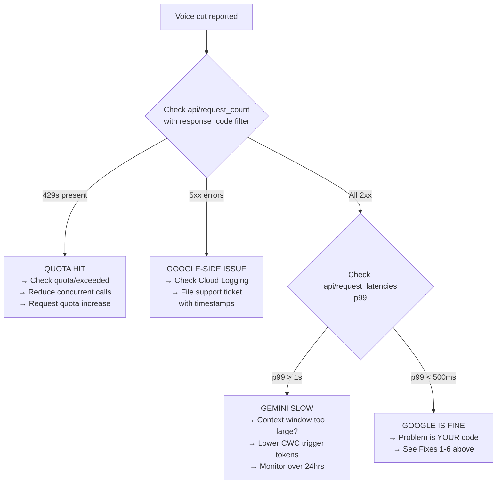
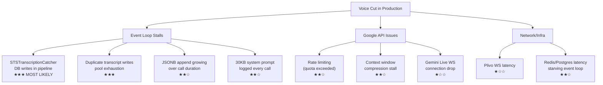

# 🔍 STS Bot Voice Cut Analysis — Deep Investigation Report

> **Scope**: Full code audit of the Aakashvani STS pipeline for voice cut/dropout causes in production.
> **Files Reviewed**: `bot_sts.py`, `server.py`, `call_transcript.py`, `call_limits.py`, `call_metrics.py`, `script_runtime.py`, `background_tasks.py`, `call_log_db.py`, `db/postgres.py`, `db/redis_client.py`, `db/warmup_state.py`, `n8n_webhook.py`, `post_call_extract.py`, `script_prefetch.py`, `sts_scripts/pyramid_bilingual.py`, `sts_scripts/bot_template.py`

---

## 🚨 Root Causes Found (Ranked by Severity)

### 1. CRITICAL — `STSTranscriptionCatcher` Does Blocking DB Work on Every User Speech Frame

[bot_sts.py:144-169](file:///home/satyam/aakashvani/bot_sts.py#L144-L169)

```python
class STSTranscriptionCatcher(FrameProcessor):
    async def process_frame(self, frame: Frame, direction: FrameDirection):
        await super().process_frame(frame, direction)
        if isinstance(frame, TranscriptionFrame) and direction == FrameDirection.UPSTREAM:
            import db.postgres as pg_db                      # ← lazy import on hot path
            from call_transcript import _pg_pool, _pg_write  # ← lazy import on hot path
            ts = datetime.now(timezone.utc).isoformat()
            self._tb.turns.append(...)
            pool = _pg_pool()
            if pool and self._tb._session_call_id:
                spawn_background_task(
                    _pg_write(
                        pg_db.append_transcript_turn(...)     # ← DB write on EVERY user turn
                    ),
                    "sts_transcription_pg",
                )
        await self.push_frame(frame, direction)               # ← frame is pushed AFTER db setup
```

> [!CAUTION]
> **This is the #1 suspect.** This `FrameProcessor` sits in the **main audio pipeline** between `user_aggregator` and `llm`. Every time the user speaks, it:
> 1. Does lazy Python `import` (first call costs ~1-5ms for module resolution)
> 2. Calls `_pg_pool()` (acquires pool reference)
> 3. Spawns a background task with `_pg_write` wrapping `append_transcript_turn`
> 4. Only THEN pushes the frame downstream
>
> **Even though the DB write is backgrounded**, the `spawn_background_task` + `asyncio.create_task` machinery and the lazy imports run synchronously on the pipeline event loop before the frame is forwarded. Under load, task creation overhead accumulates and introduces micro-stalls in the audio stream.

**Additionally**: The `TranscriptBuffer.register()` in [call_transcript.py:293-316](file:///home/satyam/aakashvani/call_transcript.py#L293-L316) does **the same DB write** via `_maybe_pg_append` through the aggregator event handlers. So **every user turn triggers TWO DB writes** — one from `STSTranscriptionCatcher` and one from `TranscriptBuffer._maybe_pg_append`.

---

### 2. CRITICAL — `_pg_write` Has a 5-Second Timeout That Blocks Background Tasks & Starves the Pool

[call_transcript.py:219-224](file:///home/satyam/aakashvani/call_transcript.py#L219-L224)

```python
_PG_WRITE_TIMEOUT_S = 5.0

async def _pg_write(coro):
    try:
        return await asyncio.wait_for(coro, timeout=_PG_WRITE_TIMEOUT_S)
    except Exception as exc:
        logger.warning("postgres call_log write skipped: {}", exc)
        return None
```

> [!WARNING]
> Every transcript turn write, every `patch_call_log_post_call_snapshot`, and every `mark_call_log_not_in_progress` goes through `_pg_write` with a **5-second timeout**. If PostgreSQL is slow (high load, network latency, lock contention from concurrent campaigns), these tasks:
> - Hold asyncpg pool connections for up to 5 seconds each
> - The pool default is only **50 connections** (`DB_POOL_MAX=50`)
> - During a campaign with 10-20 concurrent calls, each producing ~2 DB writes per user turn → **40+ pool connections consumed by transcript writes alone**
> - Pool exhaustion causes `asyncio.TimeoutError` cascading across all calls

---

### 3. HIGH — `append_transcript_turn` Uses JSONB Concatenation on a Growing Column

[db/postgres.py:3211-3227](file:///home/satyam/aakashvani/db/postgres.py#L3211-L3227)

```python
async def append_transcript_turn(pool, session_call_id, role, content, ts):
    turn = [{"role": role, "content": content, "ts": ts.isoformat()}]
    await pool.execute(
        """
        UPDATE call_logs
        SET transcript = transcript || $1::jsonb
        WHERE session_call_id = $2 AND in_progress = TRUE
        """,
        turn,
        session_call_id,
    )
```

> [!WARNING]
> **JSONB `||` (concatenation) rewrites the entire JSONB column on every append.** For a 10-minute call with ~30 turns, each append reads and rewrites an increasingly large JSON blob. This creates:
> - **Increasing write amplification** as the call progresses (turn 30 rewrites all 30 turns)
> - **Row-level locks** during the UPDATE, blocking concurrent reads of the same row
> - **WAL pressure** on PostgreSQL, as each rewrite generates a full-row WAL entry
>
> This is a textbook cause of **progressive voice degradation** — calls start fine but get worse as they continue.

---

### 4. HIGH — Massive System Prompt Logged on Every Single Call

[script_runtime.py:490-493](file:///home/satyam/aakashvani/script_runtime.py#L490-L493)

```python
logger.info("[prompt] system_instruction for call ->\n{}", runtime.system_instruction)
for idx, msg in enumerate(runtime.bootstrap_messages):
    content = msg.get("content") if isinstance(msg, dict) else str(msg)
    logger.info("[prompt] bootstrap[{}] -> {}", idx, content)
```

> [!IMPORTANT]
> The `pyramid_bilingual.py` system instruction is **~30,600 bytes** (686 lines). This gets logged via `logger.info` on **every call start**. With loguru's default `stderr` output:
> - If logging is piped to a cloud logging service (CloudWatch, GCP Logging, etc.), the synchronous serialization of a 30KB string blocks the event loop
> - At 10 concurrent calls/minute, that's **300KB/min of prompt text** just for system instruction logs
> - The `call_transcript_payload` logging at [call_transcript.py:493-500](file:///home/satyam/aakashvani/call_transcript.py#L493-L500) truncates at 4000 chars but still serializes the full JSON first (`json.dumps(transcript, ensure_ascii=False)`) before checking length

---

### 5. HIGH — Duplicate Transcript Writing (TranscriptBuffer + STSTranscriptionCatcher)

Both paths write to Postgres simultaneously:

| Path | Triggered by | Writes to |
|------|-------------|-----------|
| `STSTranscriptionCatcher.process_frame()` | Every `TranscriptionFrame` (upstream) | `pg_db.append_transcript_turn()` |
| `TranscriptBuffer.register() → _maybe_pg_append` | `on_user_turn_stopped` event | `pg_db.append_transcript_turn()` |

The `STSTranscriptionCatcher` catches **raw transcription frames** while the `TranscriptBuffer` catches **aggregated turn events**. For user speech, both fire, creating **duplicate Postgres UPDATE operations** on the same `call_logs` row. This means:
- Double the pool connections consumed
- Double the JSONB rewrite cost
- Potential ordering issues in the transcript column

---

### 6. MEDIUM — SQLite `insert_call_log` Is Blocking and Called via `asyncio.to_thread`

[call_transcript.py:518-533](file:///home/satyam/aakashvani/call_transcript.py#L518-L533)

```python
row_id = await asyncio.to_thread(
    insert_call_log,
    session_call_id=session_call_id,
    ...
    transcript=transcript,
    ...
)
```

The `insert_call_log` in [call_log_db.py:78-125](file:///home/satyam/aakashvani/call_log_db.py#L78-L125) does:
1. `json.dumps(transcript)` — serializes the entire transcript
2. `sqlite3.connect(path)` — opens a new SQLite connection each time
3. `conn.execute(INSERT)` + `conn.commit()`

While `asyncio.to_thread` moves this off the event loop, it consumes a thread from Python's default `ThreadPoolExecutor` (default 5-8 workers). Under concurrent calls, this pool can saturate.

---

### 7. MEDIUM — Pipeline Processor Ordering Creates Bottleneck

[bot_sts.py:173-182](file:///home/satyam/aakashvani/bot_sts.py#L173-L182)

```python
pipeline = Pipeline([
    transport.input(),      # 1. Audio in from Plivo
    user_aggregator,        # 2. Context aggregation
    catcher,                # 3. STSTranscriptionCatcher ← DB writes HERE
    llm,                    # 4. GeminiLiveLLMService
    transport.output(),     # 5. Audio out to Plivo
    end_gate,               # 6. BotSpeechEndGate
    usage_tap,              # 7. UsageMetricsTap
    assistant_aggregator,   # 8. Assistant context aggregation
])
```

The `catcher` (STSTranscriptionCatcher) is positioned **between the user aggregator and the LLM**. Any delay in `process_frame` directly delays audio frames reaching Gemini. Even though the DB write is backgrounded, the overhead of creating the background task runs synchronously in the frame processing chain.

---

### 8. MEDIUM — Context Window Compression Trigger May Cause Momentary Stalls

[bot_sts.py:61-77](file:///home/satyam/aakashvani/bot_sts.py#L61-L77)

Default `GEMINI_CWC_TRIGGER_TOKENS=20000` triggers compression when the context hits ~20K tokens. When compression fires:
- Gemini API pauses audio output while it compresses
- The retained ~10K tokens still need to be re-processed
- This manifests as a brief voice cut/silence mid-call

For long calls (>5 minutes), this can trigger multiple times, each causing a noticeable audio gap.

---

### 9. LOW-MEDIUM — `warmup_state.py` Race Condition Can Cause Cold-Start Stutter

[db/warmup_state.py:33-48](file:///home/satyam/aakashvani/db/warmup_state.py#L33-L48)

```python
async def wait_for_warmup(call_id: str, *, timeout_s: float = 3.0) -> bool:
    ...
    try:
        while time.monotonic() < deadline:
            value = await redis.get(key)
            if value == "ready":
                return True
            if value is None:    # ← key deleted/expired
                return False     # ← returns False, BUT...
            await asyncio.sleep(0.1)
        return (await redis.get(key)) == "ready"
    finally:
        await redis.delete(key)  # ← ALWAYS deletes the key
```

If `wait_for_warmup` returns `False` (timeout or key missing), it **deletes the key**, which means `set_warmup_ready(call_id)` (using `xx=True` — set only if exists) **silently fails**. This can cause the first Gemini connection to be cold, adding 1-2s of silence at call start.

---

### 10. LOW — `UsageMetricsTap` in Pipeline After `transport.output()`

[bot_sts.py:179](file:///home/satyam/aakashvani/bot_sts.py#L179)

The `usage_tap` processes `MetricsFrame` objects. While the `UsageMetricsAccumulator` is lightweight, it's positioned after `transport.output()` which means metrics frames flow through it along with `BotStartedSpeaking`/`BotStoppedSpeaking` frames. The `_MAX_USAGE_SNAPSHOTS = 100` cap in [call_metrics.py:11](file:///home/satyam/aakashvani/call_metrics.py#L11) prevents unbounded growth, but the list-append operations are on the shared event loop.

---

## 🔴 NEW: Production Server Findings (Hostinger VPS)

> [!CAUTION]
> **The production logs confirm the diagnosis.** The dashboard frontend is hammering the same server that runs the voice pipeline — and the queries are extremely heavy.

### Server Context
- **Single Uvicorn process** ([server.py:521](file:///home/satyam/aakashvani/server.py#L521): `uvicorn.run(app, host="0.0.0.0", port=7860)`) — no workers
- **3.8 GiB RAM VPS** on Hostinger — one Python process is the main CPU user
- **Everything shares one event loop**: API requests, WebSocket audio streaming, background DB tasks, Gemini Live connections

### The Killer: `/calls?limit=200` Fetches Full Transcripts (26 hits in sample)

The calls endpoint uses `SELECT cl.*` ([db/postgres.py:3367](file:///home/satyam/aakashvani/db/postgres.py#L3367)):

```sql
SELECT cl.*, l.name, l.phone
FROM call_logs cl LEFT JOIN leads l ON cl.lead_id = l.id
WHERE cl.client_id = $1 ...
ORDER BY cl.created_at DESC
LIMIT 200 OFFSET 0
```

**`cl.*` includes the `transcript` JSONB column** — the full turn-by-turn conversation for each call. For 200 calls with ~30 turns each:

| Component | Per Call | × 200 Calls | Total |
|:---|:---|:---|:---|
| `transcript` JSONB | 2-50 KB | × 200 | **0.4 - 10 MB** |
| `call_data` JSONB | 1-5 KB | × 200 | **0.2 - 1 MB** |
| `extraction_json` JSONB | 0.5-3 KB | × 200 | **0.1 - 0.6 MB** |
| **Total per request** | | | **0.7 - 11.6 MB** |

**This runs 26 times in your log sample.** That's potentially **up to 300 MB of JSONB data** being read from Postgres, deserialized through `json.loads` (via the asyncpg JSONB codec registered at [db/postgres.py:320-331](file:///home/satyam/aakashvani/db/postgres.py#L320-L331)), and serialized to HTTP responses — all on the **same event loop** that's trying to stream audio.

### `/api/campaigns/{id}/stats` Runs Full Table Scans (27 hits)

The stats endpoint calls `get_campaign_outcome_stats` ([db/postgres.py:2569-2592](file:///home/satyam/aakashvani/db/postgres.py#L2569-L2592)):

```sql
SELECT
    COUNT(*)::int AS total_leads,
    COUNT(*) FILTER (WHERE status = 'pending')::int AS pending_leads,
    COUNT(*) FILTER (WHERE status = 'calling')::int AS calling_leads,
    -- ... 8 more COUNT(*) FILTER aggregations
FROM leads
WHERE client_id = $1 AND campaign_id = $2
```

**11 filtered COUNT aggregations in one query**, scanning every row in the `leads` table for that campaign. With 1000+ leads per campaign, this is CPU-intensive on both Postgres and the event loop (waiting for the result).

### `/api/campaigns/` List with No Pagination (64 hits)

`list_campaigns` ([db/postgres.py lines ~1070-1090](file:///home/satyam/aakashvani/db/postgres.py)) runs:
```sql
SELECT * FROM campaigns WHERE client_id = $1 ORDER BY created_at DESC
```
**No LIMIT.** Plus it calls `get_campaigns_interested_counts` which scans the entire `leads` table:
```sql
SELECT campaign_id, COUNT(*)::int AS interested_leads
FROM leads WHERE client_id = $1 AND outcome = 'Interested'
GROUP BY campaign_id
```

### Combined Impact on Voice Pipeline

```
Dashboard polling load (sample period):
┌──────────────────────────────────────────────┐
│ 64× /campaigns         → full table scans    │
│ 27× /stats             → 11 COUNT aggregates │
│ 26× /calls?limit=200   → multi-MB JSONB      │
│ ─────────────────────────────────────────────│
│ = 117 DB-heavy requests on the SAME pool     │
│   and SAME event loop as the voice pipeline  │
└──────────────────────────────────────────────┘

    ↓ Competing with ↓

Voice pipeline needs:
┌──────────────────────────────────────────────┐
│ append_transcript_turn   → DB pool conn      │
│ Gemini WebSocket frames  → event loop time   │
│ Plivo WebSocket frames   → event loop time   │
│ Audio frame processing   → sub-ms latency    │
└──────────────────────────────────────────────┘
```

> [!WARNING]
> **The single-process Uvicorn + 50-connection DB pool + dashboard polling creates a perfect storm.** Every time the dashboard refreshes, it steals event loop time and DB connections from active voice calls.

### Immediate Fixes for This

**Fix A — Exclude transcripts from list queries** (highest impact, easiest fix):
```sql
-- BEFORE:
SELECT cl.*, l.name, l.phone FROM call_logs cl ...

-- AFTER:
SELECT cl.id, cl.session_call_id, cl.client_id, cl.campaign_id,
       cl.lead_id, cl.bot_config_id, cl.route, cl.call_sid,
       cl.started_at, cl.ended_at, cl.created_at,
       cl.in_progress, cl.duration_seconds, cl.billed_minutes,
       cl.credits_charged, cl.outcome, cl.qualified,
       cl.usage_prompt_tokens, cl.usage_completion_tokens,
       cl.usage_total_tokens, cl.usage_tts_characters,
       l.name, l.phone
FROM call_logs cl ...
-- Deliberately EXCLUDE: transcript, call_data, extraction_json, plivo_hangup_json
```
This alone could reduce payload from 10 MB to ~100 KB per request.

**Fix B — Add pagination to `list_campaigns`**:
```python
# Add LIMIT/OFFSET
rows = await pool.fetch(
    "SELECT * FROM campaigns WHERE client_id = $1 ORDER BY created_at DESC LIMIT $2 OFFSET $3",
    client_id, limit, offset,
)
```

**Fix C — Cache stats queries** (they don't need real-time freshness):
```python
from functools import lru_cache
import time

# Cache stats for 10 seconds — dashboards don't need sub-second freshness
_stats_cache: dict[str, tuple[float, dict]] = {}

async def get_campaign_outcome_stats_cached(pool, client_id, campaign_id):
    key = f"{client_id}:{campaign_id}"
    cached = _stats_cache.get(key)
    if cached and time.monotonic() - cached[0] < 10:
        return cached[1]
    stats = await get_campaign_outcome_stats(pool, client_id, campaign_id)
    _stats_cache[key] = (time.monotonic(), stats)
    return stats
```

**Fix D — Run with multiple Uvicorn workers** to isolate API from voice:
```bash
# Instead of: uvicorn.run(app, host="0.0.0.0", port=7860)
# Use: 
uvicorn server:app --host 0.0.0.0 --port 7860 --workers 2
```
⚠️ This requires switching from the global `_pool` pattern to per-worker pool init.

---

## 📊 Data Size Analysis

| Data Element | Size per Call | Logged? | Frequency |
|:---|:---|:---|:---|
| System instruction (`pyramid_bilingual`) | ~30 KB | Yes (`logger.info`) | Once per call |
| Bootstrap message | ~200 bytes | Yes (`logger.info`) | Once per call |
| `call_transcript_summary` | ~500 bytes | Yes | Once per call |
| `call_transcript_payload` (full JSON) | 2-50 KB | Yes (truncated at 4KB) | Once per call |
| `append_transcript_turn` per turn | ~100-500 bytes | No | Per user/assistant turn (~30/call) |
| `usage_metrics_json` blob | ~2-5 KB | No | Once per call |
| n8n webhook payload | 5-120 KB | Yes (size logged) | Once per call |

> [!IMPORTANT]
> The biggest logging concern is the **system instruction dump** (30KB per call). At 50 concurrent calls, that's **1.5 MB of synchronous log writes** hitting `stderr` at call-start time.

---

## 🔧 Recommended Fixes (Priority Order)

### Fix 1: Remove `STSTranscriptionCatcher` DB writes (eliminates duplicate writes)
The `TranscriptBuffer.register()` already handles turn persistence via `on_user_turn_stopped` / `on_assistant_turn_stopped`. The `STSTranscriptionCatcher` creates duplicate writes. Remove the DB write path from it or remove the class entirely if the aggregator events cover all transcription.

### Fix 2: Move `catcher` after `llm` in the pipeline
If you keep `STSTranscriptionCatcher`, move it after the LLM so it doesn't block audio frames reaching Gemini:
```python
pipeline = Pipeline([
    transport.input(),
    user_aggregator,
    llm,                    # ← LLM first, no delay
    catcher,                # ← catch transcriptions after LLM
    transport.output(),
    ...
])
```

### Fix 3: Replace per-turn JSONB append with batch write
Instead of `transcript = transcript || $1::jsonb` on every turn, accumulate turns in-memory and write once at call end (which you already do via `finalize_call_log`). The per-turn `append_transcript_turn` is redundant if `finalize_call_log` writes the complete transcript.

### Fix 4: Reduce system instruction logging
```python
# Before (30KB logged every call)
logger.info("[prompt] system_instruction for call ->\n{}", runtime.system_instruction)

# After (hash + size only)
logger.info("[prompt] system_instruction len={} hash={:.8s}",
            len(runtime.system_instruction),
            hashlib.md5(runtime.system_instruction.encode()).hexdigest())
logger.debug("[prompt] system_instruction for call ->\n{}", runtime.system_instruction)
```

### Fix 5: Increase DB pool size or isolate transcript writes
```env
DB_POOL_MIN=10
DB_POOL_MAX=100
```
Or better: create a separate pool for non-critical transcript writes so they don't starve the main pool.

### Fix 6: Lower `_PG_WRITE_TIMEOUT_S` for non-critical writes
```python
_PG_WRITE_TIMEOUT_S = 2.0   # down from 5.0
```

---

## 🔎 How to Diagnose from Google's Side

All metrics below use the `serviceruntime.googleapis.com/` prefix. In **Metrics Explorer**, select **Consumed API** as the resource type and filter to `service = "generativelanguage.googleapis.com"`.

### Step 1: Check Error Rates (Are Gemini calls failing?)

**Metric**: `serviceruntime.googleapis.com/api/request_count`

In **Metrics Explorer** (Cloud Console → Monitoring → Metrics Explorer):

| Setting | Value |
|:---|:---|
| Resource type | `Consumed API` |
| Metric | `Request count` |
| Filter | `resource.labels.service = "generativelanguage.googleapis.com"` |
| Group by | `metric.labels.response_code` |
| Aggregation | Sum |
| Period | 1 minute |

**What to look for**:
- **`response_code = 429`** → Rate limited. The Gemini Live WebSocket stalls mid-stream.
- **`response_code = 503`** → Google servers overloaded. Causes audio drops.
- **`response_code = 500`** → Internal Google error. Report to Google if sustained.
- **`response_code = 499`** → Client cancelled (could be your side timing out).

You can also group by `metric.labels.response_code_class` to see `2xx` vs `4xx` vs `5xx` distribution at a glance.

> [!TIP]
> The `grpc_status_code` label gives you granular gRPC codes. Look for:
> - `grpc_status_code = 8` → `RESOURCE_EXHAUSTED` (quota hit)
> - `grpc_status_code = 14` → `UNAVAILABLE` (server down)
> - `grpc_status_code = 4` → `DEADLINE_EXCEEDED` (response timeout)
> - `grpc_status_code = 13` → `INTERNAL` (Google bug)

---

### Step 2: Check Latencies (Is Gemini responding slowly?)

**Metric**: `serviceruntime.googleapis.com/api/request_latencies`

| Setting | Value |
|:---|:---|
| Resource type | `Consumed API` |
| Metric | `Request latencies` |
| Filter | `resource.labels.service = "generativelanguage.googleapis.com"` |
| Aligner | `Delta` |
| Reducer | `99th percentile` |
| Period | 1 minute |

**What to look for**:
- **p50 > 200ms** → Gemini is slow; will cause perceptible voice delays.
- **p99 > 1s** → Tail latency causing intermittent voice cuts on unlucky requests.
- **Sustained spike** correlated with your voice cut timestamps → Google-side problem.
- **Steady latency but your app still has issues** → Problem is on your side (event loop, network).

> [!IMPORTANT]
> This metric covers **non-streaming requests only**. Gemini Live uses a WebSocket stream, so initial connection/setup latencies will show here but ongoing stream latency may not. Use this to detect cold-start and reconnection delays.

Also check **request/response sizes** to see if payloads are abnormally large:

- `serviceruntime.googleapis.com/api/request_sizes` — bytes sent to Google
- `serviceruntime.googleapis.com/api/response_sizes` — bytes received from Google

A sudden increase in request sizes could indicate context window growth or prompt bloat.

---

### Step 3: Check Quota Usage (Are you hitting limits?)

These are the critical quota metrics. Go to **Cloud Console → IAM & Admin → Quotas & System Limits** and filter to `generativelanguage.googleapis.com`.

#### 3a. Are you hitting rate limits right now?

**Metric**: `serviceruntime.googleapis.com/quota/exceeded`

| Setting | Value |
|:---|:---|
| Resource type | `Consumer Quota` |
| Metric | `Quota exceeded error` |
| Filter | `resource.labels.service = "generativelanguage.googleapis.com"` |
| Group by | `metric.labels.quota_metric`, `metric.labels.limit_name` |

If this is `true` for any `quota_metric`, you're being rate-limited. The `limit_name` label tells you which limit (e.g., "Requests per minute", "Tokens per minute").

#### 3b. How close to the limit are you?

**Metric**: `serviceruntime.googleapis.com/quota/rate/net_usage`

| Setting | Value |
|:---|:---|
| Resource type | `Consumer Quota` |
| Metric | `Rate quota usage` |
| Filter | `resource.labels.service = "generativelanguage.googleapis.com"` |
| Group by | `metric.labels.quota_metric` |
| Period | 1 minute |

Compare this against the limit:

**Metric**: `serviceruntime.googleapis.com/quota/limit`

| Setting | Value |
|:---|:---|
| Resource type | `Consumer Quota` |
| Metric | `Quota limit` |
| Filter | `resource.labels.service = "generativelanguage.googleapis.com"` |
| Group by | `metric.labels.quota_metric`, `metric.labels.limit_name` |

> [!WARNING]
> If `rate/net_usage` is consistently >80% of `quota/limit` for any quota metric, you will get intermittent 429s during traffic spikes. This is a **very common cause of voice cuts** during campaign runs with concurrent calls.

#### 3c. Concurrent session limits (Live API specific)

**Metric**: `serviceruntime.googleapis.com/quota/concurrent/usage`

| Setting | Value |
|:---|:---|
| Resource type | `Consumer Quota` |
| Metric | `Concurrent Quota usage` |
| Filter | `resource.labels.service = "generativelanguage.googleapis.com"` |
| Group by | `metric.labels.quota_metric` |

Compare against `quota/concurrent/limit`. If concurrent Live API sessions hit the cap, new calls fail to connect or existing sessions get dropped.

---

### Step 4: Set Up Alerts for Proactive Detection

Create these alerts in **Cloud Console → Monitoring → Alerting → Create Policy**:

#### Alert 1: Error rate spike
```
Metric:    serviceruntime.googleapis.com/api/request_count
Filter:    resource.labels.service = "generativelanguage.googleapis.com"
           metric.labels.response_code_class = "5xx"
Condition: > 5 errors in 5 minutes
```

#### Alert 2: Quota nearing limit
```
Metric:    serviceruntime.googleapis.com/quota/rate/net_usage
Filter:    resource.labels.service = "generativelanguage.googleapis.com"
Condition: > 80% of quota/limit for 3 consecutive minutes
```

#### Alert 3: Quota exceeded
```
Metric:    serviceruntime.googleapis.com/quota/exceeded
Filter:    resource.labels.service = "generativelanguage.googleapis.com"
Condition: == true
```

---

### Step 5: Cloud Logging Queries

If you have a GCP project with Cloud Logging enabled for the Gemini API:

```
-- All errors from Gemini API
resource.type="consumed_api"
resource.labels.service="generativelanguage.googleapis.com"
severity>=WARNING

-- Rate limit events specifically
resource.type="consumed_api"
resource.labels.service="generativelanguage.googleapis.com"
httpRequest.status=429

-- Server errors
resource.type="consumed_api"
resource.labels.service="generativelanguage.googleapis.com"
httpRequest.status>=500

-- Correlate with specific time window (replace timestamps)
resource.type="consumed_api"
resource.labels.service="generativelanguage.googleapis.com"
severity>=ERROR
timestamp>="2026-07-28T09:00:00Z"
timestamp<="2026-07-28T11:00:00Z"
```

---

### Step 6: Pipecat-Side Event Handlers (Add These to `bot_sts.py`)

Add these after `llm = GeminiLiveLLMService(...)` in [bot_sts.py:122-128](file:///home/satyam/aakashvani/bot_sts.py#L122-L128):

```python
@llm.event_handler("on_connection_error")
async def on_conn_error(llm, error):
    logger.error("[gemini] Connection error: {} — will cause voice cut", error)

@llm.event_handler("on_connection_lost")
async def on_conn_lost(llm):
    logger.error("[gemini] Connection lost — active call will experience voice cut")

@llm.event_handler("on_error")
async def on_error(llm, error):
    logger.error("[gemini] Service error: {}", error)
```

---

### Step 7: Network Diagnostics from Production Server

```bash
# DNS resolution latency
time dig generativelanguage.googleapis.com

# TCP + TLS handshake timing
curl -o /dev/null -s -w \
  "dns: %{time_namelookup}s\nconnect: %{time_connect}s\ntls: %{time_appconnect}s\ntotal: %{time_total}s\n" \
  https://generativelanguage.googleapis.com/

# Packet loss and route quality (100 packets)
mtr -r -c 100 generativelanguage.googleapis.com

# Sustained WebSocket connectivity test
python3 -c "
import asyncio, time, websockets
async def test():
    uri = 'wss://generativelanguage.googleapis.com'
    try:
        async with websockets.connect(uri) as ws:
            print(f'Connected in {time.time():.3f}s')
    except Exception as e:
        print(f'Failed: {e}')
asyncio.run(test())
"
```

---

### 🎯 Quick Triage Runbook

When a voice cut is reported:



> [!TIP]
> **Key insight from Google's docs**: Metrics are sampled every 60 seconds and data may not be visible for up to 1800 seconds (30 minutes). So when a voice cut happens, you need to wait up to 30 minutes before the data shows in Metrics Explorer. **Capture your voice cut timestamps** immediately so you can correlate later.

---

## 📋 Summary: Most Likely Voice Cut Causes



> [!TIP]
> **Start with Fixes 1-3** (remove duplicate DB writes, move catcher position, stop per-turn JSONB append). These are the most likely culprits and require minimal code changes. Then set up the Google API monitoring (Steps 1-4 above) to rule out server-side issues.
