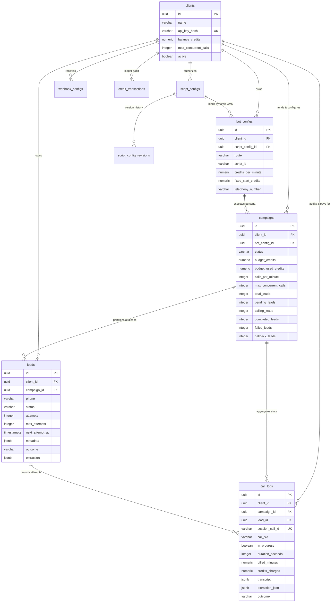
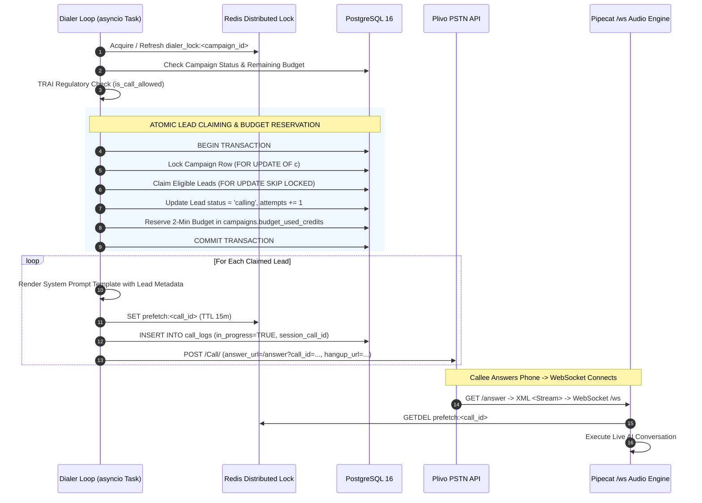
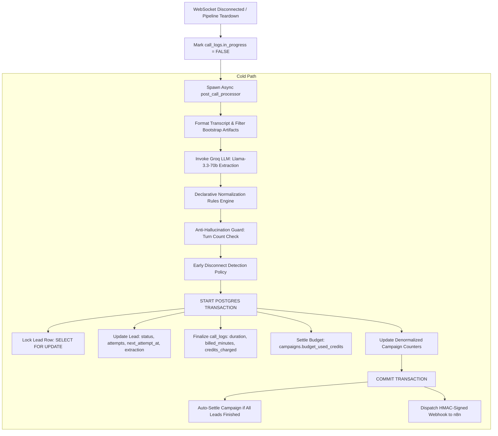

# Aakashvani: System Design & Engineering Master Guide (HLD to LLD)
*Production Architecture, Low-Latency Voice AI Pipelines, Concurrency Engine, Financial Ledger & Interview Handbook*

---

## Table of Contents
1. [Executive Summary & High-Level Design (HLD)](#1-executive-summary--high-level-design-hld)
   - 1.1 Business Problem & Product Goals
   - 1.2 Core Architectural Principles & Latency Budget
   - 1.3 High-Level System Architecture Diagram
   - 1.4 Dual AI Route Topologies: STS vs. Cascaded Multi-Provider
2. [Database Architecture & Data Modeling (PostgreSQL 16)](#2-database-architecture--data-modeling-postgresql-16)
   - 2.1 Multi-Tenant Isolation & Schema Design
   - 2.2 Entity Relationship Diagram (ERD)
   - 2.3 Detailed Table Specifications & Schema Mechanics
   - 2.4 Index Engineering & Query Optimization
   - 2.5 Transactional Guarantees & Concurrency Primitives
3. [Redis Architecture & Ephemeral State Management](#3-redis-architecture--ephemeral-state-management)
   - 3.1 Redis's Role in Real-Time Voice Infrastructure
   - 3.2 Ephemeral Key Registry, Lifecycles & TTL Policies
   - 3.3 Distributed Locking with Atomic Lua Scripts
   - 3.4 Rate Limiting & Pre-warm Synchronization
4. [Low-Level Design (LLD): Dialer Engine & Concurrency](#4-low-level-design-lld-dialer-engine--concurrency)
   - 4.1 Concurrent Dialer Loop Architecture
   - 4.2 Lead Claiming Algorithm (`FOR UPDATE SKIP LOCKED`)
   - 4.3 Indian Telecom Regulatory Compliance (TRAI) Engine
   - 4.4 Carrier Balance Pre-flight Checks & Circuit Breaking
   - 4.5 Stale Sweepers & Crash Recovery Loops
5. [Low-Level Design (LLD): Real-Time Voice AI Pipeline](#5-low-level-design-lld-real-time-voice-ai-pipeline)
   - 5.1 Telephony Ingestion & Bidirectional Audio WebSocket
   - 5.2 Pipecat Frame Processing Graph
   - 5.3 Speech-to-Speech (STS) Pipeline via Gemini Live
   - 5.4 Cascaded Multi-Provider Factory Pattern
   - 5.5 Graceful Hangup Architecture & The Gemini 30s Dead-Air Solution
   - 5.6 Live Transcript Streaming & Debounced Database Flushing
6. [Post-Call Processing, State Machine & Financial Ledger](#6-post-call-processing-state-machine--financial-ledger)
   - 6.1 Asynchronous Post-Call Architecture
   - 6.2 Groq LLM Structured Extraction & Declarative Normalization
   - 6.3 Anti-Hallucination & Early-Disconnect Guardrails
   - 6.4 Lead State Machine Transitions & Natural Language Callback Parsing
   - 6.5 Prepaid Financial Ledger & Atomic Credit Settlement
   - 6.6 HMAC-Signed Webhook Fan-out (n8n Integration)
7. [Comprehensive System Design & Technical Interview Handbook](#7-comprehensive-system-design--technical-interview-handbook)
   - 7.1 System Architecture, Streaming & Latency Optimization
   - 7.2 Database Engineering, Concurrency & Distributed Locking
   - 7.3 Redis Strategy, Ephemeral State & Failure Recovery
   - 7.4 Voice AI Pipelines, Audio Edge Cases & Failure Modes
   - 7.5 Financial Integrity, Ledger Accounting & Billing Models
8. [Summary & Repository Quick Reference](#8-summary--repository-quick-reference)

---

<div style="page-break-after: always;"></div>

## 1. Executive Summary & High-Level Design (HLD)

### 1.1 Business Problem & Product Goals
**Aakashvani** is a high-throughput, multi-tenant B2B **Autonomous Outbound AI Voice-Calling Platform** engineered specifically for the Indian enterprise landscape (Real Estate, Insurance, EdTech, Lending, Healthcare). 

Traditional telecalling operations face critical bottlenecks: high human agent attrition, inconsistent qualification accuracy, delayed CRM updates, and exorbitant per-seat costs. Aakashvani automates telecalling by deploying natural, multilingual conversational AI agents that:
1. Place thousands of concurrent outbound telephone calls across Indian PSTN/mobile networks.
2. Converse dynamically in regional Indian languages (Hindi, Marathi, English, Hinglish) with sub-second turnaround latency.
3. Adhere strictly to conversational playbooks, objections handling, and dynamic persona definitions.
4. Extract structured lead qualification intelligence post-call using specialized LLM extractors.
5. Coordinate lead lifecycle states, scheduling callbacks, retrying unanswered dials, and triggering instant CRM/webhook updates.
6. Enforce rigorous financial isolation through a real-time prepaid credit ledger.

```
┌──────────────────────────────────────────────────────────────────────────────────────────────────┐
│                                       KEY SYSTEM METRICS                                         │
├────────────────────────────┬─────────────────────────────┬───────────────────────────────────────┤
│ Conversational Turn Latency│ < 500 ms (STS) / < 800 ms   │ Audio in to Audio out response window │
│ Telephony Audio Contract   │ 8 kHz PCM Mono              │ Standard Plivo μ-law / linear PCM     │
│ Database Consistency       │ Strict ACID (PostgreSQL 16) │ Multi-tenant isolation + row locking │
│ Ephemeral Coordination     │ Sub-millisecond (Redis 7)   │ Lua-scripted locks & prefetch stores  │
│ Regulatory Compliance      │ TRAI (Telecom India)        │ 09:00 - 21:00 IST Window Enforcement  │
│ Financial Accounting       │ Pro-rata per second         │ Pre-allocation + Dial Reservation     │
└────────────────────────────┴─────────────────────────────┴───────────────────────────────────────┘
```

---

### 1.2 Core Architectural Principles & Latency Budget

To deliver human-like conversation over telephony, the platform adheres to three non-negotiable architectural mandates:

1. **Zero Cold-Start Latency on Telephony Connect**: Telephony carriers charge the moment a callee picks up. If the bot takes 2–3 seconds to load its prompt or initialize AI models, the human user says *"Hello? Hello?"* and disconnects. Aakashvani uses **Dial-Time Prompt Prefetching** and **Pre-warmed AI WebSockets** to speak within **150ms** of call pickup.
2. **Strict Separation of Hot Audio Path vs. Cold Intelligence Path**: Audio frames must NEVER be blocked by database queries, CRM webhooks, or complex LLM extraction. All extraction, financial finalization, ledger updates, and webhook fan-outs occur asynchronously via dedicated background workers after the audio pipeline tears down.
3. **Double-Spend & Race Condition Prevention**: In a concurrent dialing system where dozens of worker tasks claim leads simultaneously across shared client budgets, state management must be atomic. We pair **PostgreSQL `FOR UPDATE SKIP LOCKED`** with **Redis Distributed Locks** and **Two-Phase Credit Reservation**.

```
┌────────────────────────────────────────────────────────────────────────────────────────┐
│                              TOTAL LATENCY BUDGET (< 600 ms)                           │
├────────────────────────────────────────────────────────────────────────────────────────┤
│ [PSTN Carrier] ──(30ms)──> [FastAPI WS Transport] ──(20ms)──> [Silero VAD Endpointing] │
│                                                                        │ (80ms)        │
│                                                                        ▼               │
│ [Plivo Audio Out] <──(30ms)── [TTS Audio Stream] <──(180ms)── [Gemini Live / Groq LLM]│
└────────────────────────────────────────────────────────────────────────────────────────┘
```

---

### 1.3 High-Level System Architecture Diagram

```
                              ┌───────────────────────────────────┐
                              │     React 18 + Vite SPA Client    │
                              │  Admin (/admin/*) | Client (/app) │
                              └─────────────────┬─────────────────┘
                                                │ HTTPS / REST
                                                ▼
┌─────────────────────────────────────────────────────────────────────────────────────────────────┐
│                               FASTAPI ASGI BACKEND (server.py :7860)                             │
│                                                                                                 │
│  ┌─────────────────────────┐  ┌─────────────────────────┐  ┌─────────────────────────────────┐  │
│  │   Client Auth & API     │  │    Admin Auth & API     │  │   Telephony Inbound Webhooks    │  │
│  │ (Bearer Token -> SHA256)│  │   (X-Admin-Key Header)  │  │  (/start, /answer, /plivo-*)    │  │
│  └────────────┬────────────┘  └────────────┬────────────┘  └────────────────┬────────────────┘  │
│               │                            │                                │                   │
│               ▼                            ▼                                ▼                   │
│  ┌───────────────────────────────────────────────────────────────────────────────────────────┐  │
│  │                                 BACKGROUND RUNTIME & MANAGERS                             │  │
│  │  ┌─────────────────────┐  ┌──────────────────────────┐  ┌──────────────────────────────┐  │  │
│  │  │ Concurrent Dialer   │  │ Real-Time Audio Pipeline │  │ Post-Call Processor          │  │  │
│  │  │ (Task per Campaign) │  │ (Pipecat WebSocket Server│  │ (Groq Extraction, Billing,   │  │  │
│  │  │                     │  │  bot_sts / bot_cascade)  │  │  Lead State Machine, Webhook)│  │  │
│  │  └──────────┬──────────┘  └─────────────┬────────────┘  └──────────────┬───────────────┘  │  │
│  └─────────────┼───────────────────────────┼──────────────────────────────┼──────────────────┘  │
└────────────────┼───────────────────────────┼──────────────────────────────┼─────────────────────┘
                 │                           │                              │
                 ▼                           ▼                              ▼
┌────────────────────────────────┐ ┌────────────────────────────────┐ ┌───────────────────────────┐
│     POSTGRESQL 16 CLUSTER      │ │         REDIS 7 CLUSTER        │ │   EXTERNAL CLOUD SERVICES │
│ (asyncpg Connection Pooling)   │ │ (Ephemeral Cache & Coordinator)│ │                           │
│                                │ │                                │ │ • Plivo PSTN Telephony    │
│ • clients (Ledger Balance)     │ │ • dialer_lock:<campaign_id>    │ │ • Google Gemini Live STS  │
│ • bot_configs (Route & Specs)  │ │ • prefetch:<call_id>           │ │ • Sarvam / Deepgram STT   │
│ • campaigns (Throttles & State)│ │ • pgctx:<call_id>              │ │ • Groq LLM (Llama-3.3-70b)│
│ • leads (Dialer State Machine) │ │ • warmup:<call_id>             │ │ • Cartesia / ElevenLabs   │
│ • call_logs (Transcripts/Audit)│ │ • slowapi rate limit storage   │ │ • n8n Webhook Consumer    │
│ • script_configs (Dynamic CMS) │ │                                │ │ • Cloudflare R2 Audio Stg │
└────────────────────────────────┘ └────────────────────────────────┘ └───────────────────────────┘
```

---

### 1.4 Dual AI Route Topologies: STS vs. Cascaded Multi-Provider

Aakashvani implements two distinct audio processing topologies selected dynamically per bot configuration:

```
TOPOLOGY A: Speech-to-Speech (STS) Route [bot_sts.py]
===================================================================================================
Plivo (8kHz PCM) ──> [FastAPI WS] ──> [Silero VAD] ──> [Gemini Live WebSocket API] ──> [Audio Out]
                                                                │
                                                     (Unified Audio-to-Audio)
                                                     Single sub-400ms Hop

TOPOLOGY B: Cascaded Multi-Provider Route [bot_cascade.py]
===================================================================================================
Plivo (8kHz PCM) ──> [FastAPI WS] ──> [Silero VAD] ──> [STT: Sarvam / Deepgram / Soniox / Eleven]
                                                                │ Text
                                                                ▼
                                                        [LLM: Groq / OpenAI / Google]
                                                                │ Text Tokens
                                                                ▼
                                                        [TTS: Cartesia / ElevenLabs / Sarvam]
                                                                │ 8kHz PCM Audio
                                                                ▼
                                                        [Audio End Gate] ──> [Plivo Audio Out]
```

| Dimension | Speech-to-Speech (STS) | Cascaded Multi-Provider |
| :--- | :--- | :--- |
| **Core Engine** | Google Gemini Live Preview (`gemini-2.0` / `gemini-3.1`) | Discrete STT + LLM + TTS chained via Pipecat 1.5 |
| **End-to-End Latency** | **300 ms – 500 ms** (Ultra-low) | **600 ms – 950 ms** (Cumulative hop latency) |
| **Language Nuance** | Native prosody, tone inflection, seamless Hindi/Marathi accents | Highly optimized Indian STT (Sarvam) + Fast Inference (Groq) |
| **Interruption Handling**| Native model-level barge-in over full-duplex audio | Pipeline-level frame cancellation triggered by VAD |
| **Custom Function Tools**| Handled natively during live audio stream | Schema-validated tool execution via LLM JSON mode |
| **Cost Profile** | Billed per audio token (Inbound/Outbound) | Billed per STT audio second + LLM token + TTS character |

---

<div style="page-break-after: always;"></div>

## 2. Database Architecture & Data Modeling (PostgreSQL 16)

### 2.1 Multi-Tenant Isolation & Schema Design
The system of record is **PostgreSQL 16**, interfaced asynchronously via `asyncpg`. Multi-tenancy is enforced at the database layer through strict tenant scoping:
- Every core table (`bot_configs`, `campaigns`, `leads`, `call_logs`, `script_configs`, `webhook_configs`, `credit_transactions`) contains a `client_id UUID NOT NULL REFERENCES clients(id) ON DELETE CASCADE`.
- Every application query executed on behalf of a client explicitly filters by `client_id` (`WHERE client_id = $N`), preventing cross-tenant data leakage.
- Administrative queries (`/internal/*`) execute specialized administrative fetch methods (e.g., `list_call_logs(client_id=None)`).

---

### 2.2 Entity Relationship Diagram (ERD)



---

### 2.3 Detailed Table Specifications & Schema Mechanics

#### 1. `clients` (Master Tenant & Balance Authority)
Holds client credentials, operational concurrency limits, and the master credit balance.
- `api_key_hash VARCHAR(64) UNIQUE`: Stores the hex-encoded **SHA-256 hash** of the client API key. The plain-text key is never persisted or logged.
- `balance_credits NUMERIC(12,2)`: Master prepaid wallet. Decremented when campaign budgets are allocated; incremented when admins top up credits or when unused campaign budgets are returned.
- `max_concurrent_calls INTEGER`: Hard platform ceiling across all active campaigns for this tenant.

#### 2. `bot_configs` (Persona & Pricing Registry)
Defines how a call will be executed and billed.
- `route VARCHAR(20)`: `'sts'` (Gemini Live) or `'cascaded'` (STT+LLM+TTS).
- `script_id VARCHAR(100)`: Identifies static fallback script files (`sts_scripts/<id>.py` or `cascade_scripts/<id>.py`).
- `script_config_id UUID REFERENCES script_configs(id)`: When populated, routes prompt generation through the dynamic DB-backed CMS rather than flat files.
- `credits_per_minute NUMERIC(6,2)`: Pro-rata rate per minute (calculated down to the second).
- `fixed_start_credits NUMERIC(10,4)`: Connection setup fee charged immediately upon carrier pickup (default: `0.6000`).

#### 3. `campaigns` (Orchestration Engine & Real-Time Counters)
Controls dialing pace, budget partitions, and maintains **denormalized lead counters**.
- `status VARCHAR(50)`: State machine: `draft` $\rightarrow$ `running` $\rightarrow$ `(pausing)` $\rightarrow$ `paused` $\rightarrow$ `completed` / `cancelled`.
- `budget_credits NUMERIC(12,2)`: Budget locked from `clients.balance_credits` upon campaign creation.
- `budget_used_credits NUMERIC(12,2)`: Running accumulator tracking both active dial reservations and finalized call charges.
- **Denormalized Counters**: `total_leads`, `pending_leads`, `calling_leads`, `completed_leads`, `failed_leads`, `callback_leads`.
  - *Engineering Rationale*: Querying `COUNT(*)` over millions of lead rows on a 5-second UI polling loop introduces massive database CPU pressure. Counters are updated atomically inside the same transaction as lead status transitions (`increment_campaign_counters`).

#### 4. `leads` (Dialer State Machine Authority)
Represents a contact target and drives dialing progression.
- `phone VARCHAR(20)`: E.164 normalized phone number. Unique constraint on `(campaign_id, phone)` prevents duplicate uploads.
- `status VARCHAR(50)`: `pending` $\rightarrow$ `calling` $\rightarrow$ `completed` | `failed` | `callback_scheduled`.
- `attempts INT` / `max_attempts INT`: Retry counter. Incremented atomically when claimed by the dialer.
- `next_attempt_at TIMESTAMPTZ`: Gate for dialer eligibility. Set to future timestamps for retry backoff or callback requests.
- `metadata JSONB`: Dynamic domain attributes from CSV (e.g. `{ "unit_type": "3BHK", "budget": "1.5Cr" }`), safely injected into prompts using `string.Template`.

#### 5. `call_logs` (Audit Trail & Live Polling Source)
Per-attempt execution record.
- `session_call_id VARCHAR(255) UNIQUE`: Internal UUID generated before dial dispatch. Used by frontend drawers for real-time polling.
- `call_sid VARCHAR(255)`: Telephony carrier UUID (Plivo `CallUUID`), linked asynchronously upon `/answer`.
- `in_progress BOOLEAN`: `TRUE` while the call is live; set to `FALSE` during pipeline teardown.
- `transcript JSONB`: Chronological array of turns: `[{"role": "assistant", "content": "...", "timestamp": "..."}]`.
- `cost_usd NUMERIC(10,6)`: Internal COGS margin tracking provider API expenses (Google, Groq, Cartesia, Sarvam), strictly shielded from tenant visibility.

#### 6. `script_configs` & `script_config_revisions` (Dynamic AI CMS)
Enables zero-downtime prompt engineering, model switching, and extraction updates from the Admin UI.
- `system_instruction_template TEXT`: The core prompt containing `${lead_name}` and `${custom_field}` placeholders.
- `extraction_schema JSONB`: Pydantic-compatible JSON schema defining the required post-call extraction output.
- `normalization_rules JSONB`: Declarative rule list converting fuzzy LLM responses to strict enum outcomes.
- `script_config_revisions`: Immutable audit log storing complete JSON snapshots on every create, update, or rollback.

---

### 2.4 Index Engineering & Query Optimization

To sustain hundreds of concurrent calls without index lock contention, PostgreSQL indexes are engineered specifically around hot execution paths:

```sql
-- 1. THE HOTTEST DIALER INDEX (Partial Composite Index)
-- Enables sub-millisecond lead claiming without table scans
CREATE INDEX idx_leads_dialer ON leads (campaign_id, next_attempt_at ASC)
WHERE status IN ('pending', 'callback_scheduled');

-- 2. LIVE CALL LOG POLLING INDEX (Partial Index)
-- Powers the real-time active call dashboard
CREATE INDEX idx_call_logs_live ON call_logs (session_call_id)
WHERE in_progress = TRUE;

-- 3. TELEPHONY WEBHOOK LOOKUP
CREATE INDEX idx_call_logs_call_sid ON call_logs (call_sid);

-- 4. TENANT-SCOPED CAMPAIGN FILTERING
CREATE INDEX idx_leads_campaign_status ON leads (campaign_id, status);
CREATE INDEX idx_call_logs_client_date ON call_logs (client_id, created_at DESC);
```

---

### 2.5 Transactional Guarantees & Concurrency Primitives

To guarantee zero race conditions between concurrent dialer threads claiming leads, Aakashvani uses **Row-Level Locking with Skipped Locks**:

```sql
-- Executed inside asyncpg transaction during lead claiming:
SELECT id, phone, name, metadata, attempts, max_attempts
FROM leads
WHERE campaign_id = $1
  AND client_id = $2
  AND status IN ('pending', 'callback_scheduled')
  AND attempts < max_attempts
  AND next_attempt_at <= NOW()
  AND NOT EXISTS (
      -- Safety guard: ensure no live call is active for this lead
      SELECT 1 FROM call_logs c
      WHERE c.lead_id = leads.id AND c.in_progress = TRUE
        AND c.started_at > NOW() - (INTERVAL '15 minutes')
  )
ORDER BY next_attempt_at ASC
LIMIT $3
FOR UPDATE SKIP LOCKED;
```

#### Why `FOR UPDATE SKIP LOCKED`?
1. **Zero Thread Contention**: If Worker A is locking Rows 1–10 to place calls, Worker B executing simultaneously does not wait or block; it immediately skips those locked rows and claims Rows 11–20.
2. **Elimination of Deadlocks**: Because workers never wait on each other's row locks, deadlock frequency drops to zero.

---

<div style="page-break-after: always;"></div>

## 3. Redis Architecture & Ephemeral State Management

### 3.1 Redis's Role in Real-Time Voice Infrastructure
While PostgreSQL acts as the ACID system of record, **Redis 7** provides sub-millisecond ephemeral state coordination. In telephony, network events arrive out of order (e.g. WebSocket connect before HTTP `/answer` finishes, or `/plivo-hangup` before WebSocket closure). Redis bridges these distributed asynchronous events without polluting the relational database.

```
┌────────────────────────────────────────────────────────────────────────────────────────┐
│                                 REDIS MEMORY TOPOLOGY                                  │
├────────────────────────────┬─────────────────────────────┬─────────────────────────────┤
│ Storage Key Pattern        │ Data Structure              │ TTL / Expiry Policy         │
├────────────────────────────┼─────────────────────────────┼─────────────────────────────┤
│ dialer_lock:<campaign_id>  │ String (UUID token)         │ 30 seconds (Heartbeat renewed)│
│ prefetch:<call_id>         │ String (JSON serialized)    │ 15 minutes (Single-pop)     │
│ pgctx:<call_id>            │ String (JSON serialized)    │ 15 minutes (Fallback grace) │
│ warmup:<call_id>           │ String (Status flag)        │ 60 seconds                  │
│ slowapi:rate_limit:*       │ Hash / ZSet (SlowAPI)       │ 60 seconds sliding window   │
└────────────────────────────┴─────────────────────────────┴─────────────────────────────┘
```

---

### 3.2 Ephemeral Key Registry, Lifecycles & TTL Policies

#### 1. `prefetch:<call_id>` (Dial-Time Prompt Stash)
- **Lifecycle**: Written by `concurrent_dialer.py` before dialing Plivo $\rightarrow$ Read and atomically deleted (`getdel`) by `/ws` in `server.py` upon WebSocket connection.
- **Payload**: Contains the pre-rendered system instruction (with substituted lead variables), model configurations, VAD settings, and extraction schemas.
- **Why?**: Prevents `/ws` from having to execute slow SQL queries against `script_configs` and `leads` while the human caller is waiting on the line.

#### 2. `pgctx:<call_id>` (Context Routing Bridge)
- **Lifecycle**: Stored during `/ws` initialization $\rightarrow$ Consumed during post-call finalization.
- **Payload**: `{ "client_id": "...", "campaign_id": "...", "lead_id": "...", "bot_config_id": "..." }`.
- **Why?**: Maps the carrier's transient WebSocket session to the persistent PostgreSQL relational identifiers.

#### 3. `warmup:<call_id>` (Gemini Live Session Pre-warming)
- **Lifecycle**: Initialized as `"pending"` at `POST /start` $\rightarrow$ Set to `"ready"` once Gemini WebSocket handshake succeeds $\rightarrow$ Polled by `/answer` with a 3.0s timeout before returning Plivo XML.

---

### 3.3 Distributed Locking with Atomic Lua Scripts

To guarantee that **exactly one dialer task runs per campaign across a distributed cluster**, Aakashvani implements an atomic Redis Distributed Lock (`dialer/dialer_lock.py`):

```python
# Atomic Lock Acquisition (Set if Not Exists with Expiry)
acquired = await redis.set(
    f"dialer_lock:{campaign_id}",
    unique_worker_token,
    nx=True,
    ex=30  # 30-second lease
)
```

#### Atomic Lock Refresh (Lua Script)
Every 10 seconds, the active dialer worker refreshes its lease. It must only refresh if it still owns the lock:

```lua
-- KEYS[1]: lock key, ARGV[1]: worker token, ARGV[2]: TTL seconds
if redis.call("get", KEYS[1]) == ARGV[1] then
    return redis.call("expire", KEYS[1], ARGV[2])
else
    return 0
end
```

#### Safe Lock Release (Lua Script)
When a campaign is paused or completed, the worker releases the lock. A plain `DEL` would cause a catastrophic race condition: if Worker A lagged, timed out, and Worker B acquired the lock, Worker A's `DEL` would destroy Worker B's lock!

```lua
-- Atomic Check-and-Delete: KEYS[1]: lock key, ARGV[1]: worker token
if redis.call("get", KEYS[1]) == ARGV[1] then
    return redis.call("del", KEYS[1])
else
    return 0
end
```

---

<div style="page-break-after: always;"></div>

## 4. Low-Level Design (LLD): Dialer Engine & Concurrency

### 4.1 Concurrent Dialer Loop Architecture

The dialer subsystem (`dialer/concurrent_dialer.py`) runs as an independent `asyncio.Task` per running campaign. It coordinates batch dispatching while strictly respecting multi-tier concurrency limits.



---

### 4.2 Lead Claiming Algorithm (`FOR UPDATE SKIP LOCKED`)

The claim query in `db/postgres.py` (`claim_leads_for_dialer`) implements a two-tier budget and slot calculator:

1. **Slot Calculation**:
   $$\text{Available Slots} = \min(\text{Campaign Max Concurrent} - \text{Active Calling Leads}, \text{Client Ceiling})$$
2. **Budget Reservation Calculation**:
   $$\text{Reservation Cost Per Call} = \text{fixed\_start\_credits} + (\text{credits\_per\_minute} \times 2.0)$$
   $$\text{Budget Slots} = \lfloor (\text{budget\_credits} - \text{budget\_used\_credits}) / \text{Reservation Cost} \rfloor$$
   $$\text{Effective Slots to Claim} = \min(\text{Available Slots}, \text{Budget Slots})$$

If $\text{Effective Slots} \le 0$, the dialer throttles and sleeps without claiming leads.

---

### 4.3 Indian Telecom Regulatory Compliance (TRAI) Engine

Indian telecom law (TRAI) strictly mandates that commercial outbound telemarketing calls may **only occur between 09:00:00 and 21:00:00 Indian Standard Time (IST)**. Violations lead to immediate telecom carrier blacklisting.

In `compliance.py`:
- `is_call_allowed(now_utc)`: Converts UTC timestamp to `Asia/Kolkata`. Evaluates whether $09:00 \le \text{IST Time} < 21:00$.
- `next_compliant_time(now_utc)`: If dialed at 21:30 IST, calculates the exact timestamp for 09:00:00 IST the following morning.
- **Dialer Behavior**: When the compliance check fails, the dialer does not discard leads; it updates `leads.next_attempt_at = next_compliant_time()` and sleeps the campaign task until 09:00 IST.

---

### 4.4 Carrier Balance Pre-flight Checks & Circuit Breaking

Plivo accounts operate on a prepaid USD balance. If outbound dials are fired against an empty Plivo balance, the carrier rejects requests with HTTP `402 Payment Required` or error strings like `"insufficient cash credits"`.

1. **Pre-flight Balance Check (`dialer/plivo_balance.py`)**:
   - Queries Plivo Account API every 60 seconds, caching balance in memory.
   - If balance $<\ \$2.00\text{ USD}$, dialing immediately halts, logging critical warnings to the Admin Diagnostics console.
2. **Circuit Breaker**:
   - If Plivo returns an insufficient balance error during a live dispatch, the dialer invalidates the cache, immediately transitions the campaign status to `paused`, and returns claimed leads to `pending`.

---

### 4.5 Stale Sweepers & Crash Recovery Loops

In distributed systems, server processes may crash or experience SIGKILL mid-call. Aakashvani implements self-healing maintenance loops (`dialer/maintenance.py` & `server.py`):

1. **Server Startup Auto-Resume**:
   - Upon FastAPI startup (`lifespan`), the server queries `get_all_running_campaigns()` and automatically spawns dialer tasks for any campaign that was `running` prior to restart.
2. **Stale Call Log Sweeper (`stale_call_log_loop`)**:
   - Runs every 5 minutes in the background.
   - Identifies any `call_logs` stuck in `in_progress = TRUE` where `started_at < NOW() - 15 minutes`.
   - Force-finalizes the call record, marks `in_progress = FALSE`, sets outcome to `'Stale_Session_Recovered'`, and releases the corresponding lead back to `failed` or `pending` to prevent permanent lead exhaustion.

---

<div style="page-break-after: always;"></div>

## 5. Low-Level Design (LLD): Real-Time Voice AI Pipeline

### 5.1 Telephony Ingestion & Bidirectional Audio WebSocket

Telephony audio streaming is coordinated between Plivo and FastAPI via standard WebSockets (`server.py`):

1. **Plivo Callback (`/answer`)**:
   - When callee answers, Plivo issues HTTP GET `/answer?call_id=UUID`.
   - Server returns Plivo XML containing `<Stream>` instruction:
   ```xml
   <Response>
       <Stream bidirectional="true" keepCallAlive="true" streamTimeout="86400">
           wss://api.aakashvani.ai/ws?call_id=UUID&amp;body=BASE64_PAYLOAD
       </Stream>
   </Response>
   ```
2. **Audio Transport Contract**:
   - Format: **8 kHz, 16-bit Linear PCM / μ-law**, Mono.
   - Telephony frames are exchanged in 20ms chunks (160 samples per chunk = 320 bytes).

---

### 5.2 Pipecat Frame Processing Graph

Inside `/ws`, the audio engine instantiates a **Pipecat 1.5 Pipeline**. Audio frames flow through a directional processing graph:

```
[Inbound Plivo WebSocket]
         │  InputAudioRawFrame (8kHz PCM)
         ▼
[FastAPIWebsocketTransport]
         │
         ▼
[SileroVADAnalyzer] ─────────── (Detects human voice vs background silence)
         │
         ▼
[LLMUserAggregator] ─────────── (Aggregates speech tokens into coherent user turns)
         │
         ▼
[AI LLM / STS Engine] ───────── (Gemini Live OR Groq LLM)
         │  Text Tokens / Audio Output Frames
         ▼
[BotSpeechEndGate] ──────────── (Intercepts and ensures final goodbye plays out)
         │
         ▼
[UsageMetricsTap] ───────────── (Tracks prompt/completion tokens & TTS characters)
         │
         ▼
[PlivoFrameSerializer] ──────── (Serializes PCM frames into Plivo JSON envelopes)
         │
         ▼
[Outbound Plivo WebSocket]
```

---

### 5.3 Speech-to-Speech (STS) Pipeline via Gemini Live

In `bot_sts.py`, Aakashvani connects directly to Google's Gemini Live bidirectional WebSocket API (`GeminiLiveLLMService`):

- **Full-Duplex Native Audio**: Audio goes directly into Gemini; Gemini emits raw audio out. No separate STT or TTS steps exist.
- **Context Window Compression**: Speech models accumulate massive token counts rapidly. We configure sliding-window compression:
  ```python
  {"enabled": True, "trigger_tokens": 32000} # Compresses to ~16k retained tokens
  ```
- **The STS Transcription Catcher**: Because Gemini Live handles speech natively, standard Pipecat `UserStoppedSpeakingFrame` events do not fire. We insert `StsTranscriptionCatcher(FrameProcessor)` to intercept upstream `TranscriptionFrame` events and populate the `TranscriptBuffer` in real time.

---

### 5.4 Cascaded Multi-Provider Factory Pattern

In `bot_cascade.py` and `providers/factory.py`, Aakashvani provides an enterprise **Provider-Agnostic Engine** built on Pipecat 1.5's `from_mapping()` settings architecture:

```python
# Universal Service Factory (providers/factory.py)
_SERVICES = {
    ("stt", "sarvam"):     (SarvamSTTService, SarvamSTTSettings),
    ("stt", "deepgram"):   (DeepgramSTTService, DeepgramSTTSettings),
    ("stt", "elevenlabs"): (ElevenLabsRealtimeSTTService, ElevenLabsRealtimeSTTSettings),
    ("stt", "soniox"):     (SonioxSTTService, SonioxSTTSettings),
    ("llm", "groq"):       (GroqLLMService, GroqLLMSettings),
    ("llm", "openai"):     (OpenAILLMService, OpenAILLMSettings),
    ("llm", "google"):     (GoogleLLMService, GoogleLLMSettings),
    ("tts", "cartesia"):   (CartesiaTTSService, CartesiaTTSSettings),
    ("tts", "elevenlabs"): (ElevenLabsTTSService, ElevenLabsTTSSettings),
    ("tts", "deepgram"):   (DeepgramTTSService, DeepgramTTSSettings),
    ("tts", "sarvam"):     (SarvamTTSService, SarvamTTSSettings),
}
```

#### Dotted-Key Normalization for Complex Provider Settings
Certain providers have nested configurations (e.g. Cartesia's `generation_config.speed`). The factory uses `_split_nested()` to dynamically fold flat dictionary keys into nested Pydantic models before initializing services.

---

### 5.5 Graceful Hangup Architecture & The Gemini 30s Dead-Air Solution

A critical failure mode in voice AI is handling call termination cleanly without abrupt audio cutoffs or lingering dead air.

#### The Gemini Live 30-Second Dead-Air Bug
When an LLM decides to hang up, standard frameworks dispatch an `EndFrame` down the pipeline. However, **Gemini Live defers `EndFrame` processing until it receives a `turn_complete` signal from Google**. Because the model has already concluded its response, no `turn_complete` is ever emitted. The WebSocket hangs open in total dead air for 30 seconds until carrier timeout!

#### The `CallEndCoordinator` Solution (`call_limits.py`)
Aakashvani resolves this through a dedicated coordination harness:

1. **`CancelFrame` over `EndFrame`**: Upon detecting hangup, `CallEndCoordinator` issues an immediate `CancelFrame` (hard task cancellation) rather than a queued `EndFrame`.
2. **`BotSpeechEndGate` Delayed Flush**: To prevent cutting off the bot's final words (*"Thank you, have a great day!"*), the coordinator waits for `BotStoppedSpeakingFrame` plus a configurable `hangup_delay_s` (default: 1.8s) before severing the WebSocket.
3. **Four-Tier Hangup Triggers**:
   - **LLM Function Tool**: The bot invokes the `end_call` tool schema.
   - **Regex Goodbye Marker**: Fallback regex scan over assistant turns (e.g. `r"\b(goodbye|alvida|shubh ratri)\b"`).
   - **Silence Watchdog**: `SilenceActivityTap` triggers hangup if no audio is detected for 45 consecutive seconds.
   - **Max Duration Hard Cap**: Configurable cap (default: 10 minutes) protects against runaway telecom billing.

---

### 5.6 Live Transcript Streaming & Debounced Database Flushing

Clients can open an active call in the web dashboard and watch the live transcript update turn-by-turn. 

- **Problem**: Writing to PostgreSQL on every single spoken word or turn creates massive database write-lock contention under 100 concurrent calls.
- **Solution (`TranscriptBuffer`)**: As turns complete, they are appended to an in-memory buffer. A background task debounces writes, executing a bulk JSONB update to `call_logs.transcript` every **2.0 seconds**. When the call terminates, a final non-debounced flush guarantees 100% transcript retention.

---

<div style="page-break-after: always;"></div>

## 6. Post-Call Processing, State Machine & Financial Ledger

### 6.1 Asynchronous Post-Call Architecture

When the WebSocket pipeline closes, `call_transcript.attach_pipeline_finalize` spawns an un-awaited background task (`spawn_background_task`) executing `post_call_processor.process_post_call`.



---

### 6.2 Groq LLM Structured Extraction & Declarative Normalization

1. **Extraction Prompt (`post_call_extract.py`)**:
   - Sends sanitized transcript to **Groq (`llama-3.3-70b-versatile`)** with `response_format={"type": "json_object"}`.
   - Prompt is generated dynamically from the script configuration's `extraction_schema`.
2. **Declarative Normalization Engine**:
   - LLMs often output slight variations (e.g. `"not interested"`, `"No"`, `"disinterested"`).
   - `normalize_post_call_extraction` evaluates ordered rules:
   ```json
   [
     {
       "field": "intent_status",
       "operator": "in",
       "values": ["yes", "interested", "sure", "ready"],
       "target": "Interested"
     },
     {
       "field": "intent_status",
       "operator": "in",
       "values": ["no", "busy", "dont call", "not interested"],
       "target": "Not_Interested"
     }
   ]
   ```

---

### 6.3 Anti-Hallucination & Early-Disconnect Guardrails

Voice AI pipelines face unique extraction failure modes which Aakashvani guards against deterministically:

#### 1. The Short-Call Hallucination Guard (`validate_interested_outcome`)
- **Vulnerability**: A lead picks up, says *"Hello? Who is this?"*, and hangs up after 4 seconds. An over-eager LLM often extracts `intent_status = "Interested"`.
- **Enforcement Rule**: If `outcome == "Interested"`, we compute total transcript turns:
  $$\text{Total Turns} = \text{Assistant Turns} + \text{User Turns}$$
  If $\text{Total Turns} \le 5$, the outcome is **hard-downgraded to `"Unknown"`**, preventing fake leads from entering client sales funnels.

#### 2. Early Disconnect Policy (`apply_early_disconnect_policy`)
- If the callee disconnects in $< 30\text{ seconds}$ with no clear intent, the outcome is classified as `Early_Disconnect`.
- The lead state machine maps `Early_Disconnect` to `callback_scheduled` with a short retry delay (default: 15–30 minutes) rather than burning an attempt permanently.

---

### 6.4 Lead State Machine Transitions & Natural Language Callback Parsing

Lead transitions are governed by strict outcome buckets (`post_call_processor.py`):

```
┌────────────────────────────────────────────────────────────────────────────────────────┐
│                              LEAD STATE TRANSITION TABLE                               │
├─────────────────────┬───────────────────┬───────────────────┬──────────────────────────┤
│ Outcome Bucket      │ Intent Outcomes   │ New Lead Status   │ Next Action / Schedule   │
├─────────────────────┼───────────────────┼───────────────────┼──────────────────────────┤
│ **TERMINAL**        │ Interested,       │ `completed`       │ Terminal. No more dials. │
│                     │ Not_Interested    │                   │ Webhook fired to CRM.    │
├─────────────────────┼───────────────────┼───────────────────┼──────────────────────────┤
│ **CALLBACK**        │ Callback_Requested│`callback_scheduled`│ Parse NLP callback time. │
│                     │ Early_Disconnect  │                   │ Schedule next_attempt_at.│
├─────────────────────┼───────────────────┼───────────────────┼──────────────────────────┤
│ **RETRY**           │ Busy, Unknown,    │ `pending` (if < max) Retry delay applied.    │
│                     │ No_Answer         │ `failed`  (if >=max) Max attempts exhausted. │
└─────────────────────┴───────────────────┴───────────────────┴──────────────────────────┘
```

#### Natural Language Callback Parsing
If the callee states *"Call me tomorrow at 4 PM"*, the LLM extracts `"tomorrow at 4pm"`. The parser (`_parse_callback_time`) uses `dateparser` configured with `"TIMEZONE": "Asia/Kolkata"` to convert the phrase into an absolute UTC timestamp stored in `leads.next_attempt_at`.

---

### 6.5 Prepaid Financial Ledger & Atomic Credit Settlement

Aakashvani guarantees **zero credit deficit** through a three-phase atomic settlement model:

```
PHASE 1: CAMPAIGN CREATION (Pre-allocation)
Client Balance: ₹10,000  ──[Allocates ₹2,000]──> Campaign Budget: ₹2,000
Client Balance becomes ₹8,000. Campaign cannot spend more than ₹2,000.

PHASE 2: DIAL DISPATCH (Reservation)
Dialer claims lead ──[Reserves 2-Min Maximum: ₹0.60 setup + (2 × ₹1.20) = ₹3.00]
campaigns.budget_used_credits increments by ₹3.00.

PHASE 3: POST-CALL FINALIZATION (True Pro-Rata Settlement)
Call terminates after 45 seconds (0.75 minutes):
  Actual Charge = fixed_start_credits + (0.75 × credits_per_minute)
                = ₹0.60 + (0.75 × ₹1.20) = ₹1.50
  Settlement Delta = Actual Charge (₹1.50) - Reserved Charge (₹3.00) = -₹1.50
  campaigns.budget_used_credits is adjusted by -₹1.50 (Net used: ₹1.50).
```

#### Campaign Completion Budget Return
When all leads in a campaign reach terminal states (`completed` or `failed`), `try_settle_campaign_budget` executes atomically:
$$\text{Refund Amount} = \text{budget\_credits} - \text{budget\_used\_credits}$$
$$\text{clients.balance\_credits} \leftarrow \text{clients.balance\_credits} + \text{Refund Amount}$$
The campaign is marked `completed` and `budget_returned_at = NOW()` prevents duplicate refunds.

---

### 6.6 HMAC-Signed Webhook Fan-out (n8n Integration)

When a lead qualifies or completes, Aakashvani dispatches an outbound HTTP POST to the client's configured n8n webhook URL (`n8n_webhook.py`).

- **Security Contract**: Webhooks are signed using **HMAC-SHA256**:
  ```python
  signature = hmac.new(
      secret.encode("utf-8"),
      payload_bytes,
      hashlib.sha256
  ).hexdigest()
  headers["X-Aakashvani-Signature"] = signature
  ```
- **Payload Contents**: Includes client ID, campaign ID, lead ID, phone, call duration, structured extraction JSON, full transcript, and secure recording playback URL.

---

<div style="page-break-after: always;"></div>

## 7. Comprehensive System Design & Technical Interview Handbook

This section provides deep, authoritative answers to high-probability technical interview questions covering distributed systems, real-time voice engineering, databases, and concurrency.

---

### 7.1 System Architecture, Streaming & Latency Optimization

#### Q1: Why did you choose WebSockets over WebRTC for the telephony bot audio pipeline?
> **Expert Answer:**
> "Telephony carriers (like Plivo, Twilio, and Exotel) interface with PSTN trunks via SIP and expose raw audio streaming over bidirectional WebSockets using standard media framing (8kHz linear PCM or G.711 μ-law). WebRTC is designed for peer-to-peer browser communication with complex ICE/STUN/TURN NAT traversal and RTP/SRTP packetization.
> 
> Utilizing WebSockets matches the carrier's native telephony streaming contract directly, eliminating the need for an expensive WebRTC gateway or media server (like Janus or Mediasoup) in the critical path. This reduces architectural complexity, eliminates media transcoding hops, and allows our Python ASGI server (FastAPI) to handle thousands of concurrent bidirectional audio channels with minimal memory overhead."

#### Q2: Walk me through your latency budget. How do you achieve sub-500ms voice turnarounds?
> **Expert Answer:**
> "Achieving sub-500ms conversational latency requires optimizing every link in the audio chain:
> 1. **VAD Optimization (80ms)**: We run local **Silero VAD v5** directly in the audio stream with aggressive silence detection thresholds (800ms silence duration and low start sensitivity).
> 2. **Network Protocol (20ms)**: Direct binary WebSocket connections to Google Gemini Live or Groq LLM clusters.
> 3. **Elimination of Transcoding**: Telephony requires 8kHz audio. We configure our TTS engines (Cartesia / ElevenLabs) to output native 8kHz PCM directly, bypassing server-side resampling shims.
> 4. **Dial-Time Context Prefetching**: We pre-render dynamic prompts and stash them in Redis during dialing. When the callee answers, `/ws` retrieves the pre-rendered payload from Redis in `< 1ms`, eliminating database query overhead from the hot path."

---

### 7.2 Database Engineering, Concurrency & Distributed Locking

#### Q3: How do you prevent race conditions when multiple dialer worker tasks claim leads concurrently?
> **Expert Answer:**
> "We prevent race conditions through a two-layered concurrency strategy:
> 1. **Campaign-Level Isolation**: We use a **Redis Distributed Lock** (`dialer_lock:<campaign_id>`) with atomic Lua renewal scripts to ensure that exactly one dialer task runs per campaign across the entire cluster.
> 2. **Row-Level Lead Claiming**: Inside PostgreSQL, we use `SELECT ... FOR UPDATE SKIP LOCKED`. When worker tasks request a batch of leads, PostgreSQL locks the selected rows and skips any rows currently locked by other transactions. This guarantees that no two workers can ever claim the same lead, while completely eliminating lock-wait latency and database deadlocks."

#### Q4: Why are lead counters denormalized on the `campaigns` table instead of using `COUNT(*)`?
> **Expert Answer:**
> "In our platform, client dashboards poll campaign statistics every 3–5 seconds. A single enterprise campaign may contain 500,000 leads. Executing `SELECT COUNT(*) WHERE status = 'completed'` across hundreds of active campaigns every few seconds would saturate database CPU with disk page reads and lock contention.
> 
> By maintaining denormalized counter columns (`completed_leads`, `calling_leads`, etc.) on the `campaigns` table, dashboard reads execute as instantaneous single-row index lookups ($O(1)$). Counters are updated atomically via delta math (`increment_campaign_counters`) within the exact same database transaction that updates the lead's status."

---

### 7.3 Redis Strategy, Ephemeral State & Failure Recovery

#### Q5: What data lives in Redis versus PostgreSQL, and what happens if Redis crashes?
> **Expert Answer:**
> "We maintain a strict boundary between ephemeral coordination and permanent audit state:
> - **PostgreSQL** is the ACID system of record: clients, balance ledger, bot configs, campaigns, permanent lead states, call transcripts, and extractions.
> - **Redis** stores transient coordination data: distributed locks (`dialer_lock:`), pre-rendered prompt stashes (`prefetch:`), session routing contexts (`pgctx:`), and SlowAPI rate limiting counters.
> 
> **Failure Recovery**: If Redis restarts, no persistent business or financial data is lost. Active distributed locks expire naturally; dialer loops simply re-acquire locks on their next cycle. If a prefetch key is lost during a restart, the `/ws` audio pipeline gracefully falls back to Tier-2 resolution (loading the static script from disk via `importlib`)."

#### Q6: Explain the race condition in standard Redis distributed lock release and how your Lua script solves it.
> **Expert Answer:**
> "A naive lock release uses `redis.delete(key)`. Consider this scenario:
> 1. Worker A acquires the lock with a 30s TTL.
> 2. Worker A experiences a long garbage collection pause or network delay lasting 31 seconds.
> 3. The lock expires in Redis. Worker B acquires the lock.
> 4. Worker A wakes up and executes `redis.delete(key)`.
> 
> Worker A has just deleted Worker B's lock! Now Worker C can acquire the lock, resulting in two workers executing concurrently.
> 
> Our solution uses an **Atomic Lua Script** that evaluates `if redis.call('get', KEYS[1]) == ARGV[1] then return redis.call('del', KEYS[1]) else return 0 end`. Worker A passes its unique UUID token. Because the token in Redis now belongs to Worker B, the comparison fails, and Worker A cannot delete Worker B's lock."

---

### 7.4 Voice AI Pipelines, Audio Edge Cases & Failure Modes

#### Q7: How did you diagnose and solve the '30-second dead air' issue on Gemini Live call hangups?
> **Expert Answer:**
> "In Pipecat's Gemini Live integration, when a model triggers call termination, the standard pipeline dispatches an `EndFrame`. However, Gemini Live's WebSocket service holds `EndFrame` processing until it receives a `turn_complete` frame from Google's server. Because the LLM has finished speaking its closing line, it never generates another turn, causing the call to hang in complete silence for 30 seconds until carrier timeout.
> 
> We resolved this in `CallEndCoordinator` by dispatching a `CancelFrame` (hard task cancellation) instead of an `EndFrame`. To prevent cutting off the bot's closing words, we pair this with `BotSpeechEndGate`, which tracks `BotStoppedSpeakingFrame` and delays the `CancelFrame` by 1.8 seconds, allowing the goodbye audio buffer to fully flush out to the callee before tearing down the socket."

#### Q8: How do you prevent LLMs from hallucinating 'Interested' lead qualifications on accidental 3-second phone pickups?
> **Expert Answer:**
> "On PSTN networks, callees often answer, say *'Hello?'*, and immediately hang up. When short transcripts are sent to LLMs, the model frequently hallucinates qualification data.
> 
> We implement two deterministic guardrails in `post_call_processor.py`:
> 1. **Turn Count Guard (`validate_interested_outcome`)**: If the extraction outputs `'Interested'`, we inspect the raw transcript. If total conversation turns $\le 5$, we hard-downgrade the outcome to `'Unknown'`.
> 2. **Early Disconnect Policy (`apply_early_disconnect_policy`)**: If call duration is $< 30\text{ seconds}$ and the callee disconnected with weak intent, we reclassify the call as `Early_Disconnect` and reschedule a retry, preventing burnt leads."

---

### 7.5 Financial Integrity, Ledger Accounting & Billing Models

#### Q9: How does Aakashvani prevent double-spending and negative wallet balances across concurrent campaigns?
> **Expert Answer:**
> "We enforce a **Three-Phase Credit Accounting Protocol**:
> 1. **Pre-Allocation**: When a client creates a campaign with a ₹2,000 budget, that amount is immediately deducted from `clients.balance_credits`. The campaign can never spend outside its allocated sandbox.
> 2. **Dial-Time Reservation**: When the dialer claims a lead, it locks the campaign row (`FOR UPDATE OF c`) and reserves the maximum cost of a 2-minute call (`fixed_start_credits + rate * 2`). If remaining campaign budget is insufficient, dialing halts immediately.
> 3. **Pro-Rata Settlement**: When the call ends, we compute exact duration down to the second:
>    $$\text{Actual Charge} = \text{fixed\_start\_credits} + \left(\frac{\text{duration\_seconds}}{60} \times \text{credits\_per\_minute}\right)$$
>    We adjust `campaigns.budget_used_credits` by the difference $(\text{Actual} - \text{Reserved})$.
> 
> When the campaign finishes, any unused budget $(\text{budget\_credits} - \text{budget\_used\_credits})$ is atomically refunded to `clients.balance_credits`."

---

## 8. Summary & Repository Quick Reference

```
┌──────────────────────────────────────────────────────────────────────────────────────────────────┐
│                                  KEY REPOSITORY CODE LOCATIONS                                   │
├───────────────────────────────┬──────────────────────────────────────────────────────────────────┤
│ FastApi Server & WebSockets   │ server.py                                                        │
│ Speech-to-Speech (STS) Bot    │ bot_sts.py                                                       │
│ Cascaded Multi-Provider Bot   │ bot_cascade.py                                                   │
│ Provider Factory & Catalog    │ providers/factory.py, providers/catalog.py                       │
│ Concurrent Dialer Engine      │ dialer/concurrent_dialer.py                                      │
│ Redis Distributed Locking     │ dialer/dialer_lock.py                                            │
│ TRAI Regulatory Compliance    │ compliance.py                                                    │
│ Graceful Hangup & End Gates   │ call_limits.py                                                   │
│ Transcript Buffer & Debounce  │ call_transcript.py                                               │
│ Post-Call Extraction (Groq)   │ post_call_extract.py                                             │
│ Post-Call Processor & Billing │ post_call_processor.py, billing.py                                │
│ PostgreSQL Schema & Queries   │ db/postgres.py, db/schema/                                       │
│ Redis Ephemeral Client        │ db/redis_client.py, db/warmup_state.py                           │
└───────────────────────────────┴──────────────────────────────────────────────────────────────────┘
```
